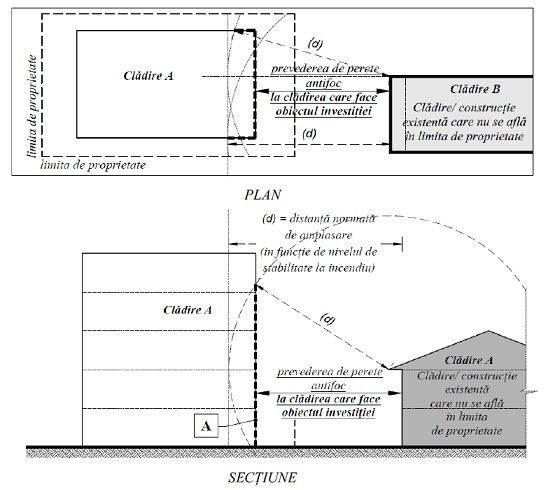
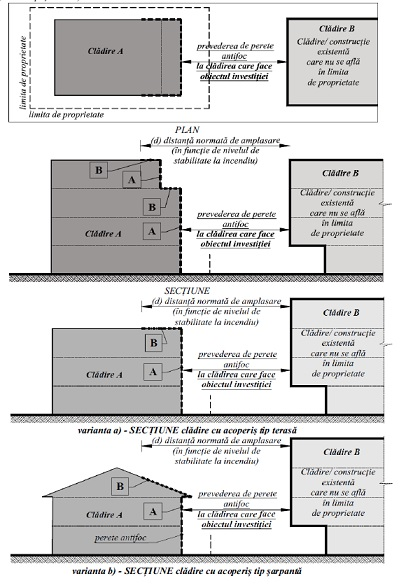
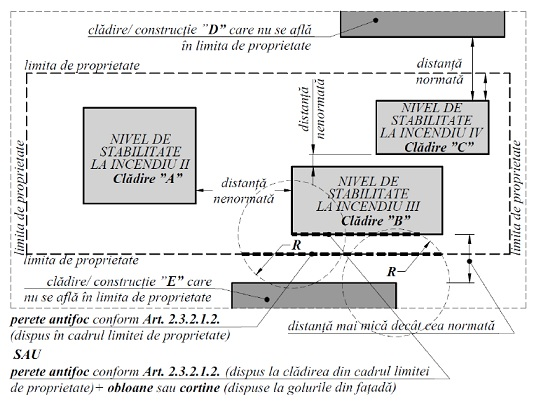

# Anexa nr. 1 – AMPLASARE CONSTRUCȚII
AMPLASARE CONSTRUCȚII
(1) Condițiile normate de limitare a posibilităților de propagare a incendiilor între construcții și compartimente de incendiu sunt obligatorii și se realizează prin amplasarea la distanțele minime de siguranță stabilite în Tabelul 4 (Distanțe minime de siguranță între construcții sau compartimente de incendiu supraterane (civile, de producție și/sau depozitare)) sau se delimitează cu pereți rezistenți la foc de separare a compartimentelor de incendiu (pereți antifoc) și, după caz, cu planșee rezistente la foc de separare a compartimentelor de incendiu (planșee antifoc), aplicându-se prevederile stabilite la Capitolul II, Secțiunea III/2.3. ("Limitarea propagării incendiilor"/23.2. - "Elemente rezistente la foc pentru separarea compartimentelor de incendiu și protecția golurilor funcționale de trecere") din normativ.
(2) Pentru construcțiile existente se respectă distanțele de siguranță stabilite în Anexa 10 la Tabelul 145: Distanțe de siguranță la construcții existente sau se delimitează (Figura 84) cu pereți rezistenți la foc de separare a compartimentelor de incendiu (pereți antifoc) și, după caz, planșee rezistente la foc de separare a compartimentelor de incendiu (planșee antifoc), aplicându-se prevederile stabilite la CAPITOLUL 2/CONDIȚII GENERALE DE PERFORMANȚĂ A CONSTRUCȚIILOR EXISTENTE/ A.10. 2.2. AMPLASAREA CONSTRUCȚIILOR SI CONFORMAREA LOR lA FOC/ Amplasare.

  

  Figura 84 - Schemă amplasare construcții - principiu amplasare
  construcții la distanțe mai mici decât cele normate
  Note Figura 84:
  - (a) Indicativul "A" reprezintă perete antifoc conform Art. 2.3.2.1.2. (sau conform A.10. 2.3.4. (1) pentru clădiri existente).
  - (b) Indicativul "B" reprezintă fâșia min REI 60prevăzută la Art. 2.3.2.1.4. (sau conform A.10. 2.3.14. pentru clădiri existente).
  - (c) În pereții antifoc ("A ") dispuși la fațadele construcțiilor, golurile prevăzute se protejează prin uși, obloane sau cortine rezistente la foc (rezistente la foc pe o perioadă minimum jumătate din rezistența la foc a pereților antifoc, dar cel puțin 1 oră).

  

  Varianta 2) - amplasare construcții la distanțe mai mici decât cele normate
  Figura 85 - Amplasare construcții la distanțe mai mari sau mai mici decât cele normate
  Note Figura 85:
  - (a) Indicativul "A" reprezintă perete antifoc conform Art. 2.3.2.1.2. (sau conform A.10. 2.3.4. (1) pentru clădiri existente).
  - (b) Indicativul "B" reprezintă fâșia min REI 60prevăzută la Art. 2.3.2.1.4. (sau conform A.10. 2.3.14. pentru clădiri existente).
  - (c) În pereții antifoc ("A ") dispuși la fațadele construcțiilor, golurile prevăzute se protejează prin uși, obloane sau cortine rezistente la foc (rezistente la foc pe o perioadă minimum jumătate din rezistența la foc a pereților antifoc, dar cel puțin 1 oră).
(3) Clădirile comasate într-un compartiment de incendiu se amplasează, față de alte construcții sau compartimente de incendiu, la distanțele minime de siguranță stabilite în Tabelul 4, funcție de nivelul de stabilitate la incendiu stabilit conform Art. 2.2.1.1. alin. (2). La clădirile existente comasate, se aplică distanțele de siguranță stabilite în Anexa 10 la Tabelul 145.
(4) Construcțiile supraterane civile (publice), de producție și/sau depozitare sau construcțiile mixte, se amplasează comasat sau grupat la distanțe nenormate între ele, în limitele unor compartimente de incendiu specifice, cu arii maxime admise în funcție de destinație, nivelul de stabilitate la incendiu cel mai dezavantajos, riscul de incendiu cel mai mare și numărul de niveluri normat (luând în calcul suma ariilor construite efective).
(5) Construcțiile destinate persoanelor care nu se pot evacua singure (definite conform terminologie), precum și cele pentru obiecte, echipamente sau aparatură de importanță deosebită, clădirile civile supraterane înalte și/sau foarte înalte sau cu săli aglomerate, nu se comasează cu alte construcții.
(6) Comasarea cu alte construcții sau între ele a clădirilor civile supraterane înalte și/sau foarte înalte este interzisă în cadrul aceluiași compartiment de incendiu.
(7) Clădirile civile cu înălțimi obișnuite pot fi amplasate independent sau comasate cu alte clădiri civile cu înălțimi obișnuite în limitele ariilor compartimentelor de incendiu pentru clădiri civile admise în normativ (respectiv în Anexa 10 pentru cele existente). Construcțiile de producție și depozitare obișnuite pot fi amplasate independent sau comasate cu alte construcții de producție și/sau depozitare, în limitele ariilor compartimentelor de incendiu admise în normativ (respectiv în Anexa 10 pentru cele existente).
(8) Construcțiile de producție și depozitare nu se comasează cu clădiri civile, fiind obligatorie compartimentarea lor cu pereți antifoc sau dispunerea la distanțe de siguranță (între construcții de producție/depozitare și clădiri civile). Construcțiile cu funcțiuni de producție și/sau depozitare pot fi comasate (între ele), asigurându-se măsurile de compartimentare și protecție corespunzătoare fiecărei funcțiuni.
(9) Construcțiile independente, precum și grupările sau comasările de construcții, constituite conform alin. (4), se amplasează astfel încât să nu permită propagarea incendiilor o perioadă de timp normată sau, în cazul prăbușirii, să nu afecteze obiectele învecinate, respectându-se distanțele minime de siguranță sau compartimentându-se față de alte construcții prin pereți antifoc. Prin însumarea ariilor construite ale clădirilor respective (Ac) trebuie respectate valorile maximum admise pentru compartimentul de incendiu rezultat, în funcție de destinația și nivelul cel mai defavorabil de stabilitate la incendiu asigurat, de riscul de incendiu cel mai mare și numărul de niveluri normat. Compartimentul de incendiu rezultat din comasarea construcțiilor va avea nivelul de stabilitate la incendiu determinat de clădirea cu cel mai defavorabil nivel, riscul de incendiu cel mai mare și numărul de niveluri normat.
  Exemplu (conform Figura 86):
  În cazul construcțiilor noi, comasarea rezultată din Construcție "A" + Construcție "B" + Construcție "C" (cu distanțe nenormate între ele) va respecta:
  - – nivelul de stabilitate la incendiu cel mai dezavantajos, pentru compartimentul de incendiu existent rezultat (rezultă nivelul IV de stabilitate la incendiu al compartimentului comasat);
  - – aria maxim admisă în funcție de destinație, pentru compartimentul de incendiu existent rezultat - aria maxim admisă în funcție de destinație, pentru compartimentul comasat cu nivelul IV de stabilitate la incendiu, conform Tabelul 41 (Condiții de corelare a ariilor construite (Ac) ale clădirilor și compartimentelor de incendiu supraterane civile cu nivelul de stabilitate la incendiu) sau Tabelul 114 (Condiții de corelare a ariilor construite (Ac) și a numărului de niveluri al construcțiilor și compartimentelor de incendiu supraterane de producție și/sau depozitare), pentru fiecare construcție cu funcțiuni mixte (civile-civile sau producție-depozitare/producție-producție/depozitare-depozitare) se aplică Art. 7.1.1; construcțiile de producție și/sau depozitare nu se comasează cu clădiri civile;
  - – riscul de incendiu cel mai mare pentru compartimentul de incendiu existent rezultat (conform subcapitolului 2.1.2. Risc de incendiu (de la Art. 2.1.2.1. până la Art. 2.1.2.6.)) și ale Articolelor Art. 2.2.2.1., Art. 3.1.1.1., Art. 6.1.1.1., Art. 6.1.1.2., Art. 6.1.2.1., Art. 6.1.2.2. Art. 7.1.3. etc; pentru construcții cu funcțiuni mixte (civile-civile sau producție- depozitare/producție-producție/depozitare-depozitare) se aplică conform Art. 2.1.2.4. sau Art. 7.1.3.);
  - – numărul de niveluri normat, pentru compartimentul de incendiu existent rezultat - număr de niveluri în funcție de destinație, pentru compartimentul comasat cu nivelul IV de stabilitate la incendiu, conform Tabelul 42 (Condiții de corelare între destinație, capacitatea maximă simultană și numărul de niveluri supraterane ale clădirilor civile, cu nivel de stabilitate la incendiu III, iv sau V) sau Tabelul 114 (Condiții de corelare a ariilor construite (Ac) și a numărului de niveluri al construcțiilor și compartimentelor de incendiu supraterane de producție și/sau depozitare).
  În cazul construcțiilor existente, comasarea rezultată din Construcție "A" + Construcție "B" + Construcție "C" va respecta:
  - – nivelul de stabilitate la incendiu cel mai dezavantajos, pentru compartimentul de incendiu existent rezultat (rezultă nivelul IV de stabilitate la incendiu al compartimentului comasat);
  - – aria maxim admisă în funcție de destinație, pentru compartimentul de incendiu existent rezultat - aria maxim admisă în funcție de destinație, pentru compartimentul comasat cu nivelul IV de stabilitate la incendiu, conform Tabelul 147 (Arii construite admise pentru compartimente de incendiu ale clădirilor civile existente (publice) supraterane)) sau Tabelul 168: (Arii construite și număr de niveluri admise pentru construcții existente și compartimente de incendiu ale construcțiilor existente de producție și/sau depozitare); pentru fiecare construcție cu funcțiuni mixte (civile-civile sau producție-depozitare/producție-producție/ depozitare-depozitare) se aplică conform Articolelor A.10. 7.1.3. si A.10. 7.1.4.; construcțiile de producție și/sau depozitare nu se comasează cu clădiri civile;
  - – riscul de incendiu cel mai mare (respectiv categoria de pericol de incendiu rezultată) pentru compartimentul de incendiu existent rezultat (conform Art. A.10. 2.1.1., A.10. 2.1.2., A.10.2.1.3, A.10. 2.1.4., A.10. 2.1.5., A.10. 2.1.6., A.10. 2.2.1. (3), A.10. 2.2.8., A.10. 5.1.1., A.10. 5.1.4, A.10. 7.1.3. si A.10. 7.1.4. etc; pentru construcții cu funcțiuni mixte (civile-civile sau producție-depozitare/producție-producție/depozitare-depozitare) se aplică conform Articolelor Art. A.10. 2.1.1., A.10. 2.1.2. și/sau A.10. 7.1.1., A.10. 7.1.2., A.10. 7.1.3. si A.10. 7.1.4. );
  - – numărul de niveluri normat, pentru compartimentul de incendiu existent rezultat - număr de niveluri în funcție de destinație, pentru compartimentul comasat cu nivelul IV de stabilitate la incendiu, conform Tabelul 148 (Număr de niveluri supraterane maxim admis și capacitatea clădirilor civile existente cu nivelul de stabilitate la incendiu III, IV și/sau V) si/ sau Tabelul 168 (Arii construite și număr de niveluri admise pentru construcții existente și compartimente de incendiu ale construcțiilor existente de producție și/sau depozitare).
  Notă (exemplu conform Figura 86): Lungimile de evacuare se conformează în acord cu nivelul IV de stabilitate la incendiu al compartimentului de incendiu, pentru fiecare dintre destinațiile clădirilor/ construcțiilor comasate (pentru ambele exemple, respectiv construcții noi comasate sau pentru construcții existente comasate).

  

  Figura 86 - Amplasare construcții comasate
  Note Figura 86 (exemplu pentru comasare clădiri civile noi față de alte construcții/compartimente dispuse în afara limitei de proprietate):
  - (a) În cazul în care distanța dintre compartimentul de incendiu format din comasarea rezultată din Clădire "A" + Clădire "B" + Clădire "C" si altă construcție/alte construcții/alt (alte) compartiment(e) de incendiu (de exemplu față de Construcția "E") nu respectă distanțele de siguranță normate, se prevede perete antifoc (dispus în cadrul limitei de proprietate), conform prevederi normate (sau perete antifoc dispus la clădirea/ construcția care face obiectul, inclusiv prevederea obloanelor, cortinelor etc. la clădirea/construcția din cadrul limitei de proprietate).
  - (b) "R" reprezintă distanța de siguranță normată (conform Tabelul 4: Distanțe minime de siguranță între construcții sau compartimente de incendiu supraterane (civile, de producție și/sau depozitare) sau Tabelul 145: Distanțe de siguranță la construcții existente).
  - (c) În toate cazurile Ac compartiment de incendiu comasat = suma Ac ale construcțiilor comasate.
