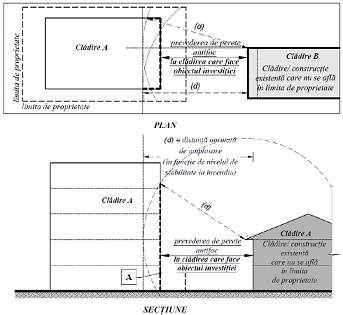
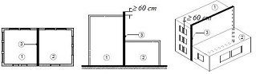
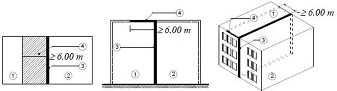
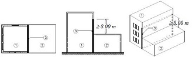
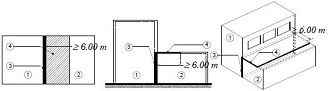
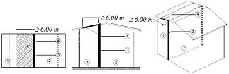
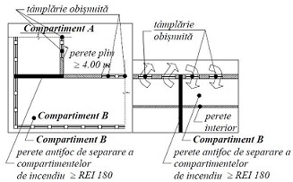

# Anexa nr. 10 – CONSTRUCȚII EXISTENTE – cap. 2 CONDIȚII GENERALE DE PERFORMANTĂ A CONSTRUCȚIILOR EXISTENTE
**CAPITOLUL 2 CONDIȚII GENERALE DE PERFORMANTĂ A CONSTRUCȚIILOR EXISTENTE**

A.10.2.1. RISC DE INCENDIU SI NIVEL DE STABILITATE LA INCENDIU
  Risc de incendiu
  - A.10.2.1.1. La clădirile existente civile (publice) riscul de incendiu este determinat, în principal, de densitatea sarcinii termice (q) stabilită prin calcul și de destinația respectivă. conform Art. 2.1.2. și Art. 2.1.3..
  - A.10.2.1.2. În funcție de densitatea sarcinii termice, riscul de incendiu în clădiri civile (publice) existente, poate fi:
    - – mare: Qi = peste 840 MJ/mp;
    - – mijlociu: Qi = 420 MJ/mp ÷ 840 MJ/mp;
    - – mic: Qi = sub 420 MJ/mp.
  - A.10.2.1.3. În funcție de destinație (funcțiune), unele spații și încăperi din clădirile civile (publice) existente, se încadrează în următoarele riscuri de incendiu:
    - – mare: în care se utilizează, sau depozitează materiale sau substanțe combustibile (arhive, biblioteci, multiplicare, parcaje autoturisme etc.);
    - – mijlociu: în care se utilizează foc deschis (bucătării, centrale termice, oficii cu preparări calde etc.);
    - – mic: celelalte încăperi și spații.
    În încăperile și spațiile echipate cu instalații automate de stingere a incendiilor, riscurile mari de incendiu pot fi considerate mijlocii, iar riscurile mijlocii pot fi considerate mici. Pentru întregul compartiment de incendiu sau clădire existentă, riscul de incendiu considerat va fi cei mai mare care reprezintă minimum 30% din volumul acestora.
  - A.10.2.1.4. La construcții de producție si/sau depozitare existente, riscul de incendiu are în vedere natura activităților desfășurate, caracteristicile de ardere ale materialelor și substanțele utilizate, prelucrate, manipulate sau depozitate, și densitatea sarcinii termice, se au în vedere prevederile din Tabelul 143. La acestea riscul de incendiu este definit prin anterioarele categorii de pericol de incendiu, ce exprimă:
    - – categoriile A (BE3a) și B (BE3b): posibilități de incendiu și explozie volumetrică (risc foarte mare de incendiu);
    - – categoria C (BE2): posibilități de incendiu/ardere (risc mare de incendiu);
    - – categoria D (BE1a): existența focului deschis sub orice formă, în absența substanțelor combustibile (risc mijlociu de incendiu);
    - – categoria E (BE1b): existența unor materiale sau substanțe incombustibile în stare rece sau a substanțelor combustibile în stare de umiditate înaintată, peste 80% (risc mic de incendiu).
  - A.10.2.1.5. Zonele din încăperi, încăperile, compartimentele și construcțiile existente de producție si/sau depozitare vor avea definit riscul de incendiu (fiecare în parte) prin una din cele cinci categorii de pericol de incendiu, conform prevederilor din Tabelul 143, în funcție de pericolul de incendiu determinat de proprietățile fizico-chimice ale materialelor și substanțelor utilizate, prelucrate, manipulate sau depozitate - inclusiv utilajele, rafturile, paletele, ambalajele etc. Pentru construcții și compartimente de incendiu existente, se va avea în vedere echivalarea fostelor categorii de pericol de incendiu, conform prevederilor din Tabelul 143 (în funcție de pericolul de incendiu determinat de proprietățile fizico-chimice ale materialelor și substanțelor utilizate, prelucrate, manipulate sau depozitate -inclusiv utilajele, rafturile, paletele, ambalajele etc.) cu caracteristicile substanțelor și materialelor ce determină încadrarea în riscuri de incendiu a spațiilor, încăperilor, compartimentelor de incendiu și construcțiilor de producție și/sau depozitare.
    Tabelul 143: Caracteristici ale substanțelor și materialelor ce determină încadrarea în riscuri de incendiu a spațiilor, încăperilor, compartimentelor de incendiu și construcțiilor de producție și/sau depozitare existente

| Risc de Incendiu | Caracteristicile substanțelor și materialelor | Precizări |
|---|---|---|
| RISC Foarte mare Categoria de pericol de incendiu A (BE3a) | Substanțe și materiale a căror aprindere sau explozie poate să aibă loc în urma contactului cu oxigenul din aer, cu apa sau cu alte substanțe ori materiale. Lichide cu temperatura de inflamabilitate a vaporilor până la 28ºC, gaze sau vapori cu limita inferioară de explozie până la 10%, atunci când acestea pot forma cu aerul amestecuri explozive. | Nu determină încadrarea în risc de incendiu foarte mare: 1 - folosirea substanțelor solide, lichide sau gazoase drept combustibil pentru ardere; 2 - scăpările și degajările de gaze, vapori sau praf care sunt în cantități ce nu pot forma cu aerul amestecuri explozive. În asemenea situații, încadrarea se face în risc mare, mijlociu sau mic, în funcție de densitatea sarcinii termice și riscul de incendiu în ansamblu. În cazul în care densitatea de sarcină termică rezultată din materialele și substanțele combustibile din spațiul respectiv, inclusiv cele din utilaje sau cele utilizate la transportul sau la depozitarea materialelor combustibile, a ambalajelor, paletelor sau rafturilor combustibile este mai mare de 105 MJ/mp, atunci riscul de incendiu este considerat foarte mare. |
| RISC Foarte mare Categoria de pericol de incendiu B (BE3b) | Lichide cu temperatura de inflamabilitate a vaporilor cuprinsă între 28ºC și 100ºC, gaze sau vapori cu limita inferioară de explozie mai mare de 10%, atunci când acestea pot forma cu aerul amestecuri explozive. Fibre, praf sau pulberi, care se degajă în stare de suspensie, în cantități ce pot forma cu aerul amestecuri explozive. | Nu determină încadrarea în risc de incendiu foarte mare: 1 - folosirea substanțelor solide, lichide sau gazoase drept combustibil pentru ardere; 2 - scăpările și degajările de gaze, vapori sau praf care sunt în cantități ce nu pot forma cu aerul amestecuri explozive. În asemenea situații, încadrarea se face în risc mare, mijlociu sau mic, în funcție de densitatea sarcinii termice și riscul de incendiu în ansamblu. În cazul în care densitatea de sarcină termică rezultată din materialele și substanțele combustibile din spațiul respectiv, inclusiv cele din utilaje sau cele utilizate la transportul sau la depozitarea materialelor combustibile, a ambalajelor, paletelor sau rafturilor combustibile este mai mare de 105 MJ/mp, atunci riscul de incendiu este considerat foarte mare. |
| RISC Mare Categoria de pericol de incendiu C (BE2) | Substanțe și materiale combustibile solide. Lichide cu temperatura de inflamabilitate a vaporilor mai mare de 100ºC. | Nu determină încadrarea în risc mare de incendiu, oricare din următoarele situații: 1 - substanțele solide, lichide sau gazoase utilizate drept combustibil pentru ardere. 2 - lichidele combustibile cu temperatura de inflamabilitate peste 100ºC utilizate la comenzi hidraulice, răcire, ungere, filtre și tratamente termice, în cantități de max. 2 mc, cu condiția luării unor măsuri locale pentru limitarea propagării incendiului; 3 - echipamentul electric care conține până la 60 kg ulei pe unitatea de echipament, precum și fluxurile de cabluri cu mai puțin de 3,5 kg material combustibil/ml de flux. În situațiile de mai sus, încadrarea se face în funcție de pericolul de incendiu în ansamblu și densitatea de sarcină termică, în risc mijlociu sau mic de incendiu. În cazul în care densitatea de sarcină termică rezultată din materialele și substanțele combustibile din spațiul respectiv, inclusiv cele din utilaje (care nu se încadrează la aliniatul 2 și 3) sau cele utilizate la transportul sau utilizate la depozitarea materialelor combustibile, a ambalajelor, paletelor sau rafturilor combustibile, este mai mare de 105 MJ/mp, atunci riscul de incendiu este considerat mare. |
| RISC Mijlociu Categoria de pericol de incendiu D (BE1a) | Substanțe sau materiale incombustibile în stare fierbinte, topite sau incandescente, substanțe cu degajări de căldură radiantă, flăcări sau scântei. Substanțe solide, lichide sau gazoase ce se ard în calitate de combustibil. |  |
| RISC Mic Categoria de pericol de incendiu E (BE1b) | Încăperi și spații în care se utilizează, prelucrează ori depozitează materiale sau substanțe incombustibile și nu este utilizat focul deschis. Substanțe sau materiale incombustibile, în stare rece sau materiale combustibile în stare de umiditate înaintată (peste 80%), ori ambalaje combustibile cu lichide incombustibile, astfel încât posibilitatea aprinderii lor este exclusă. |  |

  - A.10.2.1.6. Riscurile de incendiu (fostele categorii de pericol de incendiu) se stabilesc pe zone și încăperi precum și independent pentru fiecare compartiment existent de incendiu în parte și construcție existentă, menționând-se obligatoriu în documentația tehnico-economică. Cel mai periculos risc (cea mai periculoasă categorie de pericol) de incendiu necompartimentată existentă într-o încăpere (spațiu), compartiment de incendiu sau construcție existentă, de regulă, determină riscul (categoria de pericol) a acestora, cu următoarele excepții:
    - – categoriile A și B de pericol de incendiu al căror volum aferent este mai mic de 5% din volumul încăperii sau a compartimentului respectiv;
    - – categoriile C și D de pericol de incendiu cu un volum aferent mai mic de 10% din volumul încăperii sau al compartimentului respectiv, fără a depăși o arie de 400 mp.
    În cazurile exceptate se iau măsuri care să reducă posibilitățile formării concentrației locale cu pericol de explozie și a propagării incendiului spre spațiile învecinate din cadrul încăperii sau al compartimentului respectiv. In cazul existenței mai multor categorii de pericol de incendiu necompartimentate, situate în puncte distincte ale încăperii sau ale compartimentului existent, se iau în considerare sumele volumelor aferente și respectiv ale ariilor efective ale fiecărei categorii de pericol. Pentru categoriile C și D (BE2 și BE1a) de pericol de incendiu însumarea se aplică numai dacă distanța dintre spațiile respective, este mai mică de 40 m (măsurată pe orizontală). Pentru compartimente de incendiu sau construcții existente, categoria de pericol de incendiu cea mai periculoasă se extinde la întregul volum al acestora atunci când reprezintă mai mult de 30% din volumul construit al compartimentului sau construcției.
    Note:
    - (1) Recomandabil ca la estimarea riscului de incendiu, respectiv a probabilității de inițiere a unui incendiu și de producere a consecințelor acestuia, să se aibă în vedere, de regulă, și următoarele elemente:
      - a) pericolele de incendiu identificate;
      - b) nivelurile criteriilor de performanță ale construcțiilor privind cerința fundamentală "securitate la incendiu";
      - c) nivelul de echipare și dotare cu sisteme, instalații, echipamente și aparatură de alimentare cu apă, gaze combustibile, energie electrică și termică, de ventilație și climatizare, starea de funcționare și performanțele acestora;
      - d) factorul uman, determinat de numărul de persoane, vârsta și starea fizică ale acestora, nivelul de instruire;
      - e) alte elemente care pot influența producerea, dezvoltarea și/sau propagarea unui incendiu.
    - (2) Pentru estimarea riscului de incendiu, se recomandă să se ia în considerare următorii factori:
      - a) probabilitatea inițierii unui incendiu (surse de aprindere posibile în funcție de natura activităților desfășurate precum și circumstanțe care pot favoriza aprinderea);
      - b) destinația clădirii, precum și dezvoltarea, severitatea și posibilitățile de propagare a incendiului, stabilite în funcție de densitatea sarcinii termice (q) și/sau viteza de degajare a căldurii datorată tipurilor și cantităților de produse utilizate și materiale adăpostite;
      - c) categoriile de utilizatori ai clădirii;
      - d) nivelul de asigurare a protecției bunurilor în unele cazuri, produselor de construcții, mediului și al continuității activității.
  - A.10.2.1.7. Pentru determinarea concentrației amestecului exploziei în construcții existente se ține seama de scăpările și degajările de gaze, vapori sau praf, atât în timpul desfășurării normale a activității, cât și în cazurile accidentale de avarie stabilite prin proiect la instalațiile de utilități aferente.
  Nivel de stabilitate la incendiu
  - A.10.2.1.8. Condițiile minime pe care trebuie să le îndeplinească elementele principale ale construcției existente (compartimentului de incendiu existent) astfel încât întreaga construcție existentă sau compartiment existent să poată fi încadrat într-un anumit nivel de stabilitate la incendiu (denumit anterior "grad de rezistență la foc"), sunt precizate în Tabelul 144.
    Tabelul 144: Condiții minime pentru încadrarea construcțiilor existente în nivel de stabilitate la incendiu

| Nr. crt. | Tipul elementelor de construcție utilizate | Tipul elementelor de construcție utilizate | Nivelul de stabilitate la incendiu al construcției/compartimentului | Nivelul de stabilitate la incendiu al construcției/compartimentului | Nivelul de stabilitate la incendiu al construcției/compartimentului | Nivelul de stabilitate la incendiu al construcției/compartimentului | Nivelul de stabilitate la incendiu al construcției/compartimentului |
|---|---|---|---|---|---|---|---|
| Nr. crt. | Tipul elementelor de construcție utilizate | Tipul elementelor de construcție utilizate | I | II | III | IV | V |
| 1 | STALPI (R) | STALPI (R) | 180 A1 sau A2-s1,d0 | 120 A1 sau A2-s1,d0 | 60 min. A2- s1÷s3,d0÷d1 B- s1÷s3,d0÷d1 | 30 min. C-s1÷s3,d0÷d1 | - min. A2-s1÷s3,d2 B-s1÷s3,d2 C-s1÷s3,d2 D-s1÷s3,d2 E-d2 |
| 2 | GRINZI (R) | GRINZI (R) | 60 A1 sau A2-s1,d0 | 45 (30)(***) A1 sau A2-s1,d0 | 45 (30)(***) min. A2-s1÷s3,d0÷d1 B-s1÷s3,d0÷d1 | 15 min. C-s1÷s3,d0÷d1 | - min. A2-s1÷s3,d2 B-s1÷s3,d2 C-s1÷s3,d2 D-s1÷s3,d2 E-d2 |
| 3 | PLANȘEE (planșee nervuri, acoperișuri terasă) (REI) | PLANȘEE (planșee nervuri, acoperișuri terasă) (REI) | 60 A1 sau A2-s1,d0 | 45 (30)(***) A1 sau A2-s1,d0 | 45 (30)(***) min. A2-s1÷s3,d0÷d1 B-s1÷s3,d0÷d1 | 15 min. C- s1÷s3,d0÷d1 | - min. A2-s1÷s3,d2 B-s1÷s3,d2 C-s1÷s3,d2 D-s1÷s3,d2 E-d2 |
| 4 | PEREȚI PORTANȚI (STRUCTURALI) cu rol de limitare a propagării focului (REI) | PEREȚI PORTANȚI (STRUCTURALI) cu rol de limitare a propagării focului (REI) | 180 A1 sau A2-s1,d0 | 120 A1 sau A2-s1,d0 | 60 min. A2- s1÷s3,d0÷d1 B- s1÷s3,d0÷d1 | 30 min. C-s1÷s3,d0÷d1 | - min. A2-s1÷s3,d2 B-s1÷s3,d2 C-s1÷s3,d2 D-s1÷s3,d2 E-d2 |
| 5 | Pereti neportanți despărțitori interiori cu rol de limitare a propagării focului (EI) | Pereti neportanți despărțitori interiori cu rol de limitare a propagării focului (EI) | (***) 30 A1 A2-s1,d0 | 30 min. A2-s1÷s3,d0÷d1 B-s1÷s3,d0÷d1 | 15 min. C-s1÷s3,d0÷d1 | 15 min. D-s1÷s3,d0÷d1 | - min. A2-s1÷s3,d2 B-s1÷s3,d2 C-s1÷s3,d2 D-s1÷s3,d2 E-d2 |
| 6 | Pereți exteriori neportanți (cu excepția panourilor de tâmplărie, a pereților cortină, fațadelor ventilate, fațadelor duble „double skin”).(E) | Pereți exteriori neportanți (cu excepția panourilor de tâmplărie, a pereților cortină, fațadelor ventilate, fațadelor duble „double skin”).(E) | 15 A1 sau A2-s1,d0 | 15 min. A2-s1 ÷s3,d0÷d1 B÷s1+s3,d0÷d1 | 15 min. C-s1+s3,d0+d1 | - min. D- s1÷s3,d0÷d1 | - min. A2-s1÷s3,d2 B-s1÷s3,d2 C-s1÷s3,d2 D-s1÷s3,d2 E-d2 |
| 7 | Șarpante ale acoperișurilor, acoperișuri autoportante (cupole, structuri spațiale reticulate etc.) și planșee – terasă care nu constituie căi de evacuare sau care preiau încărcări provenite numai din zăpadă (R) | Șarpante ale acoperișurilor, acoperișuri autoportante (cupole, structuri spațiale reticulate etc.) și planșee – terasă care nu constituie căi de evacuare sau care preiau încărcări provenite numai din zăpadă (R) | 45 (30) A1 sau A2-s1,d0 | 30 (15)(***) min. A2-s1÷s3,d0÷d1 B-s1÷s3,d0÷d1 | 15 min. C-s1÷s3,d0÷d1 | - min. D- s1÷s3,d0÷d1 | - min. A2-s1÷s3,d2 B-s1÷s3,d2 C-s1÷s3,d2 D-s1÷s3,d2 E-d2 |
| 8 | Panouri/ sisteme de învelitoare ale acoperișurilor (EI) | a. cu încărcări din vânt și zăpadă | 15 A1 sau A2-s1,d0 (*) | - min. A2- s1÷s3,d0÷d1 B-s1÷s3,d0÷d1 (*) | - min. C- s1÷s3,d0÷d1 (*) | - min. D- s1÷s3,d0÷d1 (*) | - min. A2-s1÷s3,d2 B-s1÷s3,d2 C-s1÷s3,d2 D-s1÷s3,d2 E-d2 (*) |
| 8 | Panouri/ sisteme de învelitoare ale acoperișurilor (EI) | b. cu încărcări suplimen tare provenite din PV | (**) Broof (T4) | (**) Broof (T3) | (**) Broof (T3) | (**) Croof (T3) | (**) Droof (T3) |

    Note Tabelul 144:
    - (a) (*) La construcțiile existente echipate cu instalații de stingere a incendiilor cu sprinklere ori ceață de apă, cu excepția celor încadrate în nivel I de stabilitate, se consideră că este satisfăcută condiția de încadrare în nivelul de stabilitate la incendiu, dacă sistemul de învelitoare este compus din:
      - – strat cu profil trapezoidal din oțel cu grosimea mai mare sau egală cu 1,00 mm;
      - – barieră de vapori care are mai puțin de 11.6 MJ/mp, grosimea mai mică de 1,00 mm și masa pe unitatea de suprafață mai mică de 1 kg/mp;
      - – termoizolație cu grosime de minimum 20 cm, clasa de reacție la foc A1, cu densitatea minimă 150kg/mc;
      - – membrană hidroizolantă care trebuie să îndeplinească numai clasa de performanță la foc exterior, astfel: minimum B_ROOF(T3) pentru nivelul II si/sau III de stabilitate la incendiu sau C_ROOF(T3) pentru nivelul IV de stabilitate la incendiu.
    - (b) (**) Este obligatorie asigurarea și a minimum condițiilor prevăzute pentru suporturi standardizate de panouri sau sisteme de învelitoare ale acoperișurilor în pantă prevăzute la Nr. Crt. 8 lit. b).
    - (c) "-" - Fără performanțe determinate la foc.
    - (d) "h"- Cota ultimului planșeu accesibil/folosibil al construcției, față de nivelul de referință.
    - (e) În scopul verificării cerințelor de rezistență la foc ale elementelor structurale secundare, proiectantul trebuie să verifice că prăbușirea acestor elemente prin efectul incendiului nu va compromite: capacitatea portantă a altor elemente structurale care fac parte din structură (în condiții de incendiu), eficacitatea compartimentării elementelor structurale, operarea sistemelor active de protecție împotriva incendiilor, evacuarea în siguranță a utilizatorilor precum și siguranța echipelor de intervenție.
    - (f) În cazul pereților vitrați se consideră îndeplinită condiția privind clasa de reacție la foc, atunci când sunt realizați cu structuri din profile având clasa de reacție la foc A1 sau A2-s1,d0, cu excepția componentelor nesubstanțiale, a izolatorilor și garniturilor precum și a foliilor de laminare și sunt prevăzute cu panouri de umplere din elemente de vitraj din sticlă simplă, sticlă izolantă sau sticlă stratificată (formată din două sau mai multe sticle tratate termic lipite între ele cu folii organice de laminare) sau din produse clasa de reacție la foc A1 sau A2-s1,d0, cu rezistența la foc EI necesară.
    - (g) (*** - În clădirile și compartimentele de incendiu în care densitatea sarcinii termice nu depășește 840 MJ/m 2, (cu excepția clădirilor înalte, foarte înalte și cu săli aglomerate, cele care adăpostesc persoane care nu se pot evacua singure, și cu echipament de importanță deosebită), se pot aplica valorile rezistențelor la foc din paranteze.
  - A.10.2.1.9. Toate elementele principale ale construcției existente, funcție de rolul acestora, trebuie să îndeplinească condițiile minime de reacție și rezistență la foc prevăzute pentru încadrarea în nivelul respectiv de stabilitate la incendiu. Pentru ca un element al construcției existente să corespundă la un anumit nivel de stabilitate la incendiu, trebuie să îndeplinească ambele condiții minime (atât cea de reacție la foc cât și cea de rezistență la foc) precizate în Tabelul 144.
  - A.10.2.1.10. Gradul de rezistență la foc (nivelul de stabilitate la incendiu) al construcției existente sau al unui compartiment de incendiu existent este determinat de elementul său cu cea mai defavorabilă încadrare și se precizează obligatoriu în documentația tehnico-economică. Se vor avea în vedere și dispozițiile precizate la Art. 2.1.3.3. din normativ.
  - A.10.2.1.11. La stabilirea nivelului de stabilitate la incendiu a construcției existente sau a compartimentului de incendiu existent, nu se iau în considerare următoarele:
    - a) șarpanta și suportul învelitorii construcțiilor de nivel de stabilitate la incendiu ii sau III, cu pod, dacă planșeul spre pod nu este suspendat de șarpanta acoperișului, iar golurile acestuia sunt protejate prin elemente de închidere rezistente la foc minimum 30 minute. La clădirile existente înalte și foarte înalte acoperișurile cu pod vor fi realizate integral din materiale clasa de reacție la foc A1 sau A2-s1,d0. Șarpanta și suportul învelitorii construcțiilor cu pod trebuie să îndeplinească următoarele:
      - – pentru nivelul II de stabilitate la incendiu, dacă planșeul spre pod are rezistența la foc REI 30 (A1 sau A2-s1,d0) și nu este suspendat de șarpanta acoperișului, iar golurile din planșeul spre pod sunt protejate cu elemente de închidere rezistente la foc minimum EI 30, normal închise;
      - – pentru nivelul III de stabilitate la incendiu, dacă planșeul spre pod are rezistența la foc REI 30 (min A2-s1÷s3,d0÷d1 sau B-s1÷s3,d0÷d1) și nu este suspendat de șarpanta acoperișului, iar golurile din planșeul spre pod sunt protejate cu elemente de închidere rezistente la foc minimum EI 30, normal închise.
    - b) învelitorile acoperișurilor de orice fel, cu excepția panourilor de învelitoare precizate conform Tabelul 144 nr. crt. 8 b), precum și termoizolațiile incombustibile și hidroizolațiile montate deasupra unui suport continuu A1 sau A2-s1,d0 rezistent la foc conform cerințelor din Tabelul 144;
    - c) luminatoarele dispuse pe acoperiș, a căror arie însumată (în proiecție orizontală) este mai mică de 25% din aria spațiului în care sunt dispuse, dar nu mai mult de 25 mp, indiferent de clasa lor de reacție la foc;
    - d) luminatoarele atriumurilor (indiferent de aria lor) sau luminatoarele dispuse în acoperiș cu aria mai mare de 25% din aria spațiului în care sunt amplasate, atunci când sunt realizate cu structuri din profile având clasa de reacție la foc A1 sau A2-s1,d0, cu excepția componentelor nesubstanțiale, a izolatorilor și garniturilor, ale elementelor de vitraj simplu sau izolant (realizate din sticlă), ale ușilor și ferestrelor exterioare, inclusiv cele inserate în pereții cortină sau din produse clasa de reacție la foc A1 sau A2-s1,d0;
    - e) pardoselile și tâmplăria (uși, ferestre, obloane), inclusiv fâșiile fixe pentru iluminatul natural executate din materiale maximum D-s1÷s3, d0÷d1, în suprafață de maximum 10% din aria peretelui exterior și astfel dispuse și întrerupte încât să nu favorizeze propagarea incendiului de la un nivel la altul și în lungul clădirii existente (cu excepția acelor situații în care se precizează în mod explicit în anexă);
    - f) contravântuirile structurilor, platformele și elementele metalice necesare funcțional sau tehnologic, care nu sunt luate în calcul la rezistența și stabilitatea construcției în caz de incendiu;
    - g) elementele constructive situate la parter ale marchizelor, windfangurilor, verandelor, pridvoarelor, cerdacurilor, teraselor deschise și serelor;
    - h) pereții interiori despărțitori despărțitori funcționali având clasa de reacție la foc A1 sau A2-s1,d0 din cadrul unor spații open-space, cu suprafața maxim normată precum și alte categorii de pereți despărțitori combustibili a căror folosire este admisă conform normativului (Art. 2.1.3.4. lit. h), i) și j));
    - i) componetele nesubstanțiale, garniturile, izolatorii, elementele de vitraj (din sticlă) simplu sau izolant ale ușilor și ferestrelor exterioare, inclusiv cele inserate în pereții cortină;
    - j) platformele metalice și elementele metalice care nu fac parte din structura de rezistență a construcției.
  - A.10.2.1.12. În construcțiile existente în care densitatea sarcinii termice nu depășește 420 MJ/mp și materialele combustibile sunt astfel distribuite încât să nu pericliteze stabilitatea construcției prin încălzirea locală a unor elemente de construcție în timpul incendiului, se admite utilizarea structurilor metalice neprotejate sau parțial protejate și reducerea corespunzătoare a rezistenței la foc a stâlpilor, pereților și planșeelor până la minimum 15 minute, considerându-se că structura existentă îndeplinește condițiile pentru nivelul de stabilitate la incendiu II. în aceleași condiții se pot reduce și rezistențele la foc ale stâlpilor, pereților și planșeelor realizate din alte materiale. La clădiri existente înalte, foarte înalte și la clădiri cu săli aglomerate, precum și la cele pentru persoane care nu se pot evacua singure (clădiri existente pentru copii de vârstă preșcolară/clădiri existente de învățământ nivelul antepreșcolar (0 - 3 ani) (creșe și case de copii), clădiri existente cu funcțiune de spitale sau cu caracter spitalicesc (spitale, maternități, policlinici, staționare medicale, dispensare, centre medicale și de sănătate multifuncționale, clinici și unități medicale ambulatorii similare policlinicilor, centre medicale de diagnostic și tratament, aziluri sau cămine pentru bătrâni și persoane cu dizabilități, ospicii pentru alienați mintal, sanatorii etc.)) precum și la cele de producție si/sau depozitare vor fi respectate și prevederile specifice acestora.
  - A.10.2.1.13. Structurile metalice neprotejate sau parțial protejate pot fi utilizate la lucrările de intervenție efectuate asupra construcțiilor existente situate în cadrul aceluiași compartiment de incendiu, în condițiile anexei în general la:
    - – compartimente și spații echipate cu instalații automate de stingere cu apă care asigură răcirea elementelor pe timpul normat;
    - – construcții supraterane având maximum 15,00 m înălțime;
    - – construcțiile menționate la alineatul precedent, cu excepțiile prevăzute.
  - A.10.2.1.14.
    - (1) La utilizarea structurilor metalice neprotejate sau parțial protejate, se vor avea în vedere rolul elementului în asigurarea stabilității construcției existente, categoria de importanță a construcției, numărul de persoane și capacitatea acestora de autoevacuare, valoarea bunurilor adăpostite, precum și urmările posibile ale prăbușirii construcției datorată acțiunii focului.
    - (2) Pentru extinderea construcțiilor existente cu alte compartimente de incendiu (minimum unul) sau pentru schimbarea destinației celor existente se vor respecta dispozițiile Art. 2.1.3.3.÷ Art. 2.1.3.5. din normativ.
A.10.2.2. AMPLASAREA CONSTRUCȚIILOR SI CONFORMAREA LOR LA FOC
  Amplasare
  - A.10.2.2.1.
    - (1) Construcțiile existente supraterane civile, de producție și/sau depozitare, pot fi amplasate la distanțele normate față de vecinătăți (Figura 28 - Amplasare independentă a construcțiilor (la distanțe normate)) respectându-se distanțele prevăzute din Tabelul 145, delimitate cu pereți rezistenți la foc de separare a compartimentelor de incendiu (pereți antifoc) și, după caz, planșee rezistente la foc de separare a compartimentelor de incendiu (planșee antifoc) (Figura 29 (Amplasare compartimentată)) conform condițiilor prevăzute în anexă sau pot fi amplasate comasat (Figura 30: Amplasare comasată a construcțiilor în limita ariilor compartimentelor de incendiu normate (Ac compartiment de incendiu = suma Ac construcții comasate)).
    - (2) Construcțiile supraterane civile (publice) de producție si/sau depozitare existente, de regulă, sunt amplasate comasat sau grupate la distanțe nenormate între ele, în limitele unor compartimente de incendiu specifice, cu arii maxime admise în funcție de destinație, nivelul de stabilitate la incendiu cel mai dezavantajos, riscul de incendiu și numărul de niveluri normat, (luând în calcul suma ariilor construite efective).
    - (3) Construcțiile existente de locuit cu regim normal de înălțime, fără săli aglomerate și cu risc mic de incendiu, pot fi admise fără normarea distanțelor între ele în interiorul cvartalurilor existente pentru care există rețele de hidranți exteriori dimensionate pentru cea mai defavorabilă situație, prevăzându-se măsuri compensatorii care vizează limitarea propagării incendiilor de la o construcție la alta, funcție de nivelul de stabilitate cel mai defavorabil al clădirilor existente, numărul de niveluri maxim admis, luând în calcul suma efectivă a ariilor construite ale clădirilor existente, în limita maxim admisă pentru un compartiment de incendiu conform Figura 274. Nivelul de stabilitate la incendiu al construcției existente este determinat de elementul său cu cea mai defavorabilă încadrare în valorile normate iar nivelul de stabilitate la incendiu rezultat prin comasarea construcțiilor existente al compartimentului de incendiu, este determinat de nivelul de stabilitate la incendiu al construcției comasate cel mai defavorabil raportat la încadrarea în valorile normate din anexă. Ariile maxim admise pentru un compartiment de incendiu nu pot fi mărite pe proprie răspundere.

    

    Figura 274 - Amplasarea construcțiilor existente la
    distanțe mai mici decât cele normate
  - A.10.2.2.2. Construcțiile independente existente și grupările sau comasările de construcții existente constituite conform Art. A.10.2.2.1., se amplasează astfel încât să nu permită propagarea incendiilor o perioadă de timp normată sau, în cazul prăbușirii, să nu afecteze obiectele învecinate, respectându- se distanțele minime de siguranță din Tabelul 145 sau compartimentându-se prin pereți rezistenți la foc alcătuiți corespunzător densității sarcinii termice celei mai mari, potrivit normativului și ale prezentei anexe.
    Tabelul 145: Distanțe de siguranță la construcții existente

| Nivel de stabilitate la incendiu | Distanțe minime de siguranță (m) față de construcții existente având nivelul de stabilitate la incendiu | Distanțe minime de siguranță (m) față de construcții existente având nivelul de stabilitate la incendiu | Distanțe minime de siguranță (m) față de construcții existente având nivelul de stabilitate la incendiu |
|---|---|---|---|
| Nivel de stabilitate la incendiu | I și/sau II | III | IV și/sau V |
| I-II | 6 | 8 | 10 |
| III | 8 | 10 | 12 |
| IV--V | 10 | 12 | 15 |

    Note Tabelul 145:
    - (a) Pentru construcțiile existente de producție sau depozitare cu risc mare sau foarte mare, inclusiv explozie volumetrică (din fosta categorie A sau B de pericol de incendiu), distanțele de siguranță față de clădiri existente cu alte riscuri sau categorii de pericol de incendiu, se majorează cu 50%, fără a fi mai mici de 15,00 m.
    - (b) În cazuri justificate tehnic, în cadrul limitei de proprietate, investitorii pot stabili distanțe mai mici prin hotărâri scrise ale consiliilor de conducere respective, dacă adoptă măsuri de protecție compensatorii, stabilite de către persoane atestate (experți tehnici pentru cerința fundamentală securitate la incendiu construcții si/sau instalații) prin proiect și scenarii de securitate la incendiu. Măsurile alternative de protecție (pasive, active sau combinații ale acestora) și de îmbunătățire a cerinței de securitate la incendiu (care trebuie să vizeze îmbunătățirea cerințelor care nu pot fi respectate), se efectuează în baza unei/unor expertize tehnice pentru cerința fundamentală securitate la incendiu (construcții si/ sau instalații).
  - A.10.2.2.3. Construcțiile existente cu destinații sau funcțiuni diferite, grupate sau comasate în cadrul unui compartiment de incendiu, se separă între ele cu pereți și planșee corespunzătoare destinațiilor, riscurilor și categoriilor de incendiu, precum și densității sarcinii termice, conform prevederilor normativului și ale prezentei anexe, iar între compartimentele de incendiu, dacă nu sunt asigurate distanțele de siguranță, se prevăd elemente despărțitoare verticale antifoc sau rezistente la foc (pereți) din materiale clasa de reacție la foc A1 sau A2-s1,d0, rezistente la foc corespunzător densității sarcinii termice, dar minimum 3 ore (REI 180) și după caz, rezistente la explozie. În clădiri existente înalte și foarte înalte, se pot realiza compartimente de incendiu conform prevederilor specifice acestora.
  Conformare la foc
  - A.10.2.2.4. Construcțiile existente în ansamblu și elementele de construcții ale acestora, trebuie astfel alcătuite și conformate încât să nu favorizeze propagarea focului și a fumului.
  - A.10.2.2.5. Pe cât posibil, activitățile cu riscuri mari de incendiu se dispun în zone distincte ale construcției existente, iar cele cu pericol de explozie la ultimul nivel. Atunci când această dispunere nu este posibilă tehnic sau funcțional, se iau măsurile de protecție și compartimentare necesare, conform prevederilor normativului și ale prezentei anexe.
  - A.10.2.2.6. Prin dispunerea funcțiunilor în construcția existentă și asigurarea măsurilor de protecție corespunzătoare, se va urmări eliminarea posibilităților de propagare ușoară a fumului și a focului în afara compartimentelor în care s-a produs incendiul, precum și protejarea acestora față de acțiunea unui incendiu din vecinătatea lor.
  - A.10.2.2.7. Funcțiunile diferite dintr-o construcție existentă, de regulă, se separă cu elemente de construcții verticale și orizontale rezistente la foc, astfel alcătuite și dimensionate încât să nu pună în pericol viața utilizatorilor un timp determinat.
  - A.10.2.2.8. Construcțiile existente cu funcțiuni mixte (civile, de producție si/sau depozitare), vor avea dispuse funcțiunile periculoase, în zone distincte și prevăzute elemente de separare corespunzătoare riscurilor și categoriilor de incendiu, precum și densității sarcinii termice a acestora, prin pereți și planșee rezistente la foc, ale căror goluri funcțional necesare vor fi protejate corespunzător prevederilor normativului și ale prezentei anexe.
  - A.10.2.2.9. Pentru limitarea propagării fumului și focului în construcții existente, se realizează compartimente de incendiu, iar în interiorul acestor compartimente se recomandă prevederea elementelor de separare rezistente la foc.
  - A.10.2.2.10. Ariile construite admise pentru compartimente de incendiu ale construcțiilor existente civile (publice), de producție si/sau depozitare, sunt precizate diferențiat în prezenta anexă, corespunzător nivelului de stabilitate la incendiu și destinației construcției respective, conform precizărilor din Tabelul 145.
A.10.2.3. LIMITAREA PROPAGĂRII INCENDIILOR
  Dispoziții generale
  - A.10.2.3.1. Elementele de construcții, pereți și planșee utilizate pentru limitarea propagării incendiilor și a efectelor acestora, precum și a exploziilor, sunt de tipul:
    - – antifoc (REI sau EI-M);
    - – rezistente la foc (REI sau EI);
    - – rezistente la explozie (REI);
    - – etanșe la foc (E).
    Protecția golurilor funcționale din aceste elemente de construcții, se realizează, după caz, cu uși, obloane, cortine, încăperi tampon sau tamburi deschiși, alcătuite și dimensionate conform prevederilor normativului.
  - A.10.2.3.2. În funcție de densitatea cea mai mare a sarcinii termice din spațiile pe care le desparte, de regulă, pereții la construcțiile existente trebuie să reziste la foc conform Tabelul 146, dacă prevederile anexei nu stabilesc alte condiții.
    Tabelul 146: Rezistența la foc a pereților la construcțiile existente

| Densitatea sarcinii termice (q) - (MJ/m2) | Rezistența la foc minimă admisă |
|---|---|
| < 210 | EI/REI 30 |
| 210 ÷ 420 | EI/REI 60 |
| 421 ÷ 630 | EI/REI 120 |
| 631 ÷ 840 | EI/REI 180 |
| 841 ÷ 1260 | EI/REI 240 (EI/REI 180) * |
| 1261 ÷ 1.680 | (EI/REI 180) * |
| 1681 ÷ 2940 | (EI/REI 180) * |
| > 2940 | (EI/REI 180) * |

    Notă Tabelul 146: *) - Valoarea de EI/REI 180 (din paranteze) se aplică în toate cazurile în care se prevăd instalații automate de stingere a incendiilor.
  Elemente rezistente la foc pentru separarea compartimentelor de incendiu (antifoc) existente și protecția golurilor funcționale de trecere
  Pereți antifoc
  - A.10.2.3.3. Pereții antifoc din construcțiile existente se execută din materiale A1 sau A2-s1,d0, astfel amplasați, alcătuiți și dimensionați încât să reziste la efectele incendiilor din compartimentele de incendiu pe care le separă.
  - A.10.2.3.4.
    - (1) Pereții antifoc din construcțiile existente trebuie să îndeplinească în caz de incendiu funcția de compartimentare, păstrându-si stabilitatea, rezistențele mecanice și capacitatea de izolare termică pe timpul normat, în funcție de densitatea sarcinii termice conform cu Tabelul 146, dar cel puțin 3 ore (REI180).
    - (2) Pereții antifoc dintre construcțiile existente care se extind cu alte compartimente de incendiu noi (minimum unul), se realizează conform prevederilor normativului (Capitol 2.3.2.1. Pereți rezistenți la foc pentru separarea compartimentelor de incendiu), dar cel puțin 3 ore (REI 180).
    - (3) Pereții antifoc din cadrul extinderilor construcțiilor existente (cu excepția celor prevăzuți la A.10. 2.3.4. alin. (2) dintre construcția existentă și extindere/extinderi) se realizează conform prevederilor normativului (Capitol 2.3.2.1. Pereți rezistenți la foc pentru separarea compartimentelor de incendiu).
  - A.10.2.3.5. În clădirile existente parter și în cazurile precizate în prezenta anexă, compartimentarea antifoc se poate realiza prin pereți clasă de reacție la foc A1 sau A2-s1,d0 care asigură numai rezistență la foc prevăzută la Art. A.10. 2.3.2. și în Tabelul 146.
  - A.10.2.3.6. În construcțiile existente cu structuri din beton armat sau metalice, pereții antifoc pot fi înglobați direct în aceste structuri, care vor fi astfel executate sau protejate încât să aibă rezistență la foc cel puțin egală cu cea necesară pentru pereții antifoc respectivi.
  - A.10.2.3.7. Pereții antifoc din construcțiile existente care separă, pe anumite porțiuni ale lor, spații cu pericol de explozie, trebuie să îndeplinească pe aceste porțiuni și condițiile prevăzute pentru pereții rezistenți la explozie.
  - A.10.2.3.8. Nu se admite încastrarea în pereții antifoc a planșeelor sau a elementelor constructive care au rezistență la foc mai mică de 2 ore (REI 120 pentru planșee și R 120 pentru grinzi, ferme etc), permițându-se numai rezervarea acestora (liberă sau articulată). Rezemarea grinzilor metalice pe pereți antifoc se realizează astfel încât grinda dilatată să nu dea împingeri laterale în peretele antifoc.
  - A.10.2.3.9. Rosturile dintre pereții antifoc existenți și planșee, stâlpi, acoperișuri și pereții exteriori ai construcției existente, se etanșează cu materiale care să asigure o rezistență la foc de cel puțin 1 oră și 30 de minute (EI 90).
  - A.10.2.3.10. Pereții antifoc din construcțiile existente trebuie să depășească planul exterior al acoperișurilor, luminatoarelor, pereților din clasa de reacție la foc D-s1÷s3,d0÷d1 sau clasa de reacție la foc A2-s1÷s3,d2, B-s1÷s3,d2, C-s1÷s3,d2, D-s1÷s3,d2 sau E-d2, pe care îi intersectează (Figura 36 (Separare compartimente de incendiu cu înălțimi egale prin depășirea acoperișului cu minimum 60 cm (a peretelui antifoc) și Figura 37 (Depășirea planurilor exterioare ale acoperișurilor și pereților combustibili) precum și conform Figura 275), astfel:
    - – 60 cm (măsurat pe verticală), față de orice astfel de element combustibil al acoperișurilor și luminatoarelor aflate la mai puțin de 4,00 m distanță de peretele antifoc din construcțiile existente, inclusiv a acoperișurilor cu suport din tablă și termoizolație și/sau hidroizolație necombustibile;
    - – 30 cm (măsurat pe orizontală) față de pereți exteriori și streașini din clasa de reacție la foc D-s1÷s3,d0÷d1 sau clasa de reacție la foc A2-s1÷s3,d2, B-s1 ÷s3,d2, C-s1÷s3,d2, D-s1÷s3,d2 sau E-d2.
  - A.10.2.3.11. Depășirea de către pereții antifoc din construcțiile existente a planului acoperișurilor cu învelitoare și termoizolație executate din materiale combustibile montate pe placă din beton armat, precum și a acoperișurilor executate în întregime din materiale clasa de reacție la foc A1 sau A2-s1,d0, nu este obligatorie.
  - A.10.2.3.12. Pereții rezistenți la foc din construcțiile existente cu rol de pereți antifoc prevăzuți la Art. A.10.2.3.5., trebuie să depășească planul exterior al acoperișurilor, luminatoarelor pereților etc. combustibili pe care îi intersectează, conform prevederilor stabilite pentru pereții antifoc.
  - A.10.2.3.13. Pe acoperișuri, pe o distanță de cel puțin 4,00 m în ambele părți ale peretelui antifoc sau rezistent la foc din construcțiile existente, luminatoarele trebuie să fie din materiale clasa de reacție la foc A1 sau A2-s1,d0, fixe și cu geam armat (fără ochiuri mobile).
  - A.10.2.3.14. Depășirea planului acoperișurilor, al streașinilor sau a pereților combustibili, clasa de reacție la foc D-s1÷s3,d0÷d1 sau clasa de reacție la foc A2-s1÷s3,d2, B-s1÷s3,d2, C-s1÷s3,d2, D-s1÷s3,d2 sau E-d2, poate fi înlocuită prin fâșii clasa de reacție la foc A1 sau A2-s1,d0 de acoperiș, streașină sau respectiv de perete, cu lățimea de cel puțin 6,00 m.
  - A.10.2.3.15. În cazul clădirilor existente cu înălțimi diferite, de regulă, pereții antifoc se prevăd la construcția existentă cea mai înaltă, pe toată înălțimea acesteia sau pe cel puțin 8,00 m înălțime față de construcția mai joasă. Se admite prevederea pereților antifoc la construcția existentă mai joasă dacă aceasta este astfel alcătuită încât incendiul să nu se poată propaga prin depășirea peretelui antifoc în acest sens, pe distanța de 6,00 m de la construcția existentă mai înaltă, porțiunea de clădire existentă mai joasă trebuie să îndeplinească următoarele condiții:
    - – acoperișul (terasa) să fie fără goluri, cu rezistență la foc de minimum 1 oră (REI60) și învelitoare clasa de reacție la foc A1 sau A2-s1,d0 sau protejată cu materiale clasa de reacție la foc A1 sau A2-s1,d0 (sapă de ciment slab armată, dale, pietriș, zgură, mortar de perlit etc.);
    - – încăperile existente din porțiunea respectivă să fie prevăzute cu instalații automate de stingere a incendiilor, atunci când densitatea sarcinii termice din interiorul lor depășește 840 MJ/mp.
  - A.10.2.3.16. Pereții antifoc din construcțiile existente se amplasează astfel încât să se evite posibilitățile de propagare a incendiului dintr-un compartiment de incendiu în altul, prin golurile neprotejate din pereții exteriori, dispuse la colțurile întrânde ale construcțiilor, sau prin incendierea unor construcții combustibile existente amplasate în vecinătate.

    

    Varianta a) - Separare compartimente de incendiu la construcții cu
    înălțimi diferite - prin perete antifoc care depășește planul
    exterior, conform Art. A.10. 2.3.15.

    

    Varianta b) - Separare compartimente de incendiu la construcții
    cu înălțimi diferite - separare la clădirea cu înălțime mai mică

    

    Varianta c) Separare compartimente de incendiu la construcții cu
    înălțimi diferite - separare la clădirea mai înaltă

    

    Varianta d) Separare compartimente de incendiu cu înălțimi
    diferite - separare la clădirea cu înălțime mai
    mică cu fâșie REI60

    

    Varianta e) Separare compartimente de incendiu cu
    înălțimi egale - cu fâsie REI60
    Figura 275 - Scheme pereți antifoc la construcții existente
    Legendă Figura 275: 1 - compartiment 1 de incendiu; 2 - compartiment 2 de incendiu; 3 - perete antifoc A1, A2s1d0 conform Art. A.10. 2.3.4.; 4 - fâșie rezistentă la foc min. REI60
  - A.10.2.3.17. În cazurile în care pereții antifoc sunt amplasați la colțurile întrânde ale clădirilor existente în formă de L sau U, golurile din pereții exteriori adiacenți se dispun astfel încât distanța dintre ele să fie de cel puțin 4,00 m. Atunci când se prevăd goluri funcționale în această porțiune, se consideră protejate dacă sunt cu tâmplărie fixă clasa de reacție la foc A1 sau A2-s1,d0 și geam armat, ori cu elemente de închidere rezistente la foc 45 minute (EI 45-C), prevăzute cu autoînchidere sau închidere automată în caz de incendiu, conform Figura 276.

    

    Figura 276 - Pereți antifoc amplasați la colțurile întrânde ale
    clădirilor existente în formă de L sau U la construcții existente
  - A.10.2.3.18. Străpungerea pereților antifoc din construcțiile existente cu elemente metalice este admisă, dacă se iau măsuri împotriva transmiterii căldurii prin conductibilitate (alegerea unor trasee judicioase, îndepărtarea materialelor combustibile, protejarea locală a elementelor metalice etc). Golurile din jurul elementelor metalice se vor realiza astfel încât să permită dilatarea liberă a acestora și se etanșează cu materiale clasa de reacție la foc A1, A2-s1,d0, A2-s1÷s3,d0÷d1, B-s1÷s3,d0÷d1 sau C-s1÷s3,d0÷d1, care să asigure o rezistență la foc de minimum 1 oră și 30 de minute (EI 90).
  - A.10.2.3.19.
    - (1) Traversarea pereților antifoc din construcțiile existente de către conducte, canale de ventilare, conductoare și cabluri electrice, este admisă numai dacă sunt îndeplinite următoarele condiții:
      - – spațiile libere în jurul conductelor, cablurilor și conductoarelor electrice etc. (inclusiv cele pozate în canale), se închid cu materiale clasa de reacție la foc A1 sau A2- s1,d0, asigurându-se rezistența la foc egală cu cea a peretelui;
      - – canalele de ventilare ce trec prin perete vor fi incombustibile, iar golul dintre perete și acestea se etanșează cu materiale clasa de reacție la foc A1 sau A2-s1,d0, rezistente la foc cel puțin 1 oră și 30 de minute (EI 90);
      - – trecerea conductelor și a canalelor de ventilare se realizează astfel încât să nu producă dislocări ale unor porțiuni de perete din cauza dilatării lor sub efectul creșterilor de temperatură;
      - – canalele de ventilare se prevăd cu sisteme de obturare, cu închidere automată în caz de incendiu, respectiv clapete antifoc cu rezistența la foc minimum 1 oră și 30 minute (EI90);
      - – se asigură evitarea aprinderii materialelor combustibile din vecinătatea canalelor de ventilare și a conductelor metalice, din cauza căldurii transmise prin conductibilitate (trasee corespunzătoare, termoizolare etc.).
    - (2) Traversarea pereților antifoc din construcțiile existente care se extind cu alte compartimente de incendiu noi (minimum unul), se realizează conform prevederilor normativului (Art. 2.3.2.1.12. alin. (1)) și traversarea pereților de sectorizare prevăzuți pentru protecția contra incendiilor care limitează propagarea în interiorul compartimentelor de incendiu se realizează conform prevederilor normativului (Art. 2.3.2.1.12. alin. (2)).
  Protecția golurilor din pereți antifoc
  - A.10.2.3.20. Pereții antifoc din construcțiile existente, de regulă, se realizează fără goluri. Practicarea unor goluri în acești pereți se admite numai atunci când activitatea sau funcționalitatea impun prevederea lor (pentru circulație, transport, supraveghere etc.) și sunt protejate corespunzător prevederilor prezentei anexe. Suprafața totală admisă de goluri nu trebuie să fie mai mare de 25% din cea a peretelui antifoc în care sunt practicate.
  - A.10.2.3.21. Golurile de circulație, transport, supraveghere etc. din pereții antifoc si, după caz, planșee antifoc din construcțiile existente, se protejează obligatoriu cu elemente corespunzătoare, care pot fi: uși, obloane, cortine, încăperi tampon sau tamburi deschiși antifoc, realizate conform prezentei anexe (laplansee se utilizează numai obloane sau chepenguri).
  Uși, obloane, cortine antifoc
  - A.10.2.3.22.
    - (1) Golurile funcționale din pereții antifoc din construcțiile existente, se protejează obligatoriu cu elemente având rezistența la foc 1 oră și 30 minute și echipate cu dispozitive de autoînchidere sau închidere automată în caz de incendiu (EI 90-C), în funcție de cerințele funcționale.
    - (2) Golurile funcționale din pereții antifoc din construcțiile existente care se extind cu alte compartimente de incendiu noi (minimum unul), se realizează conform prevederilor normativului (Art. 2.3.2.2.2.1.).
  - A.10.2.3.23. Ușile antifoc și sistemele lor de închidere, trebuie să îndeplinească condițiile din reglemetările tehnice și standardele specifice.
  - A.10.2.3.24. Obloanele antifoc și cortinele de siguranță antifoc, se alcătuiesc și realizează, în general, similar cu ușile antifoc.
  Încăperi tampon antifoc
  - A.10.2.3.25. În cazul în care, datorită unor condiții funcționale, protecția golurilor din pereții antifoc nu se poate realiza prin uși, obloane sau cortine antifoc, golurile se pot proteja prin încăperi tampon antifoc. încăperile antifoc din construcțiile existente se realizează conform Figura 17 (încăpere tampon protejată) și a condițiilor din prezenta anexă.
  - A.10.2.3.26. Pereții și planșeele încăperilor tampon antifoc trebuie să fie clasa de reacție la foc A1 sau A2-s1,d0 și rezistenți la foc cel puțin 1 oră (pereți EI/REI 60 și planșee REI 60). Se recomandă ca amplasarea încăperilor tampon să se facă alipit peretelui antifoc din construcțiile existente și să fie dispuse spre spațiile cu densitatea sarcinii termice mai mică.
  - A.10.2.3.27. În pereții încăperilor tampon se admite practicarea numai a golurilor strict necesare pentru circulație. Pentru realizarea ventilării sau evacuării fumului din încăperile tampon se pot realiza goluri în pereți sau planșee.
  - A.10.2.3.28. Golurile pentru circulație practicate în pereții încăperilor tampon antifoc existente, se protejează cu uși rezistente la foc cel puțin 45 minute (EI 45-C), prevăzute după caz, cu dispozitive de autoînchidere sau cu închidere automată în caz de incendiu.
    - (2) Golurile pentru circulație practicate în pereții încăperilor tampon antifoc din construcțiile existente care se extind cu alte compartimente de incendiu noi (minimum unul), se realizează conform prevederilor normativului (Art. 2.3.2.2.3.1. și Tabelul 14 (Pereți și planșee la încăperi tampon protejate și goluri pentru circulație funcțională și evacuare practicate în pereții încăperilor tampon)).
  Tamburi deschiși antifoc
  - A.10.2.3.29. În cazuri excepționale, când datorită necesităților funcționale, protecția golurilor din pereții antifoc din construcțiile existente nu se poate realiza cu uși, obloane, cortine sau încăperi tampon antifoc, pot fi prevăzuți tamburi deschiși antifoc.
  - A.10.2.3.30. Tamburii deschiși antifoc din construcțiile existente trebuie să aibă lățimea egală cu cea a golului protejat, iar lungimea totală de minimum 4,00 m. Amplasarea lor poate fi făcută alipit peretelui antifoc din construcțiile existente sau în ambele părți ale acestuia (conform Figura 26 (Tambur deschis)).
  - A.10.2.3.31. Pereții și planșeele tamburului deschis antifoc din construcțiile existente trebuie să fie realizați din materiale clasa de reacție la foc A1 sau A2-s1,d0, fără goluri și cu rezistența la foc de minimum 1 oră (EI/REI 60 pereți și REI 60 planșee). În tamburii deschiși trebuie să se prevadă sprinklere sau drencere cu acționare automată în caz de incendiu, amplasate câte unul la fiecare 1 mp de suprafață orizontală a tamburului.
  Planșee antifoc
  - A.10.2.3.32. Planșeele antifoc sunt elemente de construcție orizontale sau înclinate care delimitează volume închise din construcții existente înalte și foarte înalte (compartimente existente de incendiu constituite din unul până la trei niveluri succesive cu aria desfășurată prevăzută în prezenta anexă), sau separă funcțiuni cu riscuri mari de incendiu.
  - A.10.2.3.33. Planșeele antifoc din construcțiile existente se realizează din materiale clasa de reacție la foc A1 sau A2-s1,d0, cu rezistența la foc minimum 2 ore (REI 120) și fără goluri sau cu goluri strict funcționale, protejate conform prezentei anexe.
  Elemente rezistente la foc și protecția golurilor
  Pereți și protecția golurilor
  - A.10.2.3.34. Condițiile minime și de rezistență la foc pentru pereții rezistenți la foc din construcțiile existente, sunt stabilite în prezenta anexă, precum și în reglementările tehnice de specialitate. Pentru cazurile în care reglementările tehnice nu prevăd condiții speciale, reacția la foc și rezistența la foc a acestor pereți se stabilește prin documentația tehnico-economică în funcție de nivelul de stabilitate la incendiu al construcției, densitatea sarcinii termice a încăperilor și rolul de separare al pereților.
  - A.10.2.3.35. Golurile de circulație funcțională practicate în pereții rezistenți la foc din construcțiile existente se protejează corespunzător condițiilor precizate în normativ, în prezenta anexă și în reglementările tehnice de specialitate.
  Planșee și protecția golurilor
  - A.10.2.3.36. Planșeele pot constitui elemente de întârziere a propagării incendiilor în interiorul unui compartiment existent de incendiu, numai atunci când sunt rezistente la foc conform prevederilor prezentei anexe și nu au goluri, sau dacă golurile practicate în ele sunt protejate cu elemente de închidere corespunzătoare.
  - A.10.2.3.37. Condițiile privind reacția la foc și rezistența la foc a planșeelor din construcțiile existente folosite pentru a separa între ele spații cu funcțiuni importante și încăperi cu risc mare de incendiu, precum și ale planșeelor care delimitează căi de evacuare, sunt cele prevăzute în prezenta anexă și în reglementările tehnice de specialitate.
  - A.10.2.3.38. Golurile funcționale din planșeele intermediare rezistente la foc din construcțiile existente, care constituie elemente de întârziere a propagării focului, se protejează prin elemente rezistente la foc, prevăzute după caz, cu dispozitive de autoînchidere sau închidere automată în caz de incendiu. în cazuri justificate, când nu se pot realiza elemente rezistente la foc, protecția golurilor poate fi asigurată numai prin prevederea pe conturul golului (sub planșeu), a unor ecrane clasa de reacție la foc A1 sau A2-s1,d0 și perdele de apă cu intrare în funcțiune automată în caz de incendiu, sau alte sisteme de protecție agrementate tehnic.
  - A.10.2.3.39. În clădirile existente cu pod, de nivelul I, II si/sau III de stabilitate la incendiu golurile prevăzute în planșeele spre pod, se protejează cu elemente de închidere rezistente la foc minimum 30 minute (EI 30). Separarea porțiunilor mansardate ale construcției existente, față de poduri ale acesteia se realizează cu pereți clasa de reacție la foc A1 sau A2-s1,d0 rezistenți la foc minimum 2 ore (EI/REI 120), iar golurile de comunicare funcțională din aceștia se protejează cu uși rezistente la foc minimum 45 de minute, echipate cu dispozitive de autoînchidere sau închidere automată în caz de incendiu (EI 45-C).
  Elemente rezistente la explozie și protecția golurilor
  - A.10.2.3.40. Elementele de separare față de restul construcției existente a încăperilor cu pericol de explozie (categoriile A (BE3a) și B (BE3b) de pericol de incendiu), vor fi clasa de reacție la foc A1 sau A2-s1,d0 și rezistente la explozie.
  - A.10.2.3.41. Separarea încăperilor sau spațiilor cu pericol de explozie față de alte încăperi cu riscuri, categoriile de pericol sau destinații din clădirile existente, inclusiv față de încăperile tampon, trebuie să se facă prin pereți și planșee rezistente la explozie, alcătuite și realizate conform prezentei anexe.
  - A.10.2.3.42. Alcătuirea și dimensionarea pereților rezistenți la explozie se determină prin calcul astfel încât aceștia să nu se prăbusească sub efectul suprapresiunii care se produce în încăperile respective, funcție de suprafețele de decomprimare asigurate (ferestre, panouri, luminatoare, acoperișuri zburătoare, trape etc.).
  - A.10.2.3.43. Pereții rezistenți la explozie trebuie să împiedice și propagarea incendiului din spațiile învecinate spre încăperile cu pericol de explozie, rezistența lor la foc fiind stabilită în funcție de densitatea sarcinii termice a încăperilor respective.
  - A.10.2.3.44. Practicarea unor goluri în pereții rezistenți la explozie nu este admisă decât în cazuri excepționale, impuse de necesități funcționale, și numai dacă sunt protejate corespunzător prevederilor din prezenta anexă.
  - A.10.2.3.45. Străpungerea pereților rezistenți la explozie de către conducte, conductori sau cabluri electrice, se admite numai în cazuri de strictă necesitate funcțională, cu condiția respectării prevederilor normativului și ale prezentei anexe.
  - A.10.2.3.46. Golurile de comunicare funcțională prevăzute în pereții rezistenți la explozie, din construcțiile existente se protejează prin încăperi tampon antiexplozie (antiex), și numai în cazuri excepționale justificate tehnic prin tamburi deschiși antiex. Aceeași prevedere se aplică și pentru comunicarea între încăperi cu pericol de explozie, în cazurile în care comunicarea directă ar prejudicia siguranța sau atunci când încăperile sunt situate în compartimente de incendiu diferite.
  - A.10.2.3.47. Încăperile tampon și tamburii deschiși antiex prevăzuți în pereții rezistenți la explozie din construcțiile existente, se realizează similar celor de la pereții antifoc, recomandându-se ca pereții și planșeele acestor încăperi să fie amplasate spre spațiile mai puțin periculoase. Ușile încăperii tampon antiex vor avea asigurate în afară de cerințele prevăzute la Art. A.10. 2.3.28. și măsuri specifice de protecție astfel încât prin manevre să nu permită scântei capabile să inițieze aprinderea amestecurilor explozive respective.
  - A.10.2.3.48. La încăperile tampon și tamburii deschiși antiex ce separă spații în care se produc degajări de gaze, vapori sau praf cu pericol de explozie, trebuie să se ia măsuri pentru ca în timpul exploatării normale să se împiedice trecerea acestora dintr-o parte în cealaltă.
  - A.10.2.3.49. Pentru planșeele rezistente la explozie din construcțiile existente, se vor respecta prevederile referitoare la alcătuire, dimensionare și celelalte condiții stabilite pentru pereții rezistenți la explozie (de la Art. A.10.2.3.42. până la Art. A.10.2.3.45.). Planșeele și elementele lor de susținere vor fi astfel dimensionate și realizate, încât să nu fie aruncate de suflul exploziei.
  Spații cu pericol de explozie categoria A (BE3a) și B (BE3b) de pericol de incendiu
  - A.10.2.3.50. Construcțiile care adăpostesc funcțiuni cu pericol de explozie se realizează din materiale și elemente de construcție clasa de reacție la foc A1 sau A2-s1,d0. La construcțiile independente cu pericol de explozie se recomandă utilizarea elementelor de construcție ușoare, clasa de reacție la foc A1 sau A2-s1,d0, iar acoperișul acestor construcții trebuie să fie fără pod.
  - A.10.2.3.51. Încăperile și spațiile cu pericol de explozie categoria A (BE3a) sau B (BE3b) de pericol de incendiu, dacă nu pot fi dispuse în afara construcțiilor cu alte destinații, se separă de restul construcției prin elemente clasa de reacție la foc A1 sau A2-s1,d0, rezistente la explozie si, după caz, la foc, corespunzător alcătuite și dimensionate în conformitate cu prevederile reglementărilor tehnice de specialitate. Planșeele și elementele lor de susținere vor fi astfel executate încât să nu fie deplasate de suflul exploziei.
  - A.10.2.3.52. Practicarea unor goluri în pereții rezistenți la explozie nu este admisă decât în cazuri excepționale, impuse de necesități tehnologice sau funcționale, și numai dacă sunt protejate corespunzător prevederilor din prezenta anexă.
  - A.10.2.3.53. Străpungerea pereților rezistenți la explozie de către conducte, conductoare sau cabluri electrice, este admisă numai în cazuri de strictă necesitate și în condițiile luării măsurilor de protecție care să asigure împiedicarea trecerii vaporilor, gazelor și prafului combustibil.
  - A.10.2.3.54. Planșeele rezistente la explozie, trebuie să îndeplinească condițiile asigurate de către pereții rezistenți la explozie ai spațiului respectiv.
  - A.10.2.3.55. Încăperile și spațiile cu pericol de explozie nu vor avea plafoane (autoportante sau suspendate) și zone neventilate care să faciliteze producerea concentrațiilor periculoase de aer cu gaze, vapori sau praf combustibil. În încăperile cu degajări de praf combustibil, finisajul va permite curățirea ușoară a suprafețelor.
  - A.10.2.3.56. Încăperile și spațiile închise cu pericol de explozie trebuie să aibe asigurate în pereții exteriori sau în acoperiș, goluri pentru decomprimare în caz de explozie, cu aria totală de minimum 0,05 mp la 1 mc din volumul încăperii respective. Adoptarea unui procent mai mic este admisă pe baza unui calcul justificativ, din care să rezulte că prin aceasta stabilitatea clădirii nu este afectată. Golurile pentru decomprimare se amplasează în vecinătatea surselor de explozie, avându-se în vedere ca efectul suflului exploziei în exteriorul construcției să nu afecteze obiecte învecinate sau căi publice de circulație.
  - A.10.2.3.57. Golurile ce se prevăd pentru decomprimare în caz de explozie pot fi neînchise sau închise. Elementele de închidere, proiectate și realizate astfel încât să cedeze la presiunea datorată exploziei, pot fi constituite din: panouri sau porțiuni de perete sau acoperiș de tip ușor (dislocabile sau rabatabile), ferestre si/sau luminatoare cu geam simplu nearmat care să cedeze la presiunea de cel mult 118 daN/mp.
  - A.10.2.3.58. În spațiile în care se pot produce amestecuri explozive de aer cu gaze, vapori sau praf, stratul de uzură al pardoselilor trebuie să fie executat din materiale care la lovire să nu producă scântei capabile să inițieze aprinderea respectivelor amestecuri explozive.
  - A.10.2.3.59. În încăperi și spații cu pericol de explozie, tâmplăria și sistemele de acționare a acesteia se vor realiza sau proteja astfel încât, prin manevrare, să nu producă scântei capabile să inițieze aprinderea amestecurilor explozive.
  - A.10.2.3.60. Delimitarea zonelor din construcții existente până la care se extind măsurile de protecție impuse de spațiile încadrate în categoriile A (BE3a) și B (BE3b) de pericol de incendiu se face având în vedere posibilitatea prezenței amestecurilor de aer cu gaze, vapori sau praf, în concentrații care să prezinte pericol de explozie, în timpul funcționării normale și în caz de avarie a instalațiilor aferente.
  Elemente etanșe la foc
  - A.10.2.3.61. Elementele etanșe la foc (E) se prevăd în cazurile, condițiile și în conformitate cu prezenta anexă și reglementările tehnice de specialitate.
  - A.10.2.3.62. Pentru ca un element să fie considerat etans, trebuie să îndeplinească condițiile normate de etanșeitate stabilite în reglementările tehnice.
A.10.2.4. ALCĂTUIRI CONSTRUCTIVE
  Dispoziții generale
  - A.10.2.4.1. Construcțiile existente și elementele de construcții, în general se alcătuiesc și realizează astfel încât să nu favorizeze apariția și propagarea incendiilor.
  - A.10.2.4.2. Elementele de construcție combustibile se recomandă să nu aibă goluri interioare iar eventualele goluri interioare ale acestora vor fi întrerupte, de regulă, la cel mult 3,00 m pe verticală și 6,00 m pe orizontală. întreruperile se pot executa din același material ca și elementul. Golurile din elementele combustibile verticale nu trebuie să comunice cu cele din elementele combustibile orizontale. întreruperea continuității golurilor orizontale trebuie realizată obligatoriu în dreptul pereților despărțitori iar a celor verticale în dreptul planșeelor. întreruperea continuității golurilor interioare este obligatorie și la placările combustibile ale pereților și tavanelor, dar nu se referă la canalele de ventilare, la spațiul de deasupra plafoanelor (autoportante sau suspendate) cu rol de ventilare precum și la spațiile din podul clădirilor existente. Se vor respecta și dispozițiile Art. 2.4.1.1. și Art. 2.4.1.2. din normativ.
  - A.10.2.4.3. Continuitatea componentelor combustibile ale acoperișurilor fără pod, trebuie să se întrerupă cel puțin în dreptul rosturilor de tasare, dilatare sau seismice ale construcțiilor, prin intercalarea unor elemente A1 sau A2-s1,d0, de minimum 1,00 m lățime, sau alte sisteme acceptate care să asigure limitarea transmiterii arderii.
  Plafoane suspendate sau autoportante
  - A.10.2.4.4. Plafoanele suspendate sau autoportante combustibile trebuie să aibe continuitatea întreruptă, cel puțin la limita pereților încăperii și în dreptul rosturilor de tasare-dilatare ale construcției. întreruperile se realizează prin fâsii incombustibile sau spații libere în planul plafonului, de minimum 60 cm.
  - A.10.2.4.5. La plafoanele combustibile sau incombustibile autoportante sau suspendate de planșee, de regulă, continuitatea golului dintre plafon (autoportant sau suspendat) și planșeu se întrerupe, prin diafragme din materiale clasa de reacție la foc A1, A2-s1,d0, A2-s1÷s3,d0÷d1, B-s1÷s3,d0÷d1 sau C-s1÷s3,d0÷d1, sau în cazuri justificate tehnic, prin perdele de drencere/sprinklere deschise, dispuse la maximum 25 m pe două direcții perpendiculare. Sunt exceptate plafoanele suspendate sau autoportante care nu sunt pline (de tip perforat, lamelar, fagure, grătar sau altele similare).
  Galerii, canale
  - A.10.2.4.6. Montarea în aceeași galerie, canal sau estacadă a unor conducte sau a unor sisteme de transport pentru lichide sau gaze, al căror amestec poate produce explozie sau incendiu, nu este admisă.
  - A.10.2.4.7. Galeriile, canalele și estacadele destinate transportării substanțelor combustibile, cele care trec pe deasupra construcțiilor existente, precum și cele care constituie căi de evacuare a persoanelor, vor fi executate din materiale clasa de reacție la foc A1 sau A2-s1,d0.
  - A.10.2.4.8. Galeriile și canalele închise, prin care se transportă materialele combustibile sau conțin materiale sau elemente combustibile, vor avea asigurate posibilități de evacuare a fumului si, după caz, a gazelor fierbinți.
  - A.10.2.4.9. La trecerea canalelor, conductelor sau cablurilor prin pereți și planșee antifoc sau rezistente la foc, se vor lua măsuri corespunzătoare de etanșare a golurilor din jurul acestora cu alcătuiri rezistente la foc, potrivit prevederilor prezentei anexe.
  - A.10.2.4.10. La intrarea în construcții existente a galeriilor, estacadelor și a canalelor de orice fel, se vor lua măsuri de protecție a golurilor în funcție de natura materialelor din care sunt executate, precum și a celor transportate, de destinația spațiilor spre care acced și de rolul de protecție la foc al peretelui traversat. Atunci când prezenta anexă nu impune măsuri de protecție speciale, vor fi prevăzute uși pline, iar în cazuri justificate în care condițiile tehnice sau funcționale nu permit montarea acestora, golurile se pot proteja cu perdele de drencere. Fac excepție estacadele, galeriile și canalele deschise realizate din elemente clasa de reacție la foc A1 sau A2-s1,d0, prin care se transportă materiale incombustibile, la care protejarea golurilor este obligatorie numai când traversează pereți antifoc.
  - A.10.2.4.11. În construcțiile existente de nivelul I, II si/sau III de stabilitate la incendiu, de regulă, pereții tuturor ghenelor verticale pentru conducte trebuie să fie clasa de reacție la foc A1 sau A2- s1,d0, rezistenți la foc minimum 15 minute (EI 15), cu excepția cazurilor menționate în prezenta anexă, în care sunt necesare rezistențe mai mari. Trapele și ușile de vizitare practicate în pereții ghenelor verticale pentru conducte, trebuie să fie realizate din materiale A1 sau A2-s1,d0 sau, după caz, clasa de reacție la foc A2-s1÷s3,d0÷d1, B-s1÷s3,d0÷d1 sau C-s1÷s3,d0÷d1.
  - A.10.2.4.12. Ghenele verticale pentru conducte și cabluri, la trecerea lor prin planșee vor avea închise spațiile dintre conducte sau cabluri, cu elemente clasa de reacție la foc A1 sau A2-s1,d0, rezistente la foc minimum 30 de minute (EI 30), în toate cazurile în care pereții și trapele sau ușile lor de vizitare nu sunt rezistente la foc minimum 30 de minute (EI 30). La trecerea prin pereții de compartimentare antifoc existenți, ghenele orizontale se închid în jurul conductelor și a cablurilor, cu materiale clasa de reacție la foc A1 sau A2-s1,d0 cu rezistență la foc echivalentă cu cea a elementului străpuns. Elementele și materialele de construcție utilizate pentru protecția, închiderea sau mascarea instalațiilor și a echipamentelor, trebuie să fie cel puțin clasa de reacție la foc C-s1÷s3,d0÷d1, recomandându-se clasa de reacție la foc A1, A2-s1,d0, A2-s1÷s3,d0÷d1 sau B-s1÷s3,d0÷d1.
  Coșuri, tuburi
  - A.10.2.4.13. Coșurile de fum (sau de ventilare) și sobele, se alcătuiesc, execută și izolează față de elementele combustibile ale construcției existente conform reglementărilor tehnice în acest domeniu, astfel încât să nu conducă la incendii din cauza transmiterii căldurii sau a scăpărilor de gaze fierbinți, flăcări, scântei etc.
  - A.10.2.4.14. Hotele de captare a degajărilor de căldură ale unor echipamente, dispozitive, aparate etc. și tubulatura acestora, de regulă, vor fi realizate din materiale clasa de reacție la foc A1 sau A2-s1,d0 și izolate față de elementele și materialele combustibile alăturate. În cazuri justificate funcțional, acestea pot fi clasa de reacție la foc A2-s1÷s3,d0÷d1, B-s1÷s3,d0÷d1 sau C-s1÷s3,d0÷d1 dacă reglementările tehnice de profil specifică.
  - A.10.2.4.15. Elementele de construcție care separă de restul construcției existente, camerele și crematoriile pentru gunoi, vor fi realizate din materiale clasa de reacție la foc A1 sau A2-s1,d0 rezistente la foc minimum 1 oră (EI/REI 60) și uși rezistente la foc minimum de 30 de minute (EI 30- C). Camerele și crematoriile vor avea asigurată evacuarea fumului în exterior prin tiraj natural - organizat, minimum 1% din arie, sau prin sistem de ventilare mecanică.
  - A.10.2.4.16. Tuburile pentru gunoi vor fi realizate din materiale clasa de reacție la foc A1 sau A2-s1,d0, iar accesul din construcție la acestea se asigură, de regulă, prin exterior (logii, balcoane), sau prin încăpere tampon separată de restul construcției și de casa scării prin pereții clasa de reacție la foc A1 sau A2-s1,d0, rezistenți la foc minimum 1 oră (EI/REI 60) și uși pline cu autoînchidere (-C), cu excepțiile precizate în prezenta anexă.
  Ascensoare
  - A.10.2.4.17. Puțurile ascensoarelor și în general, ale sistemelor de transport pe verticală, inclusiv încăperile pentru mașinile aferente acestora, se separă de restul construcției prin elemente clasa de reacție la foc A1 sau A2-s1,d0 cu rezistența la foc corespunzătoare riscului (sau fostelor categorii de pericol) de incendiu, tipului de clădire existentă și destinației, dar nu mai puțin de 1 oră pentru pereți (EI/REI 60) și planșee (REI 60). Puțurile ascensoarelor de intervenție în caz de incendiu, vor corespunde prevederilor specifice acestora.
  - A.10.2.4.18. În casele de scări de evacuare nu este admisă amplasarea ascensoarelor pentru materiale, precum și a oricărui sistem de transport de materiale pe verticală.
  - A.10.2.4.19. Pentru ascensoarele de persoane înglobate în case de scări sau amplasate în atriumuri ori dispuse în exteriorul construcțiilor existente, precum și cele pentru acces la platforme, galerii sau pasarele deschise, nu este obligatorie separarea de restul construcției existente prin elemente rezistente la foc, conform prevederilor Art. A.10. 2.4.17.
  Finisaje
  - A.10.2.4.20. Finisajul pe căile de evacuare a persoanelor trebuie să fie, de regulă, clasa de reacție la foc A1 sau A2-s1,d0. Se admit pardoseli din lemn și mochete de maximum 2 cm grosime, precum și finisajele din folii de max. 0,5 cm grosime, care vor fi lipite pe suport clasa de reacție la foc A1 sau A2-s1,d0, cu excepțiile prevăzute în prezenta anexă. Clasele de performanță privind reacția la foc a produselor folosite pentru finisarea interioară vor respecta prevederile Art. 3.1.4.11.
  - A.10.2.4.21. La placarea cu materiale combustibile a pereților clasa de reacție la foc A1 sau A2- s1,d0, rezistenți la foc, se vor lua măsurile corespunzătoare de protecție, cum sunt: tratare cu substanțe ignifuge, întreruperi locale ale continuității materialelor combustibile, prevederea instalațiilor automate de stingere etc., conform prevederilor reglementărilor tehnice.
  - A.10.2.4.22. Finisajele și tratamentele termice sau fonice combustibile montate pe pereți clasa de reacție la foc A1 sau A2-s1,d0 rezistenți la foc, nu vor crea goluri cu adâncimea mai mare de 20 cm față de aceștia.
  - A.10.2.4.23. Plafoanele suspendate sau autoportante, placările, tratamentele termice și fonice, pardoselile înalte, precum și finisajele combustibile, vor fi montate sau protejate față de aparate electrice, corpuri de iluminat și în general de orice sursă de încălzire, astfel încât să nu fie posibilă aprinderea lor.
  Pereți cortină și fațade vitrate
  - A.10.2.4.24. Pereții cortină utilizați la închiderile perimetrale ale construcțiilor existente, de regulă, se realizează din materiale și elemente de construcție clasa de reacție la foc A1, A2-s1,d0, A2-s1÷s3,d0÷d1, B-s1÷s3,d0÷d1 sau C-s1÷s3,d0÷d1, asigurând rezistența la foc corespunzătoare condițiilor de încadrare în nivelul de stabilitate la incendiu al construcției existente.
  - A.10.2.4.25. Pereții cortină vor fi astfel proiectați, alcătuiți și realizați încât să întârzie propagarea incendiilor de la un nivel la altul, atât prin exteriorul construcției existente (pe fațadă), cât și prin interiorul construcției.
  - A.10.2.4.26. Pentru întârzierea propagării incendiilor prin exteriorul construcției existente (pe fațadă), vitrările pereților cortină și ale fațadelor vitrate se separă pe verticală prin zone pline cu înălțimea de cei puțin 1,20 m, etanșe la foc minimum 30 minute (E 30). Pentru întârzierea propagării incendiilor între nivelurile construcției se poate adopta una din soluțiile prezentate la Art. 2.3.6.1.2. ÷ Art. 2.3.6.1.7..
  - A.10.2.4.27. În dreptul planșeelor de rezistență ale construcției existente și pe toată grosimea acestora, spațiul liber dintre peretele cortină și planșeu se etanșează cu materiale clasa de reacție la foc A1 sau A2-s1,d0, asigurându-se minimum 30 de minute etanșeitate la foc (E 30) astfel încât să se întârzie propagarea incendiilor prin interior. În toate situațiile, pentru o mai bună comportare la foc se pot aplica și vopselele termospumante.
  - A.10.2.4.28. Pentru întârzierea propagării fumului și a focului, la pereții cortină care nu au parapete pline clasa de reacție la foc A1 sau A2-s1,d0 rezistente la foc minimum 30 de minute (EI 30) precum și la fațadele vitrate care nu îndeplinesc condițiile prevăzute la Art. A.10. 2.4.26., sub planșeele de rezistență ale construcției existente se dispun ecrane continue de cel puțin 50 cm înălțime din materiale clasa de reacție la foc A1 sau A2-s1,d0, etanșe la foc minimum 30 minute (E 30). Atunci când plafoanele suspendate sau autoportante sunt dispuse la limita inferioară a ecranelor, în plafoane se vor asigura spații libere (traforuri) prin care fumul să pătrundă în spatele ecranului. Ecranele pot fi înlocuite cu instalație automată tip drencer care să asigure perdea de protecție.
  - A.10.2.4.29. Pereții cortină se ancorează cu elemente din oțel de structura de rezistență a construcției existente pe care o închide perimetral.
  - A.10.2.4.30. Materialele termoizolante utilizate la pereții cortină vor fi clasa de reacție la foc A1, A2-s1,d0, A2-s1÷s3,d0÷d1, B-s1÷s3,d0÷d1 sau C-s1÷s3,d0÷d1.
  Casa scării
  - A.10.2.4.31. Pereții caselor de scări închise din construcțiile existente de nivelul de stabilitate la incendiu I și/sau II, de regulă, trebuie să fie clasa de reacție la foc A1 sau A2-s1,d0, rezistenți la foc minimum 2 ore și 30 de minute (EI/REI 150) pentru construcțiile edificate înainte de 01 ianuarie 2007 sau rezistenți la foc minimum 3 ore (EI/REI 180) pentru construcțiile edificate după data de 01 ianuarie 2007 și după caz, rezistenți la explozie, iar în clădirile cu nivelul de stabilitate la incendiu IV și respectiv V, ei pot fi clasa de reacție la foc A2-s1÷s3,d0÷d1, B-s1÷s3,d0÷d1 sau C-s1÷s3,d0÷d1, cu rezistență la foc de minimum 30 minute (EI/REI 30) și respectiv 15 minute (EI/REI15). Fac excepție situațiile prevăzute în prezenta anexă. Grosimea de perete din spatele nișelor sau șlițurilor prevăzute în pereții caselor de scări, trebuie să asigure rezistență la foc de minimum 45 minute (EI/REI 45) pentru construcțiile cu nivelul de stabilitate la incendiu I, II și/sau III și respectiv 15 minute (EI/REI 15) la cele de nivelul de stabilitate la incendiu IV și/sau V.
  - A.10.2.4.32. Planșeele clădirilor existente cu nivelul de stabilitate la incendiu I, II și/sau III care separă casele de scări și căile lor de ieșire spre exterior față de restul construcției, trebuie să fie clasa de reacție la foc A1 sau A2-s1,d0 cu rezistență la foc de cel puțin 1 oră (REI 60). La clădirile existente cu nivelul de stabilitate la incendiu IV și/sau V se vor respecta condițiile de încadrare în nivelul de stabilitate la incendiu.
  - A.10.2.4.33. Grinzile, podestele și rampele scărilor interioare închise sau deschise trebuie să fie clasa de reacție la foc A1 sau A2-s1,d0, cu rezistența la foc de minimum 1 oră (R 60) în clădirile cu nivelul de stabilitate la incendiu I, II și/sau III și cel puțin din clasa de reacție la foc C-s1÷s3,d0÷d1 și rezistență la foc 45 minute (R 45) în construcții cu nivelul de stabilitate la incendiu IV, respectiv 15 minute (R15) în construcții cu nivelul de stabilitate la incendiu V. Fac excepție situațiile precizate în prezenta anexă.
  - A.10.2.4.34. Elementele de protecție a golurilor de acces la casele de scări de evacuare existente, vor îndeplini condițiile prevăzute în prezenta anexă/în normativ.
  Atrium
  - A.10.2.4.35. Prevederile prezentei anexe se referă la atriumurile închise, acoperite cu lățimea de cel puțin radical 7H (în care H este cea mai mică înălțime a atriumului, dar minimum patru niveluri ale construcției existente).
  - A.10.2.4.36. Realizarea unor atriumuri care nu îndeplinesc condițiile minime de dimensionare precizate, este admisă numai dacă se iau măsuri corespunzătoare de protecție care să împiedice transmiterea focului de la un nivel la altul, prin efectul de cos (protecția golurilor cu elemente rezistente la foc, copertine, balcoane, perdele de apă etc., după caz).
  - A.10.2.4.37. Pentru închiderile perimetrale ale atriumurilor, de regulă, se utilizează materiale și elemente de construcție clasa de reacție la foc A1 sau A2-s1,d0, rezistente la foc minimum 15 minute (EI15) cu excepția unor materiale aferente vitrărilor (garnituri, chituri, masticuri etc.) care pot fi din clasa de reacție la foc A2-s1÷s3,d0÷d1, B-s1÷s3,d0÷d1 sau C-s1÷s3,d0÷d1.
  - A.10.2.4.38. Atunci când atriumurile se închid perimetral cu panouri vitrate față de restul construcției existente, aceste închideri se realizează astfel încât să nu favorizeze propagarea incendiilor de la un nivel la altul. Vitrările se separă pe verticală prin zone pline cu înălțimea de cel puțin 1,20 m, etanșe la foc minimum 1 oră (E 60). Zonele pline dintre vitrări, pot fi înlocuite pe planșee orizontale continue (copertine), clasa de reacție la foc A1 sau A2-s1,d0, rezistente la foc minimum 1 oră (REI 60), și lățimea de cel puțin 1,20 m măsurată pe orizontală.
  - A.10.2.4.39. Circulațiile comune orizontale care sunt deschise spre atrium, se prevăd la limita lor spre atrium (sub planșee) cu ecrane continue din materiale clasa de reacție la foc A1 sau A2-s1,d0, etanșe la foc minimum 1 oră (E 60), cu înălțimea de cel puțin 50 cm, realizate similar prevederilor Art. A.10. 2.4.28., fără a fi admisă înlocuirea lor cu instalație automată tip sprinkler sau drencer.
  - A.10.2.4.40. Dacă din considerente funcționale se prevăd pereți pentru separarea atriumurilor de restul construcției existente, aceștia trebuie să fie clasa de reacție la foc A1 sau A2-s1,d0 cu rezistența la foc corespunzătoare densității sarcinii termice, dar minimum 1 oră (EI/REI 60). Vitrările acestora nu vor depăși 30% din suprafața peretelui și vor fi clasa de reacție la foc A1 sau A2-s1,d0, rezistente la foc cel puțin 15 minute (EI 15), dacă prezenta anexă nu stabilește altfel.
  - A.10.2.4.41. În atriumuri se pot utiliza dotări (fixe sau mobile) din materiale clasa de reacție la foc A1, A2-s1,d0, A2-s1÷s3,d0÷d1, B-s1÷s3,d0÷d1 sau C-s1÷s3,d0÷d1, iar densitatea sarcinii termice nu va depăși 420 MJ/mp. La determinarea densității sarcinii termice se ia în considerare cel mai mare nivel al atriumului delimitat de pereți (în afara celui de la parter).
  - A.10.2.4.42. Luminatoarele și cupolele care acoperă atriumurile se pot realiza cu structură clasa de reacție la foc A1 sau A2-s1,d0 și vitrări clasa de reacție la foc A1, A2-s1,d0, A2-s1÷s3,d0÷d1, B- s1÷s3,d0÷d1 sau C-s1÷s3,d0÷d1 care nu se iau în considerare la determinarea nivelului de stabilitate la incendiu al construcției existente.
  - A.10.2.4.43. În construcțiile existente cu atrium, nu se recomandă dispunerea adiacentă neseparată de atrium, a unor spații cu risc mare de incendiu. Atunci când totuși se prevăd (pentru activități comerciale, expoziții permanente cu exponate combustibile și altele similare cu densitatea sarcinii termice peste 840 MJ/mp), aceste spații se echipează obligatoriu cu instalații automate de semnalizare și stingere a incendiilor.
  - A.10.2.4.44. Depozitele de materiale si/sau substanțe combustibile neseparate față de atriumuri prin elemente rezistente la foc corespunzătoare densității sarcinii termice, nu sunt admise.
  Încăperi de depozitare
  - A.10.2.4.45. Încăperile de depozitare a materialelor și substanțelor combustibile solide cu aria mai mare de 36 mp situate în construcții existente cu alte destinații, de regulă, se separă față de restul construcției existente prin pereți și planșee clasa de reacție la foc A1 sau A2-s1,d0 având rezistența la foc corespunzătoare densității sarcinii termice (conform Art. A.10. 2.3.2. și Tabelul 146 (Rezistența la foc a pereților la construcțiile existente)), dacă prezenta anexă nu stabilește altfel. Construcțiile existente pentru depozite se realizează conform prevederilor specifice.
  - A.10.2.4.46. Golurile de comunicație funcțională din elementele de compartimentare ale depozitelor precizate la Art. A.10. 2.4.45. se protejează cu elemente corespunzătoare prevederilor prezentei anexe. Evacuarea fumului în caz de incendiu la aceste depozite este obligatorie, și se asigură prin dispozitive cu deschiderea automată în caz de incendiu, având aria liberă de minimum 1% din suprafața pardoselii sau cu sisteme mecanice de desfumare, corespunzător alcătuite, distribuite și dimensionate.
  Încăperi pentru instalații aferente construcțiilor
  - A.10.2.4.47. Stațiile de pompare a apei pentru incendiu, grupurile electrogene care constituie surse electrice de rezervă ce alimentează dispozitive de protecție la foc, vane de incendiu și altele similare, se separă de restul construcției, de regulă, prin pereți clasa de reacție la foc A1 sau A2-s1,d0, fără goluri și cu limită de rezistență la foc de cel puțin 3 ore (EI/REI 180) și planșee 1 oră și 30 de minute (REI 90), având asigurat acces ușor din exterior. Se admite și comunicarea cu restul construcției a acestor funcțiuni numai dintr-un coridor comun, prin usă cu rezistența la foc de minimum 1 oră și 30 minute (EI 90-C), echipată cu dispozitive de autoînchidere sau închidere automată în caz de incendiu. Se vor avea în vedere și prevederile din reglementările tehnice specifice.
  - A.10.2.4.48. Sălile de cazane aferente sistemului de încălzire centrală se separă de restul construcției existente prin pereți și planșee din materiale clasa de reacție la foc A1 sau A2-s1,d0 cu rezistența la foc conform reglementărilor tehnice specifice, dar minimum 1 oră și 30 de minute (pereți EI/REI 90 și planșee REI 90). În pereții de separare se admit goluri de comunicare cu restul construcției existente, protejate cu uși clasa de reacție la foc A1 sau A2-s1,d0, rezistente la foc minimum 15 minute (EI 15).
  - A.10.2.4.49. Încăperile pentru ventilatoare, filtre, camere de desprăfuire și cicloane, prin care se vehiculează gaze, vapori, praf sau deșeuri combustibile se separă funcțional față de restul clădirii existente prin elemente despărțitoare clasa de reacție la foc A1 sau A2-s1,d0, cu rezistența la foc corespunzătoare, dar cel puțin 1 oră (pereți EI/REI 60 și planșee REI 60). Accesul la aceste încăperi, de regulă, trebuie să fie din exterior sau din încăperi fără riscuri sau pericole de incendiu (cu densitatea sarcinii termice mai mică de 105 MJ/mp).
A.10.2.5. CĂI DE EVACUARE ÎN CAZ DE INCENDIU
  Dispoziții generale
  - A.10.2.5.1. În construcții existente, compartimente de incendiu existente, încăperi și alte spații construite, vor fi asigurate căi de evacuare prin care, în caz de incendiu, persoanele să poată ajunge în exterior la nivelul terenului sau al unor suprafețe carosabile, în timpul cel mai scurt și în condiții de deplină siguranță. Pentru circulațiile funcționale aferente locurilor în care prezența oamenilor apare întâmplător, sunt vizitate de cel mult 8 ori pe schimb pentru verificări, precum și al încăperilor pentru fumat sau ale grupurilor sanitare, condițiile prevăzute pentru căile de evacuare nu sunt obligatorii.
  - A.10.2.5.2. Căile de circulație prevăzute pentru funcționarea normală a construcțiilor existente trebuie să asigure și evacuarea persoanelor în caz de incendiu. Căi special destinate evacuării se prevăd numai atunci când cele funcționale sunt insuficiente sau nu pot satisface condițiile de siguranță la foc.
  - A.10.2.5.3. Prevederile din anexă constituie condiții obligatorii la proiectarea și realizarea căilor de evacuare a persoanelor din construcțiile existente al căror finisaj interior este executat din materiale tradiționale: piatră, ceramică, sticlă, lemn, metal. În cazul materialelor de finisaj care în comparație cu lemnul se aprind mai ușor, propagă flacăra la suprafață mai rapid sau emană mai mult fum ori gaze, prin proiect se vor lua măsuri suplimentare de protecție, în conformitate cu specificațiile tehnice ale produselor respective.
  - A.10.2.5.4. Căi de evacuare în caz de incendiu sunt considerate circulațiile libere care, îndeplinind condițiile stabilite prin prezentul normativ și anexă, asigură evacuarea prin uși, coridoare, degajamente holuri sau vestibuluri la nivelul terenului sau al unor suprafețe carosabile astfel: direct, prin case de scări de evacuare, prin terase, balcoane, logii, pasaje de evacuare.
  - A.10.2.5.5. Căi de evacuare pot fi considerate și cele care trec prin încăperi sau spații din clădiri existente civile (publice) sau de producție, în conformitate și cu respectarea condițiilor din normativ și prezenta anexă.
  - A.10.2.5.6. Nu constituie căi de evacuare în caz de incendiu, în general: ascensoarele, trecerile prin uși antifoc care se pot bloca în poziția închisă sau prin uși încuiate în timpul funcționării normale a clădirii existente, trecerile destinate garniturilor de tren care transportă încărcături periculoase, galeriile, tunelurile etc., prin care se transportă sau vehiculează substanțe cu pericol de incendiu, explozie, intoxicare, asfixiere cu abur cu presiune mai mare de 1 atm.
  - A.10.2.5.7. Ușile încuiate în timpul funcționării normale, pot constitui a doua cale de evacuare a unei porțiuni din construcție sau a întregii construcții existente, cu excepția sălilor aglomerate, dacă:
    - – alcătuirea și dimensionarea lor corespund prevederilor din prezenta anexă;
    - – sunt dotate cu sisteme de închidere - deschidere ușor manevrabile fără cheie, ce pot fi acționate din zona ce se evacuează sau sunt prevăzute cu panouri din sticlă securizată cu dimensiuni care să permită trecerea fluxurilor de evacuare și cu parapete de maximum 0,40 m. În cazul panourilor din sticlă, se vor prevedea mijloace de spargere și indicatoare corespunzătoare. Panourile din sticlă securizată astfel realizate pot fi amplasate și independent, lângă uși, marcate corespunzător și astfel dispuse încât să fie ușor de recunoscut.
  - A.10.2.5.8. Cea de a doua cale de evacuare poate fi constituită și din una sau mai multe ferestre (cu ochiuri mobile de min. 75 cm lățime și 1,00 m înălțime liberă), având parapetul la cel mult 1,50 m deasupra nivelului terenului sau al unei terase prin care se poate face evacuarea la nivelul terenului, pentru:
    - a) încăperile supraterane cu cel mult 50 de persoane;
    - b) încăperile situate la subsol sau demisol, dacă pe întreg nivelul există cel mult 30 de persoane și se asigură în interior scări fixe de acces la parapetele mai înalte de 1,20 m. La aceste încăperi se admit și trape de min. 80 cm x 80 cm prevăzute în interior cu scări fixe de acces care asigură evacuarea direct din exterior.
    La clădiri existente înalte, foarte înalte și cu săli aglomerate, nu este admisă asigurarea prin ferestre a celei de a doua cale de evacuare.
  - A.10.2.5.9. Alcătuirea elementelor de construcție și a finisajelor utilizate pe căile de evacuare, se va stabili în conformitate cu prevederile normativului și ale prezentei anexe.
  - A.10.2.5.10. Traseele căilor de evacuare trebuie să fie distincte și independente, astfel stabilite încât să asigure distribuția lor judicioasă, posibilitatea ca persoanele să recunoască cu ușurință traseul spre exterior, precum și circulația lesnicioasă. Căile de evacuare, nu trebuie să conducă spre exterior prin locuri în care circulația poate fi blocată în caz de incendiu din cauza flăcărilor, fumului, radiațiilor termice etc.
  Număr căi de evacuare
  - A.10.2.5.11. În construcții existente, compartimente de incendiu existente sau porțiuni de construcții existente independente din punctul de vedere al circulației, de regulă, persoanele trebuie să aibă acces la cel puțin două căi de evacuare, care pe cât posibil, să ducă în direcții opuse. A doua cale de evacuare poate fi constituită din ferestre sau trape exterioare dacă prin acestea se asigură evacuarea în condiții corespunzătoare de siguranță a persoanelor, conform prevederilor anexei, Art. A.10.2.5.8.
  - A.10.2.5.12. Asigurarea unei singure căi de evacuare este admisă atunci când conform proiectului, la fiecare nivel se pot afla simultan maximum 20 de persoane - indiferent de lungimea de evacuare realizată, precum și în cazurile în care numărul persoanelor este mai mare dar lungimea traseului de evacuare se înscrie în valoarea admisă pentru coridoare înfundate, în funcție de nivelul de stabilitate la incendiu, risc de incendiu, tip de clădire existentă, și destinație, conform prevederilor din prezenta anexă. La clădirile existente înalte, foarte înalte și sălile aglomerate, precum și în situațiile stabilite în normativ și prezenta anexă, sunt obligatorii minimum două căi de evacuare.
  - A.10.2.5.13. Alcătuirea și gabaritele căilor de evacuare, lungimea de evacuare, traseele, precum și numărul de fluxuri de evacuare, trebuie să asigure circulația lesnicioasă și fără obstacole, conform prevederilor anexei.
  Alcătuirea căilor de evacuare
  Uși
  - A.10.2.5.14. Ușile folosite pe căile de evacuare trebuie să fie cu deschidere de tip obișnuit, pe balamale sau pivoți.
  - A.10.2.5.15. Pe căile de evacuare nu se admite utilizarea ușilor care se pot bloca din cauza funcționării defectuoase a mecanismelor lor auxiliare, precum și ușile de tip glisant, ghilotină, basculant etc. Fac excepție ușile pentru maximum 5 persoane capabile să se evacueze singure, precum și cazurile prevăzute în prezenta anexă. Ușile pliante și cele turnante (cu foi care pot fi ușor pliate) pot fi folosite pe căile de evacuare numai dacă în acestea sau în imediata lor apropiere sunt prevăzute uși pietonale obișnuite (pe balamale) sau panouri din sticlă securizată conform Art. A.10. 2.5.5.
  - A.10.2.5.16. Deschiderea ușilor de pe traseul evacuării, de regulă trebuie să se facă în sensul deplasării oamenilor spre exterior, cu excepția ușilor prin care se evacuează cel mult 30 de persoane valide și a cazurilor prevăzute în prezenta anexă.
  - A.10.2.5.17. Prin deschidere, ușile de evacuare nu trebuie să se împiedice una de alta sau să stânjenească evacuarea.
  - A.10.2.5.18. În dreptul ușilor de evacuare nu se admit praguri cu înălțimea mai mare de 2,5 cm. Dacă acestea sunt necesare, se vor racorda la pardoseală prin pante. În situațiile admise de prezenta anexă ușile de evacuare practicate în alte uși cu dimensiuni mari, pot avea praguri cu înălțimea cât mai mică, dar nu mai mult de 40 cm.
  Scări interioare
  - A.10.2.5.19. Scările interioare existente pot fi închise (amplasate în case proprii de scară) sau deschise (amplasate în holuri, vestibuluri, atriumuri etc.) potrivit prevederilor prezentei anexe. Scările de evacuare, de regulă, trebuie să se ducă, pe aceeași verticală, de la ultimul nivel pentru care asigură evacuarea, până la nivelul ieșirii în exterior la nivelul terenului ori al unor suprafețe exterioare carosabile, sau pe o terasă de pe care evacuarea poate fi continuată până la nivelul terenului. Persoanele intrate în casa scării, trebuie să poată ajunge fără a o mai părăsi, până la nivelul ieșirii în exterior. Fac excepție scările din interiorul apartamentelor de locuit și scările întrerupte la care evacuarea din punctul de întrerupere până la nivelul terenului poate fi continuată în siguranță prin terase sau prin alte case de scări sau holuri cu acces direct în exterior. Legătura directă între două scări interioare întrerupte, trebuie să se realizeze printr-un palier comun.
  - A.10.2.5.20. Pentru a împiedica pătrunderea fumului pe căile de evacuare și propagarea incendiilor de la un nivel la altul, scările, indiferent dacă sunt luate sau nu în calcul la evacuare, de regulă, se separă de restul clădirii existente prin pereți și planșee alcătuite conform prezentei anexe. Scări interioare deschise sunt admise numai în cazurile și condițiile menționate în prezenta anexă. Închiderea casei scărilor trebuie să se facă astfel încât accesul persoanelor la cel puțin două scări de evacuare, acolo unde acestea sunt obligatorii, să fie posibil fără a se trece prin casa vreuneia din ele.
  - A.10.2.5.21. Holurile etajelor în care debușează liber scări de evacuare, pot fi asimilate cu casele de scări, dacă sunt destinate numai pentru circulație sau așteptare și dacă sunt separate față de restul construcției existente, conform prevederilor pentru casele de scări respective.
  - A.10.2.5.22. În pereții interiori ai caselor de scări se pot practica numai goluri de acces la nivelurile construcției existente. Pentru iluminarea casei de scări, a vestibulurilor de etaj și a coridoarelor, se pot prevedea goluri numai în condițiile admise de prezenta anexă și protejate corespunzător.
  - A.10.2.5.23. Golurile de acces la casele de scări de evacuare, se protejează conform prevederilor normativului, de regulă prin: uși pline sau cu geam simplu sau armat, sau uși etanșe și rezistente la foc, sau încăperi tampon, în situațiile admise conform anexei și corespunzător realizate și echipate. În toate situațiile, ușile de acces la casele de scări, se prevăd cu sisteme de autoînchidere sau închidere automată, după caz, cu excepția celor de la clădirile de locuit existente care nu sunt clădiri înalte sau foarte înalte.
  - A.10.2.5.24. Casele de scări de evacuare ale nivelurilor supraterane se recomandă să nu fie continuate în subsolul clădirilor existente, iar când aceasta nu este posibil sau justificat, se admite numai în condițiile stabilite, de la Art. A.10. 2.5.25. pâna la Art. A.10. 2.5.28.
  - A.10.2.5.25. Atunci când în subsolurile respective sunt numai încăperi cu risc mic de incendiu și au densitatea sarcinii termice rezultată din mobilier, finisaje și materiale adăpostite de maximum 210 MJ/mp, scările de evacuare continuate la subsol, se separă în același mod ca la nivelurile supraterane, dacă în anexă nu se dispune altfel.
  - A.10.2.5.26. În cazurile în care încăperile subterane au ferestre cu suprafața totală de min. 1/100 din suprafața pardoselii și adăpostesc destinații (funcțiuni) similare celor de la nivelurile supraterane sau spații tehnice, depozite, sau ateliere de întreținere ocupând cel mult 1/4 din aria construită a nivelului, de regulă, casele de scări continuate la subsol se separă de nivelurile subterane la fel ca la cele supraterane, iar golurile de acces se protejează prin uși rezistente la foc minimum 45 de minute (EI 45-C), prevăzute cu dispozitive de autoînchidere sau închidere automată în caz de incendiu.
  - A.10.2.5.27. Rampa de acces la subsol poate fi dispusă în continuarea casei de scări supraterane, dacă este separată de rampele aferente nivelurilor supraterane prin pereți rezistenți la foc minimum 2 ore și 30 min (EI/REI 150) pentru construcțiile edificate înainte de 01 ianuarie 2007 sau rezistenți la foc minimum 3 ore (EI/REI 180) pentru construcțiile edificate după data de 01 ianuarie 2007 și planșee rezistente la foc min. 1 oră (REI 60), recomandându-se ca evacuarea subsolului să se realizeze independent de nivelurile supraterane ale clădirii. Subsolul poate continua funcțional cu casa de scări a nivelurilor supraterane, de regulă, printr-o ușă etanșă la foc 1 oră (E 60-C) dispusă la cota parterului, în afara cazurilor în care prevederile din prezenta anexă dispun altfel.
  - A.10.2.5.28. Scările supraterane de evacuare a persoanelor pot avea rampe directe (neseparate) spre subsol atunci când asigură accesul la încăperi și spații legate funcțional de cele supraterane și dacă aceste funcționalități sunt separate de restul subsolului cu alte destinații prin pereți clasa de reacție la foc A1 sau A2-s1,d0 rezistenți la foc minimum 3 ore (EI/REI 180) și uși etanșe la foc 1 oră (E 60-C) sau 1 oră și 30 minute (E 90-C) pentru încăperi cu densitatea sarcinii termice de 840 MJ/mp sau mai mare).
  - A.10.2.5.29. În casele de scări de evacuare nu vor fi amenajate spații de lucru, de depozitare sau cu alte destinații (în afară de circulație) și nu vor fi introduse conducte de gaze naturale pentru utilizări tehnologice, conducte pentru lichide combustibile sau tuburi colectoare de gunoi sau alte materiale. Se admite amplasarea în casa scărilor a instalațiilor care nu prezintă pericol de incendiu sau explozie, dacă nu reduc gabaritul necesar pentru evacuare. În cazul amplasării tuburilor colectoare de gunoi sau alte materiale, în încăperi adiacente separate, dar care comunică cu casele scărilor de evacuare, se vor lua măsuri corespunzătoare pentru a se împiedica pătrunderea fumului și a focului în casa scării.
  - A.10.2.5.30. Casele de scări se recomandă să fie luminate natural, direct din exterior.
  - A.10.2.5.31. Iluminatul natural al caselor de scări se poate face indirect, prin goluri protejate cu elemente rezistente la foc minimum 30 minute (EI 30), din coridoare sau încăperi cu densitatea sarcinii termice mai mică de 105 MJ/mp.
  - A.10.2.5.32. În construcții existente de nivelul de stabilitate la incendiu I, II si/sau III, de regulă, iluminatul numai cu lumină artificială se admite dacă se asigură, în caz de incendiu, evacuarea fumului din casele de scări prin dispozitive automate și cu o comandă manuală, având secțiunea de cel puțin 5% din suprafața orizontală construită a acestora, dar minimum 1 mp și se asigură funcționarea în orice moment a unui sistem de iluminat artificial. Excepție fac situațiile nominalizate în prezenta anexă.
  - A.10.2.5.33. Golurile pentru iluminare practicate în pereții exteriori ai caselor de scări vor fi protejate contra radiației termice ce rezultă în timpul eventualelor incendii produse în construcții existente, instalații sau depozite din vecinătatea lor, sau chiar în porțiuni ale aceleiași construcții existente, situate la distanțe mai mici decât cele admise conform prevederilor din Art. A.10.2.2.2. și Tabelul 145.
  - A.10.2.5.34. Scări de evacuare interioare deschise se admit în cazurile și condițiile prevederilor anexei, în funcție de destinație, precum și atunci când asigură evacuarea a cel mult două niveluri succesive.
  - A.10.2.5.35. Casele de scări de evacuare, trebuie să aibă ieșiri la nivelul terenului sau al unor suprafețe exterioare carosabile, astfel:
    - a) direct în exterior;
    - b) prin hol sau vestibul;
    - c) prin coridor de maximum 10 m lungime, cu acces în exterior direct sau printr-un hol sau vestibul;
    - d) prin tunel de evacuare sau degajament protejat cu lungimea maximă de 200 m, cu acces în exterior și care este alcătuit din elemente clasa de reacție la foc A1 sau A2-s1,d0 rezistente la foc corespunzător densității sarcinii termice a încăperilor adiacente, fără a fi însă mai mici de 2 ore pentru pereți (EI/REI 120) și 1 oră pentru planșee (REI 60). Ușile din pereții tunelului sau ai degajamentului protejat vor fi rezistente la foc 1 oră (EI 60-C) spre încăperi cu sarcina termică peste 420 MJ/mp și echipate cu dispozitive de autoînchidere automată în caz de incendiu și rezistente la foc 1 oră și 30 de minute (EI 90-C) spre încăperi cu sarcina termică peste 840 MJ/mp și echipate cu dispozitive de autoînchidere automată în caz de incendiu.
    Holul, vestibulul sau coridorul prin care se asigură accesul spre exterior, trebuie să fie separat de încăperile și coridoarele interioare învecinate de la parter prin pereți clasa de reacție la foc A1 sau A2-s1,d0 rezistenți la foc minimum 1 oră (EI/REI 60), cu excepția holurilor de tip atrium la care se asigură măsurile de protecție specifice acestora.
  - A.10.2.5.36. Holurile de la parter, prin care se asigură accesul spre exterior al scărilor de evacuare, pot comunica liber cu garderobe supravegheate, încăperi de recepție pentru public și spații funcțional necesare (comerț, alimentație, întruniri etc). Toate scările de evacuare a nivelurilor supraterane, pot avea accesul spre exterior printr-un hol comun. Scările deschise, în situațiile admise în anexă, pot avea acces spre exterior prin spațiile în care sunt amplasate. Ușile caselor de scări prevăzute pentru asigurarea evacuării în caz de incendiu la nivelul terenului sau al unei suprafețe carosabile, dar neutilizate în circulația funcțională curentă, se prevăd cu panouri de geam securizat, conform Art. A.10.2.5.7.
  - A.10.2.5.37. Grinzile, podestele și treptele scărilor interioare de evacuare din clădiri existente trebuie să îndeplinească condițiile de comportare la foc prevăzute în prezenta anexă.
  - A.10.2.5.38. Înclinarea rampelor scărilor de evacuare, suprafața și forma treptelor și a podestelor, trebuie să permită o circulație lesnicioasă și sigură a persoanelor, respectându-se prevederile reglementărilor specifice.
  - A.10.2.5.39. Scările cu rampe curbe (elicoidale) sunt considerate căi de evacuare numai în porțiunea de rampă în care lățimea minimă a treptei este de 18 cm, iar lățimea maximă de 40 cm, dacă treptele au aceeași formă și dimensiuni pe toată desfășurarea scării. Se vor respecta condițiile din normativ.
  - A.10.2.5.40. Scările cu trepte balansate pot fi considerate căi de evacuare, numai pentru un singur flux de evacuare a utilizatorilor, dacă îndeplinesc condițiile de alcătuire și dimensionare stabilite în normativ, anexă și reglementările de specialitate.
  - A.10.2.5.41. În construcțiile existente cu trei sau mai multe niveluri, se va asigura posibilitatea de ridicare a furtunurilor până la locul în care urmează a fi folosite, prin ferestrele caselor de scări plasate pe fațadele accesibile (cu condiția ca sub aceste ferestre să nu se prevadă copertine sau elemente constructive proeminente care să împiedice ridicarea furtunurilor). Atunci când casele de scări nu au ferestre, se prevăd goluri cu lățimea de cel puțin 20 cm situate pe aceeași verticală, practicate în podeste sau între vanguri. Fac excepție casele de scări prevăzute cu coloane (conducte) uscate fixe, destinate alimentării cu apă în caz de incendiu.
  - A.10.2.5.42. Scările de evacuare pot fi înlocuite în toate cazurile prin planuri înclinate, dacă satisfac prevederile din normativ și reglementările tehnice referitoare la scări (închidere, rezistență la foc, dimensionare etc). Pantele planurilor înclinate vor fi de maximum 1:10 (1:8 în dreptul ieșirilor din clădire) și prevăzute cu strat de uzură care să împiedice alunecarea persoanelor.
  Scări exterioare deschise
  - A.10.2.5.43. Scările de evacuare exterioare deschise pot fi amplasate independent în exteriorul construcției existente sau alipite acesteia pe maximum trei laturi. Ele pot înlocui scările interioare de evacuare necesare sau pot constitui o continuare a acestora, dacă sunt executate din materiale clasa de reacție la foc A1 sau A2-s1,d0, cu rezistență la foc de minimum 15 minute (R 15) și dacă:
    - – respectă prevederile referitoare la dimensionarea scărilor de evacuare;
    - – sunt protejate conform Art. A.10. 2.5.44.
  - A.10.2.5.44. Scările exterioare deschise de evacuare trebuie să fie astfel amplasate sau protejate, încât circulația să nu poată fi blocată de flăcările sau fumul produs - în caz de incendiu - în construcția existentă pentru care ele asigură evacuarea, sau din cauza avarierii unor conducte de aburi, lichide sau gaze combustibile, acizi sau substanțe toxice etc., amplasate la mai puțin de 3,00 m de gabaritul scării. Se consideră satisfăcătoare protejarea scărilor prin amplasarea lor în dreptul unor porțiuni pline de perete clasa de reacție la foc A1 sau A2-s1,d0 și minimum 15 minute rezistență la foc (EI 15), care în proiecție orizontală depășesc minimum 3,00 m gabaritul scării, sau prin ecranarea scării cu elemente rezistente la foc minimum 15 minute (EI 15) față de golurile din perete (cu excepția celor de acces la scări) și conductele menționate mai sus, care se află la distanță mai mică de 3,00 metri. Golurile de acces la scările exterioare deschise se protejează prin uși etanșe la foc 15 minute (E15-C), echipate cu sisteme de autoînchidere sau prin treceri sicanate, corespunzător necesităților funcționale.
  Terase și curți interioare
  - A.10.2.5.45. Terasele circulabile, balcoanele și logiile care constituie căi de evacuare trebuie să fie clasa de reacție la foc A1 sau A2-s1,d0 cu excepția izolațiilor combustibile montate pe placă de beton - rezistente la foc de cel puțin 1 oră (REI/R 60) și protejate împotriva blocării circulației prin căderea unor elemente aprinse ale construcției. Terasele cu lățime mai mică de 6,00 m și balcoanele utilizate la evacuare, trebuie să fie protejate cu parapete pline, împotriva efectelor incendiilor de la nivele inferioare sau din vecinătate. Pot servi la evacuare și porțiuni ale teraselor necirculabile, dacă îndeplinesc condițiile de mai sus și se iau măsuri de dirijare, organizare și protecție a traseelor stabilite pentru evacuare.
  - A.10.2.5.46. Curțile interioare și spațiile libere dintre construcții existente pot fi luate în considerare pentru evacuarea persoanelor în caz de incendiu dacă au lățimea suficientă pentru trecerea numărului de fluxuri rezultate din calcul, fără a fi mai mică 3,50 m.
  - A.10.2.5.47. Evacuarea prin terase, balcoane, logii, curți interioare sau prin spațiile dintre clădiri existente se poate face numai dacă circulația nu poate fi blocată din cauza flăcărilor sau a fumului.
  Dimensionarea căilor de evacuare
  Criterii de calcul
  - A.10.2.5.48. Calculul căilor de evacuare (pentru mai mult de 5 persoane) constă în determinarea gabaritelor necesare și stabilirea lungimii traseelor, astfel încât să se asigure evacuarea rapidă din construcția existentă, în timpul normat, în acord cu lungimile de evacuare prevăzute.
  - A.10.2.5.49. Evacuarea persoanelor din construcția existentă se consideră că se face ordonat, sub formă de fluxuri (șiruri de persoane așezate una în spatele celeilalte), care circulă prin căile de evacuare spre exteriorul construcției.
  - A.10.2.5.50. Numărul de fluxuri ce trebuie asigurat pentru evacuarea persoanelor și gabaritele necesare trecerii fluxurilor de evacuare se calculează conform prevederilor anexei.
  - A.10.2.5.51. Lățimea rampelor scărilor de evacuare, de regulă, se determină după nivelul din care provine cel mai mare număr de fluxuri, fără a se cumula fluxurile care vin de la niveluri diferite, cu excepțiile prevăzute în anexă.
  - A.10.2.5.52. Dacă deasupra nivelului care determină dimensionarea rampelor scării se află alte niveluri cu un număr mai mic de persoane, lățimea porțiunii de scară situată deasupra sa poate fi mai mică, fiind dimensionată corespunzător numărului de persoane cel mai mare al unuia din nivelurile respective.
  - A.10.2.5.53. La scările cu rampe ramificate, calculul lățimii se face pentru rampa principală. Lățimea fiecărei rampe ramificate trebuie să fie de cel puțin 60% din lățimea rampei principale.
  - A.10.2.5.54. Lățimea fiecărui podest al scărilor de evacuare nu trebuie să fie mai mică decât cea a celei mai late rampe pe care o intersectează. La scările cu rampe ramificate lățimea podestului central va fi cel puțin egală cu a celei mai late rampe ramificate.
  - A.10.2.5.55. Atunci când căile de evacuare în exterior ale celorlalte niveluri sunt comune cu cele ale parterului, lățimea ieșirilor spre exterior (uși de la nivelul parterului) trebuie să asigure trecerea numărului total de persoane determinat prin însumarea:
    - – numărului de persoane care vin prin scări interioare de la nivelul cel mai populat al clădirii existente;
    - – 60% din numărul de persoane aflate la parterul clădirii existente;
    - – 60% din numărul de persoane care vin prin scările interioare de la subsol.
  Determinarea fluxurilor de evacuare
  - A.10.2.5.56. Numărul de fluxuri ce trebuie asigurate pentru evacuarea persoanelor se determină cu relația:
    F = N/C
    în care:
    F = numărul de fluxuri;
    N = numărul de persoane care trebuie să treacă prin calea de evacuare;
    C = capacitatea normată, de evacuare a unui flux;
    Rezultatele din relație se rotunjesc la numărul întreg imediat superior.
  - A.10.2.5.57. Numărul de persoane (N) pentru care se calculează căile de evacuare este constituit din capacitatea maximă simultană de persoane, stabilită prin proiect pe niveluri și total construcție existentă.
  - A.10.2.5.58. Capacitatea de evacuare a unui flux (C) se determină în funcție de tipul, destinația și riscul de incendiu a construcției existente, conform prevederilor anexei.
  - A.10.2.5.59. Pentru construcțiile existente în care se pot afla simultan un număr mare de persoane, numărul de fluxuri de evacuare rezultat din calcul pentru ușile exterioare ale construcției poate fi redus procentual, cu acordul scris al beneficiarului și asumarea răspunderii acestuia, astfel:
    - – cu 10% pentru cele care necesită 10-20 fluxuri de evacuare;
    - – cu 20% pentru 21-30 fluxuri;
    - – cu 25% pentru mai mult de 30 fluxuri.
  Gabaritele căilor de evacuare
  - A.10.2.5.60. Lățimea liberă necesară pentru trecerea fluxurilor de evacuare, în raport cu numărul acestora, este de minimum:
    - – 80 cm pentru un flux;
    - – 1,10 m pentru două fluxuri;
    - – 1,60 m pentru trei fluxuri;
    - – 2,10 m pentru patru fluxuri;
    - – 2,50 m pentru cinci fluxuri;
    Lățimile intermediare se consideră valabile pentru trecerea numărului inferior de fluxuri.
  - A.10.2.5.61. Lățimea căilor de evacuare pentru mai mult de 50 de persoane, nu va fi micșorată în sensul de circulație spre exterior, chiar dacă este mai mare decât cea rezultată din calcul.
  - A.10.2.5.62. Dimensiunile brute (nefinisate) ale coridoarelor și ale scărilor precum și cele ale golurilor de comunicație practicate în pereții acestora (uși), se stabilesc astfel încât spațiul liber necesar pentru trecerea numărului de fluxuri să nu fie redus cu mai mult de 10 cm pe înălțimea de maximum 2,10 m de la cota pardoselii (prin proeminențe ale pereților, tocurilor, căptușelilor, canaturilor, de uși sau ferestre în poziție deschisă, finisajelor interioare, instalațiilor etc.). Lățimea rampelor scărilor se măsoară până la balustrade (care de regulă nu trebuie să micșoreze gabaritul liber al circulației). Reducerea de 10 cm se aplică doar pe înălțime.
  - A.10.2.5.63. În pereții coridoarelor și scărilor pentru evacuarea a mai mult de 50 de persoane sunt admise nișe cu parapetul (limita inferioară) la mai mult de 1,20 m deasupra pardoselii sau cu marginea lor superioară la maximum 90 cm de pardoseală.
  - A.10.2.5.64. Lățimea coridoarelor, rampelor și podestelor scărilor ce sunt utilizate pentru evacuarea a peste 50 de persoane nu trebuie să fie redusă de uși sau ferestre care se deschid spre acestea și pot fi blocate în poziție deschisă de persoanele care se deplasează pentru a ieși din construcția existentă. Fac excepție ferestrele al căror parapet este de cel puțin 2,00 m față de nivelul pardoselii sau al treptelor din dreptul lor.
  - A.10.2.5.65. Ușile deschise spre podestele scărilor de evacuare nu trebuie să reducă gabaritul acestora, determinat prin calcul. În fața ușilor ascensoarelor pentru persoane, de regulă, lățimea podestelor scărilor trebuie să fie de cel puțin 1,60 m. Fac excepție cazurile în care ușile de palier ale ascensoarelor sunt glisante sau se închid rotindu-se în același sens cu cel în care se deplasează fluxul de evacuare spre exterior, cazuri în care lățimea podestului se poate reduce la 1,20 m.
  - A.10.2.5.66. De regulă, lățimea liberă de trecere a unei uși de evacuare nu trebuie să depășească 2,50 m. Dacă lățimea ușii este mai mare, ea se împarte cu montanți solid încastrați în spații de trecere cu lățimea de maximum 2,50 m. Fac excepție ușile a căror lățime este de cel puțin două ori mai mare decât cea necesară trecerii fluxurilor de evacuare, precum și cele monumentale.
  - A.10.2.5.67. Lățimea rampei scărilor de evacuare, de regulă, nu trebuie să fie mai mare de 2,50 m între pereți și balustradă sau între două balustrade ale aceleiași rampe. Atunci când lățimea rampei este mai mare, se împarte prin balustrade intermediare în spații de max. 2,50 m lățime. Nu este obligatorie prevederea balustradelor intermediare la rampele:
    - a) folosite urcând, pentru a ajunge la ieșire;
    - b) cu lățimea cel puțin de două ori mai mare decât cea necesară fluxurilor de evacuare, sau sunt scări monumentale.
  - A.10.2.5.68. Înălțimea liberă pe căile de evacuare trebuie să fie de minimum 2,00 m. Pentru poduri sau subsoluri, această înălțime poate fi de minimum 1,90 m iar ușile din pod și subsol pot avea înălțimea liberă de 1,80 m.
  Lungimea căii de evacuare
  - A.10.2.5.69. La determinarea lungimii căii de evacuare, se ia în considerare traseul parcurs în axa căii de evacuare, de la punctul de plecare până la o ieșire în exterior, sau până la o scară de evacuare închisă sau deschisă, sau până la un degajament protejat, ținând seama de poziția diferitelor echipamente sau obiecte cu amplasament fix care trebuie ocolite, respectându-se nivelele de performanță admise în axexă.
  - A.10.2.5.70. La stabilirea lungimii căii de evacuare nu se iau în considerare distanțele parcurse:
    - a) pe scările de evacuare și de la baza acestora spre exterior precum și în interiorul degajamentelor protejate;
    - b) în interiorul încăperilor în care nu se depășește lungimea de evacuare admisă pentru coridoare înfundate.
  - A.10.2.5.71. Determinarea perioadei teoretice de timp necesare evacuării utilizatorilor conform prevederilor din prezenta anexă se efectuează prin posibila raportare a lungimilor de evacuare admise la viteza medie de deplasare, considerată 0,4 m/s pe orizontală și 0,3 m/s pe verticală (scări, pante).
  Marcarea căilor de evacuare
  - A.10.2.5.72. Traseele căilor de evacuare trebuie marcate cu indicatoare conform reglementărilor tehnice.
  - A.10.2.5.73. La clădirile existente cu peste două niveluri supraterane, în cazul coborârii scărilor de evacuare sub nivelul terenului, în condițiile menționate la Art. A.10. 2.5.24., se vor lua măsuri pentru îndrumarea circulației de evacuare spre ieșirea în exterior.
  - A.10.2.5.74. Documentațiile tehnico-economice ale construcțiilor existente vor cuprinde, după caz, planuri de evacuare, cu indicarea și marcarea căilor de urmat în caz de incendiu.
A.10.2.6. INSTALAȚII AFERENTE CONSTRUCȚIILOR EXISTENTE
  - A.10.2.6.1. Instalațiile aferente construcțiilor existente (hidro, electrice, de încălzire, de ventilare, condiționare și altele asemenea), se proiectează și execută astfel încât să nu contribuie la producerea și propagarea incendiilor, în conformitate cu prevederile prezentei anexe și ale reglementările tehnice specifice.
  - A.10.2.6.2. Sistemele și instalațiile de încălzire se stabilesc în funcție de riscul de incendiu, destinația, nivelul de stabilitate la incendiu și mărimea construcțiilor existente, fiind interzise cele cu foc deschis în spații (încăperi) care prezintă riscuri mari de incendiu și cele cu pericol de explozie. Instalațiile electrice aferente construcțiilor existente, vor fi corespunzătoare riscului de incendiu, destinației și mediului respectiv, potrivit reglementărilor tehnice specifice acestora.
  - A.10.2.6.3. Încăperile și spațiile în care se degajă substanțe combustibile vor avea asigurate instalații pentru evacuarea gazelor, vaporilor, prafului și a pulberilor pe măsura degajării acestora, astfel încât să se evite posibilitatea acumulării lor în cantități periculoase. La realizarea sistemelor și instalațiilor de ventilare sau condiționare, se va urmări reducerea posibilităților de formare a amestecurilor explozive și de propagare a incendiului prin canalele de ventilare, precum și utilizarea unor materiale, elemente și echipamente corespunzătoare riscului de incendiu, conform reglementărilor de specialitate.
  - A.10.2.6.4. Separarea instalațiilor și a sistemelor de ventilare a spațiilor și încăperilor din categoria A, B (BE 3a,b) și C (BE 2) de pericol de incendiu este obligatorie și în situațiile precizate de prezenta anexă și reglementările tehnice specifice. Evacuarea prin același sistem sau instalație de ventilare (condiționare) a substanțelor care, în amestec mecanic sau combinație chimică pot provoca aprindere sau explozie, este interzisă.
  - A.10.2.6.5. Sistemele și instalațiile de ventilare (condiționare) a încăperilor în care se depozitează, prelucrează sau manipulează substanțe combustibile, a sălilor aglomerate și a încăperilor cu echipamente si, după caz, aparatură de mare valoare sau importanță deosebită, precum și a celor cu riscuri mari de incendiu, vor fi independente de celelalte sisteme sau instalații de ventilare (condiționare) ale construcției existente.
  - A.10.2.6.6. În interiorul canalelor de ventilare (condiționare) nu se admite montarea conductelor de lichide sau gaze combustibile, precum și a circuitelor electrice.
  - A.10.2.6.7. Traversarea elementelor de compartimentare antifoc sau rezistente la foc de către canale de ventilare nu se recomandă. În cazurile în care aceste traversări sunt absolut necesare, se vor lua măsuri pentru evitarea propagării incendiilor în compartimentele învecinate, conform prevederilor normativului și ale anexei.
A.10.2.7. CĂI DE ACCES, INTERVENȚIE SI SALVARE
  - A.10.2.7.1. Pentru asigurarea condițiilor de acces, intervenție și salvare în caz de incendiu la construcții existente și instalații, se prevăd căi de circulație (drumuri) necesare funcțional sau fâsii libere de teren, corespunzător amenajate pentru accesul utilajelor și autospecialelor de intervenție ale pompierilor. Nu este obligatorie asigurarea unor circulații carosabile (drumuri) la cabane, refugii turistice, construcții existente la altitudine (montane), anexe gospodărești etc., precum și la construcții existente încadrate în categoria de importanță D (redusă).
  - A.10.2.7.2. Căile de circulație (drumurile) prevăzute, vor asigura accesul fără obstacole și pe distanțe cât mai scurte la construcții existente, depozite de substanțe combustibile, puncte de staționare și alimentare ale autospecialelor și surse de apă.
  - A.10.2.7.3. Căile de circulație și de acces (drumuri) la construcții și incinte construite existente, care au încrucișări de nivel cu linii de cale ferată pe care pot staționa vagoane, vor fi asigurate cu a doua posibilitate de traversare, astfel încât accesul autospecialelor de intervenție în caz de incendiu să fie posibil permanent.
  - A.10.2.7.4. Realizarea de curți închise pe toate laturile de construcții existente etajate, nu se recomandă. În cazurile în care se prevăd totuși asemenea curți, în care autospecialele de intervenție ale pompierilor nu au acces, este necesară asigurarea posibilităților de salvare a persoanelor din clădirea existentă prin ferestre sau goluri ale fațadelor construcției existente accesibile pentru intervenția serviciilor și unităților de pompieri, marcându-se corespunzător, astfel încât să fie ușor de recunoscut în caz de incendiu.
  - A.10.2.7.5. Curțile interioare existente neacoperite cu aria mai mare de 600 mp și închise pe toate laturile de construcții, situate la nivelul terenului sau al circulațiilor carosabile adiacente sau la o diferență de nivel mai mică de 50 cm față de aceste circulații, se prevăd obligatoriu cu accese carosabile pentru autospecialele de intervenție în caz de incendiu, cu gabarite de minimum 3,80 m lățime și 4,20 m înălțime. Pentru curțile interioare existente menționate, situate la diferențe de nivel mai mari de 50 cm (fără acces carosabil), se asigură numai acces pentru personalul de intervenție (treceri pietonale), cu lățimea de minim 1,50 m și înălțimea de 1,90 m.
  - A.10.2.7.6. Construcțiile existente blindate vor avea asigurate posibilități de acces pentru personalul de intervenție al serviciilor și unităților de pompieri, prin deschideri prevăzute în pereții exteriori, protejate cu panouri ușor demontabile din afară și marcate corespunzător.
  - A.10.2.7.7. Pentru intervenția personalului pompierilor direct din exterior, închiderile perimetrale ale construcțiilor existente cu pereți cortină vor avea marcate panourile de vitrare prin care se poate accede în circulațiile comune orizontale (holuri, vestibuluri, coridoare etc.) sau în încăperi cu acces permanent în circulațiile comune. Marcarea vizibilă din exterior a cel puțin unui acces pe fiecare etaj al construcției existente, este obligatorie la etajele situate până la 28,00 m față de carosabil, pe toate fațadele accesibile autospecialelor de intervenție ale pompierilor.
  - A.10.2.7.8. La construcțiile existente închise perimetral cu pereți cortină se vor asigura circulații carosabile în dreptul panourilor de fațadă marcate pentru accesul echipelor de intervenție ale pompierilor.
  - A.10.2.7.9. În interiorul construcțiilor existente, căile de intervenție ale personalului serviciilor și unităților de pompieri vor fi stabilite, amenajate și marcate corespunzător, astfel încât să fie ușor de recunoscut în caz de incendiu.
A.10.2.8. DOTAREA CU MIJLOACE DE INTERVENȚIE SI SERVICIUL PRIVAT PENTRU SITUAȚII DE URGENȚĂ
  - A.10.2.8.1. Pentru asigurarea verificării, supravegherii și intervenției în caz de incendiu, prin proiect se va stabili nivelul de dotare a serviciului privat pentru situații de urgență, în funcție de categoria de importanță, mărimea, destinația și vulnerabilitatea la incendiu a construcției existente,conform prevederilor actelor normative de profil.
  - A.10.2.8.2. Echiparea și dotarea serviciului de pompieri trebuie să corespundă necesităților practice asigurării siguranței la foc a construcției existente, conform prevederilor actelor normative de profil, în funcție de riscurile de incendiu și scenariile de siguranță la foc precum și a funcțiunii construcției, capacității și suprafeței construcției.
  - A.10.2.8.3. În documentația tehnică, serviciul de pompieri/serviciul pentru situații de urgență va avea stabilit spațiul necesar funcționării permanente a acestuia, de regulă, dispus la parterul sau nivelurile supraterane inferioare ale construcției existente.
  - A.10.2.8.4. Serviciul de pompieri/pentru situații de urgență va fi dotat cu mijloace de iluminat și comunicații, aparatură specifică și echipament de protecție, corespunzător riscurilor de incendiu și tipului de construcție existentă, asigurându-se rezervele necesare.
  - A.10.2.8.5. Construcțiile existente se dotează cu mijloace tehnice de stingere corespunzătoare riscurilor de incendiu specifice, precizându-se în documentație tipul acestora și cantitatea necesară, inclusiv rezervele pentru înlocuirea imediată.
