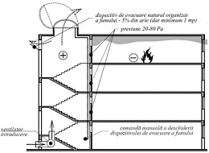
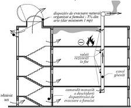
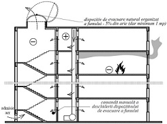

# Anexa nr. 10 – CONSTRUCȚII EXISTENTE – cap. 9 EVACUARE FUM ȘI GAZE FIERBINȚI
**SECȚIUNEA A V-A EVACUARE FUM (DESFUMARE) ȘI GAZE FIERBINȚI**

**CAPITOLUL 9 EVACUARE FUM ȘI GAZE FIERBINȚI**

Dispoziții generale
A.10.9.1. Prin desfumare se urmărește extragerea din spațiile incendiate a unei părți din fumul și gazele de ardere în scopul asigurării condițiilor de evacuare a utilizatorilor și a folosirii mijloacelor de intervenție la stingere, precum și de limitare a propagării incendiilor. În spațiile construite și necompartimentate, cu aria liberă peste 10.400 mp, se asigură evacuarea fumului și a gazelor fierbinți în exterior, conform normativului și ale prezentei anexe.
A.10.9.2. În principiu, desfumarea se asigură prin tiraj natural, organizat sau ventilare mecanică, realizând circulația aerului în spațiul considerat și evacuarea fumului în raport cu aerul introdus, sau prin diferențe de presiune între spațiul protejat și cel incendiat pus în depresiune, ori printr-o combinație a celor două metode.
A.10.9.3. Canalele (ghenele) pentru evacuarea fumului în caz de incendiu (desfumare), trebuie să îndeplinească următoarele condiții tehnice generale:
  - – secțiunea să fie cel puțin egală cu suprafața liberă a gurilor de evacuare ale unui nivel al construcției, la care sunt racordate;
  - – raportul dintre laturile secțiunii canalelor (ghenelor) să nu fie mai mare de 2;
  - – canalele (ghenele) să fie realizate din materiale clasa de reacție la foc A1 sau A2-s1,d0, etanșe la foc minimum 15 minute (E15), dacă prevederile normativului și ale prezentei anexe nu stabilesc rezistențe mai mari; atunci când canalele (ghenele) pentru evacuarea fumului traversează încăperi cu alte destinații decât cele pentru care sunt prevăzute, vor avea aceeași rezistență la foc cu a pereților sau planșeelor care delimitează destinația respectivă;
  - – canalele (ghenele) principale colectoare vor fi verticale, fiind admise deviații de maximum 2 %;
  - – lungimile racordurilor orizontale ale canalelor de evacuare a fumului, între guri și ghenele verticale, vor fi cât mai scurte posibil.
A.10.9.4. Golurile (gurile) de introducere (admisie) a aerului și cele de evacuare a fumului se repartizează alternat, distribuindu-se cât mai uniform în spațiul protejat, astfel încât să asigure circulația aerului și evacuarea fumului, îndeplinind condițiile specifice prevăzute în normativ și prezenta anexă.
A.10.9.5. Introducerile de aer se pot realiza prin:
  - – goluri (guri) practicate în fațade;
  - – ușile încăperilor care se desfumează, practicate în pereții exteriori ai construcției;
  - – încăperi sau coridoare în suprapresiune (calculul trebuind să acopere surplusul) sau care sunt bine aerisite;
  - – scări neînchise în case de scări;
  - – goluri (guri) de introducere, racordate sau nu la canale și ghene.
  Evacuarea fumului se asigură prin goluri în acoperiș sau pereți exteriori, conform normativului și prezentei anexe.
A.10.9.6. Dispozitivele de protecție (obturare) a golurilor de introducere sau evacuare, trebuie realizate cu acționare automată sau manuală, conform prevederilor normativului și prezentei anexe. Acționarea automată a dispozitivelor de protecție va fi întotdeauna dublată de comandă manuală.
  În plus, la construcțiile echipate cu instalații automate de stingere, se asigură posibilități de acționare pentru personalul existent în spațiul protejat și care să poată comanda local desfumarea, înainte de pornirea instalației de stingere.
A.10.9.7. Dispozitivele de acționare a elementelor de protecție (obturare) a golurilor trebuie să asigure:
  - – deschiderea golurilor (gurilor) și canalelor din volumul considerat;
  - – oprirea ventilatoarelor care nu sunt prevăzute pentru evacuarea fumului în caz de incendiu (desfumare).
A.10.9.8. Comanda manuală centralizată sau locală a dispozitivelor de deschidere poate fi realizată prin sistem mecanic, electric, pneumatic sau hidraulic. În funcție de tipul construcției și prevederile specifice, comanda manuală centralizată trebuie amplasată la încăperea serviciului de pompieri sau la un acces principal al construcției.
A.10.9.9. Comanda automată a dispozitivelor de protecție a golurilor (gurilor) trebuie asigurată de instalația de semnalizare a incendiilor din încăperea sau spațiul respectiv sau de dispozitive locale (fuzibil), atunci când nu se prevăd instalații de semnalizare.
A.10.9.10. Prevederea dispozitivelor de desfumare, precum și a sistemelor de evacuare a fumului și a gazelor fierbinți produse în caz de incendiu, este obligatorie în situațiile și condițiile stabilite de prezentul normativ.
Evacuarea fumului (desfumare)
Desfumare prin tiraj natural-organizat
A.10.9.11. Desfumarea prin tiraj natural-organizat se realizează prin introduceri de aer și evacuări de fum care comunică cu exteriorul direct sau prin canale (ghene), astfel dispuse, dimensionate și realizate încât să asigure circulația aerului în volumul protejat și evacuarea fumului.
A.10.9.12. Introducerea aerului se realizează conform prevederilor Art. A.10.9.5., iar evacuarea fumului prin goluri în fațade (libere sau închise cu dispozitive care se deschid automat în caz de incendiu), prin canale și ghene, sau prin dispozitive (trape) cu deschidere automată dispuse în acoperiș sau în treimea superioară a pereților exteriori ai încăperii. Dispozitivele de evacuare a fumului dispuse în pereții exteriori, asigură desfumarea pe maximum 30,00 m adâncime a încăperii (inclusiv în cazul coridoarelor).
A.10.9.13. Dispozitivele pentru evacuarea fumului în caz de incendiu, vor avea o suprafață liberă normată, raportată la aria încăperii pe care o protejează, conform prevederilor normativului.
A.10.9.14. Golurile de ventilare naturală permanent deschise, practicate în acoperiș sau în treimea superioară a pereților exteriori, se însumează la suprafața liberă necesară desfumării.
A.10.9.15. Dispozitivele de protecție a golurilor (gurilor) pentru desfumare (voleți, panouri, trape etc.) trebuie să fie (în poziție de așteptare), realizate din materiale clasa de reacție la foc A1 sau A2-s1,d0, etanșe la foc pentru cele de introducere a aerului și rezistente la foc pentru cele de evacuare, cu rezistența la foc egală cu a canalului pe care sunt montate. Pentru golurile prevăzute în acoperiș sau în pereții exteriori, aceste condiții nu sunt obligatorii.
Desfumarea mecanică
A.10.9.16. Desfumarea prin ventilare mecanică se asigură prin evacuarea mecanică a fumului și introducerea naturală sau mecanică a aerului, astfel încât să asigure circulația aerului în spațiul protejat și evacuarea fumului. Desfumarea mecanică poate fi asigurată și prin realizarea suprapresiunii în spațiul protejat de fum (încăperi tampon, degajamente protejate, case de scări etc ).
A.10.9.17. Introducerea naturală a aerului se realizează conform prevederilor Art. A.10.9.5., iar cea mecanică prin guri de introducere racordate prin canale (ghene) la un ventilator de introducere.
A.10.9.18. Evacuarea fumului se asigură prin guri racordate prin canale (ghene), la ventilatorul de evacuare (extragere).
A.10.9.19. Canalele (ghenele) trebuie să îndeplinească, de regulă, condițiile prevăzute la Art. A.10.9.3. și în plus să fie etanșe la aer.
A.10.9.20. Viteza aerului la gurile de introducere nu va depăși 5 m/s, iar gurile de introducere mecanică a aerului trebuie să asigure minimum 60% din debitul evacuat.
A.10.9.21. Gurile de desfumare trebuie să fie protejate cu voleți din materiale clasa de reacție la foc A1 sau A2-s1,d0, etanși la foc la introduceri și rezistenți la foc la evacuări în poziție de așteptare, cu rezistența egală cu a canalului (ghenei). Nu este obligatorie prevederea voleților atunci când canalele (ghenele) sunt aferente unui singur nivel construit.
A.10.9.22. Raportul dintre latura mare și cea mică a unei guri (deschideri) de introducere sau evacuare va fi de cel mult 2.
A.10.9.23. Dispozitivele de acționare a voleților de protecție se realizează conform prevederilor de la Art. A.10.9.6. până la Art. A.10.9.9. și trebuie să asigure punerea automată în funcțiune a ventilatoarelor de desfumare.
A.10.9.24. Ventilatoarele de evacuare a fumului trebuie astfel realizate încât să poată funcționa la temperatura de 400°C a fumului, cel puțin o oră. Legătura dintre ventilator și coloană (ghenă), se realizează din materiale clasa de reacție la foc A1 sau A2-s1,d0.
A.10.9.25. Starea de funcționare sau nefuncționare a ventilatoarelor aferente desfumării va fi semnalizată la încăperea serviciului de pompieri sau în alte locuri unde permanența este asigurată.
A.10.9.26. Instalațiile, inclusiv ventilatoarele de desfumare, trebuie să fie alimentate electric dintr-o sursă normală și o sursă electrică de rezervă.
A.10.9.27. Sistemul de ventilare normală sau de condiționare a unei construcții existente, poate fi utilizat și pentru evacuarea fumului produs în caz de incendiu (desfumare), dacă îndeplinește toate condițiile specifice desfumării.
Condiții specifice de desfumare
Case de scări închise
A.10.9.28. Pentru evitarea inundării cu fum a caselor de scări de evacuare închise, desfumarea acestora se poate realiza prin tiraj natural - organizat sau prin punerea în suprapresiune față de încăperile adiacente cu care comunică. Evacuarea mecanică a fumului din casele de scări nu este admisă.
A.10.9.29. Desfumarea prin tiraj natural - organizat a casei de scări închise, se realizează prin deschiderea automată și manuală a dispozitivului de evacuare a fumului (amplasat în treimea superioară a ultimului nivel al casei scării) și a gurii (deschiderii) de introducere a aerului (prevăzută în partea de jos a casei scării).
A.10.9.30. Împiedicarea pătrunderii fumului în casele de scări de evacuare prin suprapresiune față de încăperile învecinate cu care comunică, se realizează prin introducerea mecanică a aerului în scară, sau prin evacuarea mecanică a fumului din încăperile adiacente incendiate cu care comunică sau prin combinarea celor două metode (conform Figura 277). Suprapresiunea realizată la ușile închise ale casei de scări, va fi cuprinsă între 20 și 80 Pa. Debitul trebuie să asigure o viteză de cel puțin 0,5m/s în dreptul ușilor de acces la nivelul incendiat, considerând ușile închise la celelalte niveluri. La partea superioară, casa de scări trebuie să aibă dispozitiv de evacuare a fumului (trapa) cu aria liberă determinată conform normativului, dar cel puțin 1 mp, având asigurate posibilități de deschidere prin comandă de la nivelul de acces în scară. Deschiderea dispozitivului (trapei) trebuie să poată fi comandată și de la încăperea serviciului de pompieri/pentru situații de urgență. Atunci când accesele la casele de scări sunt protejate cu încăperi tampon, se asigură suprapresiune în încăperile tampon.
A.10.9.31. Pentru evitarea inundării cu fum a circulațiilor comune orizontale închise ale construcțiilor existente, se poate asigura punerea în suprapresiune a acestora față de încăperile adiacente cu care comunică, sau desfumarea lor prin tiraj natural - organizat sau ventilare mecanică.
A.10.9.32. Asigurarea evacuării fumului din circulațiile comune orizontale închise este obligatorie în situațiile stabilite în normativ.

  

  Varianta a)

  

  Varianta b)

  

  Varianta c)
  Figura 277 - Asigurarea evacuării fumului
  în construcții existente
Circulațiile comune orizontale închise
A.10.9.33. Atunci când încăperile adiacente sunt prevăzute cu evacuări de fum, (natural-organizat sau mecanic) circulațiile comune orizontale nu mai necesită desfumare, asigurându-se o suprapresiune de cca. 20 Pa față de încăperile cu care comunică direct sau de care sunt izolate prin încăperi tampon în suprapresiune.
A.10.9.34. Desfumarea prin tiraj natural-organizat a circulațiilor comune orizontale închise se realizează în condițiile prevăzute de la Art. A.10.9.11. până la Art. A.10.9.15., potrivit următoarele reguli:
  - – introducerile de aer și evacuările fumului (gurile) se dispun alternat, la distanțe orizontale - măsurate în axele circulațiilor - care să nu depășească 10,00 m în linie dreaptă sau 7,00 m în linie frântă;
  - – ușile încăperilor accesibile publicului se recomandă să fie situate la mai mult de 5,00 m de orice gură de introducere sau de evacuare;
  - – gurile de introducere și cele de evacuare vor avea suprafețe de minimum 0,10 mp pentru fiecare flux de evacuare al circulației comune orizontale din zona pe care o desfumează;
  - – gurile de introducere vor fi dispuse cu partea lor cea mai înaltă la maximum 1,00 m față de pardoseală, iar gurile de evacuare vor avea partea de jos (parapetul) la minimum 1,80 m de pardoseală (trebuind să se afle în treimea superioară a circulației comune);
  Deschiderile în fațade pot constitui guri de introducere și/sau de evacuare, dacă respectă condițiile de dispunere precizate.
A.10.9.35. Desfumarea mecanică a circulațiilor comune orizontale închise, se realizează în condițiile prevederilor de la Art. A.10.9.16. până la Art. A.10.9.27., și potrivit următoarelor reguli:
  - – gurile de introducere a aerului și de evacuare a fumului se dispun alternat, în funcție de localizările riscurilor de incendiu, la distanțe orizontale - măsurate în axele circulațiilor - de cel mult 15,00 m în linie dreaptă și 10,00 m în linie frântă;
  - – ușile încăperilor accesibile publicului se recomandă să fie situate la mai mult de 5,00 m de orice gură de introducere sau de evacuare;
  - – gurile de introducere se dispun cu partea lor superioară la maximum 1,00 m de pardoseală, iar gurile de evacuare vor avea partea de jos (parapetul) la minimum 1,80 m de pardoseală (trebuind să se afle în treimea superioară a circulației comune);
  - – porțiunile de circulație comună cuprinse între o gură de evacuare a fumului și una de introducere a aerului, trebuie să aibă asigurat un debit de extragere de cel puțin 0,5 mc/s pentru fiecare flux de evacuare asigurat.
  În timpul funcționării desfumării, diferența de presiune dintre casa de scări de evacuare și circulația comună orizontală desfumată, trebuie să fie mai mică de 80 Pa, la toate ușile închise ale scării.
Evacuarea fumului și a gazelor fierbinți
A.10.9.36. În situațiile stabilite de anexă și normativ, pentru limitarea propagării incendiilor în construcții fără pereți interiori despărțitori pentru asigurarea evacuării fumului și a gazelor fierbinți prin tiraj natural-organizat, se prevăd (în acoperiș) sisteme alcătuite din dispozitive de evacuare și ecrane verticale clasa de reacție la foc A1 sau A2-s1,d0, coborâte sub tavan, în funcție de densitatea sarcinii termice din spațiile respective, conform Tabelul 174.
  Tabelul 174: Sisteme alcătuite din dispozitive de evacuare a fumului și a gazelor fierbinți și ecrane verticale la construcții existente

| Densitatea sarcinii termice "q" (MJ/mp) | Raportul dintre suma ariilor libere ale dispozitivelor (deschiderilor) și aria încăperii | Distanța maximă (m) între: | Distanța maximă (m) între: |
|---|---|---|---|
| Densitatea sarcinii termice "q" (MJ/mp) | Raportul dintre suma ariilor libere ale dispozitivelor (deschiderilor) și aria încăperii | axele a două deschideri | ecranele suspendate sub tavan |
| q < 420 | 1:150 | 45 | 75 |
| 420 < q < 840 | 1:125 ... 1:80 | 35 | 70 |
| 840 < q < 1.680 | 1:80 ... 1:60 | 35 | 70 |
| 1.680 < q < 4.200 | 1:60 ... 1:40 | 30 | 30 |
| q > 4.200 | 1:30 | 30 | 30 |

A.10.9.37. Dispozitivele pentru evacuarea fumului și a gazelor fierbinți vor fi distribuite cât mai uniform și prevăzute cu deschidere automată și manuală. Golurile permanent deschise (ventilări) din acoperiș sau din treimea superioară a pereților exteriori, se însumează la suprafața necesară evacuării gazelor fierbinți.
A.10.9.38. Atunci când se prevede evacuarea mecanică a fumului și a gazelor fierbinți, aceasta va respecta următoarele condiții:
  - – dispunerea ecranelor clasa de reacție la foc A1 sau A2-s1,d0 sub plafon, corespunzător prevederilor specifice evacuării prin tiraj natural-organizat (Art. A.10.9.36. și Art. A.10.9.44);
  - – prevederea gurilor de evacuare se realizează astfel încât să se asigure cel puțin o gură la maximum 320 mp;
  - – debitul de extragere a unei guri va fi de cel puțin 1 mc/s pentru 100 mp delimitați de ecrane, iar pentru încăpere va fi de minimum 1,5 mc/s;
  - – la un ventilator de evacuare pot fi racordate maximum două volume delimitate de ecrane, iar debitul ventilatorului poate fi redus la debitul necesar celui mai mare volum racordat;
  - – introducerea aerului se poate realiza mecanic sau natural, prin partea de jos a pereților, cât mai aproape de pardoseală.
A.10.9.39. Prevederea dispozitivelor pentru evacuarea gazelor fierbinți nu este obligatorie în zonele construcției existente situate la mai puțin de 30 m de pereții exteriori ce au în treimea superioară a încăperilor deschideri sau ferestre prevăzute cu ochiuri mobile care se deschid automat în caz de incendiu, cu suprafața liberă necesară și care asigură evacuarea gazelor fierbinți. Când acționarea manuală nu se poate face din apropierea dispozitivelor de evacuare (trape, ferestre etc.) iar centralizarea comenzilor nu este justificată tehnic, se admite ca acestea să nu fie prevăzute cu acționare manuală. În cazul utilizării sistemelor de dispozitive și ecrane pentru evacuarea gazelor fierbinți, nu mai este obligatorie prevederea dispozitivelor de evacuare a fumului (desfumare).
A.10.9.40. Deschiderea automată a dispozitivelor de evacuare a fumului și a gazelor fierbinți, în caz de incendiu, se poate face individual sau în grup.
A.10.9.41. În construcțiile existente prevăzute cu instalații automate de stingere, acționarea automată a dispozitivelor de evacuare a gazelor fierbinți trebuie să se facă după declanșarea instalațiilor de stingere.
A.10.9.42. În construcțiile existente prevăzute cu luminatoare, evacuarea gazelor fierbinți se va asigura obligatoriu prin ochiuri mobile ale acestora, care să îndeplinească condițiile dispozitivelor de evacuare a gazelor fierbinți. Fac excepție situațiile precizate la Art. A.10.9.39
A.10.9.43. La construcțiile existente etajate, evacuarea fumului și a gazelor fierbinți se asigură separat pentru fiecare nivel, iar canalele respective care traversează alte niveluri vor avea pereți clasa de reacție la foc A1 sau A2-s1,d0 cu rezistență la foc de cel puțin 1 oră (EI/REI 60). Fac excepție situațiile deosebite, justificate tehnic, care sunt stabilite prin reglementări tehnice specifice.
A.10.9.44. Ecranele vor coborî sub plafon în așa fel încât marginea lor inferioară să se afle, de regulă, cât mai jos, dar cel puțin 50 cm sub plafon. Înălțimea ecranelor sub plafon poate fi redusă cu maximum 1/3, dacă prin amplasarea lor la distanță mai mică decât cea prevăzută în Tabelul 174 și prin suprafața de deschidere asigurată se realizează condiții echivalente de limitare a propagării laterale a gazelor fierbinți, sub plafonul încăperilor. În încăperi cu plafoane suspendate sau autoportante, continuitatea golurilor dintre acestea și planșeul de rezistență trebuie întreruptă în dreptul ecranelor, cu material clasa de reacție la foc A1 sau A2-s1,d0.
A.10.9.45. Ecranele vor fi astfel alcătuite și dispuse încât să realizeze o casetare a spațiului de sub acoperiș. Fiecare casetă va fi prevăzută cu cel puțin un dispozitiv de evacuare a gazelor fierbinți. Dispunerea ecranelor se face, de regulă, pe latura elementelor de rezistență din zona riscului potențial de incendiu. Nu se admite traversarea ecranelor de către elemente combustibile.
Notă generală Anexa 10: dacă pentru conformarea intervențiilor la construcțiile existente (atunci când acestea nu-si schimbă destinația) se regăsesc prevederi în Anexa 10 care sunt mai restrictive decât cele privind performanțele cerute pentru clădiri noi, se vor aplica acele prevederi cerute pentru clădiri noi (mai puțin restrictive).
