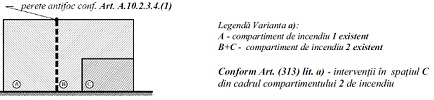
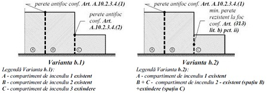
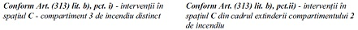
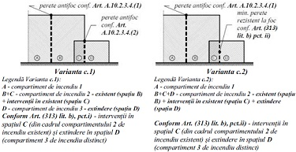

# Anexa nr. 10 – CONSTRUCȚII EXISTENTE – partea introductivă
CONSTRUCȚII EXISTENTE
(312) Prevederile prezentei anexe sunt obligatorii la lucrările de intervenție efectuate asupra construcțiilor existente care nu se extind, indiferent de forma de proprietate, categorie și clasă de importanță sau sursă de finanțare, în scopul asigurării protecției vieții oamenilor, bunurilor acestora, societății și mediului înconjurător. Se aplică la modificări ale clădirilor existente care se constituie ca fond construit anterior datei intrării în vigoare a normativului care nu se extind și care dețin sau nu dețin ansamblul de documente referitoare la proiectarea, execuția, recepția, exploatarea, întreținerea, repararea și urmărirea în timp a construcției. La lucrările de intervenții efectuate asupra construcțiilor existente edificate în baza prezentei anexe (a clădirilor existente care se constituie ca fond construit anterior datei intrării în vigoare a normativului), atunci când în mod justificat tehnic nu pot fi îndeplinite unele prevederi de securitate la incendiu normate, se asigură măsuri alternative de protecție (pasive, active sau combinații ale acestora) care să vizeze suplinirea cerințelor care nu pot fi respectate.
(313)
  - (1) Modificările la construcțiile existente care se constituie ca fond construit anterior datei intrării în vigoare a normativului, se vor conforma astfel:
    - a) intervențiile la construcțiile existente care nu se extind, se fac păstrând performanța la foc a elementelor de construcții care se înlocuiesc în conformitate cu reglementările aplicabile la data realizării lor (în acord cu Anexa 10), iar echiparea cu instalații cu rol de securitate la incendiu se face potrivit reglementărilor tehnice în vigoare.
      Notă Art. (313) lit. a): La lucrările de intervenții efectuate asupra construcțiilor existente (în conformitate cu lit. a)), atunci când în mod justificat tehnic nu pot fi îndeplinite unele prevederi de securitate la incendiu normate prin Anexa 10, se asigură măsuri de îmbunătățire a cerințelor privind securitatea la incendiu sau alternative de protecție (pasive, active sau combinații ale acestora) stabilite urmare a expertizării tehnice realizată potrivit art. 12 din Regulamentul pentru verificarea și expertizarea tehnică a proiectelor, expertizarea tehnică a execuției lucrărilor și a construcțiilor, precum și verificarea calității lucrărilor executate, aprobat prin Hotărârea Guvernului nr. 925/1995, cu modificările și completările ulterioare ulterioare. Măsurile de îmbunătățire a cerințelor privind securitatea la incendiu sau măsurile alternative de protecție (pasive, active sau combinații ale acestora care este obligatoriu să vizeze suplinirea cerințelor care nu pot fi respectate), se efectuează în baza unei/unor expertiză/e tehnică/e pentru cerința fundamentală securitate la incendiu (construcții si/sau instalații), întocmită/e în baza art. 9 și art. 12 din Regulamentul privind verificarea și expertizarea tehnică a proiectelor, expertizarea tehnică a execuției lucrărilor și a construcțiilor, precum și verificarea calității lucrărilor executate, aprobat prin Hotărârea Guvernului nr. 925/1995, cu modificările și completările ulterioare. Măsurile propuse de către expertul tehnic/experții tehnici în vederea îmbunătățirii cerinței de securitate la incendiu este obligatoriu să vizeze suplinirea cerințelor care nu pot fi respectate, atunci când în mod justificat tehnic nu pot fi îndeplinite unele prevederi de securitate la incendiu normate.
    - b) lucrările de extindere la construcțiile existente se fac păstrând performanța la foc a elementelor de construcții din volumul construcției existente (care se înlocuiesc în conformitate cu reglementările aplicabile la data realizării lor, în acord cu Anexa 10 din normativ), iar lucrările de extindere din exteriorul volumului construcției existente se realizează în concordanță cu reglementările tehnice în vigoare astfel:
      - i. în cazul în care lucrările de extindere la construcțiile existente se constituie ca și compartiment/compartimente de incendiu distinct/e (minimum unul), între construcția existentă și extindere se prevede perete antifoc. Pereții antifoc dintre construcțiile existente care se extind cu alte compartimente de incendiu noi (minimum unul) se realizează conform prevederilor normativului (Capitol 2.3.2.1. Pereți rezistenți la foc pentru separarea compartimentelor de incendiu), dar cel puțin 3 ore (EI-M 180/REI 180). Pereții antifoc din cadrul extinderilor construcțiilor existente (cu excepția celor prevăzuți anterior dintre construcția existentă și extindere/extinderi) se realizează conform prevederilor normativului (Capitol 2.3.2.1. Pereți rezistenți la foc pentru separarea compartimentelor de incendiu). Lucrările de intervenții la construcțiile existente care își păstrează destinația, se fac păstrând performanța la foc a elementelor de construcții din volumul construcției existente (care se înlocuiesc în conformitate cu reglementările aplicabile la data realizării lor, în acord cu Anexa 10), iar lucrările de extindere din exteriorul volumului construcției existente se realizează în concordanță cu reglementările tehnice în vigoare privind construcțiile noi.
      - ii. în cazul în care lucrările de extindere la construcțiile existente nu se constituie ca și compartiment/compartimente de incendiu distinct/e (minimum unul), între construcția existentă și extindere se prevede perete rezistent la foc având următoarele niveluri de performanță:
        - – REI 180/EI-M180 (clasa de reacție la foc A1 sau A2-s1,d0) prevăzuți cu uși EI_1 90-C5S_200 la Nivelul I de stabilitate la incendiu/gradul de rezistență la foc I;
        - – Nivel II - REI 120/EI120 (clasa de reacție la foc A1 sau A2-s1,d0) prevăzuți cu uși EI_2 60-C5S_200 la Nivelul II de stabilitate la incendiu/gradul de rezistență la foc II;
        - – REI 90/EI90 (clasa de reacție la foc A1 sau A2-s1,d0) prevăzuți cu uși EI_2 45-C5S_200 la Nivelul III de stabilitate la incendiu/gradul de rezistență la foc III;
        - – REI 60/EI60 (clasa de reacție la foc min B-s1,d0) prevăzuți cu uși EI_2 30- C5S_a la Nivelul IV de stabilitate la incendiu/gradul de rezistență la foc IV;
        - – REI 30/EI30 (clasa de reacție la foc min C-s1,d0) prevăzuți cu uși EI_2 15- C5S_a la Nivelul V de stabilitate la incendiu/gradul de rezistență la foc V.
  Lucrările de extindere la construcțiile existente care nu se constituie ca și compartiment/ compartiment/e de incendiu distinct/e (minimum unul), trebuie să respecte următoarele condiții:
  - – întregul compartiment de incendiu rezultat trebuie să respecte condițiile minime pe care trebuie să le îndeplinească elementele principale ale construcției existente (compartimentului de incendiu existent), astfel încât întreaga construcție existentă sau compartiment existent să poată fi încadrat într-un anumit nivel de stabilitate la incendiu (denumit anterior "grad de rezistență la foc") în conformitate cu Tabelul 144 din Anexa 10;
  - – ariile construite ale compartimentelor de incendiu rezultate admise pentru construcții civile (publice) supraterane rezultate existente trebuie să îndeplinească condițiile de corelare prevăzute în Tabelul 147 din Anexa 10 și între numărul de niveluri al clădirilor rezultate existente supraterane, destinația, nivelul de stabilitate la incendiu și capacitatea lor (număr de persoane), se vor respecta corelațiile prevăzute la Art. A.10. 3.2.5. din Anexa 10.
  Notă Art. (313) lit. b): La lucrările de intervenții efectuate asupra construcțiilor existente (din volumul construcției existente, cu excepția extinderilor), atunci când în mod justificat tehnic nu pot fi îndeplinite unele prevederi de securitate la incendiu normate prin Anexa 10, se asigură măsuri de îmbunătățire a cerințelor privind securitatea la incendiu sau alternative de protecție (pasive, active sau combinații ale acestora), stabilite în baza art. 9 și art. 12 din Regulamentul pentru verificarea și expertizarea tehnică a proiectelor, expertizarea tehnică a execuției lucrărilor și a construcțiilor, precum și verificarea calității lucrărilor executate, aprobat prin Hotărârea Guvernului nr. 925/1995, cu modificările și completările ulterioare. Măsurile de îmbunătățire a cerințelor privind securitatea la incendiu sau măsurile alternative de protecție (pasive, active sau combinații ale acestora care este obligatoriu să vizeze suplinirea cerințelor care nu pot fi respectate), se efectuează în baza unei/unor expertiză/e tehnică/e pentru cerința fundamentală securitate la incendiu (construcții și/sau instalații), întocmită/e în baza art. 9 din Regulamentul privind verificarea și expertizarea tehnică a proiectelor, expertizarea tehnică a execuției lucrărilor și a construcțiilor, precum și verificarea calității lucrărilor executate, aprobat prin Hotărârea Guvernului nr. 925/1995, cu modificările și completările ulterioare. Măsurile propuse de către expertul tehnic/experții tehnici în vederea îmbunătățirii cerinței de securitate la incendiu este obligatoriu să vizeze suplinirea cerințelor care nu pot fi respectate, atunci când în mod justificat tehnic nu pot fi îndeplinite unele prevederi de securitate la incendiu normate.

  

  Varianta a) - secțiune

  

  

  Varianta b) - secțiuni

  

  Varianta c) - secțiuni
  Figura 273 - Lucrări de intervenții efectuate
  asupra construcțiilor existente
  - (313)
    - (2) Cerințele minime privind securitatea la incendiu a construcțiilor existente la care se realizează lucrări de intervenție sunt următoarele:
