# Anexa nr. 11 – SISTEME DE EVACUARE A FUMULUI ȘI A GAZELOR FIERBINȚI
SISTEME DE EVACUARE A FUMULUI ȘI A GAZELOR FIERBINȚI
(314) Aria aerodinamică liberă a gurilor de introducere a aerului reprezintă aria totală a secțiunii transversale neobstrucționate (aria liberă geometrică), măsurată în zona cu secțiunea cea mai mică, conform figuri.

  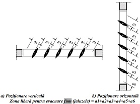

  Figura 278 - Zona liberă pentru evacuare (jaluzele)

  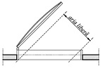

  Figura 279 - Aria liberă a gurilor de evacuare
  măsurată în sensul direcției fluxului de aer
(315) La clădirile care au prevăzute încăperi tampon către case de scări, casele de scări închise care au ferestre directe în exterior prin care să se evacueze fumul se prevăd cu dispozitiv de evacuare a fumului. Suprafața aerodinamică liberă a dispozitivelor cu deschidere automată pentru evacuarea fumului în caz de incendiu prin tiraj natural-organizat trebuie să reprezinte minimum 5% din aria celui mai mare nivel al casei de scări supraterane închise, dar cel puțin 1 mp. Încăperile tampon de acces la scări se pun în supraprapresiune. Proiectarea și calculul sistemului se face pe baza standardelor SR EN 12101-6 - Sisteme pentru controlul fumului și gazelor fierbinți. Partea 6: Specificații pentru sisteme cu presiune diferențială. Kituri (obligatoriu) și SR EN 12101-13 - Sisteme pentru controlul fumului și gazelor fierbinți. Partea 13: Sisteme cu presiune diferențială (SPD). Metode de proiectare și de calcul, instalare, încercări în vederea recepției, încercări periodice și mentenanță.

  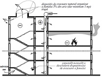

  Figura 280 - Sistem de admisie și evacuare a
  fumului natural-organizat din casa scării
  și SPD la încăperea tampon
(316) La clădirile care au prevăzute încăperi tampon către case de scări, casele de scări închise care nu au ferestre directe în exterior prin care să se evacueze fumul și încăperile tampon de acces la scări se pun în supraprapresiune, proiectarea și calculul sistemului se face pe baza standardelor SR EN 12101-6 - Sisteme pentru controlul fumului și gazelor fierbinți. Partea 6: Specificații pentru sisteme cu presiune diferențială. Kituri (obligatoriu) și SR EN 12101-13 - Sisteme pentru controlul fumului și gazelor fierbinți. Partea 13: Sisteme cu presiune diferențială (SPD). Metode de proiectare și de calcul, instalare, încercări în vederea recepției, încercări periodice.

  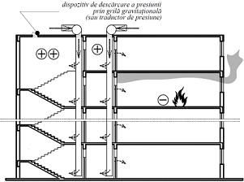

  Figura 281 - SPD la casa scării și încăperea tampon
(317) Punerea în supraprapresiune, proiectarea și calculul sistemului pe baza standardelor SR EN 12101-13 - Sisteme pentru controlul fumului și gazelor fierbinți. Partea 13: Sisteme cu presiune diferențială (SPD). Metode de proiectare și de calcul, instalare, încercări în vederea recepției, încercări periodice și mentenanță și SR EN 12101-6 - Sisteme pentru controlul fumului și gazelor fierbinți. Partea 6: Specificații pentru sisteme cu presiune diferențială. Kituri (obligatoriu) se face conform cerințelor de proiectare ale unui PDS (forța de deschidere a ușii, diferența de presiune, viteza fluxului de aer, timpul de inițiere, timpul de funcționare precum și timpul de răspuns), având în vedere faptul că PDS-ul trebuie proiectat astfel încât acesta să își poată îndeplini funcția pe toată durata de funcționare necesară.

  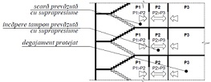

  Figura 282 - Gradient de presiune
  Notă Figura 282: Presiunea P3 poate fi în degajament protejat sau circulație comună orizontală prevăzută cu SPD.

  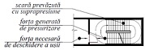

  Figura 283 - Forța maximă necesară pentru deschiderea ușii

  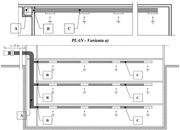

  SECȚIUNE - Varianta a)
  Legendă Figura 284 Varianta a):
  A - tubulatură colectoare
  B - volet
  C - tubulatura evacuare fum și gaze fierbinți nivel
  Varianta a) - prin canale colectoare

  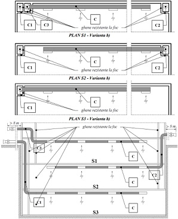

  SECȚIUNE - Varianta b)
  Legendă Figura 284 Varianta b):
  C, C1, C2, C3 - tubulatura evacuare fum și gaze fierbinți
  Varianta b) - independent, de pe fiecare nivel
  Figura 284 - Sisteme de control al fumului - evacuarea fumului la parcaje subterane
  Note Figura 284, conform standardelor de profil:
  - (a) Admisia aerului trebuie făcută concomitent cu evacuarea fumului pe nivelul/cantonul unde s-a produs incendiul și în tot parcajul pe căile de evacuare.
  - (b) Gurile de evacuare a fumului și de admisie a aerului aferente sistemului cu ventilare mecanică se racordează prin tubulaturi separate la canale colectoare verticale realizate cu pereți rezistenți la foc EI 180 atunci când străbat alte niveluri de parcare sau alte destinații. Tubulaturile de admisie a aerului și de evacuare a fumului din interiorul compartimentului de parcare și care asigură evacuarea fumului în caz de incendiu trebuie să fie din materiale din clasa de reacție la foc minimum A2-s2,d0 și etanșe la foc 30 de minute (ve sau ho). La trecerea acestor tubulaturi prin alte compartimente ale parcajului sau prin alte destinații trebuie să fie rezistente la foc 60 de minute (ve sau ho). La intrarea tubulaturilor din fiecare nivel de parcare în canalele verticale de evacuare a fumului sau de admisie a aerului se prevăd voleți rezistenți la foc 60 de minute la cele de evacuare și voleți etanși la foc 60 de minute la cele de admisie a aerului. Toți voleții vor fi cu acționare automată în caz de incendiu. În interiorul spațiului care se desfumează, tubulaturile trebuie să fie etanșe la foc 30 de minute (ve sau ho). Trecerea tubulaturilor de admisie a aerului și de evacuare a fumului prin alte spații sau compartimente ale parcajului este admisă în condițiile protejării tubulaturilor cu materiale rezistente la foc 60 de minute. Clasificările tubulaturilor de admisie a aerului și de evacuare a fumului precum și clasificările voleților vor fi corelate cu prevederile reglementărilor, standardelor precum și ale Regulamentelor în vigoare.

  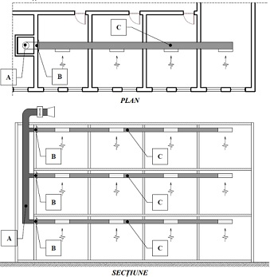

  Legendă Figura 285:
  A - tubulatură colectoare [conform minimum condiții prevăzute la Art. 8.1.14. alin. (1) și Tabel 118 sau Art. 8.1.14. alin. (1) și Art. 8.1.14. alin. (2)];
  B - volet minimum EI 60_multi(i<->o);
  C - tubulatură evacuare fum și gaze fierbinți nivel monocompartiment ("single") pentru spații cu aceeași destinație, etanșă la foc minimum E_600 30_hoS_single.
  Figura 285 - Sisteme de control al fumului -
  evacuarea fumului din niveluri supraterane
  (din încăperi cu aceeași funcțiune)
  Note Figura 285:
  - (a) Admisia aerului trebuie făcută concomitent cu evacuarea fumului pe nivelul/cantonul/rezervorul de fum unde s-a produs incendiul și în tot compartimentul/toată clădirea (în funcție de condițiile de evacuare) pe căile de evacuare;
  - (b) În situația utilizării canalelor colectoare comune (conducte rezistente la foc) de evacuare a fumului și gazelor fierbinți în caz de incendiu a tuturor nivelurilor supraterane sau subterane ale clădirilor, ghenele verticale prin care canalele colectoare ale sistemului de evacuare a fumului și gazelor fierbinți în caz de incendiu respective traversează alte niveluri ale construcției vor îndeplini condițiile prevăzute la Art. 2.4.11.2.;
  - (c) În situația utilizării canalelor colectoare comune (conducte rezistente la foc) de evacuare a fumului și gazelor fierbinți în caz de incendiu a tuturor nivelurilor supraterane sau subterane ale clădirilor, ghenele se vor proteja conform condițiilor normate.

  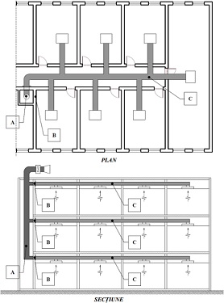

  Legendă Figura 286:
  A - tubulatură colectoare (conform minimum condiții prevăzute la Art. 8.1.14. alin. (1) și Tabel 118 sau Art. 8.1.14. alin. (1) și Art. 8.1.14. alin. (2));
  B - volet minimum EI 60_multi(i<->o);
  C - tubulatură evacuare fum și gaze fierbinți nivel multicompartiment ("multi") prin circulații comune, rezistentă la foc minimum EI 60_hoS_multi (sau EI 90>hoS_multi sau EI 120_hoS_multi).
  Figura 286 - Sisteme de control al fumului - evacuarea fumului
  din niveluri supraterane prin circulații comune
  Note Figura 286:
  - (a) Admisia aerului trebuie făcută concomitent cu evacuarea fumului pe nivelul/rezervorul de fum unde s-a produs incendiul și în tot compartimentul/toată clădirea (în funcție de condițiile de evacuare) pe căile de evacuare;
  - (b) Condiția care trebuie îndeplinită pentru a nu amplasa voleți la intersecția tubulaturilor cu pereții, este ca rezistența la foc a tubulaturii să fie minimum cât rezistența la foc a peretelui străpuns;
  - (c) Timpul de funcționare al instalației de evacuare fum și gaze fierbinți este în corelare cu timpul de funcționare al ascensoarelor de evacuare a persoanelor, fără a fi mai mică decât rezistența la foc a peretelui străpuns (se ia în calcul și faptul că tubulatura notată "C" poate fi necesar să-si păstreze caracteristicile un timp mai îndelungat decât rezistența la foc amintită, de exemplu prin amplasarea în directă legătură cu un ascensor utilizabil și pentru evacuare, caz în care rezistența acesteia va fi mai mare, de exemplu conform timpului normat de funcționare al ascensorului prevăzut și pentru evacuare);
  - (d) În toate cazurile în care tubulaturile orizontale se racordează la conducte verticale pe înălțimea construcției, conducte verticale colectoare precum și voleții prevăzuți la intrarea în canalele colectoare nu vor avea timpul de rezistență la foc și caracteristicile mai mici decât cele ale tubulaturilor care se racordează la ele;
  - (e) În situația utilizării canalelor colectoare comune (conducte rezistente la foc) de evacuare a fumului și gazelor fierbinți în caz de incendiu a tuturor nivelurilor supraterane sau subterane ale clădirilor, ghenele verticale prin care canalele colectoare ale sistemului de evacuare a fumului și gazelor fierbinți în caz de incendiu respective traversează alte niveluri ale construcției vor îndeplini condițiile prevăzute la Art. 2.4.11.2.;
    - – În situația utilizării canalelor colectoare comune (conducte rezistente la foc) de evacuare a fumului și gazelor fierbinți în caz de incendiu a tuturor nivelurilor supraterane sau subterane ale clădirilor, ghenele se vor proteja conform condițiilor normate).

  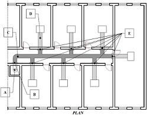

  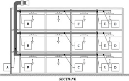

  Legendă Figura 287:
  A - tubulatură colectoare (conform minimum condiții prevăzute la Art. 8.1.14. alin. (1) și Tabel 118 sau Art. 8.1.14. alin. (1) și Art. 8.1.14. alin. (2);
  B - volet minimum EI 60_multi(i<->o);
  C - tubulatură evacuare fum și gaze fierbinți nivel multicompartiment ("multi") din destinații diferite, rezistentă la foc minimum EI 60_hoS_multi (sau EI 90_hoS_multi sau EI 120_hoS_multi);
  D - tubulatură evacuare fum și gaze fierbinți nivel monocompartiment ("single") pentru spații cu aceeași destinație, rezistentă la foc E_600 30_hoS_single;
  E - volet minimum EI 60_multi(i<->o).
  Figura 287 - Sisteme de control al fumului -
  evacuarea fumului pe zone (încăperi) din
  niveluri supraterane (din încăperi cu
  funcțiuni diferite)
  Note Figura 287:
  - (a) Condiția care trebuie îndeplinită pentru a nu amplasa voleți (notați "E" pe imagine) la intersecția tubulaturilor cu pereții, este ca rezistența la foc a tubulaturii să fie minimum cât rezistența la foc a peretelui străpuns;
  - (b) Timpul de funcționare al instalației de evacuare fum și gaxe fierbinți este în corelare cu timpul de funcționare al ascensoarelor de evacuare a persoanelor, fără a fi mai mică decât rezistența la foc a peretelui străpuns (se ia în calcul și faptul că tubulatura notată "C" pe imagine, poate fi necesar să-și păstreze caracteristicile un timp mai îndelungat decât rezistența la foc amintită de exemplu prin amplasarea în directă legătură cu un ascensor utilizabil și pentru evacuare, caz în care rezistența acesteia va fi mai mare, de exemplu conform timpului normat de funcționare al ascensorului prevăzut și pentru evacuare);
  - (c) În toate cazurile în care tubulaturile orizontale se racordează la conducte verticale pe înălțimea construcției, conducte verticale colectoare precum și voleții prevăzuți la intrarea în canalele colectoare nu vor avea timpul de rezistență la foc și caracteristicile mai mici decât cele ale tubulaturilor care se racordează la ele;
  - (d) În situația utilizării canalelor colectoare comune (conducte rezistente la foc) de evacuare a fumului și gazelor fierbinți în caz de incendiu a tuturor nivelurilor supraterane sau subterane ale clădirilor, ghenele verticale prin care canalele colectoare ale sistemului de evacuare a fumului și gazelor fierbinți în caz de incendiu respective traversează alte niveluri ale construcției vor îndeplini condițiile prevăzute la Art. 2.4.11.2.;
  - (e) În situația utilizării canalelor colectoare comune (conducte rezistente la foc) de evacuare a fumului și gazelor fierbinți în caz de incendiu a tuturor nivelurilor supraterane sau subterane ale clădirilor, ghenele se vor proteja conform condițiilor normate.

  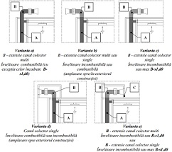

  Figura 288 - Evacuarea fumului pe acoperiș
  Notă Figura 288: În cazul variantelor în care extensia pe acoperiș a tubulaturii sau a canalului colector este "single" și ventilatorul de evacuare a fumului nu este poziționat în interiorul construcției, cerința este de învelitoare incombustibilă (sau maximum clasa de reacție la foc B-s1,d0), învelitoarea putând avea performanța Broof T4 cel puțin 6 m radial față de ventilatoarele poziționate pe acoperiș.
REFERINȚE LEGISLATIVE ȘI TEHNICE CARE AU FOST LUATE
ÎN CONSIDERARE LA ELABORAREA NORMATIVULUI
Note:
1. Referințele datate au fost luate în considerare la data elaborării prezentei reglementări tehnice.
2. La data utilizării reglementării tehnice se va utiliza ultima formă în vigoare a referințelor legislative și tehnice.
1. Legislație primară

| Nr. crt. | Acte legislative | Publicație |
|---|---|---|
| 1. | Legea nr. 10/1995 privind calitatea în construcții, republicată, cu modificările și completările ulterioare, | M. Of. P nr. 765 din 30 septembrie 2016 |

2. Reglementări tehnice aprobate prin ordin de ministru

| Nr. crt. | Denumire | Publicație |
|---|---|---|
| 1. | Regulamentul privind clasificarea și încadrarea produselor pentru construcții pe baza performanțelor de comportare la foc, aprobat prin Ordinul ministrului transporturilor, construcțiilor și turismului și al ministrului de stat, ministrului administrației și internelor nr. 1822/394 din 2004, cu modificările și completările ulterioare | M. Of. P I nr. 90 din 27.01.2005 |
| 2. | Normativ de securitate la incendiu a parcajelor subterane pentru autoturisme, indicativ NP 127-2009, aprobat prin Ordinul ministrului dezvoltării regionale și locuinței și al ministrului de stat, ministrul administrației și internelor nr. 1078/326/2009 | M. Of. P I nr. 74 din 02/02/2010 |
| 3. | Normativ privind proiectarea fațadelor cu alcătuire ventilată, indicativ NP 135-2013, aprobat prin Ordinul ministrului dezvoltării regionale și administrației publice nr. 3415/2013 | M. Of. P I nr. 807bis din 19.12.2013 |
| 4. | Normativ privind securitatea la incendiu a construcțiilor, Partea a II-a - Instalații de stingere indicativ P 118/2-2013, aprobat prin Ordinul ministrului dezvoltării regionale și administrației publice nr. 2.463/2013, cu modificările și completările ulterioare | M. Of., p I, nr. 595 bis/24.09.2013 |
| 5. | Normativ privind securitatea la incendiu a construcțiilor, Partea a III-a - Instalații de detectare, semnalizare și avertizare incendiu, indicativ P118/3- 2015, aprobat prin Ordinul ministrului dezvoltării regionale și administrației publice nr. 364/2015, cu modificările și completările ulterioare | M. Of., p I, nr. 243 bis /09.04.2015 |
| 6. | Normativ pentru proiectarea, execuția și exploatarea instalațiilor electrice aferente clădirilor, indicativ I7-2011, aprobat prin Ordinul ministrului dezvoltării regionale și turismului nr. 2.741/2011, cu modificările și completările ulterioare | M. Of. , P I nr. 802bis din 14.11.2011 |
| 7. | Normativ privind adaptarea clădirilor civile și spațiului urban aferent la nevoile individuale ale persoanelor cu handicap, indicativ NP 051-2012 — Revizuire NP 051/2000, aprobat prin Ordinul viceprim-ministrului, ministrului dezvoltării regionale și administrației publice nr. 189/2013 | M. Of. , P I nr. 121bis din 05.03.2013 |
| 8. | Regulamentul (UE) nr. 305/2011 al Parlamentului European și al Consiliului din 9 martie 2011 de stabilire a unor condiții armonizate pentru comercializarea produselor pentru construcții și de abrogare a Directivei 89/106/CEE a Consiliului Rectificare la Regulamentul (UE) nr. 305/2011 | Jurnalul Oficial al Uniunii Europene (JOUE), seria L, nr. 88 din 4 aprilie 2011 |
| 9. | Regulamentul delegat (UE) 2024/1681 al Comisiei din 6 martie 2024 de completare a Regulamentului (UE) nr. 305/2011 al Parlamentului European și al Consiliului prin stabilirea unor clase de performanță în ceea ce privește rezistența la foc a produselor pentru construcții | Jurnalul Oficial al Uniunii Europene (JOUE), seria L, din13.6.2024 |
| 10. | Regulamentul (UE) 2024/3110 al Parlamentului European și al Consiliului din 27 noiembrie 2024 de stabilire a unor norme armonizate pentru comercializarea produselor pentru construcții și de abrogare a Regulamentului (UE) nr. 305/2011 (Notă: din momentul intrării în vigoare/punerii în aplicare) | Jurnalul Oficial al Uniunii Europene (JOUE), seria L, din 18.12.2024 |
| 11. | Regulamente delegate și Decizii delegate - Regulamentul delegat (UE) 2024/1681 al Comisiei din 6 martie 2024 de completare a Regulamentului (UE) nr. 305/2011 al Parlamentului European și al Consiliului prin stabilirea unor clase de performanță în ceea ce privește rezistența la foc a produselor pentru construcții; Regulamentul delegat (UE) 2019/1188 al Comisiei din 14 martie 2019 care completează Regulamentul (UE) nr. 305/2011 al Parlamentului European și al Consiliului prin stabilirea unor clase de performanță în ceea ce privește rezistența la încărcarea vântului pentru jaluzelele și copertinele externe; Decizia delegată (UE) 2018/779 a Comisiei din 19 februarie 2018 privind sistemele aplicabile pentru evaluarea și verificarea constanței performanței panourilor sandwich cu față metalică pentru utilizare structurală în conformitate cu Regulamentul (UE) nr. 305/2011 al Parlamentului European și al Consiliului; Regulamentul delegat (UE) 2017/2293 al Comisiei din 3 august 2017 privind condițiile de clasificare, fără testare, a produselor din lemn laminat încrucișat reglementate de standardul armonizat EN16351 și a produselor din lemn de furnir laminat acoperite de standardul armonizat EN 14374 în ceea ce privește reacție la foc; Regulamentul delegat (UE) 2017/122 7 al Comisiei din 20 martie 2017 privind condițiile de clasificare, fără testare, a produselor din lemn laminat lipit acoperite de standardul armonizat EN 14080 și a produselor din lemn masiv îmbinate structurale acoperite de standardul armonizat EN 15497 în ceea ce privește la reacția lor la foc; Regulamentul delegat (UE) 2017/1228 al Comisiei din 20 martie 2017 privind condițiile de clasificare, fără testare, a straturilor externe și a tencuielilor interne pe bază de lianți organici acoperiți de standardul armonizat EN 15824 și a mortarelor de tencuire și tencuială acoperite de standardul armonizat EN 998-1 cu privire la reacția lor la foc; Decizia delegată (UE) 2015/1936 a Comisiei din 8 iulie 2015 privind sistemele aplicabile pentru evaluarea și verificarea constanței performanței pentru conductele de ventilație și țevile de ventilare a aerului în conformitate cu Regulamentul (UE) nr. 305/2011 al Parlamentului European și al Consiliului Decizia delegată (UE) 2015/1958 a Comisiei din 1 iulie 2015 privind sistemele aplicabile de evaluare și verificare a constanței performanței geosintetice și a produselor conexe; Regulamentul delegat (UE) 2016/364 al Comisiei din 1 iulie 2015 privind clasificarea performanței reacției la foc a produselor pentru construcții; Regulamentul delegat (UE) nr. 1292/2014 al Comisiei din 17 iulie 2014 privind condițiile de clasificare, fără testare, a anumitor pardoseli din lemn neacoperite conform EN 14342 în ceea ce privește reacția lor la foc; Regulamentul delegat (UE) nr. 1293/2014 al Comisiei din 17 iulie 2014 privind condițiile de clasificare, fără testare, a laturilor metalice și a mărgelelor pentru tencuiala internă acoperite de standardul armonizat EN 13658-1, a laturilor metalice și a mărgelelor pentru turnare externă acoperite de standardul armonizat EN 13658-2 și margele metalice și profiluri caracteristice acoperite de standardul armonizat EN 14353, în ceea ce privește reacția lor la foc; Regulamentul delegat (UE) nr. 1291/2014 al Comisiei din 16 iulie 2014 privind condițiile de clasificare, fără testare, a panourilor pe bază de lemn conform EN 13986 și a panourilor și placărilor din lemn masiv conform EN 14915 în ceea ce privește capacitatea lor de protecție împotriva incendiilor, atunci când sunt utilizate pentru acoperirea pereților și a tavanului; Regulamentul delegat (UE) nr. 574/2014 al Comisiei de modificare a anexei III la RCP și a întrebărilor frecvente privind anexa III (declarația de performanță) (207 KB); Regulamentul delegat (UE) nr. 568/2014 al Comisiei de modificare a anexei V la RCP și a întrebărilor frecvente privind anexa V (evaluarea și verificarea constanței performanței) (258 KB); Regulamentul de punere în aplicare (UE) nr. 1062/2013 al Comisiei privind formatul european de evaluare tehnică. | Jurnalul Oficial al Uniunii Europene (JOUE) |
|  |  |  |

3. Standarde - EUROCOD:

| Nr. crt. | Indice | EUROCOD |
|---|---|---|
| 1. | SR EN 1991-1-2 | Eurocod 1: Acțiuni asupra structurilor. Partea 1-2: Acțiuni generale. Acțiuni asupra structurilor expuse la foc |
| 2. | SR EN 1991-1-2/NA | Eurocod 1: Acțiuni asupra structurilor. Partea 1-2: Acțiuni generale. Acțiuni asupra structurilor expuse la foc. Anexă națională |
| 3. | SR EN 1992-1-2 | Eurocod 2: Proiectarea structurilor de beton. Partea 1-2: Reguli generale. Calculul comportării la foc |
| 4. | SR EN 1992-1-2/NA | Eurocod 2: Proiectarea structurilor de beton. Partea 1-2: Reguli generale. Calculul comportării la foc. Anexă națională |
| 5. | SR EN 1993-1-2 | Eurocod 3: Proiectarea structurilor de oțel. Partea 1-2: Reguli generale. Calculul structurilor la foc |
| 6. | SR EN 1993-1- 2/NB | Eurocod 3: Proiectarea structurilor de oțel. Partea 1-2: Reguli generale - Calculul structurilor la foc. Anexă națională |
| 7. | SR EN 1994-1-2 | Eurocod 4: Proiectarea structurilor compozite de oțel și beton. Partea 12: Reguli generale. Calculul structurilor la foc |
| 8. | SR EN 1994-1-2/NB | Eurocod 4: Proiectarea structurilor compozite de oțel și beton. Partea 12: Reguli generale. Calculul structurilor la foc. Anexă națională |
| 9. | SR EN 1995-1-2 | Eurocod 5: Proiectarea structurilor de lemn. Partea 1-2: Generalități. Calculul structurilor la foc |
| 10. | SR EN 1995-1-2/NB | Eurocod 5: Proiectarea structurilor de lemn. Partea 1-2: Generalități. Calculul structurilor la foc. Anexă națională |
| 11. | SR EN 1996-1-2 | Eurocod 6: Proiectarea structurilor de zidărie. Partea 1-2: Reguli generale. Calculul structurilor la foc |
| 12. | SR EN 1996-1-2/NA | Eurocod 6: Proiectarea structurilor de zidărie. Partea 1-2: Reguli generale. Calculul structurilor la foc. Anexă națională |
| 13. | SR EN1999-1-2 | Eurocod 9: Proiectarea structurilor de aluminiu. Partea 1-2: Calculul structurilor la foc |
| 14. | SR EN 1999-1-2/NA | Eurocod 9: Proiectarea structurilor de aluminiu. Partea 1-2: Calculul structurilor la foc. Anexa națională |

4. Standarde:

| Nr. crt. | Indice | Standarde |
|---|---|---|
| 1. | SR EN ISO 13943 | Securitate la incendiu. Vocabular |
| 2. | SR ISO 8421-2 | Protecție împotriva incendiilor. Vocabular. Partea 2: Protecția structurală împotriva incendiului |
| 3. | SR EN 2:1995 | Clase de incendii |
| 4. | SR EN 1364-1 | Încercări de rezistență la foc a elementelor neportante. Partea 1: Pereți |
| 5. | SR EN 1364-2 | Încercări de rezistență la foc pentru elemente de construcții neportante. Partea 2: Plafoane |
| 6. | SR EN 1364-3 | Încercări pentru rezistența la foc a elementelor neportante. Partea 3: Pereți cortină - Configurație completă (ansamblu complet) |
| 7. | SR EN 1364-4 | Încercări privind rezistența la foc a elementelor neportante. Partea 4: Pereți cortină. Configurație parțială |
| 8. | SR EN 1364-5 | Încercări de rezistență la foc a elementelor neportante. Partea 5: Grile de transfer |
| 9. | SR EN 1365-1 | Încercări de rezistență la foc pentru elemente de construcții portante. Partea 1: Pereți |
| 10. | SR EN 1365-2 | Încercări de rezistență la foc pentru elemente de construcții portante. Partea 2: Planșee și acoperișuri |
| 11. | SR EN 1365-3 | Încercări de rezistență la foc pentru elemente de construcții portante. Partea 3: Grinzi |
| 12. | SR EN 1365-4 | Încercări de rezistență la foc a elementelor de construcții portante. Partea 4: Stâlpi |
| 13. | SR EN 1365-5 | Încercări de rezistență la foc a elementelor de construcții portante. Partea 5: Balcoane și pasarele |
| 14. | SR EN 1365-6 | Încercări de rezistență la foc pentru elementele de construcții portante. Partea 6: Scări |
| 15. | SR EN 1366-1 | Încercări de rezistență la foc pentru instalații tehnice. Partea 1: Conducte de ventilare |
| 16. | SR EN 1366-2 | Încercări de rezistență la foc pentru instalații tehnice. Partea 2: Clapete rezistente la foc |
| 17. | SR EN 1366-3 | Încercări de rezistență la foc pentru instalații tehnice. Partea 3: Etanșări ale trecerilor |
| 18. | SR EN 1366-4 | Încercări de rezistență la foc pentru instalații tehnice. Partea 4: Sisteme de etanșare pentru îmbinări liniare |
| 19. | SR EN 1366-5 | Încercări de rezistență la foc pentru instalații tehnice. Partea 5: Canale pentru instalații tehnice |
| 20. | SR EN 1366-6 | Securitatea la incendiu. Încercări de rezistență la foc a instalațiilor pentru utilități. Partea 6: Pardoseli supraînălțate și pardoseli cu goluri |
| 21. | SR EN 1366-7 | Securitatea la incendiu. Încercări de rezistență la foc a instalațiilor pentru utilități. Partea 7: Închideri de trecere pentru sisteme de conveiere |
| 22. | SR EN 1366-8 | Încercări de rezistență la foc pentru instalații tehnice. Partea 8: Conducte pentru evacuarea fumului |
| 23. | SR EN 1366-9 | Încercări de rezistență la foc ale instalațiilor tehnice. Partea 9: Conducte de evacuare a fumului dintr-un singur compartiment |
| 24. | SR EN 1366-10 | Încercări de rezistență la foc a instalațiilor tehnice. Partea 10: Clapete pentru controlul fumului |
| 25. | SR EN 1366-11 | Încercări de rezistență la foc pentru instalații tehnice. Partea 11: Sisteme de protecție la incendiu pentru sisteme de cabluri și componente asociate |
| 26. | SR EN1366-12 | Încercări de rezistență la foc pentru instalații tehnice. Partea 12: Bariere rezistente la foc nemecanice pentru conducte de ventilare |
| 27. | SR EN 1366-13 | Încercări de rezistență la foc pentru instalații tehnice. Partea 13: Coșuri de fum |
| 28. | SR EN 15659 | Unități de depozitare de securitate. Clasificare și metode de încercare pentru determinarea rezistenței la foc. Unități de depozitare cu rezistență limitată la foc |
| 29. | SR EN 15998 | Sticlă pentru construcții. Securitate în caz de incendiu, rezistență la foc. Metodologie de încercare a sticlei în scopul clasificării |
| 30. | SR EN 1191 | Ferestre și uși. Rezistență la deschidere și închidere repetată. Metodă de încercare |
| 31. | SR EN 16034 | Uși pentru pietoni, uși pentru uz industrial, comercial, pentru garaje și ferestre. Standard de produs, caracteristici de performanță. Caracteristici de rezistență la foc și/sau etanșeitate la fum |
| 32. | SR EN 1634-1 | Încercări de rezistență la foc și etanșeitate la fum pentru uși, obloane, ferestre mobile și elemente de feronerie. Partea 1: Încercări de rezistență la foc pentru uși, obloane și ferestre mobile |
| 33. | SR EN 1634-2 | Încercări de rezistență la foc și etanșeitate la fum pentru uși, obloane, ferestre și elemente de feronerie. Partea 2: Încercări de caracterizare a rezistenței la foc pentru elemente de feronerie |
| 34. | SR EN 1634-3 | Încercări de rezistență la foc pentru ansambluri de uși și obloane. Partea 3: Uși și obloane etanșe la fum |
| 35. | SR EN 1634-3 | Încercări de rezistență la foc și de etanșeitate la fum pentru uși și ansambluri de închidere, ferestre și elemente metalice pentru construcții. Partea 3: Încercare de etanșeitate la fum pentru uși și ansambluri de închidere |
| 36. | SR EN 13216-1 | Coșuri de fum. Metode de încercare pentru sistemele coșurilor de fum. Partea 1: Metode de încercare generale |
| 37. | SR EN 12604+A1 | Uși și porți pentru uz industrial, comercial și pentru garaje. Aspecte mecanice. Cerințe și metode de încercare |
| 38. | SR EN 13381-1 | Metode de încercare pentru determinarea contribuției la rezistența la foc a elementelor de construcție. Partea 1: Membrane de protecție orizontale |
| 39. | SR EN 13381-2 | Metode de încercare pentru determinarea contribuției la rezistența la foc a elementelor de construcție. Partea 2: Membrane de protecție verticale |
| 40. | SR EN 13381-3 | Metode de încercare pentru determinarea contribuției la rezistența la foc a elementelor de structură. Partea 3: Protecție aplicată pe elemente de beton |
| 41. | SR EN 13381-4 | Metode de încercare pentru determinarea contribuției la rezistența la foc a elementelor de construcție. Partea 4: Protecție pasivă aplicată pe elemente din oțel |
| 42. | SR EN 13381-5 | Metode de încercare pentru determinarea contribuției la rezistența la foc a elementelor de structură. Partea 5: Protecție aplicată pe elemente compozite de beton/tablă profilată de oțel |
| 43. | SR EN 13381-6 | Metode de încercare pentru determinarea contribuției la rezistența la foc a elementelor de structură. Partea 6: Protecție aplicată pe stâlpi de oțel cu goluri umplute cu beton |
| 44. | SR EN 13381-7 | Metodă de încercare pentru determinarea contribuției la rezistența la foc a elementelor de construcție. Partea 7: Protecția aplicată elementelor din lemn |
| 45. | SR EN 13381-8 | Metode de încercare pentru determinarea contribuției la rezistența la foc a elementelor de construcție. Partea 8: Protecție reactivă aplicată elementelor din oțel |
| 46. | SR EN 13381-9 | Metode de încercare pentru determinarea contribuției la rezistența la foc a elementelor de construcție. Partea 9: Sisteme de protecție la incendiu aplicate grinzilor alveolare de oțel |
| 47. | SR EN 13381-10 | Metode de încercare pentru determinarea contribuției la rezistența la foc a elementelor de construcție. Partea 10: Protecție aplicată barelor din oțel solicitate la întindere (tiranți) |
| 48. | SR EN 13501-1 | Clasificare la foc a produselor și elementelor de construcție. Partea 1: Clasificare folosind rezultatele încercărilor de reacție la foc |
| 49. | SR EN 13501-2 | Clasificarea la foc a produselor și elementelor de construcție. Partea 2: Clasificare folosind rezultatele încercărilor de rezistență la foc și/sau de etanșeitate la fum, cu excepția produselor utilizate în instalațiile de ventilare |
| 50. | SR EN 13501-3 | Clasificare la foc a produselor și elementelor de construcție. Partea 3: Clasificare pe baza rezultatelor încercărilor de rezistență la foc pentru produse și elemente utilizate în instalații tehnice ale construcțiilor: Conducte și clapete rezistente la foc |
| 51. | SR EN 13501-4 | Clasificare la foc a produselor și elementelor de construcție. Partea 4: Clasificare folosind rezultatele încercărilor de rezistență la foc ale componentelor sistemelor de control al fumului |
| 52. | SR EN 13501-5 | Clasificare la foc a produselor și elementelor de construcție - Partea 5: Clasificare folosind rezultatele încercărilor acoperișurilor la expunere la un foc exterior |
| 53. | SR EN 13501-6 | Clasificarea la foc a produselor și elementelor de construcție. Partea 6: Clasificare folosind rezultatele încercărilor de reacție la foc a cablurilor de energie, de comandă și de comunicații |
| 54. | SR EN 15080-8 | Extinderea domeniului de aplicare a rezultatelor încercărilor de rezistență la foc. Partea 8: Grinzi |
| 55. | SR EN 15080-12 | Aplicație extinsă a rezultatelor încercărilor de rezistență la foc. Partea 12: Pereți portanți în zidărie |
| 56. | SR EN 15254-2 | Extinderea domeniului de aplicare a încercărilor de rezistență la foc. Pereți neportanți. Partea 2: Zidărie și plăci de ipsos |
| 57. | SR EN 15254-3 | Extinderea domeniului de aplicare a rezultatelor încercărilor de rezistență la foc. Pereți neportanți. Partea 3: Pereți despărțitori ușori |
| 58. | SR EN 15254-4 | Extinderea domeniului de aplicare al încercărilor de rezistență la foc. Pereți neportanți. Partea 4: Construcții vitrate |
| 59. | SR EN 15254-5 | Extinderea domeniului de aplicare a rezultatelor încercărilor de rezistență la foc. Pereți neportanți. Partea 5: Panouri metalice tip sandviș pentru construcții |
| 60. | SR EN 15254-6 | Extinderea domeniului de aplicare a încercărilor de rezistență la foc. Pereți neportanți. Partea 6: Pereți cortină |
| 61. | SR EN 15254-7 | Extinderea domeniului de aplicare a încercărilor de rezistență la foc. Plafoane neportante. Partea 7: Panouri metalice tip sandviș pentru construcții |
| 62. | SR EN 15269-1 | Aplicare extinsă a rezultatelor încercării de rezistență la foc și/sau de etanșeitate la fum a ușilor, obloanelor și ferestrelor mobile, inclusiv a elementelor de feronerie ale acestora. Partea 1: Cerințe generale |
| 63. | SR EN 15269-2 | Extinderea domeniului de aplicare a rezultatelor încercării pentru rezistența la foc și/sau etanșeitatea la fum a ansamblurilor de uși, obloane și ferestre care se deschid, incluzând elementele lor de feronerie. Partea 2: Rezistența la foc a seturilor de uși de oțel pe balamale și pivoți |
| 64. | SR EN 15269-3 | Extinderea domeniului de aplicare a rezultatelor încercării privind rezistența la foc și/sau etanșeitatea la fum a ansamblurilor de uși, obloane și ferestre mobile, inclusiv a elementelor de feronerie ale acestora. Partea 3: Rezistența la foc a ansamblurilor de uși de lemn cu balamale și pivoți și a ferestrelor mobile cu tocuri de lemn |
| 65. | SR EN 15269-5 | Extinderea domeniului de aplicare a rezultatelor încercărilor de rezistență la foc și/sau de etanșeitate la fum a ansamblurilor de uși, obloane și ferestre, incluzând elementele de feronerie ale acestora. Partea 5: Rezistența la foc a ansamblurilor de uși vitrate cu toc metalic pe balamale și pivoți și a ferestrelor de sticlă cu toc metalic |
| 66. | SR EN15269-7 | Extinderea domeniului de aplicare a rezultatelor încercării pentru rezistența la foc și/sau etanșeitatea la fum a ansamblurilor de uși, obloane și ferestre care se deschid, incluzând elementele lor de feronerie. Partea 7: Rezistența la foc a ansamblurilor de uși glisante din oțel |
| 67. | SR EN 15269-10 | Extinderea domeniului de aplicare a rezultatelor pentru încercări de rezistență la foc și/sau control al fumului pentru uși, obloane și ansambluri care deschid ferestre, inclusiv elemente de feronerie. Partea 10: Rezistența la foc a obloanelor din oțel sub formă de rolă |
| 68. | SR EN 15269-11 | Extinderea domeniului de aplicare a rezultatelor încercărilor de rezistență la foc și/sau de etanșeitate la fum a ansamblurilor de uși, obloane și ferestre, incluzând elementele de feronerie ale acestora. Partea 11: Rezistența la foc a cortinelor mobile din țesătură |
| 69. | SR EN 15269-20 | Extinderea domeniului de aplicare a rezultatelor încercărilor de rezistență la foc și/sau de etanșeitate la fum a ansamblurilor de uși, obloane și ferestre care se deschid, inclusiv a elementelor de feronerie ale acestora. Partea 20: Etanșeitatea la fum a ușilor, a obloanelor, a cortinelor mobile din țesătură și a ferestrelor care se deschid |
| 70. | SR EN 15287 | Coșuri de fum. Proiectare, instalare și punere în funcțiune. Partea 1: Coșuri de fum și canale de racordare pentru aparate de încălzire neetanșe |
| 71. | SR EN 15287-2 | Coșuri de fum. Proiectare, instalare și punere în funcțiune. Partea 2: Coșuri de fum și canale de racordare pentru aparate de încălzire etanșe |
| 72. | SR EN 15423 | Instalații de ventilare a clădirilor. Măsuri de precauție împotriva incendiilor pentru instalațiile de distribuție a aerului în clădiri |
| 73. | SR EN 15882-1 | Extinderea domeniului de aplicare a rezultatelor încercărilor de rezistență la foc a instalațiilor tehnice - Partea 1: Conducte |
| 74. | SR EN 15882-2 | Extinderea domeniului de aplicare a rezultatelor încercărilor de rezistență la foc ale instalațiilor tehnice. Partea 2: Clapete rezistente la foc |
| 75. | SR EN 15882-3 | Extinderea domeniului de aplicare a încercărilor de rezistență la foc. Partea 3: Etanșări |
| 76. | SR EN 15882-4 | Extinderea domeniului de aplicare a rezultatelor încercărilor de rezistență la foc. Partea 4: Etanșări pentru îmbinări liniare |
| 77. | SR EN 15882-5 | Extinderea domeniului de aplicare a rezultatelor încercărilor de rezistență la foc. Partea 5: Elemente combinate pentru etanșarea trecerilor |
| 78. | SR EN 12101-1 | Sisteme pentru controlul fumului și gazelor fierbinți. Partea 1: Specificație pentru barierele de fum |
| 79. | SR EN 12101-2 | Sisteme de control al fumului și a căldurii - Partea 2: Dispozitive de evacuare naturală a fumului și a căldurii |
| 80. | SR EN 12101-3 | Sisteme de control al fumului și al căldurii. Partea 3: Specificații pentru ventilatoare mecanice de control al fumului și al căldurii |
| 81. | SR CEN/TR 12101-4 | Sisteme de control al fumului și gazelor fierbinți. Partea 4: Sisteme SHEVS instalate pentru evacuarea fumului și gazelor fierbinți |
| 82. | SR CEN/TR 12101-5 | Sisteme de control al fumului și gazelor fierbinți. Partea 5: Ghid de recomandări funcționale și metode de calcul pentru sisteme de ventilare pentru evacuarea fumului și gazelor fierbinți |
| 83. | SR EN 12101-6 | Sisteme pentru controlul fumului și gazelor fierbinți. Partea 6: Specificații pentru sisteme cu presiune diferențială. Kituri |
| 84. | SR EN 12101-13 | Sisteme pentru controlul fumului și gazelor fierbinți. Partea 13: Sisteme cu presiune diferențială (SPD). Metode de proiectare și de calcul, instalare, încercări în vederea recepției, încercări periodice și mentenanță |
| 85. | SR EN 12101-7 | Sisteme pentru controlul fumului și gazelor fierbinți. Partea 7: Tronsoane de conductă pentru controlul fumului |
| 86. | SR EN 12101-8 | Sisteme pentru controlul fumului și gazelor fierbinți. Partea 8: Clapete pentru controlul fumului |
| 87. | SR EN 12101-10 | Sisteme pentru controlul fumului și gazelor fierbinți. Partea 10: Echipament de alimentare cu energie |
| 88. | SR EN 12845 | Instalații fixe de stingere a incendiilor. Sisteme automate de stingere cu sprinklere. Proiectare, instalare și mentenanță |
| 89. | SR EN 14972-1 | Instalații fixe de stingere a incendiilor. Sisteme cu ceață de apă. Partea 1: Proiectare, instalare, verificare și mentenanță |
| 90. | SR EN 14972-3 | Instalații fixe de stingere a incendiilor. Sisteme cu ceață de apă. Partea 3: Protocol de încercare a sistemelor automate de duze pentru birouri, școli și hoteluri |
| 91. | SR EN 14972-6 | Instalații fixe de stingere a incendiilor. Sisteme cu ceață de apă. Partea 6: Protocol de încercare a sistemelor de duze automate pentru pardoseli false și plafoane false |
| 92. | SR EN 14972-7 | Instalații fixe de stingere a incendiilor. Sisteme cu ceață de apă. Partea 7: Protocol de încercare a sistemelor cu duze automate pentru spații comerciale cu risc scăzut |
| 93. | SR EN 14972-8 | Sisteme fixe de luptă împotriva incendiilor. Sisteme cu ceață de apă. Partea 8: Protocol de încercare a sistemelor cu duze deschise pentru echipamente situate în incinte care depășesc 260 mc |
| 94. | SR EN 14972-9 | Sisteme fixe de luptă împotriva incendiilor. Sisteme cu ceață de apă. Partea 9: Protocol de încercare a sistemelor cu duze deschise pentru echipamente situate în incinte care nu depășesc 260 mc |
| 95. | SR EN 14972-10 | Instalații fixe de stingere a incendiilor. Sisteme cu ceață de apă. Partea 10: Protocol de încercare a sistemelor cu duze deschise pentru protecția atriumului cu duze de perete |
| 96. | SR EN 14972-11 | Instalații fixe de stingere a incendiilor. Sisteme cu ceață de apă. Partea 11: Protocol de încercare a sistemelor cu duze deschise pentru tunelurile de cabluri |
| 97. | SR EN 14972-14 | Sisteme fixe de stingere a incendiilor. Sisteme cu ceață de apă. Partea 14: Protocol de încercare a sistemelor cu duze deschise pentru turbine de combustie amplasate în incinte care depășesc 260 mc |
| 98. | SR EN 14972-15 | Sisteme fixe de stingere a incendiilor. Sisteme cu ceață de apă. Partea 15: Protocol de încercare a sistemelor cu duze deschise pentru turbine de combustie amplasate în incinte care nu depășesc 260 mc |
| 99. | SR EN 14972-16 | Sisteme fixe de luptă contra incendiilor. Sisteme cu ceață de apă. Partea 16: Protocol de încercare pentru sistemele de duze deschise pentru mașinile de gătit industriale |
| 100. | SR EN 12259-4 | Sisteme fixe de luptă împotriva incendiilor. Componente pentru sisteme cu sprinklere și cu apă pulverizată. Partea 4: Dispozitive de alarmare cu motor hidraulic |
| 101. | SR CEN/TS14816 | Sisteme fixe de stingere a incendiului. Sisteme de stingere cu apă pulverizată. Calcul, instalare și întreținere |
| 102. | SR EN 12259-1 | Protecție împotriva incendiilor. Sisteme fixe de luptă împotriva incendiilor. Componentele sistemelor de tip sprinkler și cu apă pulverizată. Partea 1: Sprinklere |
| 103. | SR EN 12259-12 | Sisteme fixe de stingere a incendiilor. Componente pentru sisteme cu sprinklere și cu apă pulverizată. Partea 12: Pompe |
| 104. | SR EN 12259-13 | Sisteme fixe de stingere a incendiilor. Componente pentru sisteme cu sprinklere și apă pulverizată. Partea 13: Sprinklere ESFR |
| 105. | SR EN 12259-14 | Sisteme fixe de stingere a incendiilor. Componente pentru sisteme cu sprinklere și cu apă pulverizată. Partea 14: Sprinklere pentru aplicații rezidențiale |
| 106. | SR EN 12259-2 | Sisteme fixe de luptă împotriva incendiului. Componente pentru sisteme cu sprinklere și cu apă pulverizată. Partea 2: Sistem de supape de alarmă apă-apă |
| 107. | SR EN 12259-3 | Sisteme fixe de stingere a incendiilor. Componente pentru sisteme cu sprinklere și cu apă pulverizată. Partea 3: Sisteme de supapă de alarmă apă-aer |
| 108. | SR EN 12259-4 | Sisteme fixe de luptă împotriva incendiilor. Componente pentru sisteme cu sprinklere și cu apă pulverizată. Partea 4: Dispozitive de alarmare cu motor hidraulic |
| 109. | SR EN 12259-5 | Sisteme fixe de luptă împotriva incendiului. Componente pentru sisteme cu sprinklere și cu apă pulverizată. Partea 5: Detectoare de curgere a apei |
| 110. | SR EN 12259-9 | Sisteme fixe de luptă împotriva incendiilor. Componente pentru sisteme cu sprinklere și cu apă pulverizată. Partea 9: Supape de control și semnalizare pentru sisteme cu inundare |
| 111. | SR EN 15725 | Extinderea domeniului de aplicare a performanțelor la foc ale produselor și elementelor de construcție. Principiul standardelor EXAP și al rapoartelor EXAP |
| 112. | SR EN 81-58 | Reguli de securitate pentru execuția și montarea ascensoarelor. Examinare și încercări. Partea 58: Încercarea de rezistență la foc a ușilor de palier |
| 113. | SR EN 13241 | Uși și porți pentru uz industrial, comercial și pentru garaje. Standard de produs, caracteristici de performanță |
| 114. | SR EN 15283-1 | Plăci de ipsos armate cu fibre. Definiții, condiții și metode de încercare. Partea 1: Plăci de ipsos armate cu țesătură sau împâslitură |
| 115. | SR EN 15283-2 | Plăci de ipsos armate cu fibre. Definiții, condiții și metode de încercare. Partea 2: Plăci de ipsos cu fibre |
| 116. | SR EN 17020-1 | Extinderea domeniului de aplicare a rezultatelor încercării privind durabilitatea închiderii automate a ansamblurilor de uși și a ferestrelor mobile rezistente la foc și/sau etanșe la fum. Partea 1: Durabilitatea închiderii automate a ansamblurilor de uși din oțel cu balamale și pivoți |
| 117. | SR EN 17020-2 | Extinderea domeniului de aplicare a rezultatelor încercării privind durabilitatea închiderii automate a ansamblurilor de uși și a ferestrelor mobile rezistente la foc și/sau etanșe la fum. Partea 2: Durabilitatea închiderii automate a obloanelor rulante din oțel |
| 118. | SR EN 17020-3 | Extinderea domeniului de aplicare a rezultatelor încercării privind durabilitatea închiderii automate a ansamblurilor de uși și a ferestrelor mobile rezistente la foc și/sau etanșe la fum. Partea 3: Durabilitatea închiderii automate a ușilor glisante din oțel |
| 119. | SR EN 17020-4 | Extinderea domeniului de aplicare a rezultatelor încercării privind durabilitatea închiderii automate a ansamblurilor de uși și a ferestrelor mobile. Partea 4: Durabilitatea închiderii automate a blocurilor de uși vitrate cu tâmplărie metalică, articulate și pivotante, și a ferestrelor mobile cu tâmplărie metalică rezistente la foc și/sau etanșe la fum |
| 120. | SR EN 17020-5 | Extinderea domeniului de aplicare a rezultatelor încercării privind durabilitatea închiderii automate a ansamblurilor de uși și a ferestrelor mobile rezistente la foc și/sau etanșe la fum. Partea 5: Durabilitatea închiderii automate a ansamblurilor de uși din lemn cu balamale și pivoți |
| 121. | STAS 6168-90 | Măsuri de siguranță contra incendiilor. Scări de salvare în caz de incendiu. Prescripții generale |
| 122. | STAS 4908 | Clădiri civile, industriale și agrozootehnice. Arii și volume convenționale |
| 123. | SR EN 3-7 | Stingătoare de incendiu portative. Partea 7: Caracteristici, performanțe și metode de încercare |
| 124. | SR EN 3-10 | Stingătoare de incendiu portabile. Partea 10: Prevederi pentru evaluarea conformității stingătorului de incendiu portabil cu EN 3-7 |
| 125. | SR EN 3-9 | Stingătoare de incendiu portative. Partea 9: Cerințe suplimentare față de EN 3-7 pentru rezistența la presiune a stingătoarelor cu dioxid de carbon |
| 126. | SR EN 3-8 | Stingătoare de incendiu portative. Partea 8: Cerințe privind construcția, rezistența la presiune și încercările mecanice pentru stingătoare a căror presiune maximă admisibilă este mai mică sau egală cu 30 bari și care sunt conforme cu cerințele din EN 3-7” |
| 127. | SR EN 615 | Protecție împotriva incendiului. Agenți de stingere. Prescripții pentru pulberi (altele decât pulberile pentru clasa D) |
| 128. | SR EN 1866-1 | Stingătoare mobile de incendiu. Partea 1: Caracteristici, performanțe și metode de încercare |
| 129. | SR EN 1866-2 | Stingătoare mobile de incendiu. Partea 2: Cerințe pentru construcția, rezistența la presiune și încercări mecanice pentru stingătoare, cu o presiune maximă admisibilă mai mică sau egală cu 30 bari, conforme cu cerințele EN 1866-1 |
| 130. | SR EN 1866-3 | Stingătoare mobile de incendiu. Partea 3: Cerințe de asamblare, de construcție și de rezistență la presiune a stingătoarelor cu dioxid de carbon conforme cu cerințele din EN 1866-1 |
| 131. | SR ISO 8421-6 | Protecția împotriva incendiilor. Terminologie. Partea 6: Evacuare și mijloace de evacuare |
| 132. | SR ISO 8421-7 | Protecția împotriva incendiilor. Terminologie. Partea 7: Mijloace de detectare și de inhibare a exploziilor |
| 133. | SR 10903-2 | Măsuri de protecție contra incendiilor. Determinarea sarcinii termice în construcții |
| 134. | SR EN 179 | Feronerie pentru clădiri. Dispozitive pentru ieșiri de urgență acționate printr-un mâner sau o placă de împingere, destinate utilizării pe căile de evacuare. Cerințe și metode de încercare |
| 135. | SR EN 1125 | Feronerie pentru clădiri. Dispozitive de ieșire antipanică acționate printr-o bară orizontală destinate utilizării pe căi de evacuare. Cerințe și metode de încercare |
| 136. | SR EN IEC 61215-1-2 | Module fotovoltaice (PV). Calificarea concepției și aprobarea de tip. Partea 1-2: Cerințe speciale de încercare a modulelor fotovoltaice (PV) bazate pe telurură de cadmiu (CdTe) în straturi subțiri |
| 137. | SR EN IEC 61215-1-3 | Module fotovoltaice (PV) - Calificarea concepției și omologare. Partea 1-3: Cerințe speciale de încercare a modulelor fotovoltaice (PV) bazate pe siliciu amorf în straturi subțiri |
| 138. | SR EN IEC 61215-1-4 | Module fotovoltaice (PV). Calificarea concepției și omologare. Partea 1-4: Cerințe speciale de încercare a modulelor fotovoltaice (PV) bazate pe Cu (In,GA) (S,Se) 2 în straturi subțiri |
| 139. | SR EN IEC 61215-2 | Module fotovoltaice (PV) pentru aplicații terestre. Calificarea concepției și omologare. Partea 2: Proceduri de încercare |
| 140. | SR EN 62108 | Module și ansambluri fotovoltaice concentratoare - Calificarea proiectului și omologare |
| 141. | SR EN 62446-1 | Sisteme fotovoltaice (PV). Cerințe pentru încercări, documentație și mentenanță. Partea 1: Sisteme conectate la rețea. Documentație, încercări de punere în funcțiune și inspecție |
| 142. | SR EN IEC 62446-2 | Sisteme fotovoltaice (PV). Cerințe pentru încercări, documentație și mentenanță. Partea 2: Sisteme conectate la rețea. Mentenanța sistemelor fotovoltaice |
| 143. | SR EN IEC 60904-10 | Dispozitive fotovoltaice. Partea 10: Metode de măsurare a dependenței liniare și a liniarității |
| 144. | SR EN 60904-1-1 | Dispozitive fotovoltaice. Partea 1-1: Măsurarea caracteristicilor curent- tensiune ale dispozitivelor (PV) multijoncțiune |
| 145. | SR EN IEC 60904-1 | Dispozitive fotovoltaice. Partea 1: Măsurarea caracteristicilor curent - tensiune ale dispozitivelor fotovoltaice |
| 146. | SR EN 60904-2 | Dispozitive fotovoltaice. Partea 2: Cerințe pentru dispozitive fotovoltaice de referință |
| 147. | SR EN IEC 60904-3 | Dispozitive fotovoltaice. Partea 3: Principii de măsurare pentru dispozitivele fotovoltaice (PV) pentru aplicații terestre, inclusiv date privind radiația spectrală de referință |
| 148. | SR EN IEC 60904-4 | Dispozitive fotovoltaice. Partea 4: Dispozitive solare de referință. Proceduri pentru stabilirea trasabilității etalonării |
| 149. | SR EN 60904-5 | Dispozitive fotovoltaice. Partea 5: Determinarea temperaturii echivalente a celulei (ECT) la dispozitive fotovoltaice (PV) prin metoda tensiunii în circuit deschis |
| 150. | SR EN IEC 60904-7 | Dispozitive fotovoltaice. Partea 7: Calculul corecției de neadaptare spectrală la măsurările dispozitivelor fotovoltaice |
| 151. | SR EN 60904-8-1 | Dispozitive fotovoltaice. Partea 8-1: Măsurarea sensibilității spectrale a dispozitivelor fotovoltaice (PV) multijoncțiune |
| 152. | SR EN 60904-8 | Dispozitive fotovoltaice. Partea 8: Măsurarea sensibilității spectrale a unui dispozitiv fotovoltaic (PV) |
| 153. | SR EN IEC 60904-9 | Dispozitive fotovoltaice. Partea 9: Clasificarea caracteristicilor simulatoarelor solare |
| 154. | SR EN 60695-2-11 | Încercări privind riscurile de foc. Partea 2-11: Încercări cu fir incandescent/încălzitor. Metodă de încercare a inflamabilității pentru produse finite (GWEPT) |
| 155. | SR EN 14994 | Sisteme de protecție prin ventilație împotriva exploziilor de gaze |
| 156. | SR EN 81-70 | Reguli de securitate pentru execuția și montarea ascensoarelor. Aplicații particulare pentru ascensoarele de persoane și ascensoarele de persoane și materiale. Partea 70: Accesibilitate în ascensoare pentru persoane inclusiv persoane cu dizabilități |
| 157. | SR EN 81-73 | Reguli de securitate pentru execuția și montarea ascensoarelor. Aplicații particulare pentru ascensoarele de persoane și ascensoarele de persoane și materiale. Partea 73: Funcționarea ascensoarelor în caz de incendiu |
| 158. | SR EN 81-82 | Reguli de securitate pentru execuția și montarea ascensoarelor. Ascensoare existente. Partea 82: Reguli pentru îmbunătățirea accesibilității în ascensoarele existente pentru persoane, inclusiv persoane cu dizabilități |
| 159. | SR EN 15423 | Instalații de ventilare a clădirilor. Măsuri de precauție împotriva incendiilor pentru instalațiile de distribuție a aerului în clădiri |
| 160. | SR EN 15650 | Ventilarea în clădiri. Clapete antifoc |
| 161. | SR EN 12365-1 | Feronerie pentru clădiri. Profile de etanșare pentru vitraj și garnituri de etanșare pentru uși, ferestre, obloane și pereți cortină. Partea 1: Cerințe de performanță și clasificare |
| 162. | SR EN 81-58 | Reguli de securitate pentru execuția și montarea ascensoarelor. Examinare și încercări. Partea 58: Încercarea de rezistență la foc a ușilor de palier |
| 163. | SR EN IEC 62485-2 | Prescripții de securitate pentru baterii de acumulatoare și instalații pentru baterii. Partea 2: Baterii staționare |
| 164. | SR EN 1363-1 | Încercări de rezistență la foc. Partea 1: Cerințe generale |
| 165. | SR EN 1363-2 | Încercări de rezistență la foc. Partea 2: Proceduri alternative și suplimentare |
| 166. | SR EN 14470-1 | Dulapuri de securitate în caz de incendiu pentru depozitare. Partea 1: Dulapuri de securitate pentru depozitarea lichidelor inflamabile |
| 167. | SR EN 14470-2 | Dulapuri de securitate în caz de incendiu pentru depozitare. Partea 2: Dulapuri de securitate pentru butelii de gaz sub presiune |
| 168. | SR EN 16081 | Camere hiperbarice. Cerințe specifice pentru sistemele de luptă împotriva incendiului. Performanțe, instalare și încercări |
| 169. | SR EN 12951 | Accesorii prefabricate pentru învelitoare de acoperiș. Scări de acoperiș fixate permanent. Specificație de produs și metode de încercări |
| 170. | SR EN 15998 | Sticlă pentru construcții. Securitate în caz de incendiu, rezistență la foc. Metodologie de încercare a sticlei în scopul clasificării |
| 171. | SR EN 16763 | Servicii pentru sisteme de securitate la incendiu și sisteme de securitate |
| 172. | SR EN 17407 | Echipamente portabile pentru refularea produselor de stingere furnizate de pompe de incendiu. Colectoare și distribuitoare PN16 |
| 173. | SR EN IEC 60331-1 | Încercări pentru cabluri electrice în condiții de incendiu. Integritatea circuitelor. Partea 1: Metodă de încercare la foc cu șoc la o temperatură de cel puțin 830 °C pentru cabluri cu tensiunea nominală de până la 0,6 /1,0 kV inclusiv și diametrul exterior mai mare de 20 mm |
| 174. | SR EN 60669-2-6 | Întreruptoare pentru instalațiile electrice fixe pentru utilizare casnică și similară. Partea 2-6: Prescripții particulare. Întreruptoare pentru oprire de urgență în caz de incendiu pentru reclame luminoase și corpuri de iluminat de interior și de exterior |
| 175. | SR EN IEC 60695-1-12 | Încercări privind riscul de incendiu. Partea 1-12: Ghid pentru evaluarea riscului de incendiu al produselor electrotehnice. Ingineria securității la incendiu |
| 176. | SR EN 60695-7-1 | Încercări privind riscurile de foc. Partea 7-1: Toxicitatea efluenților incendiului. Ghid general |
| 177. | SR EN 60695-7-2 | Încercări privind riscurile de foc. Partea 7-2: Toxicitatea efluenților incendiului. Rezumat și importanța metodelor de încercare |
| 178. | SR EN 60695-7-3 | Încercări privind riscurile de foc. Partea 7-3: Toxicitatea efluenților incendiului. Utilizarea și interpretarea rezultatelor încercării |

Listă tabele:
Tabelul 1: Clasa de autoînchidere (închidere automată) a ușilor
Tabelul 2: Condiții minime pentru încadrarea construcției sau a compartimentului de incendiu în niveluri de stabilitate la incendiu pentru construcții civile
Tabelul 3: Condiții minime pentru încadrarea construcției sau a compartimentului de incendiu în niveluri de stabilitate la incendiu pentru construcții de producție și/sau depozitare
Tabelul 4: Distanțe minime de siguranță între construcții sau compartimente de incendiu supraterane (civile, de producție și/sau depozitare)
Tabelul 5: Rezistențe la foc normate ale pereților (EI/REI) și planșeelor (REI) corespunzătoare densităților sarcinilor termice (q) din spațiile adiacente și/sau densităților sarcinilor termice (q) cele mai mari din spațiile pe care le despart
Tabelul 6: Rezistențe la foc normate ale pereților care separă compartimentele de incendiu (EI-M/REI) pentru construcțiile cu regim de înălțime parter, cu excepția clădirilor cu persoane care nu se pot evacua singure și a clădirilor cu săli aglomerate, corespunzătoare densităților sarcinilor termice (q) din spațiile adiacente și/sau densităților sarcinilor termice (q) cele mai mari din spațiile pe care le despart
Tabelul 7: Rezistența la foc a pereților din exterior și ale elementelor de închidere rezistente la foc ale golurilor funcționale prevăzute în pereții din exterior amplasate la colțurile întrânde ale construcțiilor civile (cu regim parter, cu excepția clădirilor cu persoane care nu se pot evacua singure și clădirilor cu săli aglomerate) în formă de L, T sau U sub un unghi α, α < 90°, unde golurile din pereții exteriori adiacenți sunt dispuse astfel încât distanța dintre ele este mai mică de 4 m
Tabelul 8: Rezistența la foc a pereților din exterior și ale elementelor de închidere rezistente la foc ale golurilor funcționale prevăzute în pereții din exterior amplasate la colțurile întrânde ale construcțiilor civile [cu excepția clădirilor prevăzute la Art. 2.3.2.1.2. lit. a)] în formă de L, T sau U sub un unghi unghi α, α < 90°, unde golurile din pereții exteriori adiacenți sunt dispuse astfel încât distanța dintre ele este mai mică de 4 m
Tabelul 9: Rezistența la foc a pereților din exterior și ale elementelor de închidere rezistente la foc ale golurilor funcționale prevăzute în pereții din exterior amplasate la colțurile întrânde ale construcțiilor civile (cu regim parter, cu excepția clădirilor cu persoane care nu se pot evacua singure și clădirilor cu săli aglomerate) în formă de L, T sau U sub un unghi α, 90° ≤ α < 135°, unde golurile din pereții exteriori adiacenți sunt dispuse astfel încât distanța dintre ele este mai mică de 4 m
Tabelul 10: Rezistența la foc a pereților din exterior și ale elementelor de închidere rezistente la foc ale golurilor funcționale prevăzute în pereții din exterior amplasate la colțurile întrânde ale construcțiilor civile (cu excepția clădirilor prevăzute la Art. 2.3.2.1.2. lit. a)) în formă de L, T sau U sub un unghi α, 90° ≤ a ≤ 135°, unde golurile din pereții exteriori adiacenți sunt dispuse astfel încât distanța dintre ele este mai mică de 4 m
Tabelul 11: Rezistența la foc a pereților din exterior și ale elementelor de închidere rezistente la foc ale golurilor funcționale prevăzute în pereții din exterior amplasate la colțurile întrânde ale construcțiilor civile (cu regim parter, cu excepția clădirilor cu persoane care nu se pot evacua singure și clădirilor cu săli aglomerate) în formă de L, T sau U sub un unghi α, α > 135°, unde golurile din pereții exteriori adiacenți sunt dispuse astfel încât distanța dintre ele este mai mică de 4 m
Tabelul 12: Rezistența la foc a pereților din exterior și ale elementelor de închidere rezistente la foc ale golurilor funcționale prevăzute în pereții din exterior amplasate la colțurile întrânde ale construcțiilor civile (cu excepția clădirilor prevăzute la Art. 2.3.2.1.2. lit. a)) în formă de L, T sau U sub un unghi unghi α, α >135°, unde golurile din pereții exteriori adiacenți sunt dispuse astfel încât distanța dintre ele este mai mică de 4 m
Tabelul 13: Rezistența la foc a pereților din exterior și ale elementelor de închidere rezistente la foc ale golurilor funcționale prevăzute în pereții de compartimentare (din exterior) amplasați la colțurile întrânde ale construcțiilor de producție și depozitare în formă de L, T sau U, unde golurile din pereții exteriori adiacenți sunt dispuse astfel încât distanța dintre ele este mai mică de 4 m
Tabelul 14: Pereți și planșee la încăperi tampon protejate și goluri pentru circulație funcțională și evacuare practicate în pereții încăperilor tampon
Tabelul 15: Pereți și planșee la tamburi deschiși și echiparea acestora
Tabelul 16: Termoizolație exterioară și/sau sisteme compozite de izolare termică (sisteme compacte în condiții de utilizare finală) pe fațade pline sau prevăzute cu elemente vitrate sau alte goluri neprotejate (pentru diferite funcțiuni/tipuri de clădiri)
Tabelul 17: Clase de performanță privind reacția la foc a materialelor folosite pentru plafoane
Tabelul 18: Clase de performanță privind reacția la foc a produselor folosite pentru pardoseli supraînălțate
Tabelul 19: Clase de performanță privind reacția la foc a produselor folosite pentru finisajele interioare la casele de scări închise, căi de evacuare orizontale (coridoare și holuri, tuneluri, degajamente protejate etc.) și încăperi în clădiri supraterane
Tabelul 20: Separarea orizontală și verticală la un sistem de fațadă dublă
Tabelul 21: Condiții minime de separare a încăperilor de depozitare cu aria utilă > 36 mp din construcții civile
Tabelul 22: Condiții minime de separare a încăperilor de depozitare cu aria utilă ≤ 36 mp din construcții civile
Tabelul 23: Număr minim simultan de persoane din clădiri de locuit
Tabelul 24: Număr minim simultan de persoane din clădiri administrative - administrații centrale sau locale, financiar-bancare, sindicate, partide, birouri
Tabelul 25: Număr minim simultan de persoane din clădiri pentru comerț - magazine, centre și complexuri comerciale, galerii comerciale, hipermarketuri sau supermarketuri cu aria desfășurată de maximum 1.500 mp
Tabelul 26: Număr minim simultan de persoane din clădiri pentru comerț - Magazine, centre și complexuri comerciale, galerii comerciale, hipermarketuri sau supermarketuri cu aria desfășurată mai mare sau egală cu 1.500 mp
Tabelul 27: Număr minim simultan de persoane din clădiri pentru comerț - alimentație publică
Tabelul 28: Număr minim simultan de persoane din clădiri pentru comerț - alte spații pentru comerț
Tabelul 29: Număr minim simultan de persoane din clădiri pentru sănătate
Tabelul 30: Număr minim simultan de persoane din clădiri pentru cultură
Tabelul 31: Număr minim simultan de persoane din clădiri pentru învățământ
Tabelul 32: Număr minim simultan de persoane din clădiri pentru turism
Tabelul 33: Număr minim simultan de persoane din clădiri de cult
Tabelul 34: Număr minim simultan de persoane din clădiri de sport
Tabelul 35: Număr minim simultan de persoane din construcții civile supraterane cu înălțimi obișnuite, montane sau din Delta Dunării, amplasate izolat
Tabelul 36: Număr minim simultan de persoane din parcaje pentru autoturisme
Tabelul 37: Număr minim simultan de persoane din construcții și amenajări în aer liber cu destinații civile
Tabelul 38: Număr maxim simultan de persoane din clădiri subterane
Tabelul 39: Număr minim simultan de persoane din construcții de producție și / sau depozitare
Tabelul 40: Număr minim simultan de persoane din încăperi specifice mai multor funcțiuni / destinații de clădiri civile
Tabelul 41: Condiții de corelare a ariilor construite (Ac) ale clădirilor și compartimentelor de incendiu supraterane civile cu nivelul de stabilitate la incendiu
Tabelul 42: Condiții de corelare între destinație, capacitatea maximă simultană și numărul de niveluri supraterane ale clădirilor civile, cu nivel de stabilitate la incendiu III, IV sau V
Tabelul 43: Mansardarea construcțiilor civile supraterane (realizarea unui nivel funcțional în volumul podului)
Tabelul 44: Mansardarea construcțiilor civile supraterane (realizarea mai multor niveluri funcționale în volumul podului)
Tabelul 45: Comportare la foc a pereților și ușilor pereților cu rol de sectorizare prevăzuți pentru limitarea propagării incendiului în interiorul unui compartiment de incendiu
Tabelul 46: Comportare la foc a pereților, ușilor și planșeelor de separare a caselor de scări închise din clădiri civile cu înălțimi obișnuite, atunci când nu se regăsesc în destinațiile specifice detaliate în normativ
Tabelul 47: Comportare la foc a pereților, ușilor și planșeelor de separare a căilor de evacuare orizontale (coridoare și holuri) din clădiri civile cu înălțimi obișnuite, atunci când nu se regăsesc în destinațiile specifice detaliate în normativ
Tabelul 48: Clase de performanță privind reacția la foc a produselor folosite pentru finisajele interioare la casele de scări închise și a căilor de circulație funcțională și de evacuare orizontale (coridoare și holuri, tuneluri, degajamente protejate etc.) în clădiri supraterane cu înălțimi obișnuite
Tabelul 49: Clase de performanță privind reacția la foc a produselor folosite pentru finisajele interioare la încăperi, cu excepția caselor de scări închise și a căilor de circulație funcțională și de evacuare orizontale (coridoare și holuri, tuneluri, degajamente protejate etc.) în clădiri supraterane cu înălțimi obișnuite
Tabelul 50: Lungimi de evacuare pe circulațiile comune orizontale deschise spre atriumuri
Tabelul 51: Număr normat de utilizatori pe unitatea de trecere (flux) de evacuare (Uf) din construcțiile civile cu înălțimi obișnuite
Tabelul 52: Clase de performanță privind reacția la foc a produselor folosite pentru finisajele interioare ale circulațiilor funcționale și de evacuare din clădiri de locuit supraterane cu înălțimi obișnuite
Tabelul 53: Condiții pentru pereții despărțitori din clădirile de locuit supraterane cu înălțimi obișnuite
Tabelul 54: Comportare la foc a pereților, ușilor și planșeelor de separarea caselor de scări închise și a ușilor din clădirile de locuit cu înălțimi obișnuite
Tabelul 55: Comportare la foc a pereților, ușilor și planșeelor de separare a căilor de evacuare orizontale (coridoare și holuri) din clădirile de locuit cu înălțimi obișnuite
Tabelul 56: Lungimi de evacuare în clădiri de locuit supraterane cu înălțimi obișnuite
Tabelul 57: Comportare la foc a pereților, ușilor și planșeelor de separare a caselor de scări închise și a ușilor din clădirile administrative supraterane cu înălțimi obișnuite
Tabelul 58: Comportare la foc a pereților, ușilor și planșeelor de separare a căilor de evacuare orizontale (coridoare și holuri) din clădirile administrative supraterane cu înălțimi obișnuite
Tabelul 59: Comportare la foc a pereților, ușilor și planșeelor de separare a holurilor de acces (lobby) din clădirile administrative supraterane cu înălțimi obișnuite
Tabelul 60: Lungimi de evacuare în clădiri administrative supraterane cu înălțimi obișnuite
Tabelul 61: Comportare la foc a pereților, ușilor și planșeelor de separare a caselor de scări închise din clădirile pentru comerț supraterane cu înălțimi obișnuite
Tabelul 62: Comportare la foc a pereților, ușilor și planșeelor de separare a căilor de evacuare orizontale (coridoare) din clădirile pentru comerț supraterane cu înălțimi obișnuite
Tabelul 63: Comportare la foc a pereților, ușilor și planșeelor de separare a căilor de evacuare orizontale (holuri) din clădirile pentru comerț supraterane cu înălțimi obișnuite
Tabelul 64: Lungimi de evacuare în clădiri pentru comerț supraterane cu înălțimi obișnuite
Tabelul 65: Comportare la foc a pereților, ușilor și planșeelor de separare a caselor de scări închise din clădirile pentru sănătate supraterane cu înălțimi obișnuite
Tabelul 66: Comportare la foc a pereților, ușilor și planșeelor de separare a căilor de evacuare orizontale (coridoare și holuri) din clădirile pentru sănătate supraterane cu înălțimi obișnuite
Tabelul 67: Lungimi de evacuare în clădiri pentru sănătate supraterane cu înălțimi obișnuite (la care este necesar transportul bolnavilor cu targa sau cu căruciorul)
Tabelul 68: Lungimi de evacuare în clădiri pentru sănătate supraterane cu înălțimi obișnuite (la care nu este necesar transportul bolnavilor cu targa sau cu căruciorul)
Tabelul 69: Comportare la foc a pereților, ușilor și planșeelor de separare a caselor de scări închise din clădirile pentru cultură supraterane cu înălțimi obișnuite
Tabelul 70: Comportare la foc a pereților, ușilor și planșeelor de separare a căilor de evacuare orizontale (coridoare și holuri) din clădirile pentru cultură supraterane cu înălțimi obișnuite
Tabelul 71: Elemente de separare (pereți și planșee) din clădirile pentru cultură supraterane cu înălțimi obișnuite
Tabelul 72: Lungimi de evacuare în clădiri pentru cultură supraterane cu înălțimi obișnuite
Tabelul 73: Comportare la foc a pereților, ușilor și planșeelor de separare a caselor de scări închise din clădirile pentru învățământ primar, secundar, terțiar, nonuniversitar și universitar supraterane cu înălțimi obișnuite
Tabelul 74: Comportare la foc a pereților, ușilor și planșeelor de separare a caselor de scări închise din clădirile pentru învățământ preșcolar supraterane cu înălțimi obișnuite
Tabelul 75: Comportare la foc a pereților, a ușilor și planșeelor de separare a căilor de evacuare orizontale (coridoare și holuri) din clădirile pentru învățământ primar, secundar, terțiar, nonuniversitar și universitar supraterane cu înălțimi obișnuite
Tabelul 76: Comportare la foc a pereților, ușilor și planșeelor de separare a căilor de evacuare orizontale (coridoare și holuri) din clădirile pentru învățământ preșcolar supraterane cu înălțimi obișnuite
Tabelul 77: Lungimi de evacuare în clădiri pentru învățământ supraterane cu înălțimi obișnuite
Tabelul 78: Comportarea la foc a pereților, ușilor și planșeelor de separare a caselor de scări închise din clădirile pentru turism supraterane cu înălțimi obișnuite
Tabelul 79: Comportarea la foc a pereților, ușilor și planșeelor de separare a căilor de evacuare orizontale (coridoare și holuri) din clădirile pentru turism supraterane cu înălțimi obișnuite
Tabelul 80: Lungimi de evacuare în clădiri pentru turism supraterane cu înălțimi obișnuite
Tabelul 81: Lungimi de evacuare în clădiri de cult supraterane cu înălțimi obișnuite
Tabelul 82: Comportare la foc a pereților, ușilor și planșeelor de separare a caselor de scări închise din clădirile pentru sport supraterane cu înălțimi obișnuite
Tabelul 83: Comportarea la foc a pereților, ușilor și planșeelor de separare a căilor de evacuare orizontale (coridoare și holuri) din clădirile pentru sport supraterane cu înălțimi obișnuite
Tabelul 84: Lungimi de evacuare în clădiri pentru sport supraterane închise, cu înălțimi obișnuite
Tabelul 85: Comportare la foc a pereților, ușilor și planșeelor de separare a caselor de scări închise din clădirile civile supraterane cu înălțimi obișnuite montane sau din Delta Dunării, amplasate izolat
Tabelul 86: Comportare la foc a pereților, ușilor și planșeelor de separare a căilor de evacuare orizontale (coridoare și holuri) din clădirile civile supraterane cu înălțimi obișnuite montane sau din Delta Dunării, amplasate izolat
Tabelul 87: Lungimi de evacuare în clădiri civile supraterane cu înălțimi obișnuite montane sau din Delta Dunării, amplasate izolat
Tabelul 88: Lungimi de evacuare în parcaje pentru autoturisme
Tabelul 89: Număr maxim de locuri admise pe un rând de scaune
Tabelul 90: Condiții minime de separare a încăperilor de depozitare cu densitatea sarcinii termice ≥ 420 MJ/mp din clădirile civile supraterane înalte
Tabelul 91: Comportare la foc a pereților, ușilor și planșeelor de separare a caselor de scări închise din clădirile civile supraterane înalte
Tabelul 92: Comportare la foc a pereților, ușilor și planșeelor de separare a căilor de evacuare orizontale (coridoare și holuri) din clădirile civile supraterane înalte
Tabelul 93: Lungimi de evacuare în clădiri supraterane înalte
Tabelul 94: Condiții minime de separare a încăperilor de depozitare cu densitatea sarcinii termice ≥ 420 MJ/mp din clădirile civile supraterane foarte înalte
Tabelul 95: Comportare la foc a pereților, ușilor și planșeelor de separare a caselor de scări închise din clădirile civile supraterane foarte înalte
Tabelul 96: Comportare la foc a pereților, ușilor și planșeelor de separare a căilor de evacuare orizontale (coridoare și holuri) din clădirile civile supraterane foarte înalte
Tabelul 97: Lungimi de evacuare în clădiri supraterane foarte înalte
Tabelul 98: Categorii de săli aglomerate
Tabelul 99: Corelare între modul de amplasare, categoria sălii aglomerate supraterane și capacitatea maximă simultană de utilizatori admisă
Tabelul 100: Corelare între categoria sălii aglomerate (porțiunea în care publicul are acces) și numărul de niveluri supraterane în care este admisă realizarea acestora
Tabelul 101: Corelare între categoria sălii aglomerate (porțiunea în care publicul are acces) și numărul maxim de niveluri subterane în care este admisă realizarea acestora
Tabelul 102: Elemente de separare din interiorul clădirii și compartimentelor de incendiu sau funcționale ale clădirilor cu săli aglomerate
Tabelul 103: Comportare la foc a pereților, ușilor și planșeelor de separare a caselor de scări închise din clădirile cu săli aglomerate de tip S1 supraterane cu înălțimi obișnuite
Tabelul 104: Comportare la foc a pereților, ușilor și planșeelor de separare a căilor de evacuare orizontale, coridoare, din clădirile cu săli aglomerate de tip S1 supraterane cu înălțimi obișnuite
Tabelul 105: Comportare la foc a pereților, ușilor și planșeelor de separare a căilor de evacuare orizontale, holuri, din clădirile cu săli aglomerate de tip S1 supraterane cu înălțimi obișnuite
Tabelul 106: Comportare la foc a pereților, ușilor și planșeelor de separare a caselor de scări închise din clădirile cu săli aglomerate de tip S2 supraterane cu înălțimi obișnuite
Tabelul 107: Comportare la foc a pereților, ușilor și planșeelor de separare a căilor de evacuare orizontale, coridoare, din clădirile cu săli aglomerate de tip S2 supraterane cu înălțimi obișnuite
Tabelul 108: Comportare la foc a pereților, ușilor și planșeelor de separare a căilor de evacuare orizontale, holuri, din clădirile cu săli aglomerate de tip S2 supraterane cu înălțimi obișnuite
Tabelul 109: Număr normat de utilizatori pe unitatea de trecere (flux) de evacuare (Uf) la săli aglomerate
Tabelul 110: Lungimi de evacuare maximum admise la săli aglomerate
Tabelul 111: Număr maxim de locuri dispuse pe un rând de scaune
Tabelul 112: Separare a căilor de circulație funcțională și de evacuare a utilizatorilor clădirilor subterane
Tabelul 113: Lungimi de evacuare în clădiri civile subterane independente
Tabelul 114: Condiții de corelare a ariilor construite (Ac) și a numărului de niveluri al construcțiilor și compartimentelor de incendiu supraterane de producție și/sau depozitare
Tabelul 115: Numărul normat de utilizatori pe unitatea de trecere (flux) de evacuare (Uf) din construcțiile de producție și/sau depozitare
Tabelul 116: Lungimi de evacuare în construcții de producție și/sau depozitare
Tabelul 117: Numărul maxim de animale admis pe o ușă de evacuare
Tabelul 118: Utilizarea conductelor colectoare de evacuare a fumului și a gazelor fierbinți pe înălțimea construcției
Tabelul 119: Valorile coeficientului de curgere pentru gurile de introducere a aerului
Tabelul 120: Valorile coeficientului de curgere (de debit) pentru dispozitivele automate de evacuare a fumului montate în fațade (trape verticale de fum)
Tabelul 121: Dispunere a ecranelor continui în sistem de evacuare a fumului și gazelor fierbinți prin tiraj natural- organizat
Tabelul 122: Debit de extragere a fumului și gazelor fierbinți prin ventilare mecanică
Tabelul 123: Uși pentru circulație funcțională și/sau evacuare practicate în pereții antifoc din clădiri civile
Tabelul 124: Uși pentru circulație funcțională și/sau evacuare practicate în pereții antifoc din construcții de producție și/sau depozitare
Tabelul 125: Suprafața construită maxim admisă între spații delimitate de pereți de sectorizare
Tabelul 126: Fluxuri de evacuare ale scării prevăzute pentru evacuarea persoanelor precum și pentru accesul forțelor de intervenție
Tabelul 127: (echivalent cu tabel 1 din SR EN IEC 62485-2) - Valori pentru curentul I la încărcare cu profiluri de încărcare IU sau U
Tabelul 128: Alegerea dispozitivului de ieșire pentru uși de evacuare în funcție de utilizare
Tabelul 129: Alternative dimensionare scări de circulație funcțională și de evacuare la clădiri cu funcțiune de sănătate
Tabelul 130: Număr maxim de locuri admise pe un rând de scaune la arene și stadioane în aer liber
Tabelul 131: Număr maxim de rânduri de scaune la arene și stadioane în aer liber
Tabelul 132: Încadrare în risc de incendiu (construcții noi)
Tabelul 133: Recomandare de clasificare a materialelor/produselor și substanțelor depozitate, după clasa de periculozitate (construcții noi)
Tabelul 134: Recomandare de clasificare a materialelor/produselor și substanțelor depozitate cu periculozitate deosebit de mare (Pentru care nu sunt aplicabile cantitățile relevante pentru încadrare în Legea nr. 59/2016 privind controlul asupra pericolelor de accident major în care sunt implicate substanțe periculoase, cu modificările și completările ulterioare).
Tabelul 135: Categorii de lichide inflamabile
Tabelul 136: Categorii de depozite de lichide inflamabile
Tabelul 137: Valorile puterii calorifice pentru materiale uzuale
Tabelul 138: Valorile puterii calorifice pentru cabluri
Tabelul 139: Materiale și elemente de construcție incombustibile (la construcții existente)
Tabelul 140: Materiale și elemente de construcție combustibile (la construcții existente)
Tabelul 141: Clase de performanță privind reacția la foc a produselor pentru construcții, cu excepția pardoselilor și a produselor termoizolante pentru tubulatura liniară (*) la construcții noi și existente
Tabelul 142: Clase de performanță privind reacția la foc a pardoselilor pentru construcții
Tabelul 143: Caracteristici ale substanțelor și materialelor ce determină încadrarea în riscuri de incendiu a spațiilor, încăperilor, compartimentelor de incendiu și construcțiilor de producție și/sau depozitare existente
Tabelul 144: Condiții minime pentru încadrarea construcțiilor existente în nivel de stabilitate la incendiu
Tabelul 145: Distanțe de siguranță la construcții existente
Tabelul 146: Rezistența la foc a pereților la construcțiile existente
Tabelul 147: Arii construite admise pentru compartimente de incendiu ale clădirilor civile existente (publice) supraterane
Tabelul 148 - Număr de niveluri supraterane maxim admis și capacitatea clădirilor civile existente cu nivelul de stabilitate la incendiu III, IV și V
Tabelul 149: Condiții minime pentru pereți și planșee la construcții existente
Tabelul 150: Capacități de evacuare la construcții existente
Tabelul 151: Condiții pentru elementele de construcție (la clădiri existente)
Tabelul 152: Pereți și uși de separare a căilor comune de circulație și de evacuare la clădiri existente de locuit
Tabelul 153: Pereți și uși de separare a căilor comune de circulație și de evacuare la clădiri existente cu funcțiune administrativă
Tabelul 154: Separare a căilor comune de circulație și de evacuare la construcții existente de comerț
Tabelul 155: Separare a căilor comune de circulație și de evacuare la clădiri existente de sănătate
Tabelul 156: Separare a căilor comune de circulație și de evacuare la clădiri existente pentru cultură
Tabelul 157: Separare a căilor comune de circulație și de evacuare la clădiri existente de învățământ
Tabelul 158: Separarea căilor comune de circulație și de evacuare la clădiri existente pentru turism
Tabelul 159: Pereți de separare a căilor comune de circulație și de evacuare la clădiri existente înalte și foarte înalte
Tabelul 160: Lungimi de evacuare la clădiri existente înalte și foarte înalte
Tabelul 161: Categorii de săli aglomerate la clădiri existente
Tabelul 162: Corelația admisă între amplasarea și categoria sălilor, numărul de locuri și nivelul de stabilitate la incendiu al clădirilor existente cu săli aglomerate
Tabelul 163: Numărul de niveluri supraterane admis în clădiri cu săli aglomerate (porțiunea în care publicul are acces)
Tabelul 164: Elemente de separare la săli aglomerate în clădiri existente
Tabelul 165: Capacitatea de evacuare la săli aglomerate în clădiri existente
Tabelul 166: Lungimi de evacuare la săli aglomerate în clădiri existente
Tabelul 167: Numărul de locuri dintr-un rând de scaune la săli aglomerate în clădiri existente
Tabelul 168: Arii construite și număr de niveluri admise pentru construcții existente și compartimente de incendiu ale construcțiilor existente de producție și/sau depozitare
Tabelul 169: Capacități de evacuare pentru construcții existente și compartimente de incendiu ale construcțiilor existente de producție și/sau depozitare
Tabelul 170: Lungimi de evacuare pentru construcții existente și compartimente de incendiu ale construcțiilor existente de producție și/sau depozitare
Tabelul 171: Clasificarea materialelor și substanțelor depozitate (după clasa de periculozitate) pentru construcții existente, compartimente de incendiu ale construcțiilor existente și încăperi existente de depozitare a materialelor și substanțelor
Tabelul 172: Clase de reacție la foc a lichidelor combustibile pentru construcții existente și compartimente de incendiu ale construcțiilor existente de producție și/sau depozitare
Tabelul 173: Categorii de depozite de lichide combustibile pentru construcții existente, compartimente de incendiu ale construcțiilor existente și încăperi existente de depozitare a lichidelor combustibile stocate
Tabelul 174: Sisteme alcătuite din dispozitive de evacuare a fumului și a gazelor fierbinți și ecrane verticale la construcții existente
Listă figuri:
Figura 1 - Tipuri de acoperișuri în pantă
Figura 2 - Tipuri de atriumuri
Figura 3 - Atrium interconectat în subteran
Figura 4 - Circulații de evacuare
Figura 5 - Locuințe de tip duplex sau triplex la clădiri cu înălțime obișnuită
Figura 6 - Compartimentare antifoc la partea supraterană și subterană la clădirile și compartimentele de incendiu civile cu înălțime obișnuită (nivel II de stabilitate la incendiu)
Figura 7 - Compartimentare antifoc și arii compartimente de incendiu la clădirile și compartimentele de incendiu supraterane civile cu înălțime obișnuită
Figura 8 - Compartimentare antifoc și arii compartimente de incendiu la clădirile și compartimentele de incendiu supraterane civile înalte
Figura 9 - Compartimentare antifoc și arii compartimente de incendiu la clădirile și compartimentele de incendiu supraterane civile foarte înalte
Figura 10 - Stadion acoperit - construcție deschisă
Figura 11 - Determinare demisol / subsol
Figura 12 - Dispozitive (guri) pentru evacuarea fumului în caz de incendiu
Figura 13 - Dispozitiv (gură) pentru admisia aerului în caz de incendiu și pentru evacuarea fumului în caz de incendiu
Figura 14 - Refugiu sigur (reprezentat printr-un punct de staționare a persoanelor cu dizabilități, fiind o zonă de securitate relativă de amplasare temporară a acestora)
Figura 15 - Lungimi de evacuare
Figura 16 - Fațade duble (cu două foi de sticlă / "double skin") - tipuri
Figura 17 - Încăpere tampon protejată
Figura 18 - Nivel de referință
Figura 19 - Încăperi închise, delimitate prin pereți cu rezistență la foc față de încăperile adiacente
Figura 20 - Spații deschise de tip open space
Figura 21 - Spații deschise de tip open space, delimitate prin pereți cu rezistență la foc față de încăperile adiacente
Figura 22 - Perete - înclinare
Figura 23 - Plenum pentru spații de tip open-space
Figura 24 - Scări cu trepte balansate
Figura 25 - Șarpantă - elemente componente
Figura 26 - Tambur deschis
Figura 27 - Șarpanta acoperișului cu pod - delimitare minimală prin planșeu rezistent la foc
Figura 28 - Amplasare independentă a construcțiilor (la distanțe normate)
Figura 29 - Amplasare compartimentată
Figura 30 - Amplasare comasată a construcțiilor în limita ariilor compartimentelor de incendiu normate (Ac compartiment de incendiu = suma Ac construcții comasate)
Figura 31 - Distanțe minime de siguranță între construcții independente
Figura 32 - Perete rezistent la foc de separare a compartimentelor de incendiu (perete antifoc A1 sau A2-s1,d0 conform Art. 2.3.2.1.2.) care secționează construcția pe toată înălțimea acesteia
Figura 33 - Separare compartimente de incendiu la construcții cu înălțimi diferite - separare la clădirea mai înaltă
Figura 34 - Separare compartimente de incendiu la construcții cu înălțimi diferite - separare la clădirea cu înălțime mai mică
Figura 35 - Separare compartimente de incendiu cu înălțimi egale cu fâșie REI 60
Figura 36 - Separare compartimente de incendiu cu înălțimi egale prin depășirea acoperișului cu minimum 60 cm (a peretelui antifoc)
Figura 37 - Depășirea planurilor exterioare ale acoperișurilor și pereților combustibili
Figura 38 - Perete rezistent la foc (în continuarea pereților antifoc conform Art. 2.3.2.1.2) dispus la exterior, la colțurile întrânde ale clădirilor civile în formă de L, T sau U sub un unghi α, α < 90°
Figura 39 - Perete rezistent la foc (în continuarea pereților antifoc conform Art. 2.3.2.1.2) dispus la exterior, la colțurile întrânde ale clădirilor civile în formă de L, T sau U sub un unghi α, 90° ≤ a < 135°
Figura 40 - Perete rezistent la foc (în continuarea pereților antifoc conform Art. 2.3.2.1.2) dispus la exterior, la colțurile întrânde ale clădirilor civile în formă de L, T sau U sub un unghi α, α > 135°
Figura 41 - Propagarea incendiilor de la un nivel la altul (pe fațade sau prin interior)
Figura 42 - Concept însumare elemente verticale cu elementele orizontale având aceeași rezistență la foc (caz general)
Figura 43 - Concept în care nu este permisă însumarea elementelor
Figura 44 - Performanțe pereți exteriori (neportanți) și/sau părți din pereții exteriori rezistenți la foc care includ elemente vitrate
Figura 45 - Performanțe zone continui cu înălțimea de cel puțin 1,20 m dispuse în planul peretelui cortină
Figura 46 - Performanțe perete cortină sau panou de tâmplărie vitrate pe toată înălțimea
Figura 47 - Performanțe ecrane de protecție
Figura 48 - Elemente incombustibile traforate dispuse la plafoane
Figura 49 - Performanțe elemente orizontale exterioare continui rezistente la foc
Figura 50 - Performanțe privind etanșarea spațiilor libere dintre planșee și peretele cortină
Figura 51 - Bordările golurilor din închiderile perimetrale
Figura 52 - Anularea efectului de coș la fațadă dublă
Figura 53 - Camere frigorifice de tip box-in-box
Figura 54 - Amplasare grupări de celule fotovoltaice
Figura 55 - Grafic înălțime clădire/ lățime copertină
Figura 56 - Proximitatea ușii de acces și evacuare cu copertină centrată pe axul ușii de evacuare (X - lungime copertină și L - lățime copertină)
Figura 57 - Proximitatea ușii de acces și evacuare cu copertină
Figura 58 - Scări cu rampe curbe (elicoidale) care sunt considerate căi de evacuare pentru mai multe unități de trecere (fluxuri)
Figura 59 - Protejarea circulațiilor prevăzute pentru evacuarea utilizatorilor de pe terasă
Figura 60 - Lățimi normate ale unităților de trecere (fluxurilor) de evacuare și lățimi libere ale ușilor de evacuare corespunzător numărului de fluxuri
Figura 61 - Lățimi și înălțimi libere ale ușilor de evacuare
Figura 62 - Evacuare (principii)
Figura 63 - Evacuare (calculul lungimii - exemple)
Figura 64 - Accesul autospecialelor de intervenție - caz general
Figura 65 - Accesul autospecialelor de intervenție la clădiri cu înălțimea mai mare de 15 m (măsurată de la nivelul de referință până la cota de călcare a ultimului nivel folosit de utilizatori)
Figura 66 - Separare tronsoane clădire (prin pereți de sectorizare rezistenți la foc pentru mansardarea construcțiilor civile)
Figura 67 - Accese la ascensoare de intervenție ale clădirilor (cerințe minimale)
Figura 68 - Concept de apărare "pe loc"
Figura 69 - Compartimentare antifoc și arii compartimente de incendiu la clădirile și compartimentele de incendiu supraterane civile înalte
Figura 70 - Întrerupere cu diafragme a plafoanelor cu suprafața continuă sau discontinuă/ modulară la clădiri înalte (atunci când spațiul dintre plafonul suspendat sau autoportant și planșeul de rezistență nu este echipat cu instalație automată de stingere cu sprinklere conform SR EN 12845)
Figura 71 - Plafoane cu suprafața continuă sau discontinuă/modulară la clădiri înalte la care nu este necesară întreruperea cu diafragme (atunci când spațiul dintre plafonul suspendat sau autoportant și planșeul de rezistență este echipat cu instalație automată de stingere cu sprinklere conform SR EN 12845)
Figura 72 - Compartimentare antifoc și arii compartimente de incendiu la clădirile și compartimentele de incendiu supraterane civile foarte înalte
Figura 73 - Întrerupere cu diafragme a plafoanelor cu suprafața continuă sau discontinuă/modulară la clădiri foarte înalte (atunci când spațiul dintre plafonul suspendat sau autoportant și planșeul de rezistență nu este echipat cu instalație automată de stingere cu sprinklere conform SR EN 12845)
Figura 74 - Plafoane cu suprafața continuă sau discontinuă/modulară la clădiri foarte înalte la care nu este necesară întreruperea cu diafragme (atunci când spațiul dintre plafonul suspendat sau autoportant și planșeul de rezistență este echipat cu instalație automată de stingere cu sprinklere conform SR EN 12845)
Figura 75 - Ascensor dedicat intervenției (obligatoriu la clădiri cu înălțimea mai mare sau egală de 75 m) prevăzut cu acces dedicat din încăperea tampon aferentă casei de scară destinată numai intervenției pompierilor
Figura 76 - Încăperi tampon protejate, ventilate în suprapresiune și prevăzute cu uși rezistente la foc minimum EI_2 90-C5S200 dispuse șicanat (la risc de explozie volumetrică)
Figura 77 - Prevederea sistemelor de control al fumului și a gazelor fierbinți la circulații comune orizontale
Figura 78 - Dispunerea pe înălțime a gurilor de evacuare a fumului și a celor de admisie a aerului pentru încăperi/spații cu înălțimea liberă de maxim 3m
Figura 79 - Lungimea maximă a rezervorului de fum
Figura 80 - Amplasarea în acoperișul/pe terasa construcțiilor a dispozitivelor de evacuare a fumului și gazelor fierbinți
Figura 81 - Evacuarea fumului din casele de scări închise supraterane asigurată prin tiraj natural (principiul nu se aplică la casele de scări închise prevăzute cu suprapresiune)
Figura 82 - Evacuarea fumului și gazelor fierbinți în caz de incendiu din circulațiile comune orizontale, prin tiraj natural-organizat
Figura 83 - Evacuarea fumului și gazelor fierbinți în caz de incendiu din circulațiile comune orizontale, prin ventilare mecanică
Figura 84 - Schemă amplasare construcții - principiu amplasare construcții la distanțe mai mici decât cele normate
Figura 85 - Amplasare construcții la distanțe mai mari sau mai mici decât cele normate
Figura 86 - Amplasare construcții comasate
Figura 87 - Pereți antifoc (de separare a compartimentelor de incendiu) - principiu de compartimentare antifoc
Figura 88 - Uși, obloane, cortine prevăzute în pereții antifoc
Figura 89 - Exemplu - tipologii pereți de separare a compartimentelor de incendiu
Figura 90 - Pereți de separare a compartimentelor de incendiu - secțiune orizontală
Figura 91 - Hale parter cu perete antifoc (de separare a compartimentelor de incendiu) sau rezistent la foc dispus între stâlpi
Figura 92 - Hale parter cu perete independent dispus în rost de dilatare sau tasare
Figura 93 - Hale etajate
Figura 94 - Hale parter - Perete antifoc care nu depășește planul acoperișului
Figura 95 - Hale parter - Perete antifoc la hale cu înălțimi diferite
Figura 96 - Compartimentarea construcțiilor de producție sau depozitare
Figura 97 - Pereți antifoc și pereți de sectorizare
Figura 98 - Perete de sectorizare care depășește streașina
Figura 99 - Performanțe privind etanșarea spațiilor libere dintre planșee și peretele cortină precum și dintre planșee și alte tipuri de pereți exteriori ancorați (prinși) de structura portantă a clădirii
Figura 100 - Exemplu de măsurători H și L - caz general
Figura 101 - Exemplu măsurare între goluri care nu sunt suprapuse la deschideri în fațadă (exemplu pentru distanța normată de 1,20 m)
Figura 102 - Calcul soluții constructive cu H + L (exemplu varianta normată de 1,20 m)
Figura 103 - Exemple de măsurători H și L - cazuri particulare
Figura 104 - Tipuri de balcoane
Figura 105 - Exemple de măsurători H + L - balcoane
Figura 106 - Soluție la scări exterioare de limitare a propagării incendiului pe fațadă
Figura 107 - Soluție de limitare a propagării incendiului pe fațadă la intersecția cu balcoane
Figura 108 - Principiul general de realizare a fâșiei/benzii orizontale continui de termoizolație, clasa de reacție la foc A1 sau A2-s1,d0
Figura 109 - Principiul de realizare a fâșiilor/benzilor orizontale continui de termoizolație clasa de reacție la foc A1 sau A2-s1,d0 pe fațadele cuprinzând goluri (uși și/sau ferestre) în zidărie
Figura 110 - Principiul de realizare a fâșiilor/benzilor orizontale continui de termoizolație clasa de reacție la foc A1 sau A2-s1,d0 pe fațadele fără goluri în zidărie: cazul unui sistem de tencuială groasă
Figura 111 - Principiul de realizare a fâșiilor/benzilor orizontale continui de termoizolație clasa de reacție la foc A1 sau A2-s1,d0 pe fațadele fără goluri în zidărie: cazul unui sistem de tencuială subțire
Figura 112 - Protecția deschiderilor prin bordări de termoizolație clasa de reacție la foc A1 sau A2-s1,d0 (tâmplărie montată pe perete)
Figura 113 - Principiul de realizare a fâșiilor/benzilor orizontale continui de termoizolație clasa de reacție la foc A1 sau A2-s1,d0 pe aceeași fațadă, indexul H (din H + L) fiind H < 1,20 m
Figura 114 - Principiul de realizare a fâșiilor/benzilor orizontale continui de termoizolație clasa de reacție la foc A1 sau A2-s1,d0 pe fațadă retrasă, indexul H (din H + L) fiind H < 1,20 m
Figura 115 - Principiul realizării supra-termoizolației
Figura 116 - Balcoane și console care sunt parte integrantă din structură
Figura 117 - Principii de realizare a porțiunilor retrase de acces, în funcție de adâncimea acestora
Figura 118 - Principii de realizare în cazul deschiderilor mari
Figura 119 - Principii de realizare pe fațade cu etaje inferioare retrase
Figura 120 - Principii de realizare pe fațade cu logii
Figura 121 - Principii de realizare pe fațade cu deschideri diferite
Figura 122 - Principii de realizare pe fațade decroșate cu înălțimi diferite
Figura 123 - Principii de realizare a fâșiilor/benzilor orizontale continui de termoizolație clasa de reacție la foc A1 sau A2-s1,d0 pe teren în pantă
Figura 124 - Cabine de ascensor
Figura 125 - Caz general goluri de acces la ascensoare prevăzute pentru transportul persoanelor cu căruciorul sau a persoanelor cu dizabilități care pot fi utilizate și pentru evacuarea asistată a acestora în caz de incendiu
Figura 126 - Goluri de acces la ascensoare prevăzute pentru transportul persoanelor cu căruciorul sau a persoanelor cu dizabilități care pot fi utilizate și pentru evacuarea asistată a acestora în caz de incendiu și la scări de evacuare a persoanelor atunci când debușează într-o încăpere tampon ventilată în suprapresiune comună
Figura 127 - Goluri de acces la ascensoare prevăzute pentru transportul persoanelor cu căruciorul sau a persoanelor cu dizabilități care pot fi utilizate și pentru evacuarea asistată a acestora în caz de incendiu și la ascensoare prevăzute pentru circulația funcțională a persoanelor și atunci când debușează într-o încăpere tampon ventilată în suprapresiune comună
Figura 128 - Goluri de acces la ascensoare prevăzute pentru transportul persoanelor cu căruciorul sau a persoanelor cu dizabilități care pot fi utilizate și pentru evacuarea asistată a acestora în caz de incendiu, la ascensoare prevăzute pentru circulația funcțională a persoanelor și la scări de evacuare a persoanelor atunci când debușează într-o încăpere tampon ventilată în suprapresiune comună
Figura 129 - Caz general goluri de acces la ascensoare prevăzute pentru transportul bolnavilor cu patul cu rotile, cu targa sau cu căruciorul sau a persoanelor cu dizabilități care pot fi utilizate și pentru evacuarea asistată a acestora în caz de incendiu
Figura 130 - Goluri de acces la ascensoare prevăzute pentru transportul bolnavilor cu patul cu rotile, cu targa sau cu căruciorul sau a persoanelor cu dizabilități care pot fi utilizate și pentru evacuarea asistată a acestora în caz de incendiu și la scări de evacuare a persoanelor atunci când debușează într-o încăpere tampon ventilată în suprapresiune comună
Figura 131 - Goluri de acces la ascensoare prevăzute pentru transportul bolnavilor cu patul cu rotile, cu targa sau cu căruciorul sau a persoanelor cu dizabilități care pot fi utilizate și pentru evacuarea asistată a acestora în caz de incendiu și la scări de evacuare a persoanelor atunci când NU debușează într-o încăpere tampon ventilată în suprapresiune comună
Figura 132 - Goluri de acces la ascensoare prevăzute pentru transportul bolnavilor cu patul cu rotile, cu targa sau cu căruciorul sau a persoanelor cu dizabilități care pot fi utilizate și pentru evacuarea asistată a acestora în caz de incendiu și la ascensoare prevăzute pentru circulația funcțională a persoanelor atunci când debușează într-o încăpere tampon ventilată în suprapresiune comună
Figura 133 - Goluri de acces la ascensoare prevăzute pentru transportul bolnavilor cu patul cu rotile, cu targa sau cu căruciorul sau a persoanelor cu dizabilități care pot fi utilizate și pentru evacuarea asistată a acestora în caz de incendiu, la ascensoare prevăzute pentru circulația funcțională a persoanelor și la scări de evacuare a persoanelor atunci când debușează într-o încăpere tampon ventilată în suprapresiune comună
Figura 134 - Caz general goluri de acces la ascensoare de intervenție
Figura 135 - Goluri de acces la ascensoare de intervenție și la scări de evacuare a persoanelor atunci când debușează într-o încăpere tampon ventilată în suprapresiune comună
Figura 136 - Goluri de acces la ascensoare de intervenție și la scări de evacuare a persoanelor atunci când NU debușează într-o încăpere tampon ventilată în suprapresiune comună
Figura 137 - Goluri de acces la ascensoare de intervenție și la ascensoare prevăzute pentru circulația funcțională a persoanelor atunci când debușează într-o încăpere tampon ventilată în suprapresiune comună
Figura 138 - Goluri de acces la ascensoare de intervenție, la ascensoare prevăzute pentru circulația funcțională a persoanelor și la scări de evacuare a persoanelor atunci când debușează într-o încăpere tampon ventilată în suprapresiune comună
Figura 139 - Goluri de acces la ascensoare de intervenție, la ascensoare prevăzute pentru circulația funcțională a persoanelor, la scări de evacuare a persoanelor și la ascensoare prevăzute pentru transportul bolnavilor cu patul cu rotile, cu targa sau cu căruciorul sau a persoanelor cu dizabilități care pot fi utilizate și pentru evacuarea asistată a acestora în caz de incendiu atunci când debușează într-o încăpere tampon ventilată în suprapresiune comună
Figura 140 - Acces comun la ascensoare de intervenție și casa scării COMUNĂ (scară prevăzută pentru evacuarea persoanelor precum și pentru accesul forțelor de intervenție) - acces al pompierilor prin aceeași scară de evacuare în clădirile înalte sau foarte înalte
Figura 141 - Puț protejat de acces și intervenție a pompierilor
Figura 142 - Ascensor dedicat intervenției (obligatoriu la clădiri cu înălțimea mai mare sau egală de 75 m) prevăzut cu acces dedicat din încăperea tampon aferentă casei de scară destinată numai intervenției pompierilor
Figura 143 - Atrium - secțiune și volum
Figura 144 - Clădiri cu atrium - variante
Figura 145 - Clădire fără atrium
Figura 146 - Atrium acoperit sau neacoperit
Figura 147 - Condiții atrium
Figura 148 - Atriumuri cu efect de coș
Figura 149 - Amplasarea atriumurilor în raport cu clădirea
Figura 150 - Închidere atrium - Atriumuri cu pereți plini
Figura 151 - Închidere atrium - Atriumuri cu pereți vitrați
Figura 152 - Închidere atrium - Atriumuri nedelimitate cu perete
Figura 153 - Atrium - spații cu risc mare de incendiu
Figura 154 - Circulațiile comune orizontale deschise (variante a și b) și închise (varianta c)
Figura 155 - Construcțiile cu pericol de explozie se realizează din materiale și elemente de construcție clasa de reacție la foc A1
Figura 156 - Nu sunt admise materiale și elemente de construcție combustibile (diferite de A1 sau A2-s1,d0)
Figura 157 - Construcțiile independente cu pericol de explozie, nu vor avea pod (indiferent de materiale și elementele din care sunt alcătuite)
Figura 158 - Dispunerea încăperilor și spațiilor cu pericol de explozie este recomandată în afara construcțiilor cu alte destinații (amplasate la distanțe de siguranță normate - D)
Figura 159 - Dispunerea încăperilor cu pericol de explozie
Figura 160 - Separare prin elemente rezistente la explozie
Figura 161 - Încăpere tampon
Figura 162 - Încăpere cu pericol de explozie - fără plafoane (autoportante sau suspendate)
Figura 163 - Goluri de decomprimare în caz de explozie la CT
Figura 164 - Goluri de decomprimare în pereții exteriori sau în acoperiș
Figura 165 - Soluții neadmise la goluri de decomprimare
Figura 166 - Goluri de decomprimare închise sau deschise
Figura 167 - Goluri prevăzute pentru decomprimare în caz de explozie neînchise sau închise
Figura 168 - Panouri rabatabile cu balamale (axe)
Figura 169 - Panou de decomprimare la spații cu pericol de explozie (oxigen) la clădiri cu funcțiuni sanitare
Figura 170 - Stație de pompare separată de restul construcției și numai cu acces direct din exterior (la subsol având curte de lumină)
Figura 171 - Stație de pompare cu acces direct din exterior (la stațiile de pompare cu debit mai mic de 4.2 l/s nu este obligatoriu) și o comunicare funcțională din interior
Figura 172 - Amplasare stație de pompare
Figura 173 - Stație de pompare - Acces pe scara verticală
Figura 174 - Încăpere de depozitare (exemplu)
Figura 175 - Încăperi și spații de depozitare (exemplu)
Figura 176 - Dispozitive fotovoltaice (conform prevederi normate)
Figura 177 - Exemplu amplasare dispozitive fotovoltaice pe terasă - distanțe
Figura 178 - Exemplu amplasare - traversare pereți antifoc
Figura 179 - Uși de evacuare pe balamale sau pivoți cu deschidere la 90° și la 180° (cu balamale aruncătoare) amplasate pe circulații comune de evacuare
Figura 180 - Îngustare lățime liberă de evacuare
Figura 181 - Secțiune ușa de evacuare pe balamale sau pivoți - racordare la praguri >2,5 cm
Figura 182 - Uși cu deschidere normală pe balamale sau pivoți - canat activ sau inactiv
Figura 183 - Exemple uși echipate cu sisteme de încuiere și dispozitive de ieșire
Figura 184 - Uși echipate cu sisteme de încuiere și dispozitive de ieșire - canat activ sau inactiv
Figura 185 - Dispozitive de ieșire de urgență
Figura 186 - Dispozitive de ieșire împotriva panicii
Figura 187 - Dispozitive de ieșire de urgență și bare împotriva panicii (exemple)
Figura 188 - Exemple uși culisante prevăzute și cu deschidere pe balamale (uși cu break out)
Figura 189 - Exemple tipuri de uși turnante folosite ca și căi de evacuare
Figura 190 - Ușă ținută deschisă de dispozitivul electromagnetic sau electromecanic, cu închidere în caz de incendiu
Figura 191 - Scări cu o rampă dreaptă
Figura 192 - Scări cu două rampe drepte
Figura 193 - Scări cu trei rampe drepte - se pot realiza cu una sau mai multe rampe
Figura 194 - Scări cu patru rampe drepte
Figura 195 - Tipologii scări
Figura 196 - Separarea rampelor supraterane de cele subterane
Figura 197 - Scări cu rampe încrucișate la clădiri înalte/foarte înalte și în subteran
Figura 198 - Scară în spirală (un flux de evacuare)
Figura 199 - Scară cu rampa curbă
Figura 200 - Scheme de principiu uși de acces în casele de scări (scară cu două rampe)
Figura 201 - Clădiri cu înălțime obișnuită - suprateran (prin deschidere, ușile de acces în casele de scări nu trebuie să reducă lățimea normată a podestelor)
Figura 202 - Clădiri înalte/foarte înalte - golurile de acces la scările de evacuare se protejează obligatoriu cu încăperi tampon la clădirile înalte și foarte înalte (prin deschidere, ușile de acces în casele de scări nu trebuie să reducă lățimea normată a podestelor)
Figura 203 - Scări exterioare
Figura 204 - Coridoare
Figura 205 - Circulații de evacuare - exemple
Figura 206 - Evacuarea într-un sens (dintr-un compartiment de incendiu în altul)
Figura 207 - Evacuarea în ambele sensuri (dintr-un compartiment de incendiu în altul)
Figura 208 - Principii privind lungimea căii de evacuare pe coridoare
Figura 209 - Principii privind lungimea căii de evacuare în interiorul spațiilor de tip open space
Figura 210 - Distanțe pe căi de evacuare (lungimea căii de evacuare)
Figura 211 - Joncțiune în "T" cu coridorul principal de evacuare (în cazul coridoarelor delimitate de pereți rezistenți la foc conform condiții normate)
Figura 212 - Diagramă joncțiune în "T" cu coridor principal de evacuare
Figura 213 - Distanțe pe căi de evacuare (lungimea căii de evacuare)
Figura 214 - Caz particular - coridoare înfundate (lungime de evacuare într-o singură direcție), evacuare în "T" (un unghi = 180°) - se acceptă
Figura 215 - Caz particular - coridoare înfundate (lungime de evacuare într-o singură direcție), evacuare în "Y" - în axul căilor de evacuare
Figura 216 - Măsurare distanța de evacuare
Figura 217 - Evacuare mai mică sau egală sau mai mare de 90° în interiorul încăperilor clădirilor noi
Figura 218 - Evacuare la 90° în interiorul încăperilor (spațiilor) de tip open space
Figura 219 - Caz particular - coridoare înfundate (lungime de evacuare într-o singură direcție), evacuare în "Y" - în axul căilor de evacuare la clădiri existente
Figura 220 - Lungime de evacuare
Figura 221 - Gabarit punct de staționare a persoanelor cu dizabilități - amplasare în scara de evacuare.
Figura 222 - Punct de staționare a persoanelor cu dizabilități - amplasare în încăpere tampon ventilată în suprapresiune
Figura 223 - Punct de staționare a persoanelor cu dizabilități
Figura 224 - Zonă de refugiu
Figura 225 - Perimetrul pereților exteriori accesibil mașinilor de intervenție - clădire cu 2 pereți antifoc spre vecinătăți
Figura 226 - Perimetrul pereților exteriori accesibil mașinilor de intervenție - clădire cu 1 perete antifoc spre vecinătate
Figura 227 - Perimetrul pereților exteriori accesibil mașinilor de intervenție - clădire fără pereți antifoc spre vecinătăți (amplasată la distanțe de siguranță)
Figura 228 - Gabaritele scărilor de circulație funcțională și de evacuare - caz general pentru 1 flux de evacuare
Figura 229 - Gabaritele scărilor de circulație funcțională și de evacuare - caz general pentru 2 fluxuri de evacuare
Figura 230 - Alternative dimensionare scări de circulație funcțională și de evacuare - funcțiune sanitară
Figura 231 - Cabină ascensor evacuare persoane cu dizabilități
Figura 232 - Dimensiuni platformă în fața ascensorului de evaluare persoane cu dizabilități
Figura 233 - Scheme principiu evacuare către altă zonă
Figura 234 - Schemă principiu zonă evacuare către alt compartiment de incendiu (din fiecare compartiment de incendiu în celălalt)
Figura 235 - Zone de refugiu (în) clădiri
Figura 236 - Căi de evacuare pentru zonele de refugiu
Figura 237 - Exemplu de punct de staționare a persoanelor cu dizabilități (exemplu la clădiri de sănătate)
Figura 238 - Exemplu parcaj deschis
Figura 239 - Detalii aport aer parcaje deschise
Figura 240 - Parcarea la stații de încărcare cu prevederea unor elemente de construcție (pereți) cu aceeași rezistență la foc ca a structurii
Figura 241 - Schemă parcare cu prevederea unor elemente de construcție (pereți) cu aceeași rezistență la foc ca a structurii, la stații de încărcare
Figura 242 - Amplasare stații de încărcare
Figura 243 - Secțiune tribune cu profil parabolic (la arene, stadioane, săli de spectacole etc.)
Figura 244 - Circulații pe gradene** la stadioane și arene în aer liber
Figura 245 - Clădire înaltă
Figura 246 - Căi de acces și intervenție la clădiri înalte
Figura 247 - Clădiri înalte sunt numai porțiunile/nivelurile SUPRATERANE.
Figura 248 - Clădirile amplasate la cote mai ridicate față de șosele, drumuri etc, nu sunt clădiri înalte
Figura 249 - Clădiri dispuse adiacent străzilor în pantă
Figura 250 - Nu sunt considerate clădiri înalte
Figura 251 - Clădire foarte înaltă construcție civilă (publică) la care pardoseala ultimului nivel folosibil este situată la înălțimea de 45,00 m sau mai mult, măsurată conform precizărilor de la clădiri înalte
Figura 252 - Soluție corectă la clădiri înalte și foarte înalte - minimum două scări de evacuare
Figura 253 - Asigurarea a cel puțin două căi de evacuare
Figura 254 - Soluție neadmisă la clădiri înalte și foarte înalte - doar cu o scară de evacuare
Figura 255 - Distanțe de evacuare în interiorul sălilor aglomerate - variante
Figura 256 - Distanțe de evacuare la săli aglomerate - interior și exterior
Figura 257 - Determinare construcții cu funcțiuni mixte (la construcții existente)
Figura 258 - Clădiri cu funcțiuni mixte civile (publice) - dispunerea unor spații sau încăperi cu pericol de explozie
Figura 259 - Amplasare la distanțe de siguranță
Figura 260 - Amplasare compartimentată
Figura 261 - Construcție etajată de producție și/sau depozitare, cu evacuare în două direcții - principii evacuare etaj
Figura 262 - Construcție etajată, cu evacuare în două direcții - principii evacuare parter
Figura 263 - Evacuare birouri/anexe prin spațiul în care sunt dispuse
Figura 264 - Scări de evacuare închise din construcții de producție și/sau depozitare
Figura 265 - Goluri de acces la scări de evacuare închise din construcțiile de producție și/sau depozitare
Figura 266 - Separare circulații comune orizontale din construcții de producție și/sau depozitare (general)
Figura 267 - Circulații comune orizontale din construcții de producție și/sau depozitare
Figura 268 - Goluri de acces la circulații comune orizontale din construcții de producție și/sau depozitare
Figura 269 - Goluri de acces la ascensoare de persoane, de marfă sau la alte mijloace mecanice de transport pe verticală din construcții de producție și/sau depozitare
Figura 270 - Admisie de aer și evacuare a fumului prin sistem natural organizat la încăperi, spații și construcții de depozitare
Figura 271 - Depozitare baterii li-ion în spații și construcții de depozitare
Figura 272 - Exemple de spații tip open-space
Figura 273 - Lucrări de intervenții efectuate asupra construcțiilor existente
Figura 274 - Amplasarea construcțiilor existente la distanțe mai mici decât cele normate
Figura 275 - Scheme pereți antifoc la construcții existente
Figura 276 - Pereți antifoc amplasați la colțurile întrânde ale clădirilor existente în formă de L sau U la construcții existente
Figura 277 - Asigurarea evacuării fumului în construcții existente
Figura 278 - Zona liberă pentru evacuare (jaluzele)
Figura 279 - Aria liberă a gurilor de evacuare măsurată în sensul direcției fluxului de aer
Figura 280 - Sistem de admisie și evacuare a fumului natural-organizat din casa scării și SPD la încăperea tampon
Figura 281 - SPD la casa scării și încăperea tampon
Figura 282 - Gradient de presiune
Figura 283 - Forța maximă necesară pentru deschiderea ușii
Figura 284 - Sisteme de control al fumului - evacuarea fumului la parcaje subterane
Figura 285 - Sisteme de control al fumului - evacuarea fumului din niveluri supraterane (din încăperi cu aceeași funcțiune)
Figura 286 - Sisteme de control al fumului - evacuarea fumului din niveluri supraterane prin circulații comune
Figura 287 - Sisteme de control al fumului - evacuarea fumului pe zone (încăperi) din niveluri supraterane (din încăperi cu funcțiuni diferite)
Figura 288 - Evacuarea fumului pe acoperiș
Figurile (desenele/imaginile prezentate) trebuie considerate cazuri orientative, neexhaustive, furnizate doar ca exemplu.
