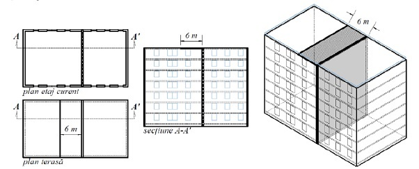
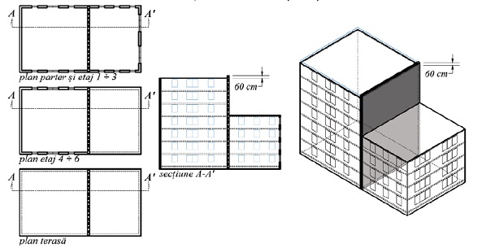
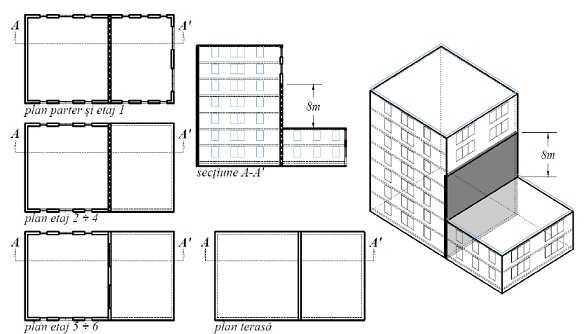
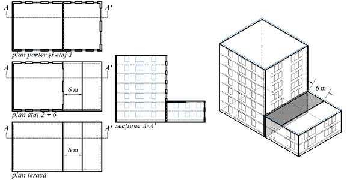
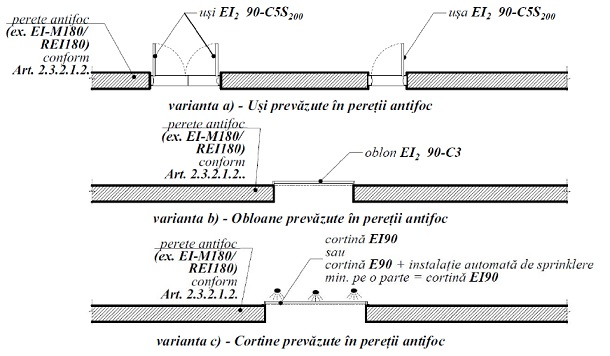
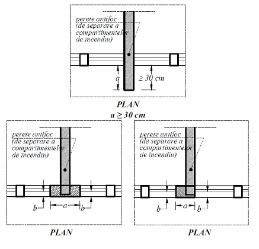
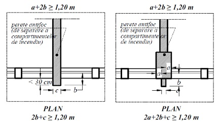
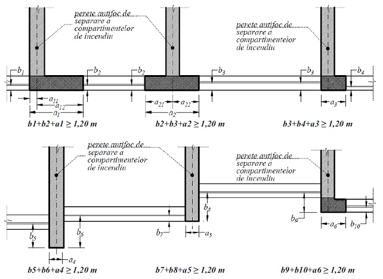

# Anexa nr. 2.1 – PEREȚI ANTIFOC ȘI PROTECȚIA GOLURILOR FUNCȚIONALE DIN PEREȚII ANTIFOC
PEREȚI ANTIFOC ȘI PROTECȚIA GOLURILOR FUNCȚIONALE DIN PEREȚII ANTIFOC
Pereți antifoc

varianta a) - clădiri cu aceeași înălțime

Varianta b1) - clădiri cu înălțime diferită cu perete antifoc ce secționează integral construcția (în condițiile în care înălțimea dintre construcții este mai mică de 8 m si acoperișurile care nu sunt realizate exclusiv din componente substanțiale cu clasa de reacție la foc A1 sau A2-s1,d0)

Varianta b2) - clădiri cu înălțime diferită cu perete antifoc ce secționează construcția pe înălțimea de 8 m

Varianta b3) - clădiri cu înălțime diferită cu perete antifoc si fâșie REI60 Varianta b) - clădiri cu înălțime diferită
Figura 87 - Pereți antifoc (de separare a compartimentelor de incendiu) -
principiu de compartimentare antifoc
(10) Pereții care separă compartimentele de incendiu trebuie să aibă rezistența la foc determinată în funcție de densitatea sarcinii termice conform Art. 2.3.2.1.2., clasa de reacție la foc A1 sau A2-s1,d0. Pereții care separă compartimente de incendiu, trebuie să secționeze construcția pe toată înălțimea acesteia.
Protecția golurilor funcționale prevăzute în pereții antifoc
(11) Ușile prevăzute pentru circulația funcțională sau pentru evacuare în pereții care separă compartimentele de incendiu din clădiri civile, trebuie să aibă rezistența la foc în conformitate cu Tabelul 123.
  Tabelul 123: Uși pentru circulație funcțională și/sau evacuare practicate în pereții antifoc din clădiri civile

| În cazul pereților antifoc care separă compartimentele de incendiu din construcții civile (conform Art. 2.3.2.1.2.) | Rezistența la foc a pereților antifoc care separă compartimentele de incendiu | Uși rezistente la foc (care NU constituie căi de evacuare către alt compartiment de incendiu) | Elemente rezistente la foc (prin uși care constituie căi de evacuare către alt compartiment de incendiu) | Elemente rezistente la foc (prin uși care constituie căi de evacuare către alt compartiment de incendiu) |
|---|---|---|---|---|
| În cazul pereților antifoc care separă compartimentele de incendiu din construcții civile (conform Art. 2.3.2.1.2.) | Rezistența la foc a pereților antifoc care separă compartimentele de incendiu | Uși rezistente la foc (care NU constituie căi de evacuare către alt compartiment de incendiu) | Rezistența la foc (EI/REI) minimă a pereților încăperii tampon (minute), cu excepția peretelui care separă compartimentele de incendiu | Uși rezistente la foc practicate în pereții antifoc (care constituie căi de evacuare către alt compartiment de incendiu) |
| a) pentru construcțiile cu regim de înălțime parter, cu excepția clădirilor destinate persoanelor care nu se pot evacua singure și a clădirilor cu săli aglomerate determinată în funcție de densitatea sarcinii termice, conform Tabelul 6 (Rezistențe la foc normate ale pereților care separă compartimentele de incendiu (EI-M/REI) pentru construcțiile cu regim de înălțime parter, cu excepția clădirilor cu persoane care nu se pot evacua singure și a clădirilor cu săli aglomerate, corespunzătoare densităților sarcinilor termice (q) din spațiile adiacente și/sau densităților sarcinilor termice (q) cele mai mari din spațiile pe care le despart) | EI-M 60/REI60 (q ≤ 420 MJ/mp) | EI_2 60-C5S_200 | EI 60/REI 60 | 2 uși x EI_2 60 - C5S_200 |
| a) pentru construcțiile cu regim de înălțime parter, cu excepția clădirilor destinate persoanelor care nu se pot evacua singure și a clădirilor cu săli aglomerate determinată în funcție de densitatea sarcinii termice, conform Tabelul 6 (Rezistențe la foc normate ale pereților care separă compartimentele de incendiu (EI-M/REI) pentru construcțiile cu regim de înălțime parter, cu excepția clădirilor cu persoane care nu se pot evacua singure și a clădirilor cu săli aglomerate, corespunzătoare densităților sarcinilor termice (q) din spațiile adiacente și/sau densităților sarcinilor termice (q) cele mai mari din spațiile pe care le despart) | EI-M 90/REI90 (420 MJ/mp <q ≤ 630 MJ/mp) | EI_2 60-C5S_200 | EI 60/REI 60 | 2 uși x EI_2 60 - C5S_200 |
| a) pentru construcțiile cu regim de înălțime parter, cu excepția clădirilor destinate persoanelor care nu se pot evacua singure și a clădirilor cu săli aglomerate determinată în funcție de densitatea sarcinii termice, conform Tabelul 6 (Rezistențe la foc normate ale pereților care separă compartimentele de incendiu (EI-M/REI) pentru construcțiile cu regim de înălțime parter, cu excepția clădirilor cu persoane care nu se pot evacua singure și a clădirilor cu săli aglomerate, corespunzătoare densităților sarcinilor termice (q) din spațiile adiacente și/sau densităților sarcinilor termice (q) cele mai mari din spațiile pe care le despart) | EI-M 120/REI 120 (630 MJ/mp <q ≤ 840 MJ/mp) | EI_2 60-C5S_200 | EI 60/REI 60 | 2 uși x EI_2 60- C5S_200 |
| a) pentru construcțiile cu regim de înălțime parter, cu excepția clădirilor destinate persoanelor care nu se pot evacua singure și a clădirilor cu săli aglomerate determinată în funcție de densitatea sarcinii termice, conform Tabelul 6 (Rezistențe la foc normate ale pereților care separă compartimentele de incendiu (EI-M/REI) pentru construcțiile cu regim de înălțime parter, cu excepția clădirilor cu persoane care nu se pot evacua singure și a clădirilor cu săli aglomerate, corespunzătoare densităților sarcinilor termice (q) din spațiile adiacente și/sau densităților sarcinilor termice (q) cele mai mari din spațiile pe care le despart) | EI-M 180/REI 180 (840 MJ/mp <q ≤ 1 680 MJ/mp) | EI_2 90-C5S_200 | EI 90/REI 90 | 2 uși x EI_2 90 - C5S_200 |
| a) pentru construcțiile cu regim de înălțime parter, cu excepția clădirilor destinate persoanelor care nu se pot evacua singure și a clădirilor cu săli aglomerate determinată în funcție de densitatea sarcinii termice, conform Tabelul 6 (Rezistențe la foc normate ale pereților care separă compartimentele de incendiu (EI-M/REI) pentru construcțiile cu regim de înălțime parter, cu excepția clădirilor cu persoane care nu se pot evacua singure și a clădirilor cu săli aglomerate, corespunzătoare densităților sarcinilor termice (q) din spațiile adiacente și/sau densităților sarcinilor termice (q) cele mai mari din spațiile pe care le despart) | EI-M 240/REI 240 (q > 1 680 MJ/mp și/sau există pericol de explozie volumetrică) | Obligatoriu încăpere tampon protejată prevăzută cu 2 uși x EI_2 120-C5S_200 | EI-M 120/REI 120 | Obligatoriu încăpere tampon protejată prevăzută cu 2 uși x EI_2 120 - C5S_200 |
| b)pentru clădirile destinate persoanelor care nu se pot evacua singure, pentru construcțiile cu risc mare de incendiu, precum și cele pentru obiecte, echipamente sau aparatură de importanță deosebită, pentru clădiri civile supraterane înalte și/sau foarte înalte sau clădiri cu săli aglomerate | EI-M 180/REI 180 | EI_2 90-C5S_200 | EI 90/REI 90 | 2 uși x EI_2 90 - C5S_200 |
| c) clădirile cu alt regim de înălțime, cu excepția clădirilor definite la literele (a) și (b) din tabel | EI-M 120/REI 120 | EI_2 60-C5S_200 | EI 60/REI 60 | 2 uși x EI_2 60 - C5S_200 |

(12) Ușile prevăzute pentru circulația funcțională sau pentru evacuare în pereții care separă compartimentele de incendiu din clădiri de producție și/sau depozitare, trebuie să aibă rezistența la foc conform Tabelul 124. In construcțiile de producție și/sau depozitare, pot fi considerate căi de evacuare a utilizatorilor si cele care trec prin pereții antifoc care separă compartimentele de incendiu:
  - a) către compartimente cu riscuri mici de incendiu, dacă servesc la evacuarea utilizatorilor spațiilor de producție si/sau depozitare învecinate;
  - b) către compartimente cu risc mijlociu mare sau foarte mare de incendiu, fără explozie volumetrică, dacă servesc la evacuarea utilizatorilor compartimentelor învecinate si nu constituie singura lor cale de evacuare, situație în care a doua cale de evacuare poate fi constituită tot printr-un spațiu cu risc mijlociu, mare sau foarte mare de incendiu dacă traseele sunt distincte și separate între ele prin pereți rezistenți la foc si golurile de circulație practicate în aceștia sunt protejate cu elemente de închidere rezistente la foc si etanșe la fum conform Tabelul 124;
  - c) încăperi sau spații cu risc foarte mare de incendiu si explozie volumetrică, dacă servesc la evacuarea utilizatorilor spațiilor de producție sau depozitare cu același risc de incendiu și nu constituie singura lor posibilitate de evacuare;
  Tabelul 124: Uși pentru circulație funcțională și/sau evacuare practicate în pereții antifoc din construcții de producție si/sau depozitare

| În cazul pereților antifoc care separă compartimentele de incendiu | Rezistența la foc a pereților antifoc care separă compartimentele de incendiu | Uși rezistente la foc practicate în pereții antifoc (care NU constituie căi de evacuare catre alt compartiment de incendiu) | Elemente rezistente la foc (prin uși care constituie căi de evacuare către alt compartiment de incendiu) | Elemente rezistente la foc (prin uși care constituie căi de evacuare către alt compartiment de incendiu) |
|---|---|---|---|---|
| În cazul pereților antifoc care separă compartimentele de incendiu | Rezistența la foc a pereților antifoc care separă compartimentele de incendiu | Uși rezistente la foc practicate în pereții antifoc (care NU constituie căi de evacuare catre alt compartiment de incendiu) | Rezistența la foc (EI/REI) minimă a pereților încăperii tampon (minute), cu excepția peretelui care separă compartimentele de incendiu | Uși rezistente la foc practicate în pereții antifoc (care constituie căi de evacuare către alt compartiment de incendiu) |
| 1 | 2 | 3 | 4 | 5 |
| Pentru construcțiile de producție și/sau depozitare | EI-M 60/REI 60 (q ≤ 420 MJ/mp) | EI_2 60-C5S_200 | EI 60/REI 60 | 2 uși x EI_2 60 - C5S_200 |
| Pentru construcțiile de producție și/sau depozitare | EI-M 90/REI 90 (420 MJ/mp < q ≤ 630 MJ/mp) | EI_2 60-C5S_200 | EI 60/REI 60 | 2 uși x EI_2 60 - C5S_200 |
| Pentru construcțiile de producție și/sau depozitare | EI-M 120/REI 120 (630 MJ/mp <q ≤ 840 MJ/mp) | EI_2 60-C5S_200 | EI 60/REI 60 | 2 uși x EI_2 60 - C5S_200 |
| Pentru construcțiile de producție și/sau depozitare | EI-M 180/REI 180 (840 MJ/mp < q ≤ 1.680 MJ/mp) | EI_2 90-C5S_200 | EI 90/REI 90 | 2 uși x EI_2 90 - C5S_200 |
| Pentru construcțiile de producție și/sau depozitare | EI-M 240/REI 240 (q > 1.680 MJ/mp și/sau există pericol de explozie volumetrică) | Nu se admite | EI-M 120/REI 120 | Obligatoriu încăpere tampon protejată prevăzută cu 2 uși x EI_2 120-C5S_200 |

(13) Ușile, obloanele si cortinele rezistente la foc care protejază golurile funcționale din pereții antifoc EI-M180/REI180 (exemplu), trebuie să fie rezistente la foc minimum 90 de minute, astfel:
  - a. Uși rezistente la foc (inclusiv dispozitivele lor de închidere) trebuie să fie rezistente la foc minimum EI_2 90-C5S_200.
  - b. Obloane rezistente la foc (inclusiv dispozitivele lor de închidere) trebuie să fie rezistente la foc minimum EI_2 90-C3.
  - c. Cortine rezistente la foc (prevăzute cu ansamblu de sprinklere dacă acestea îndeplinesc doar criteriul E90) trebuie să fie rezistente la foc minimum EI 90 (etanșeitate la foc și izolare termică 90 minute).
  Notă: * - se prevăd cu autoînchidere "C" = clasa de autoînchidere/închidere automată
(14) În toate cazurile pentru pereți antifoc dispuși la fațadele construcțiilor cu rezistența mai mică de 3 ore (conform Art. 2.3.2.1.2.), golurile prevăzute se protejează prin uși, obloane sau cortine rezistente la foc (pe o perioadă minimum jumătate din rezistența la foc a pereților antifoc, dar cel puțin 1 oră pentru pereții antifoc EI-M 60/REI 60 sau EI-M 90/REI 90 și cel puțin 90 min pentru ceilalți pereții antifoc prevăzuți la Art. 2.3.2.1.2., cu excepția pereților antifoc EI-M 240/REI240 la care se protejează prin uși, obloane sau cortine rezistente la foc min. 120 min).

  

  Figura 88 - Uși, obloane, cortine prevăzute în pereții antifoc

  

  

  Figura 89 - Exemplu - tipologii pereți de separare a compartimentelor de incendiu

  

  Figura 90 - Pereți de separare a compartimentelor de incendiu - secțiune orizontală
