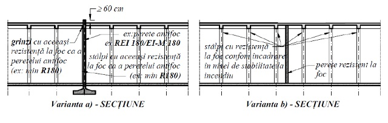
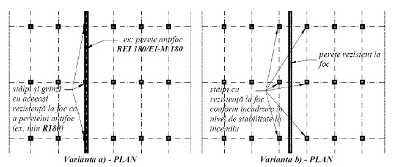
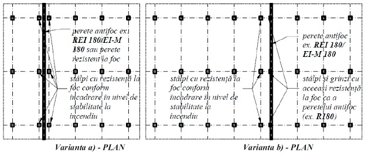
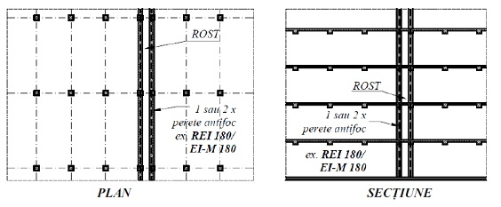
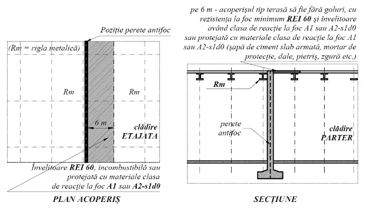
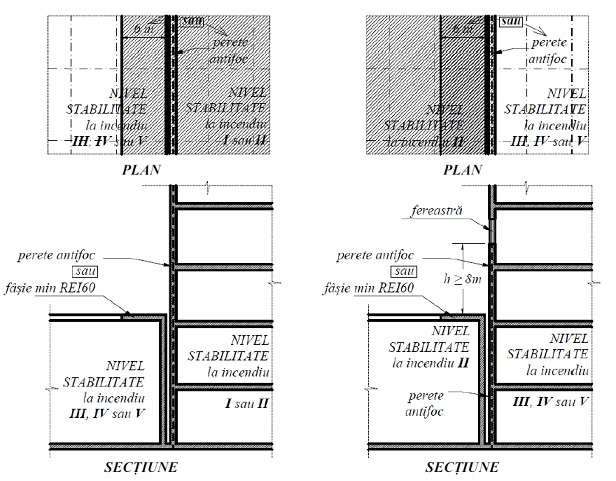
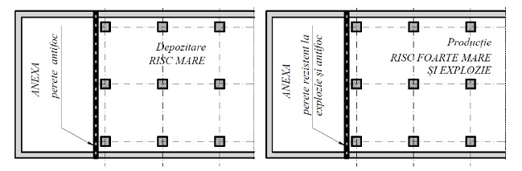

# Anexa nr. 2.2 – PEREȚI ANTIFOC SI PEREȚI REZISTENȚI LA FOC LA HALE
PEREȚI ANTIFOC SI PEREȚI REZISTENȚI LA FOC LA HALE

Figura 91 - Hale parter cu perete antifoc (de separare a compartimentelor
de incendiu) sau rezistent la foc dispus între stâlpi

Figura 92 - Hale parter cu perete independent dispus în rost de dilatare sau tasare

Figura 93 - Hale etajate

Figura 94 - Hale parter - Perete antifoc care nu depășește planul acoperișului

Figura 95 - Hale parter - Perete antifoc la hale cu înălțimi diferite

Figura 96 - Compartimentarea construcțiilor de producție sau depozitare
