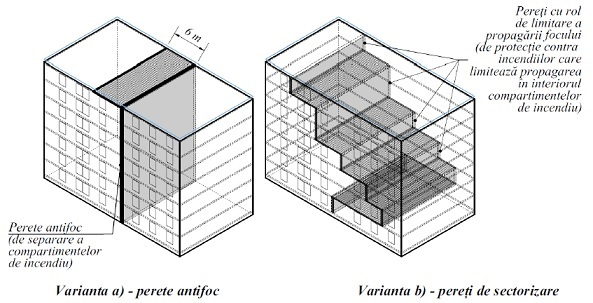
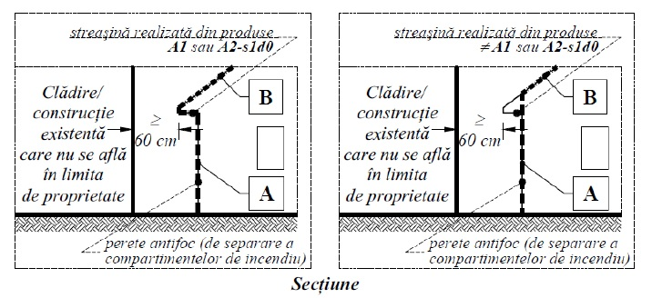
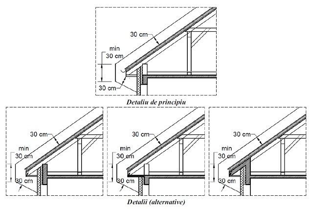

# Anexa nr. 2.3 – PEREȚI DE SECTORIZARE CU ROL DE LIMITARE A PROPAGĂRII
PEREȚI DE SECTORIZARE CU ROL DE LIMITARE A PROPAGĂRII
FOCULUI (DE PROTECȚIE CONTRA INCENDIILOR CARE LIMITEAZĂ
PROPAGAREA ÎN INTERIORUL COMPARTIMENTELOR DE INCENDIU)
(15) La clădiri civile se pot prevedea următorii pereți de sectorizare cu rol de limitare a propagării focului, având minimum următoarele niveluri de performanță:
  - – Nivel I (125m ≥ h) - REI/EI180 (A1 sau A2-s1,d0), uși Eh 90-C5S_200
  - – Nivel I (75m ≤ h < 125m) - REI/EI 180 (A1 sau A2-s1,d0), uși EI_2 90-C5S_200
  - – Nivel I (45m ≤ h < 75m) - REI/EI 120 (A1 sau A2-s1,d0), uși EI1 60-C5S_200
  - – Nivel I (28m ≤ h < 45m) - REI/EI 120 (A1 sau A2-s1,d0), uși EI_2 60-C5S_200
  - – Nivel I (h < 28m) - REI/EI 120 (A1 sau A2-s1,d0), uși EI_2 60-C5S_200
  - – Nivel II - REI/EI 90 (A1 sau A2-s1,d0), uși EI1 45-C5S_200
  - – Nivel II (+) - REI/EI 90 (A1 sau A2-s1,d0), uși EI_2 45-C5S_200
  - – Nivel III - REI/EI 60 (A1 sau A2-s1,d0), uși EI_2 30-C5S_200
  - – Nivel III (+) - REI/EI 45 (A1 sau A2-s1,d0), uși E 30-C5Sa
  - – Nivel IV - REI/EI 30 (min B-s1,d0), uși EI215-C5Sa
  - – Nivel V - REI/EI 15 (min C-s1,d0), uși C5
(16) La clădiri de producție/depozitare se pot prevedea următorii pereți cu rol de limitare a propagării focului, având minimum* următoarele niveluri de performanță:
  - – Nivel I - REI/EI 120 (A1 sau A2-s1,d0), uși EI_2 60-C5S_200
  - – Nivel II - REI/EI 120 (A1 sau A2-s1,d0), uși EI1 60-C5S_200
  - – Nivel II (+) - REI/EI 90 (A1 sau A2-s1,d0), uși EI_2 45-C5S_200
  - – Nivel III - REI/EI 60, uși E 30-C5Sa
  - – Nivel IV - REI/EI 30, uși E 15-C5Sa
  - – Nivel V - uși C3
(17) Pereții despărțitori de protecție contra incendiilor care limitează propagarea în interiorul compartimentelor de incendiu sunt folosiți pentru:
  - – divizarea* zonelor extinse (de exemplu a clădirilor civile cu lungime mare;
  - – separarea minimă* a zonelor administrative față de spații de producție si depozitare (în funcție de densitatea sarcinii termice din spațiile adiacente) atunci când zonele administrative nu se constituie ca si compartimente distincte de incendiu;
  - – izolarea minimă* a instalațiilor de producție, a utilajelor, folosite în procesul de producție acolo când acestea sunt necesare (în funcție de densitatea sarcinii termice din spațiile adiacente);
  - – separarea minimă constructivă* între anumite zone de utilizare diferită (în funcție de densitatea sarcinii termice din spațiile adiacente), atunci când zonele respective nu se constituie ca si compartimente distincte de incendiu;
  - – separarea minimă constructivă* între zonele protejate de sisteme de stingere automată a incendiilor si zonele neprotejate (în funcție de densitatea sarcinii termice din spațiile adiacente),
  - – separarea minimă constructivă* a spațiilor de tip open-space atunci când ariile acestora depășesc valoarea admisă de 400 mp si spațiile alăturate nu generează performanțe mai restrictive (în funcție de densitatea sarcinii termice din spațiile adiacente)
  Notă generală: * - cu valabilitate doar atunci când spațiile alăturate nu generează performanțe mai restrictive (nu rezultă cerințe mai mari corespunzătoare densităților sarcinilor termice (q) din spațiile adiacente și/sau densităților sarcinilor termice (q) cele mai mari din spațiile pe care le despart) și/sau atunci când separarea nu este constituită ca și compartiment distinct de incendiu.
(18) Pereții de sectorizare (Figura 97, varianta b)) cu rol de limitare a propagării focului (de protecție contra incendiilor care limitează propagarea în interiorul compartimentelor de incendiu) NU trebuie să secționeze construcția pe toată înălțimea acesteia.

  

  Figura 97 - Pereți antifoc si pereți de sectorizare
(19) Mansardarea construcțiilor civile supraterane se asigură prin realizarea de tronsoane ale clădirii conform Art. 3.1.2.9. alin. (1). Mansardarea construcțiilor civile supraterane (realizarea unui nivel funcțional în volumul podului), este admisă dacă pereții de sectorizare rezistenți la foc depășesc cu minimum 30 cm, conform Art. 3.1.2.9. alin. (2) și a figurilor următoare:

  

  Notă secțiune: Indicativul "A" reprezintă perete antifoc conform Art. 2.3.2.1.2. (sau conform A.10. 2.3.4. (1) pentru clădiri existente) și indicativul "B" reprezintă fâșia min REI 60 prevăzută la Art. 2.3.2.1.4. (sau conform A.10. 2.3.14. pentru clădiri existente).

  

  Figura 98 - Perete de sectorizare care depășește streașina
