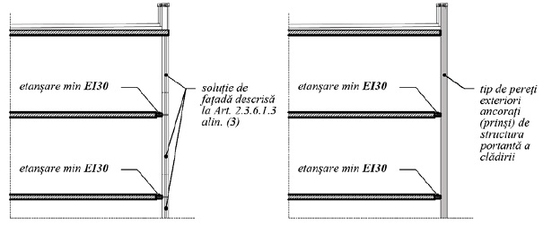

# Anexa nr. 3.1 – PREVEDERI GENERALE
PREVEDERI GENERALE
(24) Este obligatoriu ca închiderile perimetrale de orice fel ale construcțiilor să se alcătuiască și să se realizeze astfel încât să întârzie propagarea incendiilor de la un nivel la altul, atât prin exteriorul închiderii perimetrale (pe fațadă), cât și prin interiorul construcției (Figura 99), conform prevederi normate.
(25) Pentru întârzierea propagării incendiilor prin interiorul construcției spațiile libere dintre planșee și peretele cortină precum și dintre planșee și alte tipuri de pereți exteriori ancorați (prinși) de structura portantă a clădirii (de exemplu: tip de fațadă din panouri sandwich) se etanșează cu sisteme de etanșare având aceeași rezistență la foc cu a planșeului, astfel:
  - – la clădiri cu înălțime obișnuită:
    - i. rezistența la foc minimum EI 30;
  - – la clădiri înalte:
    - i. rezistența la foc minimum EI 60;
  - – la clădiri foarte înalte cu înălțimea mai mică de 125 m:
    - i. rezistența la foc minimum EI 90;
  - – la clădiri foarte înalte cu înălțimea mai mare sau egală cu 125 m:
    - i. rezistența la foc minimum EI 120.

  

  Figura 99 - Performanțe privind etanșarea spațiilor libere dintre planșee
  și peretele cortină precum si dintre planșee si alte tipuri de pereți
  exteriori ancorați (prinși) de structura portantă a clădirii
