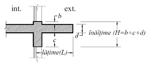
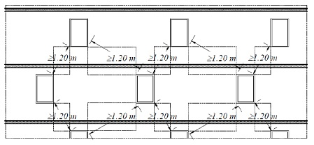
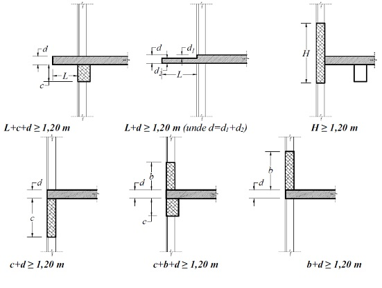
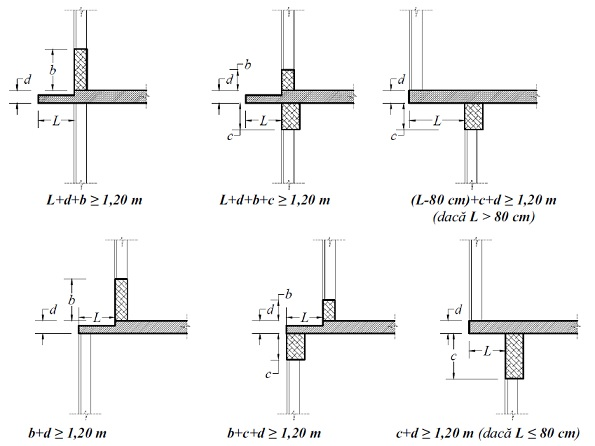
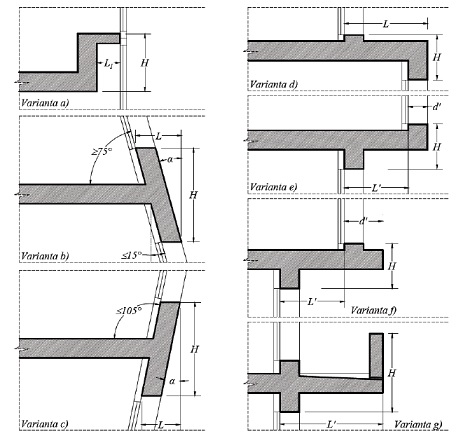
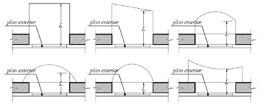
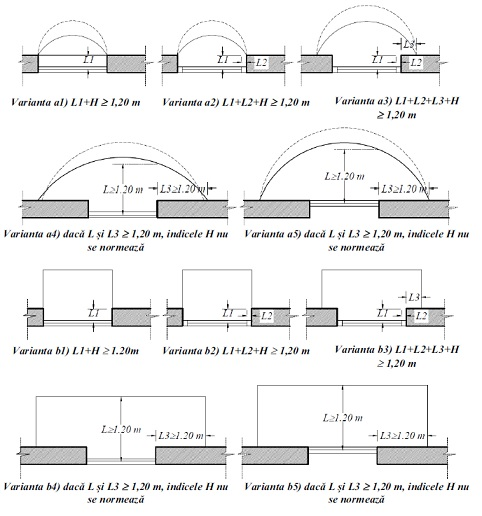
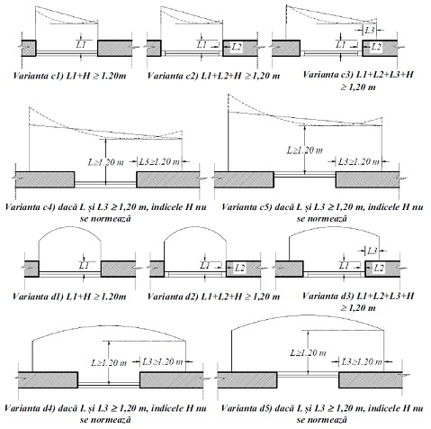
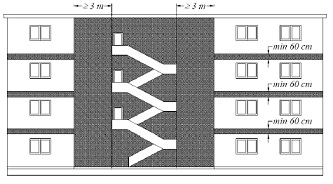
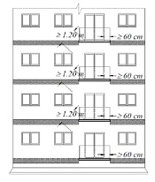

# Anexa nr. 3.2 – REGULA H + L
REGULA H + L
(26) În cazurile în care în normativ se precizează explicit, se pot însuma elementele verticale cu elementele orizontale având aceeași rezistentă la foc (aceeași perioadă de timp) conform Figura 100.

  

  Figura 100 - Exemplu de măsurători H si L - caz general
Definirea indicilor H și L (definire)
(27) Indicele "H" în general reprezintă distanța verticală care trebuie să fie egală fie cu 1,20 m, fie cu valoarea indicelui caracteristic determinat prin însumarea înălțimilor (b+c+d). Atunci când deschiderile/ferestrele din fațadă nu sunt suprapuse, indicele H se măsoară în funcție de cea mai mică distanță dintre aceste goluri/ferestre.
(28) Indicele "L " reprezintă distanța orizontală între planul exterior al elementelor de delimitare și fața exterioară a elementelor de fațadă, măsurată direct deasupra deschiderilor suprapuse, inclusiv copertinele, dacă acestea formează un obstacol rezistent la foc. Măsurarea trebuie făcută pe cea mai mare lățime a golurilor suprapuse din fațade. Această valoare trebuie luată în considerare numai atunci când este mai mare sau egală cu 15 cm.
(29) Exemple de măsurători H și L și reguli de aplicare pentru cazuri mai complexe sunt date mai jos în anexă.

  

  Figura 101 - Exemplu măsurare între goluri care nu sunt suprapuse
  la deschideri în fațadă (exemplu pentru distanța normată de 1,20 m)
  Notă Figura 101: Pentru întârzierea propagării incendiilor între nivelurile construcțiilor prin exteriorul închiderii perimetrale (pe fațadă), măsurarea pe verticală în sens diagonal, în direcția cea mai scurtă se aplică exclusiv construcțiilor prevăzute la Art. 2.3.6.1.5. și Art. 2.3.6.1.6.
Soluții constructive cu H + L

Figura 102 - Calcul soluții constructive cu H + L (exemplu varianta normată de 1,20 m)
Notă Figura 102: toate desenele exemplificative au partea de interior a construcției prevăzută spre dreapta.
Exemple de măsurători H si L - general
(30) Se pot lua în considerare următoarele:
  Decros de supralumină la o fațadă complet vitrată (Figura 103 varianta a)):
  Pentru a putea lua în considerare înălțimea unei supralumini în calculul lui H, retragerea L1 nu trebuie să depășească 40 cm, măsurată în raport cu suprafața geamurilor interioare.
  Fațadă plană înclinată sau curbată înclinată pe mai multe niveluri (parte opacă si parte vitrată) (varianta b) si (varianta c):
  Fațada înclinată spre interior (Figura 103 varianta b)):
  Oricare ar fi valoarea unghiului a, se aplică regula generală H+L (dacă L ≥ 15 cm). Fațada înclinată spre exterior (Figura 103 varianta c)):
  Dacă α ≤ 15°: se aplică regulile fațadei, măsurând H în funcție de verticală si L este egal cu 0;
  Dacă α > 15°: fațada nivelului inferior de sub nivelul înclinat trebuie să fie A1 sau A2-s1,d0, EI i→o de aceeași încadrare cu nivelul necesar pentru stabilitatea la incendiu a structurii planșeelor clădirii.
  Etaj superior retras (Figura 103 varianta d)):
  L este luat în considerare numai dacă valoarea sa este mai mare sau egală cu 15 cm (L ≥ 15 cm).
  Etaj superior în consolă (Figura 103 varianta e) si Figura 103 varianta f)):
  Valoarea proiecției L' trebuie luată în considerare în calculul L, numai dacă este mai mare de 80 cm, iar valoarea retragerii d' este luată în considerare în calculul lui L numai dacă este mai mare de 15 cm:
  L' ≤ 80 cm si d' < 15 cm =>L=0
  L' ≤ 80 cm si d' ≥ 15 cm =>L=d'
  L' > 80 cm si d' < 15 cm =>L=L'-80 cm
  L' > 80 cm si d' ≥ 15 cm =>L=(L'-80 cm)+d

  

  Figura 103 - Exemple de măsurători H și L - cazuri particulare
  Notă Figura 103: toate desenele exemplificative au partea de interior a construcției prevăzută spre stânga.
Ferestre și uși de balcoane/terasă
(31) Părțile care se deschid (uși, ferestre, sau echivalent) si nu au aceeași clasificare de rezistență/ etanșeitate la foc ca pentru zonele continui care se pot însuma pentru soluția constructivă H + L (în general de 1,20 m ale elementelor de copertină/terasă), nu sunt luate în considerare la măsurarea indicelui H.
(32) Balcoanele sau consolele, amplasate în fața unei deschideri si care îndeplinesc cerințele de rezistență (R) si reacție la foc conform prevederilor normativului sunt luate în considerare la măsurarea indicelui L.
(33) "L " reprezintă cea mai scurtă distanță a balconului/consolei, măsurată perpendicular pe fațadă.
Tipuri de balcoane

Figura 104 - Tipuri de balcoane

Figura 105 - Exemple de măsurători H + L - balcoane
Notă Figura 105: toate desenele exemplificative au partea de interior a construcției prevăzută în jos.
Exemple de limitare a propagării incendiului pe fațadă

Figura 106 - Soluție la scări exterioare de limitare a propagării incendiului pe fațadă

Figura 107 - Soluție de limitare a propagării incendiului pe fațadă la intersecția cu balcoane
