# Anexa nr. 3.3 – FÂȘII (BENZI) PENTRU SISTEME COMPOZITE DE IZOLARE TERMICĂ -
FÂȘII (BENZI) PENTRU SISTEME COMPOZITE DE IZOLARE TERMICĂ -
PRINCIPII DE REALIZARE BORDĂRI ȘI FÂȘII (BENZI) PENTRU
TERMOIZOLANȚIE ȘI/SAU SISTEME COMPOZITE DE IZOLARE TERMICĂ
EXTERIOARĂ A PEREȚILOR PERIMETRALI, DIFERITE DE A1 sau A2-s1,d0
(34) La toate construcțiile, termoizolația exterioară si/sau sistemele compozite de izolare termică exterioară (sisteme compacte în condiții de utilizare finală) a pereților perimetrali trebuie să fie clasa de reacție la foc conform prevederilor din Art. 2.3.6.1.8. si Tabelul 16 (Termoizolație exterioară si/sau sisteme compozite de izolare termică (sisteme compacte în condiții de utilizare finală)pe fațade pline sau prevăzute cu elemente vitrate sau alte goluri neprotejate (pentru diferite funcțiuni/tipuri de clădiri)).
(35) În toate cazurile se vor avea în vedere prevederile menționate în Art. 2.3.6.1.9.
(36) Pentru termoizolație si/sau sisteme compozite de izolare termică exterioară a pereților perimetrali diferite de A1 sau A2-s1,d0, se folosesc următoarele principii (conform Figura 108):
  - – lipirea completă a fâșiei/benzii (clasa de reacție la foc A1 sau A2-s1,d0) pe suport,
  - – șurub sau cui metalic,
  - – lipirea sau încastrarea termoizolației pe suport,
  - – sistem de tencuială subțire sau groasă.
  - – t < 200 mm - 1 fâșie
  - – t ≥ 200 mm - 2 fâșii (recomandare)

  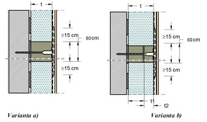

| Varianta a) - Principiul de realizare a fâșiei orizontale continui de termoizolație clasa de reacție la foc A1 sau A2-s1,d0 (grosime termoizolatie exterioară a pereților perimetrali diferită de A1 sau A2-s1,d0 < 200 mm) Cu condiția ca t < 200 mm | Varianta b) - Principiul de realizare a fâșiilor (2) orizontale continui de termoizolație clasa de reacție la foc A1 sau A2-s1,d0 - suprapunerea a două benzi continue (grosime termoizolatie exterioară a pereților perimetrali diferită de A1 sau A2-s1,d0 ≥ 200 mm) Cu următoalele condiții: t > 200 mm, t1 > t2 și t2 ≥ 100 mm |
|---|---|

  Figura 108 - Principiul general de realizare a fâșiei/benzii orizontale continui
  de termoizolație, clasa de reacție la foc A1 sau A2-s1,d
(37) Pe fațadele pereților perimetrali ale construcțiilor prevăzute cu termoizolație si/sau sisteme compozite de izolare termică exterioară a pereților perimetrali diferite de A1 sau A2-s1,d0, cuprinzând goluri (uși si/sau ferestre) în zidărie, realizarea fâșiilor/benzilor orizontale continui de termoizolație clasa de reacție la foc A1 sau A2-s1,d0 se realizează conform Figura 109.

  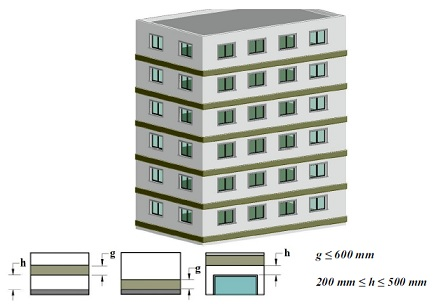

  Figura 109 - Principiul de realizare a fâșiilor/benzilor orizontale continui de
  termoizolație clasa de reacție la foc A1 sau A2-s1,d0 pe fațadele
  cuprinzând goluri (uși si/sau ferestre) în zidărie
(38) Pe fațadele pereților perimetrali ale construcțiilor prevăzute cu termoizolație și/sau sisteme compozite de izolare termică exterioară a pereților perimetrali diferite de A1 sau A2-s1,d0, fără goluri în zidărie, în cazul unui sistem de tencuială groasă, realizarea fâșiilor/benzilor orizontale continui de termoizolație clasa de reacție la foc A1 sau A2-s1,d0 se realizează conform Figura 110. Se aplică o singură fâșie la începutul inferior al termoizolației combustibile (nivelul de jos al fâșiei/ benzii, la o distanță maximă de 600 mm deasupra cotei de început a termoizolației).

  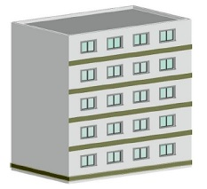

  Figura 110 - Principiul de realizare a fâșiilor/benzilor orizontale continui
  de termoizolație clasa de reacție la foc A1 sau A2-s1,d0
  pe fațadele fără goluri în zidărie: cazul unui sistem de tencuială groasă
(39) Pe fațadele pereților perimetrali ale construcțiilor prevăzute cu termoizolație si/sau sisteme compozite de izolare termică exterioară a pereților perimetrali diferite de A1 sau A2-s1,d0, fără goluri în zidărie, în cazul unui sistem de tencuială subțire, realizarea fâșiilor/benzilor orizontale continui de termoizolație clasa de reacție la foc A1 sau A2-s1,d0 se realizează conform Figura 111. Pentru sistemele de tencuială subțire, fâșiile/benzile trebuie instalate după cum urmează:
  - – la startul inferior al termoizolației combustibile (nivelul de jos al fâșiei/ benzii, se aplică la o distanță maximă de 600 mm deasupra cotei de început a termoizolației/sistemelor compozite de izolare termică);
  - – la nivelul 1 (între parter si etajul 1 acoperit cu termoizolație sau sisteme compozite de izolare termică combustibilă) si la nivelul 2 (între etajele 1 si 2 acoperite cu termoizolație sau sisteme compozite de izolare termică combustibilă).

  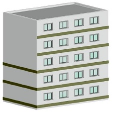

  Figura 111 - Principiul de realizare a fâșiilor/benzilor orizontale continui
  de termoizolație clasa de reacție la foc A1 sau A2-s1,d0
  pe fațadele fără goluri în zidărie: cazul unui sistem de tencuială subțire
  Notă Art. (39): Pe fațadele pereților perimetrali ale construcțiilor prevăzute cu termoizolație si/sau sisteme compozite de izolare termică exterioară a pereților perimetrali diferite de A1 sau A2-s1,d0, protecția deschiderilor prin bordări de termoizolație clasa de reacție la foc A1 sau A2-s1,d0 (pentru tâmplărie montată pe perete), se realizează după cum urmează, conform Figura 112 varianta a) H ≥ 1,20 m - protecția deschiderilor prin bordări de termoizolație clasa de reacție la foc A1 sau A2-s1,d0 (tâmplărie montată pe perete) pentru H ≥ 1,20 m:
  - – se aplică numai pe fațadele cu tâmplărie montată pe perete, indexul H (din H + L) fiind H ≥ 1.20 m;
  - – benzile de protecție ce bordează golurile pot fi aplicate continuu între goluri și în lateralul acestora; aceste benzi au aceeași grosime ca termoizolația și/sau sistemele compozite de izolație termică diferită de clasa de reacție la foc A1 sau A2-s1,d0; de exemplu, caracteristicile termoizolației utilizate pentru realizarea acestor benzi de bordare pot fi: vată minerală bazaltică conform standardului SR EN13162, Euroclasa A1 (banda de vată minerală bazaltică va fi lipită în întregime pe pereții perimetrali).
  - – conform Figura 112 varianta c), H < 1.20 m - protecția deschiderilor prin bordări de termoizolație clasa de reacție la foc A1 sau A2-s1,d0 (tâmplărie montată pe perete) pentru H < 1.20 m;
  - – se aplică numai pe fațadele cu tâmplărie montată pe perete, indexul de înălțime H (din H + L) fiind H < 1,20 m.

  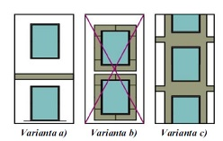

  Figura 112 - Protecția deschiderilor prin bordări de termoizolație clasa de
  reacție la foc A1 sau A2-s1,d0 (tâmplărie montată pe perete)
(40) Pe fațadele pereților perimetrali ale construcțiilor prevăzute cu termoizolație și/sau sisteme compozite de izolare termică exterioară a pereților perimetrali diferite de A1 sau A2-s1,d0, pe aceeași fațadă, în condițiile în care indexul H (din H + L) este H < 1,20 m, realizarea fâșiilor/ benzilor orizontale continui de termoizolație clasa de reacție la foc A1 sau A2-s1,d0, se realizează conform Figura 113 Varianta a) (partea din stânga a imaginii). Pe fațadele pereților perimetrali ale construcțiilor prevăzute cu termoizolație și/sau sisteme compozite de izolare termică exterioară a pereților perimetrali diferite de A1 sau A2-s1,d0, pe aceeași fațadă, în condițiile în care indexul H (din H + L) este H < 1,20 m, realizarea fâșiilor/benzilor orizontale continui de termoizolație clasa de reacție la foc A1 sau A2-s1,d0 la colțuri se realizează conform Figura 113 Varianta b) (partea din dreapta a imaginii).

  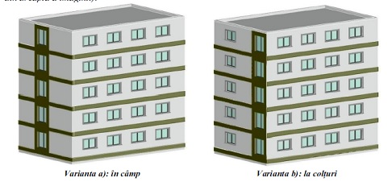

  Figura 113 - Principiul de realizare a fâșiilor/benzilor orizontale continui
  de termoizolație clasa de reacție la foc A1 sau A2-s1,d0 pe aceeași
  fațadă, indexul H (din H + L) fiind H < 1,20 m
(41) Pe fațadele pereților perimetrali ale construcțiilor prevăzute cu termoizolație și/sau sisteme compozite de izolare termică exterioară a pereților perimetrali diferite de A1 sau A2-s1,d0, cuprinzând încastrări/retrageri, în cazul unui sistem de tencuială subțire, realizarea fâșiilor/benzilor orizontale continui de termoizolație clasa de reacție la foc A1 sau A2-s1,d0 se realizează conform Figura 114. Principiul este pentru fațadele fără goluri în zidărie, cu excepția celei retrase (la fațada încastrată/cu retrageri indexul H (din H + L) fiind h < 1,20 m). Atunci când soluția anterioară este aplicată pe o fațadă încastrată/retrasă, porțiunea dintre ferestre și cele două fațade adiacente trebuie, de asemenea, să aibă aplicată continuu, între goluri și în lateralul acestora, termoizolație clasa de reacție la foc A1 sau A2-s1,d0, indiferent dacă sunt fără sau cu deschideri.

  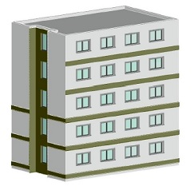

  Figura 114 - Principiul de realizare a fâșiilor/benzilor orizontale continui
  de termoizolație clasa de reacție la foc A1 sau A2-s1,d0
  pe fațadă retrasă, indexul H (din H + L) fiind H < 1,20 m
(42) Principiul realizării supra-termoizolației în sisteme compozite de izolare termică exterioară a pereților perimetrali, prevăzute cu termoizolație a pereților exteriori perimetrali diferite de A1 sau A2-s1,d0 existente, implică (conform Figura 115):
  - – lipirea completă a benzii pe suport,
  - – șurub sau cui metalic,
  - – calibrarea pe termoizolația diferită de A1 sau A2-s1,d0 existentă (sistem de tencuială subțire sau groasă),

  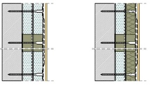

  Figura 115 - Principiul realizării supra-termoizolației
(43) În cazul în care balconul/consola integrat(ă) este integrat în structura construcției și participă la indicele H + L (de exemplu, atunci când respectă principiile prevăzute la Art. 2.3.6.1.2.), dispunerea fâșiilor/benzilor continue trebuie să respecte principiile ilustrate în Figura 116 Varianta a), principiu de realizare a fâșiilor/benzilor orizontale continui de termoizolație clasa de reacție la foc A1 sau A2-s1,d0 pe înălțimea "H" a balcoanelor și consolelor care sunt parte integrantă din structură.
(44) În cazul în care balconul este detașat de structura principală a construcției, dispunerea fâșiilor/ benzilor continue trebuie să respecte principiile ilustrate în Figura 116 Varianta b), principiu de realizare a fâșiilor/benzilor orizontale continui de termoizolație clasa de reacție la foc A1 sau A2- s1,d0 pe înălțimea "H" a balcoanelor si consolelor care nu sunt parte integrantă din structură). Balconul separat de structura nu participă la însumarea indicelor H+L.

  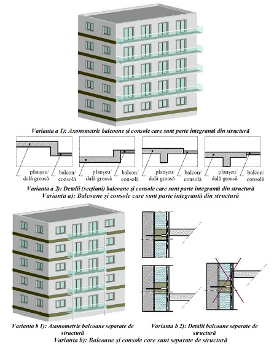

  Figura 116 - Balcoane si console care sunt parte integrantă din structură
(45) Pe porțiunile retrase de acces care întrerup banda de suprapunere din partea de jos a termoizolației si/sau a sistemelor compozite de izolare termică diferite de A1 sau A2-s1,d0 (în funcție de adâncimea acestora) ale fațadelor pereților perimetrali ale construcțiilor prevăzute cu termoizolație si/sau sisteme compozite de izolare termică exterioară a pereților perimetrali diferite de A1 sau A2-s1,d0, cuprinzând goluri (uși si/sau ferestre) în zidărie, se realizează prin interpunerea de termoizolație clasa de reacție la foc Al sau A2-sl,d0, conform Figura 117.

  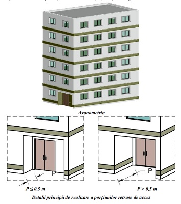

  Figura 117 - Principii de realizare a porțiunilor retrase de acces, în funcție de adâncimea acestora
(46) Pe fațadele pereților perimetrali ale construcțiilor prevăzute cu termoizolație si/sau sisteme compozite de izolare termică exterioară a pereților perimetrali diferite de A1 sau A2-s1,d0, cuprinzând deschideri mari (atunci când înălțimea deschiderii depășește înălțimea planșeului dintre două etaje), se realizează prin interpunerea fâșiilor/benzilor orizontale continui de termoizolație clasa de reacție la foc A1 sau A2-s1,d0, conform Figura 118.

  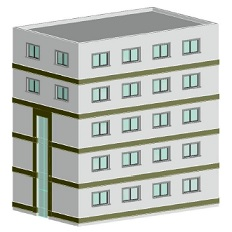

  Figura 118 - Principii de realizare în cazul deschiderilor mari
(47) Pe fațadele pereților perimetrali ale construcțiilor prevăzute cu termoizolație si/sau sisteme compozite de izolare termică exterioară a pereților perimetrali diferite de A1 sau A2-s1,d0, cuprinzând etaje inferioare retrase, se realizează prin interpunerea fâșiilor/benzilor orizontale continui de termoizolație clasa de reacție la foc Al sau A2-sl,d0, conform Figura 119.

  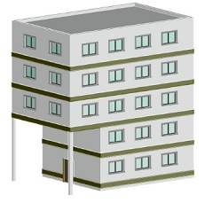

  Figura 119 - Principii de realizare pe fațade cu etaje inferioare retrase
(48) Pe fațadele pereților perimetrali ale construcțiilor prevăzute cu termoizolație si/sau sisteme compozite de izolare termică exterioară a pereților perimetrali diferite de A1 sau A2-s1,d0, cuprinzând fațade cu logii (indiferent de adâncimea acestora), se realizează prin interpunerea fâșiilor/benzilor orizontale continui de termoizolație clasa de reacție la foc A1 sau A2-s1,d0, conform Figura 120.

  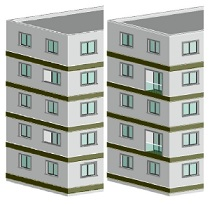

  Figura 120 - Principii de realizare pe fațade cu logii
(49) Pe fațadele pereților perimetrali ale construcțiilor prevăzute cu termoizolație și/sau sisteme compozite de izolare termică exterioară a pereților perimetrali diferite de A1 sau A2-s1,d0, cuprinzând fațade cu deschideri diferite (fațade cu deschideri cu înălțime mai mică sau mai mare decât celelalte cu L > 500 mm și 200 mm <h <500 mm), se realizează prin interpunerea fâșiilor/ benzilor orizontale continui de termoizolație clasa de reacție la foc A1 sau A2-s1,d0, conform Figura 121.

  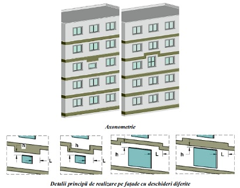

  Figura 121 - Principii de realizare pe fațade cu deschideri diferite
(50) Pe fațadele pereților perimetrali ale construcțiilor prevăzute cu termoizolație si/sau sisteme compozite de izolare termică exterioară a pereților perimetrali diferite de A1 sau A2-s1,d0, pe fațade decroșate cu înălțimi diferite, se realizează prin interpunerea fâșiilor/benzilor orizontale continui de termoizolație clasa de reacție la foc A1 sau A2-s1,d0, conform Figura 122. In cazul existenței decroșurilor între etaje, se aplică principiile de realizare pe fațade cu deschideri diferite, anterioare.

  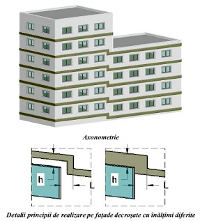

  Figura 122 - Principii de realizare pe fațade decroșate cu înălțimi diferite
(51) Pe fațadele pereților perimetrali ale construcțiilor prevăzute cu termoizolație si/sau sisteme compozite de izolare termică exterioară a pereților perimetrali diferite de A1 sau A2-s1,d0, pe teren în pantă, se realizează prin interpunerea fâșiilor/benzilor orizontale continui de termoizolație clasa de reacție la foc A1 sau A2-s1,d0, conform Figura 123.

  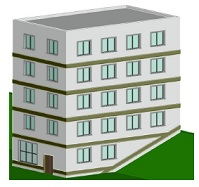

  Figura 123 - Principii de realizare a fâșiilor/benzilor orizontale continui
  de termoizolație clasa de reacție la foc A1 sau A2-s1,d0 pe teren în pantă
