# Anexa nr. 4.1 – ASCENSOARE
ASCENSOARE
Ascensoare - Generalități
(52) Ascensoarele pentru circulația funcțională a persoanelor și în general ale sistemelor de transport pe verticală, se separă de restul construcției prin elemente verticale și după caz, orizontale, clasa de reacție la foc A1 sau A2-s1,d0 și rezistente la foc corespunzător nivelului de stabilitate la incendiu asigurat, tipului de clădire și destinației, conform Art. 2.4.4.2.1. alin. (1). În acestea sunt admise numai goluri de acces (de palier), din nivelurile construcției. Golurile de acces la ascensoarele prevăzute pentru circulația funcțională a persoanelor (valide sau cu dizabilități) se protejează cu uși rezistente la foc conform Art. 2.4.4.2.5. alin. (1) și Art. 2.4.4.2.1. alin. (2), alin. (3), alin. (4) și alin. (5). În toate situațiile se vor avea în vedere prevederile stipulate la Art. 2.4.4.2.5. alin. (2) și alin. (3).
(53) În clădiri civile cu înălțime obișnuită pereții de separare față de restul construcției a ascensoarelor de marfă trebuie să fie conform Art. 2.4.4.2.4. alin. (1). Golurile de acces la ascensoarele mici de materiale (tip monte-charge), electrice sau hidraulice, se protejează cu uși rezistente la foc conform Art. 2.4.4.2.1. alin. (3). Golurile de palier prin care utilizatorii au acces la ascensoare de marfă din construcțiile civile cu înălțime obișnuită, se protejează cu uși conform Art. 3.1.4.3. alin. (2).
(54) Într-un singur puț sunt admise maximum trei cabine de ascensor sau mijloace mecanice de transport pe verticală (cabine prevăzute pentru circulația funcțională a persoanelor, de marfă, monte-charge sau platforme elevatoare etc.), conform Figura 124.

  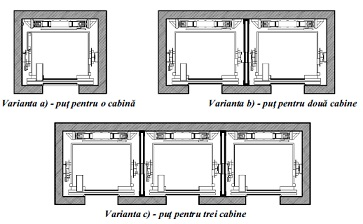

  Figura 124 - Cabine de ascensor
Ascensoare pentru evacuarea persoanelor cu dizabilități si ascensoare pentru intervenție
Ascensoare prevăzute pentru transportul persoanelor cu căruciorul sau a persoanelor cu dizabilități care pot fi utilizate și pentru evacuarea asistată a acestora în caz de incendiu
(55) Ascensoarele pentru transportul persoanelor cu căruciorul sau a persoanelor cu dizabilități care pot fi utilizate și pentru evacuarea asistată a acestora în caz de incendiu, se prevăd obligatoriu la clădiri cu persoane care nu se pot evacua singure (definite conform terminologie).
(56) Ascensoarele pentru transportul persoanelor cu căruciorul sau a persoanelor cu dizabilități care pot fi utilizate și pentru evacuarea asistată a acestora în caz de incendiu, se pot prevedea suplimentar conform Art. 2.4.4.3.3.
(57) Ascensoarele prevăzute pentru transportul persoanelor cu căruciorul sau a persoanelor cu dizabilități care pot fi utilizate și pentru evacuarea asistată a acestora în caz de incendiu, se dispun în puț propriu, separat de restul construcției prin pereți rezistenți la foc și planșee rezistente la foc conform:
  - – Art. 3.1.4.4. alin. (2) pentru clădiri cu înălțime obișnuită;
  - – Art. 4.1.4.13. alin. (1) lit. a) pentru clădiri înalte;
  - – Art. 4.2.4.13. alin. (1) lit. a) pentru clădiri foarte înalte.
(58) Ascensoarele prevăzute pentru transportul persoanelor cu căruciorul sau a persoanelor cu dizabilități care pot fi utilizate și pentru evacuarea asistată a acestora în caz de incendiu, trebuie să respecte simultan prevederile:
  - – Art. 3.1.4.4. alin. (3), lit. (c), (d), (e), (f) și (g) pentru clădiri cu înălțime obișnuită;
  - – Art. 4.1.4.13. alin. (1) lit. b) și Art. 3.1.4.4. alin. (3), lit. (c), (d), (e), (f) și (g) pentru clădiri înalte;
  - – Art. 4.2.4.13. alin. (1) lit. b) și Art. 3.1.4.4. alin. (3), lit. (c), (d), (e), (f) și (g) pentru clădiri foarte înalte.
(59) Accesul la ascensoarele prevăzute pentru transportul persoanelor cu căruciorul sau a persoanelor cu dizabilități care pot fi utilizate și pentru evacuarea asistată a acestora în caz de incendiu, trebuie să respecte prevederile:
  - – Art. 3.1.4.5. alin. (1) + alin. (4) pentru clădiri cu înălțime obișnuită;
  - – Art. 4.1.4.13. alin. (2) + alin. (7) pentru clădiri înalte;
  - – Art. 4.2.4.13. alin. (2) + alin. (7) pentru clădiri foarte înalte.

  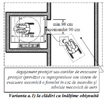

  În suprateran:
  C - uși EI60
  Notă: atunci când debușează în spatii ferite de fum.
  Notă: toate ușile spațiilor în care debușează sunt rezistente la foc min EI_2 30-C5S_200 și pereții min EI 60.

  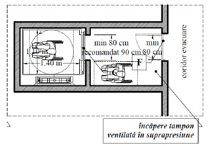

| Varianta a.2) la clădiri cu înălțime obișnuită | Varianta a.2) la clădiri cu înălțime obișnuită |
|---|---|
| În suprateran: | În subteran: |
| C - uși EI 60 | C - uși EI 60 |
| F - uși EI_2 30-C5S_200 | F - EI_2 60-C5S_200 |
| Notă: pereții încăperii tampon ventilată în | Notă: pereții încăperii tampon ventilată în |
| suprapresiune sunt rezistenți la foc min EI/REI60 | suprapresiune sunt rezistenți la foc min EI/REI 60 |
| Varianta b) la clădiri înalte | Varianta b) la clădiri înalte |
| În suprateran: | În subteran: |
| C - uși EI 90 | C - uși EI 90 |
| F - uși EI_2 30-C5S_200 | F - EI_2 60-C5S_200 |
| Notă: pereții încăperii tampon ventilată în | Notă: pereții încăperii tampon ventilată în |
| suprapresiune sunt rezistenți la foc min EI/REI 90 | suprapresiune sunt rezistenți la foc min EI/REI 90 |
| Varianta c) la clădiri foarte înalte cu înălțimea mai mică de 75 m | Varianta c) la clădiri foarte înalte cu înălțimea mai mică de 75 m |
| În suprateran: | În subteran: |
| C - uși EI 120 | C - uși EI 120 |
| F - uși EI_2 60-C5S_200 | F - EI_2 90-C5S_200 |
| Notă: pereții încăperii tampon ventilată în | Notă: pereții încăperii tampon ventilată în |
| suprapresiune sunt rezistenți la foc min EI/REI 120 | suprapresiune sunt rezistenți la foc min EI/REI 120 |
| Varianta d) la clădiri foarte înalte cu înălțimea mai mare sau egală de 75 m | Varianta d) la clădiri foarte înalte cu înălțimea mai mare sau egală de 75 m |
| În suprateran: | În subteran: |
| C - uși EI 120 | C - uși EI 120 |
| F - uși EI_2 90-C5S_200 | F - EI_2120-C5S_200 |
| Notă: pereții încăperii tampon ventilată în | Notă: pereții încăperii tampon ventilată în |
| suprapresiune sunt rezistenți la foc min EI/REI 120 | suprapresiune sunt rezistenți la foc min EI/REI 120 |

  Figura 125 - Caz general goluri de acces la ascensoare prevăzute pentru
  transportul persoanelor cu căruciorul sau a persoanelor cu dizabilități care
  pot fi utilizate și pentru evacuarea asistată a acestora în caz de incendiu

  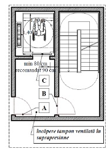

| Varianta a.1) la clădiri cu înălțime obișnuită | Varianta a.1) la clădiri cu înălțime obișnuită |
|---|---|
| În suprateran: | În subteran: |
| A - uși EI_2 30-C5S_200 | A - uși EI_2 60-C5S_200 |
| B - uși EI_2 60-C5S_200 | B - uși EI_2 60-C5S_200 |
| C - uși EI 60 | C - uși EI 60 |
| Notă: pereții încăperii tampon ventilată în | Notă: pereții încăperii tampon ventilată în |
| suprapresiune sunt rezistenți la foc min EI/REI60 | suprapresiune sunt rezistenți la foc min EI/REI 60 |
| Varianta b) la clădiri înalte | Varianta b) la clădiri înalte |
| În suprateran: | În subteran: |
| A - uși EI_2 30-C5S_200 | A - uși EI_2 60-C5S_200 |
| B - uși EI_2 90-C5S_200 | B - uși EI_2 90-C5S_200 |
| C - uși EI 90 | C - uși EI 90 |
| Notă: pereții încăperii tampon ventilată în | Notă: pereții încăperii tampon ventilată în |
| suprapresiune sunt rezistenți la foc min EI/REI 90 | suprapresiune sunt rezistenți la foc min EI/REI 90 |
| Varianta c) la clădiri foarte înalte cu înălțimea mai mică de 75 m | Varianta c) la clădiri foarte înalte cu înălțimea mai mică de 75 m |
| În suprateran: | În subteran: |
| A - uși EI_2 60-C5S_200 | A - uși EI_2 90-C5S_200 |
| B - uși EI_2120-C5S_200 | B - uși EI_2120-C5S_200 |
| C - uși EI 120 | C - uși EI 120 |
| Notă: pereții încăperii tampon ventilată în | Notă: pereții încăperii tampon ventilată în |
| suprapresiune sunt rezistenți la foc min EI/REI 120 | suprapresiune sunt rezistenți la foc min EI/REI 120 |
| Varianta d) la clădiri foarte înalte cu înălțimea mai mare sau egală de 75 m | Varianta d) la clădiri foarte înalte cu înălțimea mai mare sau egală de 75 m |
| În suprateran: | În subteran: |
| A - uși EI_2 90-C5S_200 | A - uși EI_2120-C5S_200 |
| B - uși EI_2120-C5S_200 | B - uși EI_2120-C5S_200 |
| C - uși EI 120 | C - uși EI 120 |
| Notă: pereții încăperii tampon ventilată în | Notă: pereții încăperii tampon ventilată în |
| suprapresiune sunt rezistenți la foc min EI/REI 120 | suprapresiune sunt rezistenți la foc min EI/REI 120 |

  Figura 126 - Goluri de acces la ascensoare prevăzute pentru transportul
  persoanelor cu căruciorul sau a persoanelor cu dizabilități care pot fi utilizate
  și pentru evacuarea asistată a acestora în caz de incendiu și la scări de
  evacuare a persoanelor atunci când debușează într-o încăpere
  tampon ventilată în suprapresiune comună

  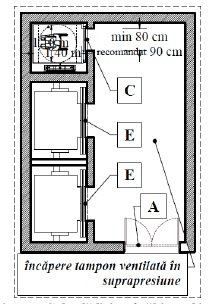

| Varianta a.1) la clădiri cu înălțime obișnuită | Varianta a.1) la clădiri cu înălțime obișnuită |
|---|---|
| În suprateran: | În subteran: |
| A - uși EI_2 30-C5S_200 | A - uși EI_2 60-C5S_200 |
| C - uși EI 60 | C - uși EI 60 |
| E - uși EI 60 | E - uși EI 60 |
| Notă: pereții încăperii tampon ventilată în | Notă: pereții încăperii tampon ventilată în |
| suprapresiune sunt rezistenți la foc min EI/REI 60 | suprapresiune sunt rezistenți la foc min EI/REI 60 |
| Varianta b) la clădiri înalte | Varianta b) la clădiri înalte |
| În suprateran: | În subteran: |
| A - uși EI_2 30-C5S_200 | A - uși EI_2 60-C5S_200 |
| C - uși EI 90 | C - uși EI 90 |
| E - uși EI90 | E - uși EI 90 |
| Notă: pereții încăperii tampon ventilată în | Notă: pereții încăperii tampon ventilată în |
| suprapresiune sunt rezistenți la foc min EI/REI 90 | suprapresiune sunt rezistenți la foc min EI/REI 90 |
| Varianta c) la clădiri foarte înalte cu înălțimea mai mică de 75 m | Varianta c) la clădiri foarte înalte cu înălțimea mai mică de 75 m |
| În suprateran: | În subteran: |
| A - uși EI_2 60-C5S_200 | A - uși EI_2 90-C5S_200 |
| C - uși EI 120 | C - uși EI 120 |
| E - uși EI 120 | E - uși EI 120 |
| Notă: pereții încăperii tampon ventilată în | Notă: pereții încăperii tampon ventilată în |
| suprapresiune sunt rezistenți la foc min EI/REI 120 | suprapresiune sunt rezistenți la foc min EI/REI 120 |
| Varianta d) la clădiri foarte înalte cu înălțimea mai mare sau egală de 75 m | Varianta d) la clădiri foarte înalte cu înălțimea mai mare sau egală de 75 m |
| În suprateran: | În subteran: |
| A - uși EI_2 90-C5S_200 | A - uși EI_2120-C5S_200 |
| C - uși EI 120 | C - uși EI 120 |
| E - uși EI 120 | E - uși EI 120 |
| Notă: pereții încăperii tampon ventilată în | Notă: pereții încăperii tampon ventilată în |
| suprapresiune sunt rezistenți la foc min EI/REI 120 | suprapresiune sunt rezistenți la foc min EI/REI 120 |

  Figura 127 - Goluri de acces la ascensoare prevăzute pentru transportul
  persoanelor cu căruciorul sau a persoanelor cu dizabilități care pot fi utilizate
  și pentru evacuarea asistată a acestora în caz de incendiu și la ascensoare
  prevăzute pentru circulația funcțională a persoanelor și atunci când
  debușează într-o încăpere tampon ventilată în suprapresiune comună

  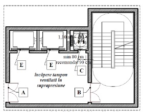

| Varianta a.1) la clădiri cu înălțime obișnuită | Varianta a.1) la clădiri cu înălțime obișnuită |
|---|---|
| În suprateran: | În subteran: |
| A - uși EI_2 30-C5S_200 | A - uși EI_2 60-C5S_200 |
| B - uși EI_2 60-C5S_200 | B - uși EI_2 60-C5S_200 |
| C - uși EI 60 | C - uși EI 60 |
| E - uși EI 60 | E - uși EI 60 |
| Notă: pereții încăperii tampon ventilată în | Notă: pereții încăperii tampon ventilată în |
| suprapresiune sunt rezistenți la foc min EI/REI 60 | suprapresiune sunt rezistenți la foc min EI/REI 60 |
| Varianta b) la clădiri înalte | Varianta b) la clădiri înalte |
| În suprateran: | În subteran: |
| A - uși EI_2 30-C5S_200 | A - uși EI_2 60-C5S_200 |
| B - uși EI_2 90-C5S_200 | B - uși EI_2 90-C5S_200 |
| C - uși EI 90 | C - uși EI 90 |
| E - uși EI 90 | E - uși EI 90 |
| Notă: pereții încăperii tampon ventilată în | Notă: pereții încăperii tampon ventilată în |
| suprapresiune sunt rezistenți la foc min EI/REI 90 | suprapresiune sunt rezistenți la foc min EI/REI 90 |
| Varianta c) la clădiri foarte înalte cu înălțimea mai mică de 75 m | Varianta c) la clădiri foarte înalte cu înălțimea mai mică de 75 m |
| În suprateran: | În subteran: |
| A - uși EI_2 60-C5S_200 | A - uși EI_2 90-C5S_200 |
| B - uși EI_2120-C5S_200 | B - uși EI_2120-C5S_200 |
| C - uși EI 120 | C - uși EI 120 |
| E - uși EI 120 | E - uși EI 120 |
| Notă: pereții încăperii tampon ventilată în | Notă: pereții încăperii tampon ventilată în |
| suprapresiune sunt rezistenți la foc min EI/REI 120 | suprapresiune sunt rezistenți la foc min EI/REI 120 |
| Varianta d) la clădiri foarte înalte cu înălțimea mai mare sau egală de 75 m | Varianta d) la clădiri foarte înalte cu înălțimea mai mare sau egală de 75 m |
| În suprateran: | În subteran: |
| A - uși EI_2 90-C5S_200 | A - uși EI_2120-C5S_200 |
| B - uși EI_2120-C5S_200 | B - uși EI_2120-C5S_200 |
| C - uși EI 120 | C - uși EI 120 |
| E - uși EI 120 | E - uși EI 120 |
| Notă: pereții încăperii tampon ventilată în | Notă: pereții încăperii tampon ventilată în |
| suprapresiune sunt rezistenți la foc min EI/REI 120 | suprapresiune sunt rezistenți la foc min EI/REI 120 |

  Figura 128 - Goluri de acces la ascensoare prevăzute pentru transportul
  persoanelor cu căruciorul sau a persoanelor cu dizabilități care pot fi
  utilizate și pentru evacuarea asistată a acestora în caz de incendiu,
  la ascensoare prevăzute pentru circulația funcțională a persoanelor și
  la scări de evacuare a persoanelor atunci când debușează
  într-o încăpere tampon ventilată în suprapresiune comună
Ascensoare prevăzute pentru transportul bolnavilor cu patul cu rotile, cu targa sau cu căruciorul sau a persoanelor cu dizabilități care pot fi utilizate și pentru evacuarea asistată a acestora în caz de incendiu
(60) Ascensoarele prevăzute pentru transportul bolnavilor cu patul cu rotile, cu targa sau cu căruciorul sau a persoanelor cu dizabilități care pot fi utilizate și pentru evacuarea asistată a acestora în caz de incendiu, se prevăd obligatoriu la clădiri pentru sănătate sau mixte cu funcțiuni de sănătate în care evacuarea utilizatorilor în caz de incendiu trebuie efectuată cu patul cu rotile, targa sau cu căruciorul.
(61) Ascensoarele prevăzute pentru transportul bolnavilor cu patul cu rotile, cu targa sau cu căruciorul sau a persoanelor cu dizabilități care pot fi utilizate și pentru evacuarea asistată a acestora în caz de incendiu la clădiri pentru sănătate (sau mixte cu funcțiuni de sănătate în care evacuarea utilizatorilor în caz de incendiu trebuie efectuată cu patul cu rotile, targa sau cu căruciorul) se dispun în puț propriu separat de restul construcției prin pereți rezistenți la foc și planșee rezistente la foc, conform:
  - – Art. 3.2.4.4. alin. (6) pentru clădiri cu înălțime obișnuită;
  - – Art. 4.1.4.13. alin. (1) lit. a) pentru clădiri înalte;
  - – Art. 4.2.4.13. alin. (1) lit. a) pentru clădiri foarte înalte.
(62) Ascensoarele prevăzute pentru transportul bolnavilor cu patul cu rotile, cu targa sau cu căruciorul sau a persoanelor cu dizabilități care pot fi utilizate și pentru evacuarea asistată a acestora în caz de incendiu la clădiri pentru sănătate (sau mixte cu funcțiuni de sănătate în care evacuarea utilizatorilor în caz de incendiu trebuie efectuată cu patul cu rotile, targa sau cu căruciorul) trebuie să respecte simultan prevederile:
  - – Art. 3.2.4.4. alin. (6) lit. b) și Art. 3.1.4.4. alin. (3) lit. c), d), e), f) și g) pentru clădiri cu înălțime obișnuită;
  - – Art. 4.1.4.13. alin. (1) lit. b) și Art. 3.1.4.4. alin. (3) lit. c), d), e), f) și g) pentru clădiri înalte;
  - – Art. 4.2.4.13. alin. (1) lit. b) și Art. 3.1.4.4. alin. (3) lit. c), d), e), f) și g) pentru clădiri foarte înalte.
(63) Accesul la ascensoarele prevăzute pentru transportul bolnavilor cu patul cu rotile, cu targa sau cu căruciorul sau a persoanelor cu dizabilități care pot fi utilizate și pentru evacuarea asistată a acestora în caz de incendiu la clădiri pentru sănătate (sau mixte cu funcțiuni de sănătate în care evacuarea utilizatorilor în caz de incendiu trebuie efectuată cu patul cu rotile, targa sau cu căruciorul) trebuie să respecte prevederile:
  - – Art. 3.2.4.4. alin. (7), alin. (8) și alin. (9) pentru clădiri cu înălțime obișnuită;
  - – Art. 4.1.4.13. alin. (8) și alin. (9) pentru clădiri înalte;
  - – Art. 4.2.4.13. alin. (8) și alin. (9) pentru clădiri foarte înalte.

  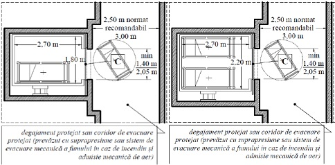

  Varianta a.1) la clădiri de sănătate cu înălțime obișnuită
  În suprateran:
  C - uși EI 90
  Notă: atunci când debușează în spații ferite de fum;
  Notă: toate ușile spațiilor în care debușează sunt rezistente la foc min EI2 30-C5S200 și pereții min EI 90.

  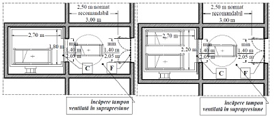

  Varianta a.2) la clădiri de sănătate cu înălțime obișnuită

| Varianta a.2) la clădiri de sănătate cu înălțime obișnuită | Varianta a.2) la clădiri de sănătate cu înălțime obișnuită |
|---|---|
| În suprateran: | În subteran: |
| C - uși EI 90 | C - uși EI 90 |
| F - uși EI_2 30-C5S_200 | F - EI_2 60-C5S_200 |
| Notă: pereții încăperii tampon ventilată în | Notă: pereții încăperii tampon ventilată în |
| suprapresiune sunt rezistenți la foc min EI/REI 90 | suprapresiune sunt rezistenți la foc min EI/REI 90 |
| Varianta b) la clădiri înalte | Varianta b) la clădiri înalte |
| În suprateran: | În subteran: |
| C - uși EI 90 | C - uși EI 90 |
| F - uși EI_2 30-C5S_200 | F - EI_2 60-C5S_200 |
| Notă: pereții încăperii tampon ventilată în | Notă: pereții încăperii tampon ventilată în |
| suprapresiune sunt rezistenți la foc min EI/REI 90 | suprapresiune sunt rezistenți la foc min EI/REI 90 |
| Varianta c) la clădiri foarte înalte cu înălțimea mai mică de 75 m | Varianta c) la clădiri foarte înalte cu înălțimea mai mică de 75 m |
| În suprateran: | În subteran: |
| C - uși EI 120 | C - uși EI 120 |
| F - uși EI_2 60-C5S_200 | F - EI_2 90-C5S_200 |
| Notă: pereții încăperii tampon ventilată în | Notă: pereții încăperii tampon ventilată în |
| suprapresiune sunt rezistenți la foc min EI/REI 120 | suprapresiune sunt rezistenți la foc min EI/REI 120 |
| Varianta d) la clădiri foarte înalte cu înălțimea mai mare sau egală de 75 m | Varianta d) la clădiri foarte înalte cu înălțimea mai mare sau egală de 75 m |
| În suprateran: | În subteran: |
| C - uși EI 120 | C - uși EI 120 |
| F - uși EI_2 90-C5S_200 | F - EI_2120-C5S_200 |
| Notă: pereții încăperii tampon ventilată în | Notă: pereții încăperii tampon ventilată în |
| suprapresiune sunt rezistenți la foc min EI/REI 120 | suprapresiune sunt rezistenți la foc min EI/REI 120 |

  Figura 129 - Caz general goluri de acces la ascensoare
  prevăzute pentru transportul bolnavilor cu patul cu rotile, cu targa
  sau cu căruciorul sau a persoanelor cu dizabilități care pot fi utilizate
  și pentru evacuarea asistată a acestora în caz de incendiu

  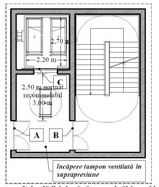

| Varianta a.1) la clădiri de sănătate cu înălțime obișnuită | Varianta a.1) la clădiri de sănătate cu înălțime obișnuită |
|---|---|
| În suprateran: | În subteran: |
| A - uși EI_2 30-C5S_200 | A - uși EI_2 60-C5S_200 |
| B - uși EI_2 90-C5S_200 | B - uși EI_2 90-C5S_200 |
| C - uși EI 90 | C - uși EI 90 |
| Notă: pereții încăperii tampon ventilată în | Notă: pereții încăperii tampon ventilată în |
| suprapresiune sunt rezistenți la foc min EI/REI 90 | suprapresiune sunt rezistenți la foc min EI/REI 90 |
| Varianta b) la clădiri înalte | Varianta b) la clădiri înalte |
| În suprateran: | În subteran: |
| A - uși EI_2 30-C5S_200 | A - uși EI_2 60-C5S_200 |
| B - uși EI_2 90-C5S_200 | B - uși EI_2 90-C5S_200 |
| C - uși EI 90 | C - uși EI 90 |
| Notă: pereții încăperii tampon ventilată în | Notă: pereții încăperii tampon ventilată în |
| suprapresiune sunt rezistenți la foc min EI/REI 90 | suprapresiune sunt rezistenți la foc min EI/REI 90 |
| Varianta c) la clădiri foarte înalte cu înălțimea mai mică de 75 m | Varianta c) la clădiri foarte înalte cu înălțimea mai mică de 75 m |
| În suprateran: | În subteran: |
| A - uși EI_2 60-C5S_200 | A - uși EI_2 90-C5S_200 |
| B - uși EI_2120-C5S_200 | B - uși EI_2120-C5S_200 |
| C - uși EI 120 | C - uși EI 120 |
| Notă: pereții încăperii tampon ventilată în | Notă: pereții încăperii tampon ventilată în |
| suprapresiune sunt rezistenți la foc min EI/REI 120 | suprapresiune sunt rezistenți la foc min EI/REI 120 |
| Varianta d) la clădiri foarte înalte cu înălțimea mai mare sau egală de 75 m | Varianta d) la clădiri foarte înalte cu înălțimea mai mare sau egală de 75 m |
| În suprateran: | În subteran: |
| A - uși EI_2 90-C5S_200 | A - uși EI_2120-C5S_200 |
| B - uși EI_2120-C5S_200 | B - uși EI_2120-C5S_200 |
| C - uși EI 120 | C - uși EI 120 |
| Notă: pereții încăperii tampon ventilată în | Notă: pereții încăperii tampon ventilată în |
| suprapresiune sunt rezistenți la foc min EI/REI 120 | suprapresiune sunt rezistenți la foc min EI/REI 120 |

  Figura 130 - Goluri de acces la ascensoare prevăzute pentru transportul
  bolnavilor cu patul cu rotile, cu targa sau cu căruciorul sau a persoanelor
  cu dizabilități care pot fi utilizate și pentru evacuarea asistată a acestora
  în caz de incendiu și la scări de evacuare a persoanelor atunci
  când debușează într-o încăpere tampon ventilată în suprapresiune comună

  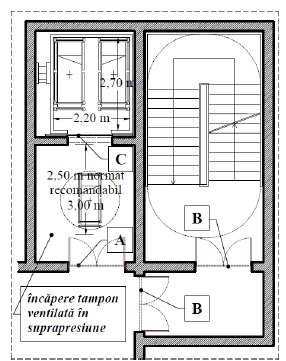

| Varianta a.1) la clădiri cu înălțime obișnuită | Varianta a.1) la clădiri cu înălțime obișnuită |
|---|---|
| În suprateran: | În subteran: |
| A - uși EI_2 30-C5S_200 | A - uși EI_2 60-C5S_200 |
| C - uși EI 90 | C - uși EI 90 |
| Notă: pereții încăperii tampon ventilată în | Notă: pereții încăperii tampon ventilată în |
| suprapresiune sunt rezistenți la foc min EI/REI 90 | suprapresiune sunt rezistenți la foc min EI/REI 90 |
| Varianta b) la clădiri înalte | Varianta b) la clădiri înalte |
| În suprateran: | În subteran: |
| A - uși EI_2 30-C5S_200 | A - uși EI_2 60-C5S_200 |
| C - uși EI 90 | C - uși EI 90 |
| Notă: pereții încăperii tampon ventilată în | Notă: pereții încăperii tampon ventilată în |
| suprapresiune sunt rezistenți la foc min EI/REI 90 | suprapresiune sunt rezistenți la foc min EI/REI 90 |
| Varianta c) la clădiri foarte înalte cu înălțimea mai mică de 75 m | Varianta c) la clădiri foarte înalte cu înălțimea mai mică de 75 m |
| În suprateran: | În subteran: |
| A - uși EI_2 60-C5S_200 | A - uși EI_2 90-C5S_200 |
| C - uși EI 120 | C - uși EI 120 |
| Notă: pereții încăperii tampon ventilată în | Notă: pereții încăperii tampon ventilată în |
| suprapresiune sunt rezistenți la foc min EI/REI 120 | suprapresiune sunt rezistenți la foc min EI/REI 120 |
| Varianta d) la clădiri foarte înalte cu înălțimea mai mare sau egală de 75 m | Varianta d) la clădiri foarte înalte cu înălțimea mai mare sau egală de 75 m |
| În suprateran: | În subteran: |
| A - uși EI_2 90-C5S_200 | A - uși EI_2120-C5S_200 |
| C - uși EI 120 | C - uși EI 120 |
| Notă: pereții încăperii tampon ventilată în | Notă: pereții încăperii tampon ventilată în |
| suprapresiune sunt rezistenți la foc min EI/REI 120 | suprapresiune sunt rezistenți la foc min EI/REI 120 |

  Figura 131 - Goluri de acces la ascensoare prevăzute pentru transportul
  bolnavilor cu patul cu rotile, cu targa sau cu căruciorul sau a persoanelor
  cu dizabilități care pot fi utilizate și pentru evacuarea asistată a acestora
  în caz de incendiu și la scări de evacuare a persoanelor atunci când
  NU debușează într-o încăpere tampon ventilată în suprapresiune comună
  Notă Figura 131: Ușile la încăperea tampon aferentă scării de evacuare se protejează obligatoriu conform condiții specifice (la clădiri înalte sau foarte înalte); la alte tipuri de construcții nu este obligatorie prevederea încăperii tampon ventilată în suprapresiune la partea supraterană a construcției (în porțiunile subterane se vor prevedea conform prevederi generale și specifice).

  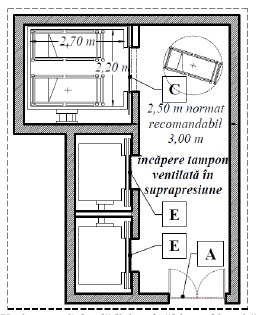

| Varianta a.1) la clădiri cu înălțime obișnuită | Varianta a.1) la clădiri cu înălțime obișnuită |
|---|---|
| În suprateran: | În subteran: |
| A - uși EI_2 30-C5S_200 | A - uși EI_2 60-C5S_200 |
| C - uși EI 90 | C - uși EI 90 |
| E - uși EI 90 | E - uși EI 90 |
| Notă: pereții încăperii tampon ventilată în | Notă: pereții încăperii tampon ventilată în |
| suprapresiune sunt rezistenți la foc min EI/REI 90 | suprapresiune sunt rezistenți la foc min EI/REI 90 |
| Varianta b) la clădiri înalte | Varianta b) la clădiri înalte |
| În suprateran: | În subteran: |
| A - uși EI_2 30-C5S_200 | A - uși EI_2 60-C5S_200 |
| C - uși EI 90 | C - uși EI 90 |
| E - uși EI 90 | E - uși EI 90 |
| Notă: pereții încăperii tampon ventilată în | Notă: pereții încăperii tampon ventilată în |
| suprapresiune sunt rezistenți la foc min EI/REI 90 | suprapresiune sunt rezistenți la foc min EI/REI 90 |
| Varianta c) la clădiri foarte înalte cu înălțimea mai mică de 75 m | Varianta c) la clădiri foarte înalte cu înălțimea mai mică de 75 m |
| În suprateran: | În subteran: |
| A - uși EI_2 60-C5S_200 | A - uși EI_2 90-C5S_200 |
| C - uși EI 120 | C - uși EI 120 |
| E - uși EI 120 | E - uși EI 120 |
| Notă: pereții încăperii tampon ventilată în | Notă: pereții încăperii tampon ventilată în |
| suprapresiune sunt rezistenți la foc min EI/REI 120 | suprapresiune sunt rezistenți la foc min EI/REI 120 |
| Varianta d) la clădiri foarte înalte cu înălțimea mai mare sau egală de 75 m | Varianta d) la clădiri foarte înalte cu înălțimea mai mare sau egală de 75 m |
| În suprateran: | În subteran: |
| A - uși EI_2 90-C5S_200 | A - uși EI_2120-C5S_200 |
| C - uși EI 120 | C - uși EI 120 |
| E - uși EI 120 | E - uși EI 120 |
| Notă: pereții încăperii tampon ventilată în | Notă: pereții încăperii tampon ventilată în |
| suprapresiune sunt rezistenți la foc min EI/REI 120 | suprapresiune sunt rezistenți la foc min EI/REI 120 |

  Figura 132 - Goluri de acces la ascensoare prevăzute pentru transportul
  bolnavilor cu patul cu rotile, cu targa sau cu căruciorul sau a persoanelor
  cu dizabilități care pot fi utilizate și pentru evacuarea asistată a acestora
  în caz de incendiu si la ascensoare prevăzute pentru circulația funcțională
  a persoanelor atunci când debușează într-o încăpere tampon ventilată în suprapresiune comună

  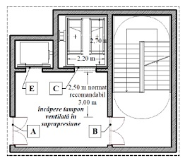

| Varianta a.1) la clădiri cu înălțime obișnuită | Varianta a.1) la clădiri cu înălțime obișnuită |
|---|---|
| În suprateran: | În subteran: |
| A - uși EI_2 30-C5S_200 | A - uși EI_2 60-C5S_200 |
| B - uși EI_2 90-C5S_200 | B - uși EI_2 90-C5S_200 |
| C - uși EI 90 | C - uși EI 90 |
| E - uși EI 90 | E - uși EI 90 |
| Notă: pereții încăperii tampon ventilată în | Notă: pereții încăperii tampon ventilată în |
| suprapresiune sunt rezistenți la foc min EI/REI 90 | suprapresiune sunt rezistenți la foc min EI/REI 90 |
| Varianta b) la clădiri înalte | Varianta b) la clădiri înalte |
| În suprateran: | În subteran: |
| A - uși EI_2 30-C5S_200 | A - uși EI_2 60-C5S_200 |
| B - uși EI_2 90-C5S_200 | B - uși EI_2 90-C5S_200 |
| C - uși EI 90 | C - uși EI 90 |
| E - uși EI 90 | E - uși EI 90 |
| Notă: pereții încăperii tampon ventilată în | Notă: pereții încăperii tampon ventilată în |
| suprapresiune sunt rezistenți la foc min EI/REI 90 | suprapresiune sunt rezistenți la foc min EI/REI 90 |
| Varianta c) la clădiri foarte înalte cu înălțimea mai mică de 75 m | Varianta c) la clădiri foarte înalte cu înălțimea mai mică de 75 m |
| În suprateran: | În subteran: |
| A - uși EI_2 60-C5S_200 | A - uși EI_2 90-C5S_200 |
| B - uși EI_2120-C5S_200 | B - uși EI_2120-C5S_200 |
| C - uși EI 120 | C - uși EI 120 |
| E - uși EI 120 | E - uși EI 120 |
| Notă: pereții încăperii tampon ventilată în | Notă: pereții încăperii tampon ventilată în |
| suprapresiune sunt rezistenți la foc min EI/REI 120 | suprapresiune sunt rezistenți la foc min EI/REI 120 |
| Varianta d) la clădiri foarte înalte cu înălțimea mai mare sau egală de 75 m | Varianta d) la clădiri foarte înalte cu înălțimea mai mare sau egală de 75 m |
| În suprateran: | În subteran: |
| A - uși EI_2 90-C5S_200 | A - uși EI_2120-C5S_200 |
| B - uși EI_2120-C5S_200 | B - uși EI_2120-C5S_200 |
| C - uși EI 120 | C - uși EI 120 |
| E - uși EI 120 | E - uși EI 120 |
| Notă: pereții încăperii tampon ventilată în | Notă: pereții încăperii tampon ventilată în |
| suprapresiune sunt rezistenți la foc min EI/REI 120 | suprapresiune sunt rezistenți la foc min EI/REI 120 |

  Figura 133 - Goluri de acces la ascensoare prevăzute pentru transportul
  bolnavilor cu patul cu rotile, cu targa sau cu căruciorul sau a persoanelor
  cu dizabilități care pot fi utilizate și pentru evacuarea asistată a acestora
  în caz de incendiu, la ascensoare prevăzute pentru circulația funcțională
  a persoanelor și la scări de evacuare a persoanelor atunci când debușează
  într-o încăpere tampon ventilată în suprapresiune comună
Ascensoare pentru intervenție
Prevederi generale
(64) Ascensoarele pentru intervenție în caz de incendiu (de pompieri), se prevăd obligatoriu în situațiile stabilite în normativ și suplimentar conform Art. 2.4.4.4.2.
(65) Ascensoarele prevăzute pentru intervenție în caz de incendiu (de pompieri), se dispun în puț propriu separat de restul construcției prin pereți rezistenți la foc si planșee rezistente la foc, conform:
  - – Art. 3.1.4.7. alin. (1) pentru clădiri cu înălțime obișnuită;
  - – Art. 4.1.4.15. alin. (2) pentru clădiri înalte;
  - – Art. 4.2.4.15. alin. (2) pentru clădiri foarte înalte.
(66) Ascensoarele prevăzute pentru intervenție în caz de incendiu (de pompieri), trebuie să respecte prevederile:
  - – Art. 3.1.4.8. alin. (5) * alin. (14) pentru clădiri cu înălțime obișnuită;
  - – Art. 3.1.4.8. alin. (3) * alin. (8), Art. 3.1.4.8. alin. (11) * alin. (14) si Art. 4.1.4.14. si Art. 4.1.4.15. alin. (1) si alin. (5) * alin. (7) pentru clădiri înalte;
  - – Art. 3.1.4.8. alin. (3) * alin. (8), Art. 3.1.4.8. alin. (11) * alin. (14) si Art. 4.2.4.14. si Art. 4.2.4.15. alin. (1) si alin. (5) * alin. (7) pentru clădiri foarte înalte.
(67) Accesul la ascensoarele prevăzute pentru intervenție în caz de incendiu (de pompieri) trebuie să respecte prevederile:
  - – Art. 3.2.4.4. alin. (7), alin. (8) si alin. (9) pentru clădiri cu înălțime obișnuită;
  - – Art. 4.1.4.15. alin. (3) si alin. (8) pentru clădiri înalte;
  - – Art. 4.2.4.15. alin. (3) si alin. (8) pentru clădiri foarte înalte.

  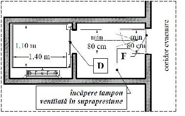

| Varianta a) la clădiri cu înălțime obișnuită | Varianta a) la clădiri cu înălțime obișnuită | Varianta a) la clădiri cu înălțime obișnuită |
|---|---|---|
| În suprateran: | În subteran: | În subteran: |
| F - uși EI_2 30-C5S_200 | F - uși EI_2 60-C5S_200 | F - uși EI_2 60-C5S_200 |
| D - uși EI 120 | D - uși EI 120 | D - uși EI 120 |
| Notă: pereții încăperii tampon ventilată în | Notă: pereții încăperii tampon ventilată în | Notă: pereții încăperii tampon ventilată în |
| suprapresiune sunt rezistenți la foc min EI/REI 120 | suprapresiune sunt rezistenți la foc min EI/REI 120 | suprapresiune sunt rezistenți la foc min EI/REI 120 |
| Varianta b) la clădiri înalte | Varianta b) la clădiri înalte | Varianta b) la clădiri înalte |
| În suprateran: | În subteran: | În subteran: |
| F - uși EI_2 60-C5S_200 | F - uși EI_2 90-C5S_200 | F - uși EI_2 90-C5S_200 |
| D - uși EI 120 | D - uși EI 120 | D - uși EI 120 |
| Notă: pereții încăperii tampon ventilată în | Notă: pereții încăperii tampon ventilată în | Notă: pereții încăperii tampon ventilată în |
| suprapresiune sunt rezistenți la foc min EI/REI 120 | suprapresiune sunt rezistenți la foc min EI/REI 120 | suprapresiune sunt rezistenți la foc min EI/REI 120 |
| Varianta c) la clădiri foarte înalte cu înălțimea mai mică de 75 m | Varianta c) la clădiri foarte înalte cu înălțimea mai mică de 75 m | Varianta c) la clădiri foarte înalte cu înălțimea mai mică de 75 m |
| În suprateran: | În subteran: | În subteran: |
| F - uși EI_2 60-C5S_200 | F - uși EI_2 90-C5S_200 | F - uși EI_2 90-C5S_200 |
| D - uși EI 120 | D - uși EI 120 | D - uși EI 120 |
| Notă: pereții încăperii tampon ventilată în | Notă: pereții încăperii tampon ventilată în | Notă: pereții încăperii tampon ventilată în |
| suprapresiune sunt rezistenți la foc min EI/REI 120 | suprapresiune sunt rezistenți la foc min EI/REI 120 | suprapresiune sunt rezistenți la foc min EI/REI 120 |
| Varianta d) la clădiri foarte înalte cu înălțimea mai mare sau egală de 75 m | Varianta d) la clădiri foarte înalte cu înălțimea mai mare sau egală de 75 m | Varianta d) la clădiri foarte înalte cu înălțimea mai mare sau egală de 75 m |
| În suprateran: | În suprateran: | În subteran: |
| F - uși EI_2 90-C5S_200 | F - uși EI_2 90-C5S_200 | F - uși EI_2120-C5S_200 |
| D - uși EI 120 | D - uși EI 120 | D - uși EI 120 |
| Notă: pereții încăperii tampon ventilată în | Notă: pereții încăperii tampon ventilată în | Notă: pereții încăperii tampon ventilată în |
| suprapresiune sunt rezistenți la foc min EI/REI 120 | suprapresiune sunt rezistenți la foc min EI/REI 120 | suprapresiune sunt rezistenți la foc min EI/REI 120 |

  Figura 134 - Caz general goluri de acces la ascensoare de intervenție

  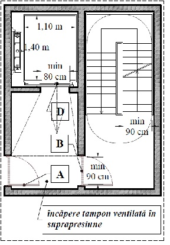

| Varianta a) la clădiri cu înălțime obișnuită | Varianta a) la clădiri cu înălțime obișnuită |
|---|---|
| În suprateran: | În subteran: |
| A - uși EI_2 30-C5S_200 | A - uși EI_2 60-C5S_200 |
| B - uși EI_2120-C5S_200 | B - uși EI_2120-C5S_200 |
| D - uși EI 120 | D - uși EI 120 |
| Notă: pereții încăperii tampon ventilată în | Notă: pereții încăperii tampon ventilată în |
| suprapresiune sunt rezistenți la foc min EI/REI 120 | suprapresiune sunt rezistenți la foc min EI/REI 120 |
| Varianta b) la clădiri înalte | Varianta b) la clădiri înalte |
| În suprateran: | În subteran: |
| A - uși EI_2 60-C5S_200 | A - uși EI_2 90-C5S_200 |
| B - uși EI_2120-C5S_200 | B - uși EI_2120-C5S_200 |
| D - uși EI 120 | D - uși EI 120 |
| Notă: pereții încăperii tampon ventilată în | Notă: pereții încăperii tampon ventilată în |
| suprapresiune sunt rezistenți la foc min EI/REI 120 | suprapresiune sunt rezistenți la foc min EI/REI 120 |
| Varianta c) la clădiri foarte înalte cu înălțimea mai mică de 75 m | Varianta c) la clădiri foarte înalte cu înălțimea mai mică de 75 m |
| În suprateran: | În subteran: |
| A - uși EI_2 60-C5S_200 | A - uși EI_2 90-C5S_200 |
| B - uși EI_2120-C5S_200 | B - uși EI_2120-C5S_200 |
| D - uși EI 120 | D - uși EI 120 |
| Notă: pereții încăperii tampon ventilată în | Notă: pereții încăperii tampon ventilată în |
| suprapresiune sunt rezistenți la foc min EI/REI 120 | suprapresiune sunt rezistenți la foc min EI/REI 120 |
| Varianta d) la clădiri foarte înalte cu înălțimea mai mare sau egală de 75 m | Varianta d) la clădiri foarte înalte cu înălțimea mai mare sau egală de 75 m |
| În suprateran: | În subteran: |
| A - uși EI_2 90-C5S_200 | A - uși EI_2120-C5S_200 |
| B - uși EI_2120-C5S_200 | B - uși EI_2120-C5S_200 |
| D - uși EI 120 | D - uși EI 120 |
| Notă: pereții încăperii tampon ventilată în | Notă: pereții încăperii tampon ventilată în |
| suprapresiune sunt rezistenți la foc min EI/REI 120 | suprapresiune sunt rezistenți la foc min EI/REI 120 |

  Figura 135 - Goluri de acces la ascensoare de intervenție și la scări
  de evacuare a persoanelor atunci când debușează
  într-o încăpere tampon ventilată în suprapresiune comună

  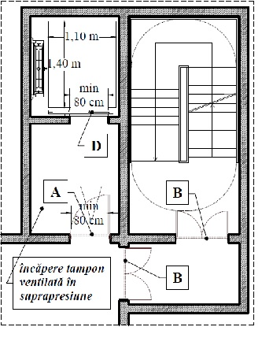

| Varianta a) la clădiri cu înălțime obișnuită | Varianta a) la clădiri cu înălțime obișnuită |
|---|---|
| În suprateran: | În subteran: |
| A - uși EI_2 30-C5S_200 | A - uși EI_2 60-C5S_200 |
| D - uși EI 120 | D - uși EI 120 |
| Notă: pereții încăperii tampon ventilată în | Notă: pereții încăperii tampon ventilată în |
| suprapresiune sunt rezistenți la foc min EI/REI 120 | suprapresiune sunt rezistenți la foc min EI/REI 120 |
| Varianta b) la clădiri înalte | Varianta b) la clădiri înalte |
| În suprateran: | În subteran: |
| A - uși EI_2 60-C5S_200 | A - uși EI_2 90-C5S_200 |
| D - uși EI 120 | D - uși EI 120 |
| Notă: pereții încăperii tampon ventilată în | Notă: pereții încăperii tampon ventilată în |
| suprapresiune sunt rezistenți la foc min EI/REI 120 | suprapresiune sunt rezistenți la foc min EI/REI 120 |
| Varianta c) la clădiri foarte înalte cu înălțimea mai mică de 75 m | Varianta c) la clădiri foarte înalte cu înălțimea mai mică de 75 m |
| În suprateran: | În subteran: |
| A - uși EI_2 60-C5S_200 | A - uși EI_2 90-C5S_200 |
| D - uși EI 120 | D - uși EI 120 |
| Notă: pereții încăperii tampon ventilată în | Notă: pereții încăperii tampon ventilată în |
| suprapresiune sunt rezistenți la foc min EI/REI 120 | suprapresiune sunt rezistenți la foc min EI/REI 120 |
| Varianta d) la clădiri foarte înalte cu înălțimea mai mare sau egală de 75 m | Varianta d) la clădiri foarte înalte cu înălțimea mai mare sau egală de 75 m |
| În suprateran: | În subteran: |
| A - uși EI_2 90-C5S_200 | A - uși EI_2120-C5S_200 |
| D - uși EI 120 | D - uși EI 120 |
| Notă: pereții încăperii tampon ventilată în | Notă: pereții încăperii tampon ventilată în |
| suprapresiune sunt rezistenți la foc min EI/REI 120 | suprapresiune sunt rezistenți la foc min EI/REI 120 |

  Figura 136 - Goluri de acces la ascensoare de intervenție și la scări de
  evacuare a persoanelor atunci când NU debușează într-o încăpere
  tampon ventilată în suprapresiune comună
  Notă Figura 136: Ușile la încăperea tampon aferentă scării de evacuare se protejează obligatoriu conform condiții specifice (la clădiri înalte sau foarte înalte); la alte tipuri de construcții, nu este obligatorie prevederea încăperii tampon ventilată în suprapresiune la partea supraterană a construcției (în porțiunile subterane se vor prevedea conform prevederi generale și specifice).

  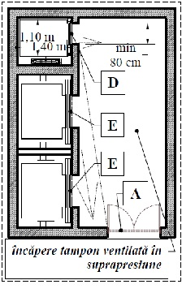

| Varianta a) la clădiri cu înălțime obișnuită | Varianta a) la clădiri cu înălțime obișnuită |
|---|---|
| În suprateran: | În subteran: |
| A - uși EI_2 30-C5S_200 | A - uși EI_2 60-C5S_200 |
| D - uși EI 120 | D - uși EI 120 |
| E - uși EI 120 | E - uși EI 120 |
| Notă: pereții încăperii tampon ventilată în | Notă: pereții încăperii tampon ventilată în |
| suprapresiune sunt rezistenți la foc min EI/REI 120 | suprapresiune sunt rezistenți la foc min EI/REI 120 |
| Varianta b) la clădiri înalte | Varianta b) la clădiri înalte |
| În suprateran: | În subteran: |
| A - uși EI_2 60-C5S_200 | A - uși EI_2 90-C5S_200 |
| D - uși EI 120 | D - uși EI 120 |
| E - uși EI 120 | E - uși EI 120 |
| Notă: pereții încăperii tampon ventilată în | Notă: pereții încăperii tampon ventilată în |
| suprapresiune sunt rezistenți la foc min EI/REI 120 | suprapresiune sunt rezistenți la foc min EI/REI 120 |
| Varianta c) la clădiri foarte înalte cu înălțimea mai mică de 75 m | Varianta c) la clădiri foarte înalte cu înălțimea mai mică de 75 m |
| În suprateran: | În subteran: |
| A - uși EI_2 60-C5S_200 | A - uși EI_2 90-C5S_200 |
| D - uși EI 120 | D - uși EI 120 |
| E - uși EI 120 | E - uși EI 120 |
| Notă: pereții încăperii tampon ventilată în | Notă: pereții încăperii tampon ventilată în |
| suprapresiune sunt rezistenți la foc min EI/REI 120 | suprapresiune sunt rezistenți la foc min EI/REI 120 |
| Varianta d) la clădiri foarte înalte cu înălțimea mai mare sau egală de 75 m | Varianta d) la clădiri foarte înalte cu înălțimea mai mare sau egală de 75 m |
| În suprateran: | În subteran: |
| A - uși EI_2 90-C5S_200 | A - uși EI_2120-C5S_200 |
| D - uși EI 120 | D - uși EI 120 |
| E - uși EI 120 | E - uși EI 120 |
| Notă: pereții încăperii tampon ventilată în | Notă: pereții încăperii tampon ventilată în |
| suprapresiune sunt rezistenți la foc min EI/REI 120 | suprapresiune sunt rezistenți la foc min EI/REI 120 |

  Figura 137 - Goluri de acces la ascensoare de intervenție și la ascensoare
  prevăzute pentru circulația funcțională a persoanelor atunci când debușează
  într-o încăpere tampon ventilată în suprapresiune comună

  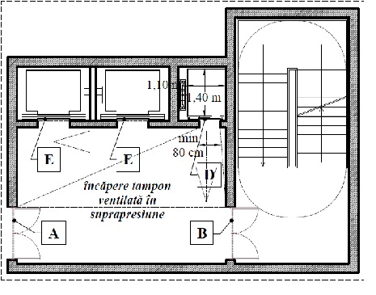

| Varianta a) la clădiri cu înălțime obișnuită | Varianta a) la clădiri cu înălțime obișnuită |
|---|---|
| În suprateran: | În subteran: |
| A - uși EI_2 30-C5S_200 | A - uși EI_2 60-C5S_200 |
| B - uși EI_2120-C5S_200 | B - uși EI_2120-C5S_200 |
| D - uși EI 120 | D - uși EI 120 |
| E - uși EI 120 | E - uși EI 120 |
| Notă: pereții încăperii tampon ventilată în | Notă: pereții încăperii tampon ventilată în |
| suprapresiune sunt rezistenți la foc min EI/REI 120 | suprapresiune sunt rezistenți la foc min EI/REI 120 |
| Varianta b) la clădiri înalte | Varianta b) la clădiri înalte |
| În suprateran: | În subteran: |
| A - uși EI_2 60-C5S_200 | A - uși EI_2 90-C5S_200 |
| B - uși EI_2120-C5S_200 | B - uși EI_2120-C5S_200 |
| D - uși EI 120 | D - uși EI 120 |
| E - uși EI 120 | E - uși EI 120 |
| Notă: pereții încăperii tampon ventilată în | Notă: pereții încăperii tampon ventilată în |
| suprapresiune sunt rezistenți la foc min EI/REI 120 | suprapresiune sunt rezistenți la foc min EI/REI 120 |
| Varianta c) la clădiri foarte înalte cu înălțimea mai mică de 75 m | Varianta c) la clădiri foarte înalte cu înălțimea mai mică de 75 m |
| În suprateran: | În subteran: |
| A - uși EI_2 60-C5S_200 | A - uși EI_2 90-C5S_200 |
| B - uși EI_2120-C5S_200 | B - uși EI_2120-C5S_200 |
| D - uși EI 120 | D - uși EI 120 |
| E - uși EI 120 | E - uși EI 120 |
| Notă: pereții încăperii tampon ventilată în | Notă: pereții încăperii tampon ventilată în |
| suprapresiune sunt rezistenți la foc min EI/REI 120 | suprapresiune sunt rezistenți la foc min EI/REI 120 |
| Varianta d) la clădiri foarte înalte cu înălțimea mai mare sau egală de 75 m | Varianta d) la clădiri foarte înalte cu înălțimea mai mare sau egală de 75 m |
| În suprateran: | În subteran: |
| A - uși EI_2 90-C5S_200 | A - uși EI_2120-C5S_200 |
| B - uși EI_2120-C5S_200 | B - uși EI_2120-C5S_200 |
| D - uși EI 120 | D - uși EI 120 |
| E - uși EI 120 | E - uși EI 120 |
| Notă: pereții încăperii tampon ventilată în | Notă: pereții încăperii tampon ventilată în |
| suprapresiune sunt rezistenți la foc min EI/REI 120 | suprapresiune sunt rezistenți la foc min EI/REI 120 |

  Figura 138 - Goluri de acces la ascensoare de intervenție, la ascensoare
  prevăzute pentru circulația funcțională a persoanelor și la scări de evacuare
  a persoanelor atunci când debușează într-o încăpere tampon ventilată în suprapresiune comună

  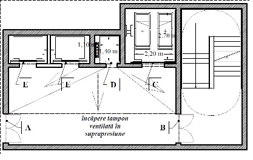

| Varianta a) la clădiri cu înălțime obișnuită | Varianta a) la clădiri cu înălțime obișnuită |
|---|---|
| În suprateran: | În subteran: |
| A - uși EI_2 30-C5S_200 | A - uși EI_2 60-C5S_200 |
| B - uși EI_2120-C5S_200 | B - uși EI_2120-C5S_200 |
| C - uși EI 120 | C - uși EI 120 |
| D - uși EI 120 | D - uși EI 120 |
| E - uși EI 120 | E - uși EI 120 |
| Notă: pereții încăperii tampon ventilată în | Notă: pereții încăperii tampon ventilată în |
| suprapresiune sunt rezistenți la foc min EI/REI 120 | suprapresiune sunt rezistenți la foc min EI/REI 120 |
| Varianta b) la clădiri înalte | Varianta b) la clădiri înalte |
| În suprateran: | În subteran: |
| A - uși EI_2 60-C5S_200 | A - uși EI_2 90-C5S_200 |
| B - uși EI_2120-C5S_200 | B - uși EI_2120-C5S_200 |
| C - uși EI 120 | C - uși EI 120 |
| D - uși EI 120 | D - uși EI 120 |
| E - uși EI 120 | E - uși EI 120 |
| Notă: pereții încăperii tampon ventilată în | Notă: pereții încăperii tampon ventilată în |
| suprapresiune sunt rezistenți la foc min EI/REI 120 | suprapresiune sunt rezistenți la foc min EI/REI 120 |
| Varianta c) la clădiri foarte înalte cu înălțimea mai mică de 75 m | Varianta c) la clădiri foarte înalte cu înălțimea mai mică de 75 m |
| În suprateran: | În subteran: |
| A - uși EI_2 60-C5S_200 | A - uși EI_2 90-C5S_200 |
| B - uși EI_2120-C5S_200 | B - uși EI_2120-C5S_200 |
| C - uși EI 120 | C - uși EI 120 |
| D - uși EI 120 | D - uși EI 120 |
| E - uși EI 120 | E - uși EI 120 |
| Notă: pereții încăperii tampon ventilată în | Notă: pereții încăperii tampon ventilată în |
| suprapresiune sunt rezistenți la foc min EI/REI 120 | suprapresiune sunt rezistenți la foc min EI/REI 120 |
| Varianta d) la clădiri foarte înalte cu înălțimea mai mare sau egală de 75 m | Varianta d) la clădiri foarte înalte cu înălțimea mai mare sau egală de 75 m |
| În suprateran: | În subteran: |
| A - uși EI_2 90-C5S_200 | A - uși EI_2120-C5S_200 |
| B - uși EI_2120-C5S_200 | B - uși EI_2120-C5S_200 |
| C - uși EI 120 | C - uși EI 120 |
| D - uși EI 120 | D - uși EI 120 |
| E - uși EI 120 | E - uși EI 120 |
| Notă: pereții încăperii tampon ventilată în | Notă: pereții încăperii tampon ventilată în |
| suprapresiune sunt rezistenți la foc min EI/REI 120 | suprapresiune sunt rezistenți la foc min EI/REI 120 |

  Figura 139 - Goluri de acces la ascensoare de intervenție, la ascensoare
  prevăzute pentru circulația funcțională a persoanelor, la scări de evacuare
  a persoanelor și la ascensoare prevăzute pentru transportul bolnavilor cu
  patul cu rotile, cu targa sau cu căruciorul sau a persoanelor cu dizabilități
  care pot fi utilizate și pentru evacuarea asistată a acestora în caz de incendiu
  atunci când debușează într-o încăpere tampon ventilată în suprapresiune comună
Ascensoare de intervenție - scară comună prevăzută pentru evacuare precum și pentru accesul forțelor de intervenție

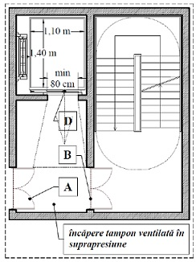

Figura 140 - Acces comun la ascensoare de intervenție și casa
scării COMUNĂ (scară prevăzută pentru evacuarea
persoanelor precum și pentru accesul forțelor de intervenție) - acces al
pompierilor prin aceeași scară de evacuare în clădirile înalte sau foarte înalte
LEGENDĂ:
D - uși EI 120
A - uși EI2 120-C5S200
B - uși EI2 120-C5S200
(68) Fluxurile de evacuare în situația în care scara este prevăzută pentru evacuare precum și pentru accesul forțelor de intervenție (în acord cu Figura 140) vor fi conformate potrivit Tabelul 126.
  Tabelul 126: Fluxuri de evacuare ale scării prevăzute pentru evacuarea persoanelor precum și pentru accesul forțelor de intervenție

| Lățimi libere uși A și B și lățime liberă a rampelor și podestelor scării (m) | Fluxuri de persoane posibil de evacuat |
|---|---|
| minimum 1,20 | 1 flux |
| 1,60 | 2 fluxuri |
| 2,10 | 3 fluxuri |
| 2,50 | 4 fluxuri |

Puț protejat de acces și intervenție a pompierilor
(69) La construcțiile cu înălțimea mai mare sau egală de 75 m se prevede obligatoriu ca cel puțin un ascensor de intervenție să fie prevăzut cu acces din încăperea tampon aferentă casei de scară destinată numai intervenției pompierilor.
(70) "Puț protejat de acces și intervenție a pompierilor" se referă la o încăpere tampon ventilată în suprapresiune din care se accesează un ascensor de intervenție și care are acces direct către o scară protejată în scopul stingerii incendiilor (destinată numai intervenției pompierilor). Este obligatoriu la clădiri foarte înalte cu înălțimea mai mare de 75 m și are caracter de recomandare la clădiri înalte și la clădiri foarte înalte cu înălțimea mai mică sau egală de 75 m precum și la clădiri spitalicești cu înălțimea mai mare de 4 niveluri supraterane cu utilizatori care nu se pot evacua singuri și la alte tipuri/funcțiuni de clădiri.
(71) Podeaua încăperii tampon ventilată în suprapresiune, trebuie să fie gradată de la ușa ascensorului spre ușa/ușile încăperii tampon ventilate în suprapresiune, cu o pantă de maximum 1: 200 pentru a preveni scurgerea apei în puțul liftului. Încăperea tampon ventilată în suprapresiune oferă o zonă tampon pentru a preveni intrarea fumului în scara protejată. Aceasta acționează ca o zonă de lucru pentru pompieri în desfășurarea operațiunilor de stingere a incendiilor și este necesar să se limiteze dimensiunea la max. 10 mp pentru a preveni utilizarea încăperii tampon ventilată în suprapresiune în alte scopuri.
  - 1) Puțul trebuie protejat integral minimum REI 240 la clădiri foarte înalte cu înălțimea mai mare de 75 m (sau REI 180/ REI 120 dacă se prevede la alte tipuri/funcțiuni de clădiri), protecția implicând ascensorul, încăperea tampon ventilată în suprapresiune și scara protejată.
  - 2) Scara trebuie conformată ca scară de intervenție ce se presurizează conform SR EN 12101-13, cu clasa de presurizare necesară intervenției (aceasta putând necesita uși deschise în timpul intervenției).
  - 3) În cazul în care ascensorul este folosit doar pentru accesul forțelor de intervenție, lățimea liberă a rampei scării și cea a ușilor de acces către aceasta au dimensiunile libere de min 90 cm, iar ușa de la ascensorul de intervenție are dimensiunile libere de min 80 cm.
(72) Ascensorul trebuie proiectat astfel încât să funcționeze corect în condițiile prevăzute de SR EN 81-72. Echipamentul electric din puțul ascensorului de pompieri și de pe cabină situat până la 1,00 m de un perete care conține o ușă de palier trebuie protejat împotriva picăturilor și stropilor de apă sau trebuie echipat cu carcase cu o protecție de cel puțin IP X3 conform SR EN 60529. Întregul echipament electric situat la mai puțin de 1,00 m de planșeul fundăturii trebuie să aibă un grad de protecție de IP 67. Echipamentul situat în spațiul mașinilor din exteriorul puțului și din fundătura trebuie protejat împotriva disfuncționalităților provocate de apă. Puțul trebuie echipat cu mijloace corespunzătoare pentru ca nivelul apei să nu urce deasupra nivelului tampoanelor complet comprimate ale cabinei. Trebuie furnizate mijloace pentru a împiedica ca nivelul apei din fundătura să ajungă la un echipament care ar putea crea o disfuncționalitate ascensorului de pompieri.

  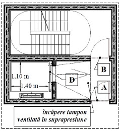

  LEGENDĂ:
  Pentru înălțimea mai mare sau egală de 75 m (obligatoriu) în partea supraterană vor îndeplini următoarele condiții:
  D - uși EI 120
  A - uși EI2 90-C5S200
  B - uși EI2 120-C5S200
  Pentru înălțimea mai mare sau egală de 75 m (obligatoriu) în partea subterană vor îndeplini următoarele condiții:
  D - uși EI 120
  A - uși EI2 120-C5S200
  B - uși EI2 120-C5S200
  Notă: Puțul ascensorului trebuie protejat integral minimum REI 240 la clădiri foarte înalte cu înălțimea mai mare de 75 m (sau REI 180/ REI 120 dacă se prevede la alte tipuri/ funcțiuni de clădiri), protecția implicând ascensorul, încăperea tampon ventilată în suprapresiune și scara protejată.
  Figura 141 - Puț protejat de acces și intervenție a pompierilor

  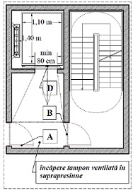

  Pentru înălțimea mai mică de 75 m (recomandabil) în partea supraterană ușile vor îndeplini următoarele condiții:
  D - ușă EI 120, dimensiune liberă de min 80 cm
  A - ușă EI_2 60-C5S_200, dimensiune liberă de min 90 cm
  B - ușă EI_2 120-C5S_200, dimensiune liberă de min 90 cm
  Pentru înălțimea mai mică de 75 m (recomandabil) în partea subterană ușile vor îndeplini următoarele condiții:
  D - ușă EI 120, dimensiune liberă de min 80 cm
  A - ușă EI_2 90-C5S_200, dimensiune liberă de min 90 cm
  B - ușă EI_2 120-C5S_200, dimensiune liberă de min 90 cm
  Pentru înălțimea mai mare sau egală de 75 m (obligatoriu) în partea supraterană ușile vor îndeplini următoarele condiții:
  D - ușă EI 120, dimensiune liberă de min 80 cm
  A - ușă EI_2 90-C5S_200, dimensiune liberă de min 90 cm
  B - ușă EI_2 120-C5S_200, dimensiune liberă de min 90 cm
  Pentru înălțimea mai mare sau egală de 75 m (obligatoriu) în partea subterană ușile vor îndeplini următoarele condiții:
  D - ușă EI 120, dimensiune liberă de min 80 cm
  A - ușă EI_2 120-C5S_200, dimensiune liberă de min 90 cm
  B - ușă EI_2 120-C5S_200, dimensiune liberă de min 90 cm
  Figura 142 - Ascensor dedicat intervenției
  (obligatoriu la clădiri cu înălțimea mai
  mare sau egală de 75 m) prevăzut cu acces dedicat din încăperea
  tampon aferentă casei de scară destinată numai intervenției pompierilor
