# Anexa nr. 4.2 – ATRIUMURI
ATRIUMURI
Generalități atriumuri
(73) Atriumul al cărui volum liber este închis pe toate fețele laterale și a cărui lățime minimă este mai mică sau egală cu înălțimea fațadei celei mai înalte și care este deschis la partea superioară cel puțin 90%, este considerat atrium descoperit.
(74) Cea mai mică dimensiune a unui atrium este definită ca fiind diametrul cilindrului drept inscripționat pe întreaga înălțime a atriului, în spațiul liber dintre:
  - – extremitățile balcoanelor pentru atriumuri deschise;
  - – pereți verticali pentru atriumuri închise;
  - – extremități ale balcoanelor și pereți verticali pentru atriumuri deschise pe o parte și închise pe cealaltă parte
(75) Secțiunea de bază a atriumului este cea mai mare dintre secțiunile orizontale incluse între elementele de construcție care delimitează atriumul (conform alineatului precedent). La fiecare nivel, secțiunea decalajului dintre elementele de construcție trebuie să fie cel puțin egală cu jumătate din această secțiune de bază.
(76) Volumul de bază al atriumului este produsul secțiunii de bază înmulțită cu înălțimea totală a atriului, măsurată la plafonul ultimului nivel.
(77) Atriumul ale cărui dimensiuni sunt precizate anterior și care este acoperit total sau parțial (mai mult de 10%), este considerat atrium acoperit. La această categorie se disting două tipuri de atriumuri acoperite:
  - – atriumurile acoperite deschise, sunt volume în care unul sau mai multe niveluri sunt deschise permanent către volumul central;
  - – atriumurile acoperite închise, sunt volume unde toate nivelurile (cu excepția nivelului inferior) sunt închise lateral prin pereți, chiar dacă în acești pereți de la nivelul inferior există goluri, sau dacă nivelurile au balcoane sau o circulație orizontală deschisă între pereți și volumul atriumului.
(78) Prevederile din normativ se referă la acele atriumuri acoperite care au lățimea minimă de cel puțin √7H din înălțimea lor (în care H este cea mai mică înălțime a atriumului) și care au cel puțin patru niveluri pe una sau mai multe laturi ale clădirii adiacente atriumului.
(79) La realizarea unor atriumuri, patio sau curți de lumină pe mai puțin de 4 niveluri și acoperite, zonele pline cu înălțimea de cel puțin 1,20 m, dintre niveluri, în dreptul planșeelor, trebuie să fie E 30.

  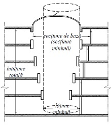

  Figura 143 - Atrium - secțiune și volum
Tipuri de atrium
(80) VARIANTA 1 Clădirea are atrium, zona etajată având minimum 4 niveluri.

  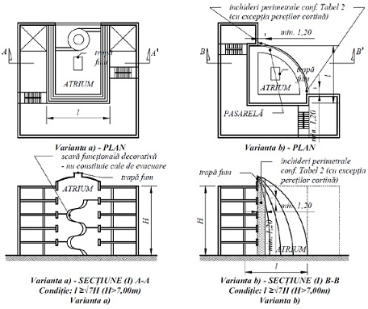

  Figura 144 - Clădiri cu atrium - variante
(81) VARIANTA 2: clădirea se consideră fără atrium, având mai puțin de 4 niveluri. La realizarea unor atriumuri, patio sau curți de lumină pe mai puțin de 4 niveluri și acoperite, zonele pline cu înălțimea de cel puțin 1,20 m, dintre niveluri, în dreptul planșeelor, trebuie să fie E 30.

  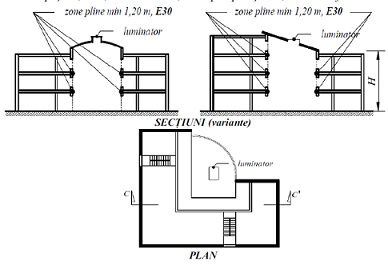

  Figura 145 - Clădire fără atrium
(82) ATRIUM (PATIO, CURTE DE LUMINĂ) incintă închisă din interiorul unei construcții, delimitată pe una sau mai multe laturi de cel puțin patru niveluri ale construcției.
(83) Atriumurile pot fi neacoperite sau acoperite.

  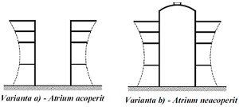

  Figura 146 - Atrium acoperit sau neacoperit
(84) Atriumurile tratate în normativ sunt cele care îndeplinesc condițiile:
  - 1) sunt delimitate pe una sau mai multe laturi de minimum patru niveluri ale clădirii;
  - 2) sunt acoperite și au lățimea cel puțin √7H (H fiind cea mai mică înălțime a atriumului).
  - 3) îndeplinesc condiția l ≥ √7H.

  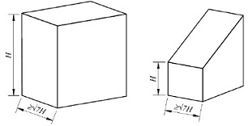

  Figura 147 - Condiții atrium
  Notă Figura 147: Atriumurile care nu îndeplinesc raportul √7H , prezintă efectul de "COȘ" în caz de incendiu și nu sunt recomandate. Atunci când se folosesc, trebuie să îndeplinească condițiile prevăzute de Art. 2.4.9.1. (2) și Art. 2.4.9.11. (2).
(85) La realizarea unor atriumuri acoperite mai înguste (lățimea mai mică de √7H), efectul de coș în caz de incendiu se mărește și este necesar să se ia una din următoarele măsuri suplimentare, precizate la Art. 2.4.9.11. alin. (2).

  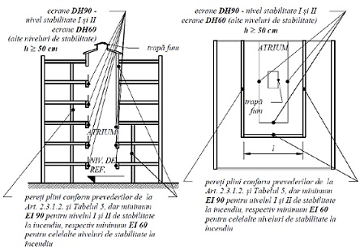

  Figura 148 - Atriumuri cu efect de coș
Amplasare atrium
(86) Amplasarea atriumurilor în raport cu clădirea, poate fi adiacentă (pe una până la trei laturi) sau înglobată.

  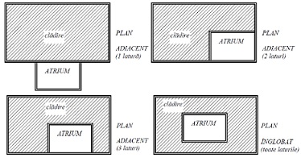

  Figura 149 - Amplasarea atriumurilor în raport cu clădirea
(87) Față de nivelurile clădirii, atriumul poate fi închis cu pereți plini, pereți vitrați sau neînchis.

  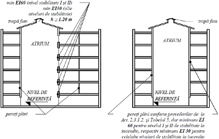

  Figura 150 - Închidere atrium - Atriumuri cu pereți plini

  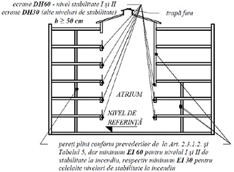

  Figura 151 - Închidere atrium - Atriumuri cu pereți vitrați

  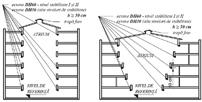

  Figura 152 - Închidere atrium - Atriumuri nedelimitate cu perete
(88) Depozitele de materiale și/sau substanțe combustibile, neseparate de atrium NU SUNT ADMISE.

  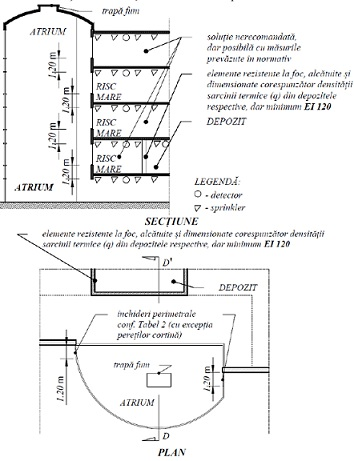

  Figura 153 - Atrium - spații cu risc mare de incendiu
(89) În construcțiile cu atrium, nu se recomandă dispunerea adiacentă, neseparată de atrium, a unor spații cu risc mare de incendiu, iar când acestea se prevăd (comerț, expoziții și altele similare cu densitatea sarcinii termice - (q) peste 840 MJ/mp), aceste spații se echipează obligatoriu cu instalații de detectare, semnalizare și alarmare, precum și cu instalații automate de stingere a incendiilor. Atunci când adiacent atriumului se prevăd spații cu funcțiuni de sănătate, cazare învățământ, comerț, expoziții și altele similare, atriumurile se prevăd cu sisteme de evacuare a fumului și gazelor fierbinți în caz de incendiu.
(90) Depozitele de materiale și/sau substanțe combustibile se separă față de atriumuri cu elemente rezistente la foc, alcătuite și dimensionate corespunzător densității sarcinii termice (q) din depozitele respective, dar minimum EI 120.
Circulații comune orizontale deschise spre atrium
(91) Circulațiile comune orizontale deschise spre atrium, se prevăd la limita lor spre atrium (sub planșee) cu ecrane continui având înălțimea de cel puțin 50 cm și rezistența la foc minimum DH 60 pentru nivelul I și/sau II de stabilitate la incendiu, respectiv minimum DH 30 pentru celelalte niveluri de stabilitate la incendiu și cu sprinklere amplasate corespunzător având durata de funcționare de minimum 60 minute, dacă spațiile adiacente sunt echipate cu astfel de instalații; pot constitui ecrane continue grinzile structurii care au înălțimea de cel puțin 50 cm sub planșeu, dedesubtul cărora se pot continua cu ecrane continue. Circulațiile comune orizontale închise spre atrium, se prevăd la limita lor spre atrium cu panouri de tâmplărie care se separă prin zone continue pline (parapete), rezistente la foc cel puțin EI 60 pentru nivelul I și/sau II de stabilitate la incendiu, respectiv minimum EI 30 pentru celelalte niveluri de stabilitate la incendiu și înălțimea minimă de 1,20 m sau conform Art. 2.4.9.4. (2).

  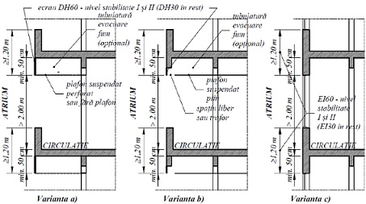

  Figura 154 - Circulațiile comune orizontale
  deschise (variante a și b) și închise (varianta c)
