# Anexa nr. 4.3 – ALCĂTUIRI CONSTRUCTIVE SPECIFICE RISCULUI DE EXPLOZIE VOLUMETRICĂ
ALCĂTUIRI CONSTRUCTIVE SPECIFICE RISCULUI DE EXPLOZIE VOLUMETRICĂ
Încăperi și spații cu pericol de explozie
Terminologie:
(92) Explozie (a unei atmosfere explozive) - Creșterea bruscă a presiunii și temperaturii, datorată oxidării sau altei reacții exoterme.
  Atmosfera explozivă gazoasă - Amestec cu aerul, în condiții atmosferice normale, a substanțelor inflamabile sub formă de gaz, vapori sau ceață în care, după aprindere, combustia se propagă în ansamblul amestecului neconsumat.
  Atmosfera explozivă cu praf - Amestec cu aerul, în condiții atmosferice normale, a substanțelor inflamabile sub formă de praf sau fibre în care, după aprindere, combustia se propagă în ansamblul amestecului neconsumat.
(93) Arie periculoasă (datorată atmosferelor explozive gazoase) - Arie în care există sau ar putea să fie prezentă o atmosferă explozivă gazoasă în asemenea cantități încât să necesite precauții speciale pentru construcția, instalarea și utilizarea aparaturii electrice.
(94) Arie periculoasă (de praf) - Arie în care praful combustibil sub formă de nor sau de strat este, sau poate fi anticipat să fie prezent în asemenea cantități încât să necesite măsuri speciale pentru construcția și utilizarea aparaturii electrice, pentru a preveni aprinderea unui amestec exploziv de praf/aer sau a unui strat de praf combustibil.
(95) Arie nepericuloasă (datorată atmosferelor explozive gazoase) - Arie în care nu poate fi prezentă o atmosferă explozivă gazoasă sau cu praf combustibil în asemenea cantități încât să necesite precauții speciale pentru construcția, instalarea și utilizarea aparaturii electrice.
(96) Arie nepericuloasă (de praf) - Arie în care praful combustibil nu este prezent în cantitate suficientă pentru a permite formarea unor amestecuri explozive semnificative de praf/aer și/sau a unor straturi de praf combustibil.
  Zona 0 - Arie în care este prezentă în permanență, sau pe perioade lungi de timp, o atmosferă explozivă gazoasă.
  Zona 1 - Arie în care este probabilă apariția unei atmosfere explozive gazoase în timpul funcționării normale.
  Zona 2 - Arie în care nu este probabilă apariția unei atmosfere explozive gazoase la funcționarea normală și, dacă totuși apare, este probabil ca aceasta să se întâmple numai rareori și doar pentru o perioadă scurtă de timp.
  Se pot obține indicații privind frecvența de apariție și durata din codurile proprii anumitor industrii sau aplicații.
  Zona 20 - Arie în care praful combustibil, sub formă de nor, este prezent în permanență sau în mod frecvent în cantitate suficientă pentru a produce o concentrație explozivă de praf combustibil în amestec cu aerul, și/sau în care stratul de praf se poate forma cu o grosime excesivă și necontrolată în timpul funcționării normale.
  Aceasta se poate întâmpla în interiorul unui spațiu limitat pentru praf în care praful poate forma amestecuri explozive, în mod frecvent sau perioade lungi. Aceasta apare tipic în interiorul echipamentului.
  Zona 21 - Arie neclasificată ca zona 20, în care, în timpul funcționării normale, praf combustibil sub formă de nor este probabil să apară în cantitate suficientă pentru a fi capabil să producă o concentrație explozivă în amestec cu aerul.
  Această zonă poate cuprinde, între altele, imediata vecinătate a punctelor de alimentare sau de evacuare a produselor pulverulente și arii în care se formează straturi de praf și este probabil ca în timpul funcționării normale să genereze o concentrație explozivă de praf combustibil în amestec cu aerul.
  Zona 22 - Arie neclasificată ca zona 21, în care nori de praf se pot produce rar și se mențin perioade scurte sau în care acumulările sau straturile de praf combustibil pot fi prezente în condiții anormale și pot genera amestecuri explozive de praf în aer. Atunci când înlăturarea acumulărilor sau straturilor de praf nu poate fi asigurată, din cauza condițiilor anormale, această arie se clasifică zona 21.
  Această zonă poate cuprinde, între altele, arii din apropierea unui echipament care conține praf ce poate scăpa prin scurgeri și poate forma depozite (săli de concasare, de exemplu, în care praful poate scăpa de la concasare și se poate depune).
  Limita inferioară explozivă LEL (abreviere) - Concentrație de gaz, vapori sau cețuri inflamabile, în aer până la care nu se formează o atmosferă explozivă gazoasă.
(97) Clasificarea zonelor ATEX depinde de prezența amestecurilor explozive în zonă.
  Zone ATEX pentru gaze și vapori
  Zona 0/Categoria 1G
  Zona 1/Categoria 2G
  Zona 2/Categoria 3G
  Zone ATEX pentru praf
  Zona 20/Categoria 1D
  Zona 21/Categoria 2D
  Zona 22/Categoria 3D
Încăperi și spații cu pericol de explozie
Măsuri constructive la spații cu pericol de explozie

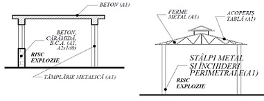

Figura 155 - Construcțiile cu pericol de explozie se realizează
din materiale și elemente de construcție clasa de reacție la foc A1

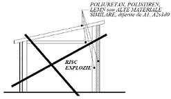

Figura 156 - Nu sunt admise materiale și elemente de
construcție combustibile (diferite de A1 sau A2-s1,d0)

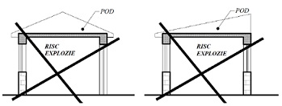

Figura 157 - Construcțiile independente cu pericol de explozie, nu vor
avea pod (indiferent de materiale și elementele din care sunt alcătuite)

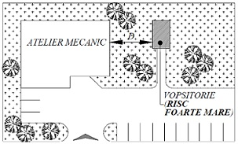

Figura 158 - Dispunerea încăperilor și
spațiilor cu pericol de explozie este recomandată în afara
construcțiilor cu alte destinații
(amplasate la distanțe de siguranță normate - D)

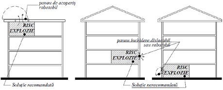

Figura 159 - Dispunerea încăperilor cu pericol de explozie
(98) Atunci când încăperile (spațiile) cu pericol de explozie (risc foarte mare și explozie volumetrică) nu pot fi dispuse în afara construcțiilor cu alte destinații, se iau măsurile de protecție prevăzute în reglementările tehnice, având în vedere că dispunerea încăperilor cu pericol de explozie nu este recomandată la nivelurile inferioare ale unei construcții etajate cu altă destinație.

  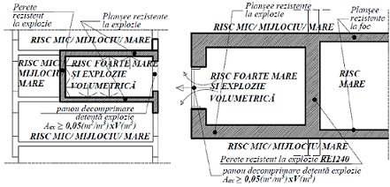

  Figura 160 - Separare prin elemente rezistente la explozie
(99) Atunci când încăperile cu pericol de explozie sunt dispuse în construcții cu alte destinații, se separă prin elemente rezistente la explozie (pereți, planșee). Planșeele rezistente la explozie trebuie să îndeplinească condițiile pereților respectivi, rezistenți la explozie.
(100) Elementele rezistente la explozie trebuie să asigure și împiedicarea propagării incendiilor din spațiile adiacente spre cel cu pericol de explozie (rezistență la foc conform densității sarcinii termice).
(101) Golurile de comunicare funcțională din pereții rezistenți la explozie se protejează prin încăperi tampon protejate, prevăzute cu pereți rezistenți la foc EI/REI 120 (cu excepția peretelui către încăperea cu risc foarte mare de incendiu și explozie volumetrică care trebuie să fie minimum REI 180) și uși 2 uși x EI_2 90-C5S_200.

  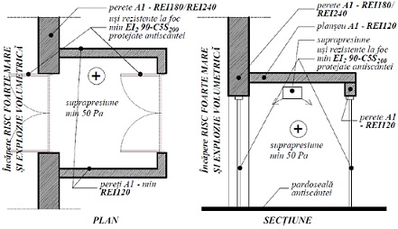

  Figura 161 - Încăpere tampon
(102) Încăperile cu pericol de explozie nu vor avea plafoane (autoportante sau suspendate) și zone neventilate.

  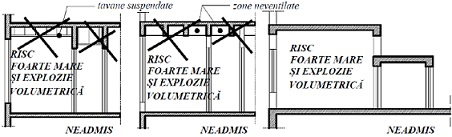

  Figura 162 - Încăpere cu pericol de explozie -
  fără plafoane (autoportante sau suspendate)
(103) Încăperile și spațiile închise cu pericol de explozie se prevăd cu goluri de decomprimare în caz de explozie.
(104) Încăperile centralelor termice echipate cu electrovană și detector automat de gaz se prevăd cu goluri de decomprimare în caz de explozie cu aria de cel puțin 0,02 mp la 1 mc din volumul încăperii.
  Determinarea dimensiunilor suprafeței zonelor de descărcare a presiunii (a golurilor de decomprimare în caz de explozie) se face conform următoarei formule (cu excepția spațiilor de la alineatul anterior):
  A_ex = 0,05 x V
  Unde:
  A_ex - dimensiunea suprafeței golului pentru decomprimare în caz de explozie, exprimată în mp;
  f_ex = 0,05 - factor specific de suprafață a golului pentru decomprimare în caz de explozie, exprimat în mp/mc;
  V - volumul de aer interior al incintei, exprimat în mc.

  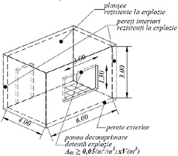

  Figura 163 - Goluri de decomprimare în caz de explozie la CT
  Exemplu:
  6,00 x 4,00 x 3,00 = 72,00 mc volum cameră CT
  72,00 mc x 0,05 mp/mc = 3,60 mp
  3,00 x 1,30 = 3,90 mp - gol decomprimare
  3,90 mp gol prevăzut de decomprimare > 3,60 mp (gol necesar de decomprimare)
(105) Golurile de decomprimare pot fi prevăzute în pereții exteriori sau în acoperiș.

  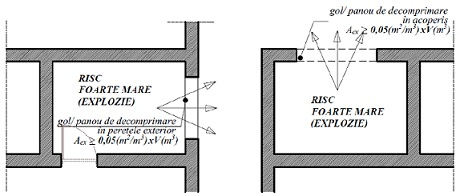

  Figura 164 - Goluri de decomprimare în pereții exteriori sau în acoperiș
(106) Nu sunt admise goluri de decomprimare în pereții și planșeele de separare față de restul construcției. În cazul în care este realizat un tambur deschis, se prevăd, de asemenea, goluri de decomprimare în partea opusă tamburului deschis, iar spre acesta se prevede perete deflector realizat similar celui de la Art. 2.3.4.1.5. .

  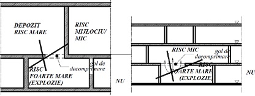

  Figura 165 - Soluții neadmise la goluri de decomprimare
(107) Golurile prevăzute pentru decomprimare în caz de explozie pot fi neînchise sau închise cu elemente de închidere care să cedeze la presiunea provocată de explozie (panouri sau porțiuni de perete sau acoperiș de tip ușor dislocabile sau rabatabile, ferestre, luminatoare cu geam simplu).

  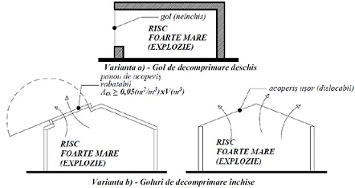

  Figura 166 - Goluri de decomprimare închise sau deschise

  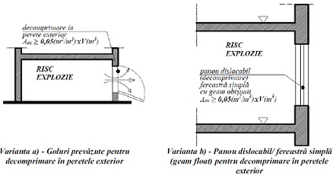

  Figura 167 - Goluri prevăzute pentru
  decomprimare în caz de explozie neînchise sau închise
  Notă Figura 167: presiunea la care trebuie să cedeze este de max. 118 daN/mp.
(108) Panourile rabatabile pot fi cu balamale (axe), orizontale sau verticale.

  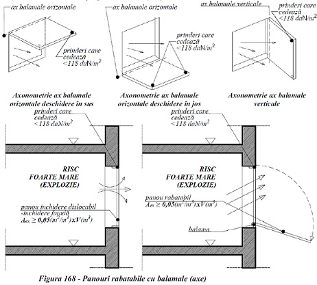

  Figura 168 - Panouri rabatabile cu balamale (axe)

  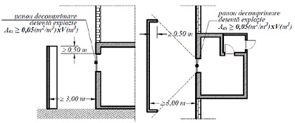

  Figura 169 - Panou de decomprimare la spații cu
  pericol de explozie (oxigen) la clădiri cu funcțiuni sanitare
(109) Depozitele de azotat de amoniu se realizează numai din materiale de construcții fără goluri, clasa de reacție la foc A1, având în vedere măsurile specifice de combatere a incendiului din Fișa cu date de securitate și, de regulă, se amplasează, față de alte construcții, la distanțe minime stabilite cu formulele:
  - – D = 22,2(0,25Q)^1/3 față de instalații vulnerabile și infrastructură critică (corespunzătoare unei suprapresiuni de explozie de 5,5 kPa);
  - – D = 17,8(0,25Q)^1/3 față de clădiri rezidențiale, inclusiv hoteluri, moteluri și alte locuri de cazare (corespunzătoare unei suprapresiuni de explozie de 7 kPa);
  - – D = 10,4(0,25Q)^1/3 față de dezvoltări comerciale, inclusiv magazine, birouri și centre de divertisment (corespunzătoare unei suprapresiuni de explozie de 14 kPa);
  - – D = 7,8(0,25Q)^1/3 față de alte clădiri industriale (corespunzătoare unei suprapresiuni de explozie de 21 kPa),
    unde:
    D = distanța între depozit și orice altă construcție vecină, exprimată în metri;
    Q = cantitatea de azotat de amoniu exprimată în kilograme.
  Notă: Distanțele se rotunjesc la cel mai apropiat multiplu superior de 10 m și se utilizează exclusiv pentru cantități mai mici decât cantitățile relevante (în tone) ale substanțelor pentru încadrarea amplasamentelor conform Legii nr. 59/2016 privind controlul asupra pericolelor de accident major în care sunt implicate substanțe periculoase, cu modificările și completările ulterioare. Pentru locații cu densitate mare a populației (de exemplu în apropierea unei săli aglomerate, unui stadion de sport, un centru comercial mare sau a unei clădiri înalte/ foarte înalte), distanțele minime vor fi stabilite cu formula: D=44,4(0,25Q)^1/3
"Prevederi împotriva pericolelor de explozie" pentru baterii staționare
Similar cu: SR EN IEC 62485-2:2019 ("Prescripții de securitate pentru baterii de acumulatoare și instalații pentru baterii. Partea 2: Baterii staționare") - Capitolul 7 "Prevederi împotriva pericolelor de explozie"
7. Prevederi împotriva pericolelor de explozie
  - 7.1. Emisii de gaz
  - 7.2. Cerințe de ventilare
  - 7.3. Ventilare naturală
  - 7.4. Ventilare forțată
  - 7.5. Moduri de încărcare
  - 7.6. Supraîncărcare în condiții de defecțiune
  - 7.7. În apropierea bateriei
  - 7.8. Prevenirea descărcărilor electrostatice în utilizarea bateriilor
7. Prevederi împotriva pericolelor de explozie
  - 7.1. Emisii de gaz
    În timpul încărcării, încărcării flotante și supraîncărcării, se emit gaze din toate bateriile și celulele secundare, cu excepția celulelor secundare care sunt sigilate etanș la gaz. Acesta este rezultatul electrolizei apei prin curentul de supraîncărcare. Gazele produse sunt hidrogen și oxigen.
    Când este emis în atmosferă, se poate crea un amestec exploziv dacă concentrația de hidrogen în aer depășește 4%.
    Când emisia de gaz este determinată experimental în baza standardelor de testare a bateriilor și valoarea rezultată este mai mică decât cea utilizată în prezentul standard, atunci nu va fi admisă nici o reducere a cerințelor de ventilare.
    Dacă valoarea experimentală a emisiei de gaz este mai mare decât valoarea presupusă în prezentul standard, atunci cerințele de ventilare vor fi adaptate, implicit crescute.
    Când o celulă ajunge la starea de încărcare completă, electroliza apei are loc conform legii Faraday. În condiții standard, adică la 0°C și 1 013 hPA (temperatura și presiune standard sub Uniunea Internațională de Chimie Pură și Aplicată):
    - – 1 Ah descompune 0,336g H_2O în 0,42 l H_2 + 0,21 l O_2;
    - – 3 Ah descompune 1 cmc (1 g) de H_2O;
    - – 26,8 Ah descompun 9 g H_2O în 1 g H_2 + 8 g O_2.
    Când funcționarea echipamentului de încărcare este oprită, se poate considera că emisia de gaz din celule s-a încheiat la aproximativ o oră după oprirea alimentării cu curent.
  - 7.2. Cerințe de ventilare
    Scopul ventilării spațiilor sau incintelor în care sunt amplasate bateriile este de a menține concentrația hidrogenului sub pragul de 4%vol, prag denumit Limită Inferioară de Explozie (LIE). Spațiile sau incintele în care sunt amplasate bateriile pot fi considerate sigure la explozie, atunci când, prin ventilare naturală sau artificială, concentrația de hidrogen este menținută sub această limită de siguranță.
    Debitul minim de aer pentru ventilarea spațiului sau incintei bateriei se va calcula cu următoarea formulă:
    Q = v x q x s x n x l_gas x C_rt x 10^-3 (mc/h)
    Q - este debitul de aer de ventilare în mc/h;
    v - este diluția necesară a hidrogenului: (100% - 4%)/4% = 24;
    q = 0,42 x 10^-3 mc/Ah hidrogen generat la 0° C;
    Observație: pentru calcule la temperatura de 25°C, valoarea (q) la temperatura de 0°C se înmulțește cu factorul 1.095.
    S = 5, factor general de siguranță;
    s - este numărul de celule;
    I_gas - este curentul care produce gaz în capacitatea nominală mA/Ah pentru curentul de încărcare flotant I_flot sau curentul de încărcare de amplificare I_impuls;
    C_rt - este capacitatea C_10 a celulelor din plumb cu acid (Ah), Uf = 1,80 V/celula la 20°C sau capacitatea C5 pentru celule NiCd (Ah), Uf = 1,00 V/celula la 20°C.
    Pentru: v x q x s = 0,05 mc/Ah formula de calcul al debitului de aer de ventilare este:
    Q = 0,05 x n x l_gas x C_rt x 10^-3 (mc/h)
    I_gas - producerea de gaz este determinată de următoarea formulă:
    l_gas = I_flot/ampl x fg x fs (mA/Ah)
    unde:
    I_flot - este curentul de încărcare flotantă în condiții de încărcare completă la o tensiune de încărcare float definită la 20°C;
    I_ampl - este curentul de încărcare de amplificare în condiții de încărcare completă la o tensiune de încărcare de amplificare definită la 20°C;
    f_g - este factorul de emisie a gazului, proporția de curent în stare complet încărcată care produce hidrogen;
    f_s - este factorul de siguranță, pentru a lua în considerare posibile celulele defecte care s-ar putea găsi într-un șir de baterii sau baterii mai vechi.
    Dacă nu se specifică altfel de către producător, valorile pentru I_flot și I_ampl cu datele justificative sunt prezentate în Tabelul 127 (echivalent cu tabel 1 din SR EN IEC 62485-2):
    Tabelul 127: (echivalent cu tabel 1 din SR EN IEC 62485-2) - Valori pentru curentul I la încărcare cu profiluri de încărcare IU sau U

| Parametri | Baterii cu celule ventilate din plumb cu acid | Baterii cu celule VRLA din plumb cu acid | Baterii NiCd cu celule ventilate |
|---|---|---|---|
| Factorul de emisie a gazului f_g | 1 | 0,2 | 1 |
| Factorul de siguranță f_s (include 10% celule defecte sau învechite) | 5 | 5 | 5 |
| Tensiunea de încărcare flotantă U_flot^c V/cell | 2,23 | 2,27 | 1,40 |
| Curentul de încărcare flotantă reprezentativ I_flot mA/Ah | 1 | 1 | 1 |
| Curentul (flotant) I_gas mA/Ah (în condiții de încărcare flotantă relevante pentru calculul debitului de aer) | 5 | 1 | 5 |
| Tensiunea de încărcare de amplificare U_ampl^c V/cell | 2,40 | 2,40 | 1,55 |
| Curentul de încărcare de amplificare reprezentativ I_ampl mA/Ah | 4 | 8 | 10 |
| Curentul (de amplificare) I_gas mA/Ah (în condiții de încărcare flotantă relevante pentru calculul debitului de aer) | 20 | 8 | 50 |
| Pentru un conținut de stibiu (Sb) mai mare de 3%, valoarea curentului utilizat pentru calcule trebuie să fie dublată. Pentru celulele de recombinare tip NiCd și NiMH, consultați producătorul. Tensiunile de încărcare flotantă și de amplificare pot varia în funcție de greutatea specifică a electrolitului din celulele din plumb cu acid. | Pentru un conținut de stibiu (Sb) mai mare de 3%, valoarea curentului utilizat pentru calcule trebuie să fie dublată. Pentru celulele de recombinare tip NiCd și NiMH, consultați producătorul. Tensiunile de încărcare flotantă și de amplificare pot varia în funcție de greutatea specifică a electrolitului din celulele din plumb cu acid. | Pentru un conținut de stibiu (Sb) mai mare de 3%, valoarea curentului utilizat pentru calcule trebuie să fie dublată. Pentru celulele de recombinare tip NiCd și NiMH, consultați producătorul. Tensiunile de încărcare flotantă și de amplificare pot varia în funcție de greutatea specifică a electrolitului din celulele din plumb cu acid. | Pentru un conținut de stibiu (Sb) mai mare de 3%, valoarea curentului utilizat pentru calcule trebuie să fie dublată. Pentru celulele de recombinare tip NiCd și NiMH, consultați producătorul. Tensiunile de încărcare flotantă și de amplificare pot varia în funcție de greutatea specifică a electrolitului din celulele din plumb cu acid. |

    NOTA 1: Valorile curentului de încărcare flotantă și de amplificare cresc o dată cu temperatura. Consecințele unor creșteri în temperatură, până la maximum 40°C, au fost considerate în calculul valorilor din Tabelul 127 (echivalent cu tabel 1 din SR EN IEC 62485-2).
    NOTA 2: În cazul în care se utilizează dopuri de aerisire pentru recombinarea gazului, valoarea curentului de producere a gazului I_gas poate fi redus la 50% din valorile pentru celulele ventilate.
    NOTA 3: Cerințele privind volumul de aer de ventilare, de exemplu, pentru două șiruri de 48V de celule VRLA din același spațiu în care se află bateria sau în același dulap pentru baterii și fiecare cu o capacitate nominală de 120 Ah C10, în condiții de service de încărcare flotantă sau de amplificare.
    Doar cu condiție de încărcare flotantă Q = 0,05 x 24 x 1 x 120 x 0,001 = 0,144 m/h per șir sau 288 l/h total.
    Cu condiție de încărcare de amplificare Q = 0,05 x 24 x 8 x 120 x 0,001 = 1,15 mc/h per șir sau 2 300 l/h total.
  - 7.3. Ventilare naturală
    Este preferabil ca necesarul de ventilare să fie asigurat prin ventilare naturală. În cazul în care ventilarea naturală nu este posibilă, se va implementa ventilarea forțată (artificială, mecanică).
    Încăperile sau incintele în care sunt amplasate baterii necesită, în condiții de ventilare naturală, o admisie și o evacuare a aerului cu suprafețe libere minime de deschidere calculate după următoarea formulă:
    A = 28 x Q
    unde
    Q - este debitul aerului proaspăt de ventilare (mc/h);
    A - este zona liberă a deschiderii în admisia și evacuarea aerului (cmp).
    NOTĂ: În scopul acestui calcul, se presupune că viteza aerului este de 0,1 m/s.
    Admisia și evacuarea aerului trebuie să fie amplasate într-un loc optim pentru a crea cele mai bune condiții pentru schimbul de aer, adică cu:
    - – deschideri pe pereții opuși;
    - – distanța minimă de separare de 2 m la deschiderile pe același perete.
    Bateriile echipate cu sisteme de evacuare a hidrogenului bazate pe capace de colectare a gazelor și tuburi nu sunt acoperite de nici un standard de produs, de testare sau de siguranță. Prin urmare, sunt obligatorii prevederile din prezentul standard privind ventilarea spațiilor sau a incintelor unde sunt instalate bateriile.
  - 7.4. Ventilare forțată
    Acolo unde un flux de aer adecvat - Q nu poate fi obținut prin ventilare naturală și se utilizează ventilarea forțată, sistemul de încărcare trebuie să fie conectat cu sistemul de ventilare sau să fie acționată o alarmă atunci când debitul de aer necesar nu este asigurat, pentru modul de încărcare selectat.
    Aerul extras din camera bateriei va fi evacuat în exteriorul clădirii.
  - 7.5. Moduri de încărcare
    Modul obișnuit de încărcare pentru bateriile staționare este încărcarea cu curentul continuu/tensiune constantă (IU caracteristic, vezi A.3).
    În cazul în care se folosesc alte metode de încărcare decât IU caracteristic sau U caracteristic în limitele specificate în Tabelul 127 (echivalent cu tabel 1 din SR EN IEC 62485-2), debitul de aer Q pentru ventilare va fi dimensionat conform curentului maxim de ieșire al încărcătorului. În cazul în care se utilizează echipamente de încărcare cu o caracteristică variabilă, atunci pentru calculul necesarului de ventilare va fi utilizat curentul de sfârșit de încărcare considerat 25% din curentul nominal al încărcătorului.
    NOTĂ: Un încărcător cu caracteristică variabilă este un încărcător cu rezistență constantă cu un curent în scădere atunci când tensiunea crește datorită stării de încărcare în creștere a bateriei.
  - 7.6. Supraîncărcare în condiții de defecțiune
    Pot exista și alte circumstanțe, de exemplu funcționarea defectuoasă a încărcătorului sau condiții de evaporare termică, cazuri în care bateria poate produce mai mult gaz decât valorile luate în calcul la proiectarea ventilării.
    Trebuie luate măsuri de precauție împotriva funcționării defectuoase a încărcătorului sau a evaporării termice, de exemplu prin coborâre tensiunea de încărcare sub tensiunea în circuit deschis sau prin deconectarea automată a alimentării electrice. Alternativ, ventilarea ar trebui calculată pentru a corespunde curentului de ieșire maxim al încărcătorului.
  - 7.7. În apropierea bateriei
    În imediata apropiere a bateriei, diluția gazelor explozive nu este întotdeauna asigurată. Prin urmare, trebuie respectată o distanță de siguranță în cadrul căreia dispozitivele incandescente (temperatura maxima a suprafeței 300°C) care pot produce scântei. Dispersia gazului exploziv depinde de viteza de emanare a gazului și de ventilarea din apropierea sursei de emanare. Pentru calcularea distanței de siguranță d de la sursa de emanare, se va aplica următoarea formulă, presupunând o dispersie emisferică a gazului. Distanța de siguranță d se regăsește și în B.1. din SR EN IEC 62485-2:2019. Pentru informații detaliate despre calculul distanței de siguranță, consultați Anexa B.

    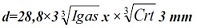

    unde:
    I_gas - este curentul care produce gaz (mA per Ah);
    C_rt - Este capacitatea nominală (Ah).
    NOTĂ: Distanța de siguranță necesară poate fi realizată prin utilizarea unui perete despărțitor între baterie și dispozitivul incandescent.
    În cazul în care bateriile fac parte integrantă dintr-un sistem de alimentare cu energie electrică, de exemplu într-un sistem UPS, distanța de siguranță d poate fi redusă conform calculelor sau măsurătorilor de siguranță ale producătorilor de echipamente. Nivelul ratei de ventilare a aerului trebuie să asigure că nu există riscul de explozie prin menținerea conținutului de hidrogen din aer sub 1% vol plus o marjă de siguranță la sursa potențială de aprindere.
    Când gazele sunt eliberate dintr-o baterie monobloc cu n celule printr-o singură deschidere de ventilare sau capac sau tub, atunci valoarea capacității utilizată pentru calcularea distanței de siguranță de la această deschidere trebuie să fie Crt=nxCrt baterie monobloc.
  - 7.8. Prevenirea descărcărilor electrostatice în utilizarea bateriilor
    Se interzice purtarea hainelor și a încălțămintei care pot genera încărcări electrostatice (vezi și 9.2 f).
    Pentru curățarea bateriei se va folosi numai material textil din bumbac umezit cu apă. Alte metode de curățare precum lichidele și pulverizatoarele duc la acumularea de încărcare electrostatică sau deteriorarea exteriorului bateriei.
