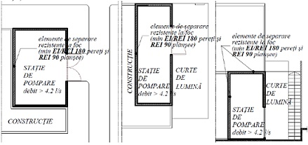
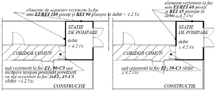
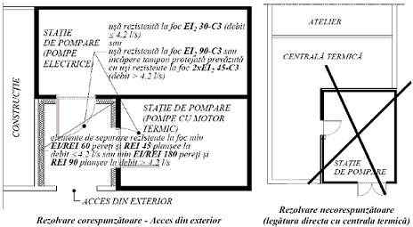
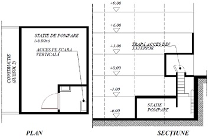

# Anexa nr. 4.4 – ÎNCĂPERI ȘI SPAȚII DESTINATE INSTALAȚIILOR
ÎNCĂPERI ȘI SPAȚII DESTINATE INSTALAȚIILOR
AFERENTE CONSTRUCȚIILOR
(Stații de pompare)
(110) Stația de pompare care asigură un debit de stingere mai mare de 4.2 l/s, se separă cu elemente clasa de reacție la foc A1 sau A2-s1,d0, rezistente la foc corespunzător densității sarcinii termice (q) din încăperile adiacente, dar minimum EI/REI 180 pentru pereți și minimum REI 90 pentru planșee.
(111) Stația de pompare cu debit mai mare de 4.2 l/s poate să comunice cu restul construcției printr-un gol funcțional protejat cu ușă rezistentă la foc EI2 90-C3 sau prin încăpere tampon protejată, (dacă nu are ferestre directe spre exterior) și prevăzută cu uși rezistente la foc EI2 45-C3. În încăpere se pot monta numai instalațiile, dispozitivele și aparatele specifice acestei funcțiuni și va avea asigurată o cale de acces din exterior (ușă directă din exterior sau dintr-o scară comună de circulație).

  

  Figura 170 - Stație de pompare separată de restul construcției și
  numai cu acces direct din exterior (la subsol având curte de lumină)

  

  Figura 171 - Stație de pompare cu acces
  direct din exterior (la stațiile de pompare cu debit mai mic de
  4.2 l/s nu este obligatoriu) și o comunicare funcțională din interior

  

  Figura 172 - Amplasare stație de pompare
(112) Stația de pompare cu debit mai mic de 4.2 l/s, se separă de restul construcției cu elemente clasa de reacție la foc A1 sau A2-s1,d0, minimum EI/REI 60 pentru pereți și minimum REI 45 pentru planșee. Stația poate să comunice cu restul construcției printr-un gol funcțional protejat cu ușă rezistentă la foc EI230-C3 fără a fi obligatoriu accesul din exterior (ușă directă din exterior sau dintr-o scară comună de circulație). Stația poate să aibă acces dintr-un hol/coridor aflat în legătură directă cu o ieșire spre exterior sau cu o scară de evacuare având debușare directă spre exterior).

  

  Figura 173 - Stație de pompare - Acces pe scara verticală
