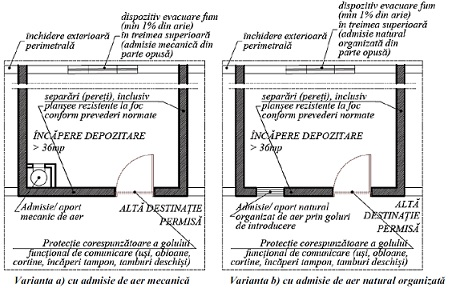
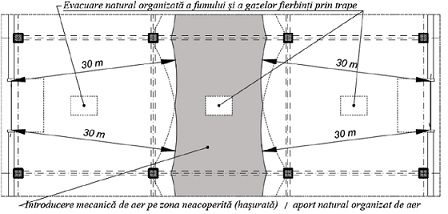

# Anexa nr. 4.5 – ÎNCĂPERI DE DEPOZITARE
ÎNCĂPERI DE DEPOZITARE
(113) Încăperile de depozitare a materialelor și substanțelor combustibile solide, cu aria mai mare de 36 mp situate în construcții cu alte destinații, trebuie să aibă asigurate conform normativului:
  - a) separări față de restul construcției, cu pereți și planșee A1 sau A2-s1,d0, rezistente la foc corespunzător densității sarcinii termice și claselor de periculozitate a materialelor depozitate;
  - b) protecția golurilor de comunicare funcțională practicate în elementele de separare;
  - c) evacuarea fumului, în caz de incendiu.

  

  Figura 174 - Încăpere de depozitare (exemplu)
  Notă Figura 174 Varianta b): Golurile de introducere pentru aportul de aer (natural organizat) vor fi protejate cu voleți (cu rezistența la foc cât a peretelui străpuns).

  

  Figura 175 - Încăperi și spații de depozitare (exemplu)
