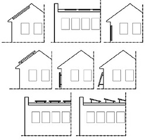
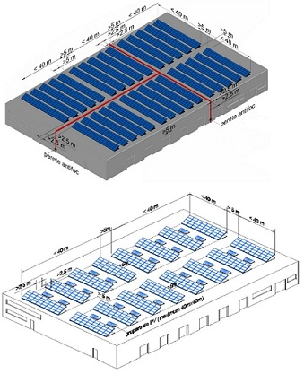
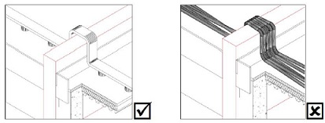

# Anexa nr. 4.6 – INSTALAȚII ȘI ECHIPAMENTE SPECIFICE ENERGIEI REGENERABILE
INSTALAȚII ȘI ECHIPAMENTE SPECIFICE ENERGIEI REGENERABILE
(114) Fațadele și acoperișurile pe care sunt aplicate dispozitive fotovoltaice, vor avea:
  - a) în situația aplicării dispozitivelor fotovoltaice pe fațadă, termoizolația sau sistemul compozit de izolație termică al fațadei va fi incombustibilă, indiferent de destinație și/sau de regimul de înălțime al clădirii;
  - b) ancorări și asamblări incombustibile, indiferent de destinație și/sau de regimul de înălțime al clădirii;
  - c) legături de echipotențializare și legare la pământ, în conformitate cu normativele de specialitate;
  - d) în cazul aplicării dispozitivelor fotovoltaice pe acoperiș, se vor avea în vedere prevederile Art. 2.3.6.2.1. iar stratul pe care se aplică:
    - – trebuie să îndeplinească performanța la foc exterior prevăzută în Tabelul 2 (Condiții minime pentru încadrarea construcției sau a compartimentului de incendiu în niveluri de stabilitate la incendiu pentru construcții civile) și/sau Tabelul 3 (Condiții minime pentru încadrarea construcției sau a compartimentului de incendiu în niveluri de stabilitate la incendiu pentru construcții de producție și/sau depozitare) din normativ sau Tabelul 144 (Condiții minime pentru încadrarea construcțiilor existente în nivel de stabilitate la incendiu) din Anexa 10 (pentru construcții existente) pentru sistemele de învelitoare (Panouri/sisteme de învelitoare ale acoperișurilor în pantă cu încărcări suplimentare provenite din PV);
      sau
    - – în cazul dispunerii panourilor fotovoltaice peste un planșeu tip terasă, stratul component exterior al acoperișurilor cu rol de asigurare a etanșeității construcției față de intemperii (de cele mai multe ori hidroizolația) să îndeplinească performanța la foc exterior prevăzută în Tabelul 2 (Condiții minime pentru încadrarea construcției sau a compartimentului de incendiu în niveluri de stabilitate la incendiu pentru construcții civile) și/sau Tabelul 3 (Condiții minime pentru încadrarea construcției sau a compartimentului de incendiu în niveluri de stabilitate la incendiu pentru construcții de producție și/sau depozitare) din normativ sau Tabelul 144 (Condiții minime pentru încadrarea construcțiilor existente în nivel de stabilitate la incendiu) din Anexa 10 (pentru construcții existente) pentru sistemele de învelitoare (Panouri/sisteme de învelitoare ale acoperișurilor în pantă cu încărcări suplimentare provenite din PV) conform încadrării în nivel de stabilitate la incendiu a construcției.
  - e) pe fațade, stratul pe care se aplică trebuie să îndeplinească performanța la foc de minimum EI 30.

    

    Figura 176 - Dispozitive fotovoltaice (conform prevederi normate)

    

    Figura 177 - Exemplu amplasare dispozitive fotovoltaice pe terasă - distanțe

    

    Figura 178 - Exemplu amplasare - traversare pereți antifoc
