# Anexa nr. 5.1 – UȘI
UȘI
Generalități
(116) "Ușă" se referă la o formă de protecție a unei deschideri în orice perete sau în structura care înconjoară un puț protejat de incendiu (cu excepția formelor de protecție denumite cortine și obloane*), indiferent dacă ușa este construită din una sau mai multe canate. Ușile folosite pentru evacuare, în general, pot fi:
  - – uși (cu deschidere normală, fără sisteme de închidere) pe balamale sau pivoți conform Art. 1.2.1. alin. 91) lit. a) din normativ;
  - – uși echipate cu sisteme de încuiere și dispozitive de ieșire (uși antipanică în acord SR EN 1125 sau uși de ieșire de urgență conform SR EN 179) conform Art. 1.2.1. alin. 91) lit. b) din normativ;
  - – uși de evacuare culisante prevăzute și cu deschidere pe balamale sau pivoți (uși culisant-pivotante = uși cu "break-out" și uși culisante automate redundante conform Art. 1.2.1. alin. 91) lit. c) și lit. d) din normativ):
  - – uși de evacuare culisant-pivotante (uși cu "break-out") sunt ușile culisante care au atât mișcare culisantă pentru deschidere automată prin sensor de prezență, cât și posibilitatea de a fi deschise pivotant prin împingerea lor de către fluxul de persoane, în sensul evacuării. Panoul culisant-pivotant trebuie amplasat astfel încât să nu existe posibilitatea situării într-o poziție intermediară și să existe spațiul necesar deschiderii prin pivotare. Se recomandă utilizarea ușilor culisant-pivotante compuse din două panouri cuplate; sau
  - – uși de evacuare culisante redundante, utilizate pentru închiderea golurilor din pereți și destinate circulației funcționale și de evacuare a utilizatorilor sunt uși acționate de un sistem complet de automatizare în care pentru fiecare echipament component esențial (motor, procesor, detector de mișcare, acumulator etc.) există constituită o sursă de energie electrică (baterii proprii, grup electrogen etc.) de rezervă în cazul unei pene de curent, defect sau incendiu, ușa culisantă se va deschide automat în siguranță fără să fie necesară acționarea mecanică;
  Observație: Ușile culisante automate pot fi folosite pe căile de evacuare dacă îndeplinesc următoarele condiții:
  - – în caz de defect, de întrerupere a alimentării cu energie electrică sau incendiu, ușile se vor deschide automat și trebuie să rămână deschise; ușile pot fi deschise prin pivotare, pliere sau deschidere laterală (doar ușile glisante redundante), pe toată lățimea normată pentru asigurarea unităților de trecere (fluxurilor) de evacuare rezultate din calcul;
  - – deschiderea ușilor este asigurată și manual, prin împingere în sensul evacuării spre exterior sau prin deschidere laterală cu dispozitiv de energie mecanică intrinsecă;
  - – uși carusel (cu tambur)/turnante conform Art. 1.2.1. alin. 91) lit. e) din normativ.
  Observație: Ușile carusel (turnante) pot fi folosite pe căile de evacuare a utilizatorilor numai dacă sunt prevăzute cu posibilitatea plierii ușoare a foilor de ușă și prin aceasta se asigură unitățile de trecere (lățimea liberă necesară evacuării fluxurilor) de evacuare rezultate din calcul. Atunci când ușile turnante nu îndeplinesc aceste condiții, în imediata lor apropiere se prevăd uși cu deschidere de tip obișnuit, pe balamale sau pivoți, care să asigure condițiile normate de evacuare.
(117) Deschiderea ușilor de evacuare pe balamale sau pivoți dispuse pe traseele de evacuare a mai mult de 30 de utilizatori capabili să se evacueze singuri, trebuie să se facă în sensul deplasării acestora spre exterior (cu excepția deschiderii ușilor de intrare în clădirile de locuit care nu sunt înalte sau foarte înalte, la care se poate realiza spre interior).
(118) Prin deschidere, ușile de evacuare nu trebuie să se împiedice una de alta sau să reducă lățimea normată libera ("L") a căilor de evacuare a utilizatorilor.
(119) Ușile de acces în casele de scări de evacuare închise vor avea asigurate sisteme de autoînchidere (C), cu excepția ușilor de acces din apartamentele de locuit, iar toate ușile rezistente la foc sau etanșe la foc și/sau etanșe la fum se prevăd cu sisteme de autoînchidere (C) sau, după caz, cu închidere automată în caz de incendiu.
(120) Ușile de acces în/din spațiile prevăzute cu suprapresiune, vor fi echipate obligatoriu cu sisteme/dispozitive de autoînchidere (C), indiferent de caracteristicile de performanță de rezistență la foc a acestora.

  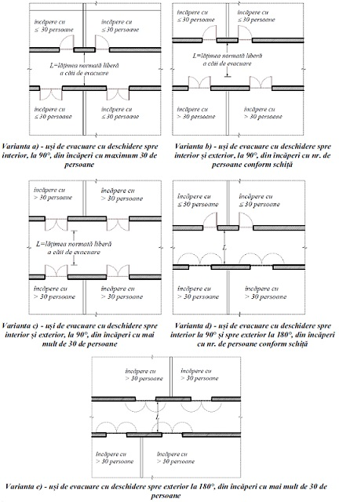

  Figura 179 - Uși de evacuare pe balamale sau pivoți cu deschidere la 90° și
  la 180° (cu balamale aruncătoare) amplasate pe circulații comune de evacuare
(121) Montarea feroneriei, a barelor antipanică etc., pe uși sau unghiul de deschidere a ușilor pe traseul de evacuare nu trebuie să îngusteze lățimea liberă necesară evacuării fluxurilor de evacuare rezultate din calcul, conform Figura 61 Variantele a) și b) din normativ ( privind "Lățimi și înălțimi libere ale ușilor de evacuare") și de mai jos.

  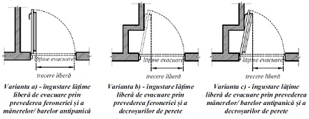

  Figura 180 - Îngustare lățime liberă de evacuare
(122) În dreptul ușilor de evacuare pentru mai mult de 5 utilizatori capabili să se evacueze singuri, nu se prevăd praguri cu înălțimea mai mare de 2,5 cm, iar cele cu înălțimea mai mare se racordează prin pante la pardoseală (pante cu înclinare de max. 8%).

  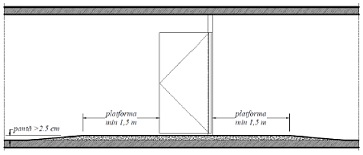

  Figura 181 - Secțiune ușa de evacuare pe
  balamale sau pivoți - racordare la praguri > 2,5 cm
Uși cu deschidere normală pe balamale sau pivoți, utilizate pe căile de evacuare
(123) Ușile pe balamale sau pivoți care se pot folosi pe căile de evacuare (cele care nu sunt echipate cu dispozitive de evacuare) pot fi într-un canat sau în două canate. Ambele canate ale ușilor duble (în două canate) se consideră a fi de evacuare doar atunci când lățimea liberă a fiecăreia dintre acestea respectă rezultatele încercărilor standardizate (în medie atunci când lățimea liberă a fiecărui canat este mai mare sau egală cu 50 cm, lățime care poate fi contrazisă prin rezultatele încercărilor standardizate) lățimea de evacuare a celor două canate însumându-se. În caz contrar, doar canatul mai mare se poate lua în calcul pentru evacuare.

  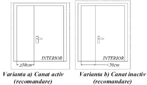

  Figura 182 - Uși cu deschidere normală pe
  balamale sau pivoți - canat activ sau inactiv
  Notă Figura 182: canatul "x" este considerat întotdeauna a fi activ când respectă rezultatele încercărilor standardizate (în funcție de feroneria utilizată, tip și sens de deschidere, amplasare etc.) și de posibilitatea de deschidere a ambelor canaturi, în medie atunci când lățimea liberă a fiecărui canat este mai mare sau egală cu 50 cm.
Uși echipate cu sisteme de încuiere și dispozitive de ieșire (uși antipanică conform SR EN 1125 sau uși de ieșire de urgență conform SR EN 179)
(124) Ușile cu dispozitive de ieșire de urgență nu se pot amplasa în locul ușilor cu dispozitive de ieșire împotriva panicii, dar ușile cu dispozitive de ieșire împotriva panicii se pot amplasa în locul ușilor cu dispozitive de ieșire de urgență.

  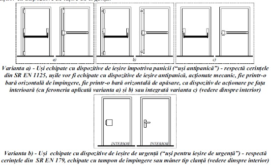

  Figura 183 - Exemple uși echipate cu
  sisteme de încuiere și dispozitive de ieșire

  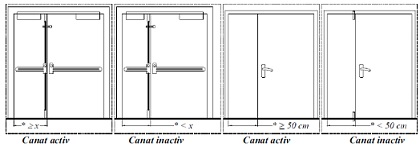

  Figura 184 - Uși echipate cu sisteme de încuiere
  și dispozitive de ieșire - canat activ sau inactiv
  Notă Figura 184: * - canatul "x" este considerat întotdeauna a fi activ când respectă rezultatele încercărilor standardizate (în funcție de feroneria utilizată, tip și sens de deschidere, amplasare etc.) și de posibilitatea de deschidere a ambelor canaturi, conform încercări (diferit față de ușile cu deschidere normală, pe balamale sau pivoți)
Uși cu dispozitive de ieșire împotriva panicii - "uși antipanică"
(125) Ușile prevăzute cu dispozitive de ieșire împotriva panicii sunt destinate evacuării din spații și clădiri unde un număr mare de utilizatori, care nu cunosc spațiile, poate fi prezent în același timp. Exemple: obligatoriu săli aglomerate, clădiri înalte și foarte înalte precum și cele explicit detaliate în cadrul normativului, centre comerciale, spitale, teatre, discoteci, funcțiuni sportive și alimentație publică etc. Trebuie să se ia în considerare tipul clădirii și al spațiilor, precum și numărul căilor de evacuare și caracteristicile acestora. Sunt obligatorii prevederile din textul normativului referitoare la uși echipate cu bare antipanică, acestea trebuind realizate în conformitate cu standardul. Echiparea acestor uși se referă la dispozitivele de ieșire de panică care respectă cerințele din standardul european SR EN 1125.
Uși cu dispozitive de ieșire de urgență - "uși pentru ieșire de urgență"
(126) Ușile prevăzute cu dispozitive de ieșire de urgență sunt destinate evacuării din clădiri în care este puțin probabil ca publicul să fie prezent în număr mare și în care personalul din clădire a fost instruit atât în procedurile de urgență, cât și în utilizarea dispozitivelor de ieșire de urgență specifice, montate. Exemple sunt birourile și încăperile fără aglomerări de persoane și fără acces al vizitatorilor (exemplu către scara exterioară de evacuare). Acestea sunt recomandate ca cel mai scăzut nivel pentru ușile de ieșire în care nu sunt necesare dispozitive de ieșire împotriva panicii. Echiparea acestor uși se referă la dispozitivele de ieșire de urgență cu acționare simplă, care respectă cerințele din standardul european SR EN 179.

  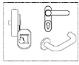

  Figura 185 - Dispozitive de ieșire de urgență

  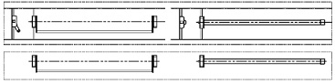

  Figura 186 - Dispozitive de ieșire împotriva panicii

  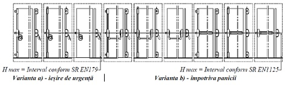

  Figura 187 - Dispozitive de ieșire de
  urgență și bare împotriva panicii (exemple)
Uși cu sisteme de evacuare acționate/controlate electric (pentru utilizarea pe căile de evacuare)
(127) Proiectarea unui sistem de ieșire controlat electric trebuie să fie făcut astfel încât orice defecțiune a unei componente incluse într-un singur element electric, cum ar fi elementul de declanșare, elementul de comandă, elementul de blocare electrică, dispozitivul cu comandă centralizată etc.) să ducă la deblocarea automată imediată a ușii.
(128) În spații și clădiri unde un număr mare de utilizatori, care nu cunosc spațiile pot fi prezenți în același timp (de exemplu săli aglomerate sau număr mare de persoane), sistemul electric controlat prevăzut pentru evacuare prevede soluții în care ușile trebuie să fie prevăzute cu dispozitive de ieșire împotriva panicii/bare de împingere. Echiparea acestor uși se poate referi la sistemele de evacuare cu componente care îndeplinesc și cerințele standardului european SR EN 13637.
(129) Pentru spațiile cu un număr mai mic de utilizatori și în care nu toată lumea are cunoștințe asupra tuturor posibilităților de evacuare din clădiri și spații, ușile trebuie să fie prevăzute cu dispozitive de ieșire de urgență. Echiparea acestor uși se referă la sistemele de evacuare cu componente care îndeplinesc cerințele standardului european SR EN 179.
Uși culisante prevăzute și cu deschidere pe balamale

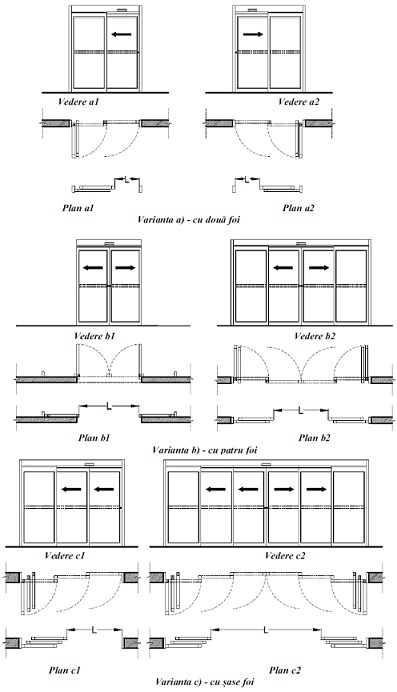

Figura 188 - Exemple uși culisante prevăzute
și cu deschidere pe balamale (uși cu break out)
Notă Figura 188: "L" reprezintă lățimea liberă de evacuare a ușilor culisante prevăzute cu break-out.

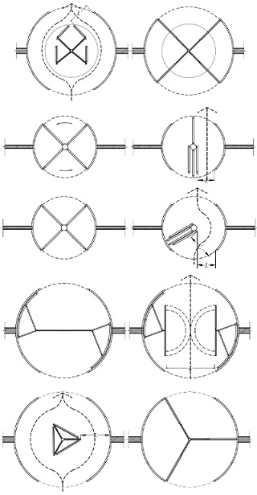

Figura 189 - Exemple tipuri de uși turnante folosite ca și căi de evacuare
Notă Figura 189: "L" reprezintă lățimea liberă de evacuare a ușilor turnante.
Caz special: uși de evacuare pe balamale sau pivoți care pot fi menținute deschise de dispozitivul electromagnetic sau electromecanic în timpul funcționării normale
(130) Dispozitiv electromagnetic sau electromecanic de fixare a ușii - "Dispozitiv electromagnetic sau electromecanic de fixare a ușilor" se referă la un dispozitiv care ține ușile deschise. Acest dispozitiv este conceput pentru a închide automat ușile în caz de incendiu, contribuind astfel la limitarea răspândirii focului și a fumului. Evenimentele care determină declanșarea acestor dispozitive includ detectarea fumului, întreruperea alimentării cu energie electrică a ușii, declanșarea unei alarme de incendiu și declanșarea manuală.
  - – dispozitiv de fixare a ușilor electromagnetic/mecanic (a se vedea Figura 190);
  - – folosite pentru uși care pot fi menținute deschise de dispozitivul electromagnetic sau electromecanic în timpul funcționării normale.
(131) Dispozitiv de blocare/ deblocare electromagnetică sau electromecanică a ușii - "Dispozitiv de blocare electromagnetic sau electromecanic" se referă la un dispozitiv care asigură controlul accesului și implicit al evacuării și care ține ușile închise. Acest dispozitiv este conceput și pentru a debloca automat ușile în caz de incendiu, contribuind astfel la facilitarea evacuării. Un dispozitiv de deblocare electromagnetică/electromecanică trebuie să fie prevăzut cu un mijloc de anulare manuală (de deblocare cu anulare a oricărei alte comenzi) situat în spațiul din care se face evacuarea.
  Notă: Trebuie folosite cu control acces în timpul funcționării normale, cu deblocare automată a dispozitivului de fixare deschisă a ușii în caz de incendiu.

  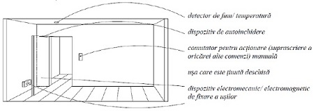

  Figura 190 - Ușă ținută deschisă de dispozitivul
  electromagnetic sau electromecanic, cu închidere în caz de incendiu
(132) Ușile prevăzute cu dispozitive de ieșire împotriva panicii se prevăd obligatoriu în situațiile prevăzute în normativ. Uși prevăzute cu dispozitive de ieșire împotriva panicii precum și uși prevăzute cu dispozitive de ieșire de urgență se pot prevedea și suplimentar (din considerente antifurt sau alte considerente) conform prevederi din Tabelul 128.
  Tabelul 128: Alegerea dispozitivului de ieșire pentru uși de evacuare în funcție de utilizare

| Funcțiune | Funcțiune | Poziția ușii | Dispozitiv de ieșire la panică (SR EN 1125) | Dispozitiv de ieșire de urgență (SR EN 179) |
|---|---|---|---|---|
| Clădiri de locuit supraterane | Locuințe alternative (Cămine/ dormitoare comune ori camere de cămin/ internat, apartamente de serviciu) | La scară/ fiecare nivel și spre exterior* | - | X |
| Clădiri administrative supraterane | < 2000 mp (Ad) | La scară/ fiecare nivel | - | X (recomandare) |
| Clădiri administrative supraterane | < 2000 mp (Ad) | De la scară spre exterior* | - | X (recomandare) |
| Clădiri administrative supraterane | < 2000 mp (Ad) | Spre exterior* | - | X (recomandare) |
| Clădiri administrative supraterane | > 2000 mp (Ad) | La scară/fiecare nivel | - | X (recomandare) |
| Clădiri administrative supraterane | > 2000 mp (Ad) | De la scară spre exterior* | X (recomandare) | - |
| Clădiri administrative supraterane | > 2000 mp (Ad) | Spre exterior* | X (recomandare) | - |
| Clădiri pentru comerț supraterane | Centru comercial sau magazin < 300 mp (A utila) | Spre exterior* sau degajament protejat | - | X |
| Clădiri pentru comerț supraterane | Centru comercial sau magazin > 300 mp (A utila) | Spre exterior* sau degajament protejat | X | - |
| Clădiri pentru comerț supraterane | Centru comercial sau magazin > 300 mp (A utila) | Din galeria comerciala comună spre exterior | X | - |
| Clădiri pentru sănătate supraterane | < 200 de paturi | La scară | - | X (recomandare) |
| Clădiri pentru sănătate supraterane | < 200 de paturi | De la scară spre exterior* | - | X (recomandare) |
| Clădiri pentru sănătate supraterane | > 200 de paturi | La scară | - | X (recomandare) |
| Clădiri pentru sănătate supraterane | > 200 de paturi | De la scară spre exterior* | X | - |
| Clădiri pentru sănătate supraterane | Centru de îngrijire de zi | Spre exterior* | - | X (recomandare) |
| Clădiri pentru cultură supraterane | < 200 de utilizatori | Spre foaier sau scară | - | X (recomandare) |
| Clădiri pentru cultură supraterane | < 200 de utilizatori | Spre exterior* | - | X (recomandare) |
| Clădiri pentru cultură supraterane | ≥ 200 de utilizatori | Spre exterior* sau la scară | - | X (recomandare) |
| Clădiri pentru cultură supraterane | ≥ 200 de utilizatori | De la scară spre exterior* | X (recomandare) | - |
| Clădiri pentru învățământ supraterane | < 200 de persoane | La scară | - | X (recomandare) |
| Clădiri pentru învățământ supraterane | < 200 de persoane | De la scară spre exterior* | - | X (recomandare) |
| Clădiri pentru învățământ supraterane | ≥ 200 de persoane | La scară | - | X (recomandare) |
| Clădiri pentru învățământ supraterane | ≥ 200 de persoane | De la scară spre exterior* | X | - |
| Clădiri pentru turism supraterane | < 200 de locuri de cazare (cu excepția restaurantului etc.) | La scară | - | X (recomandare) |
| Clădiri pentru turism supraterane | < 200 de locuri de cazare (cu excepția restaurantului etc.) | De la scară spre exterior* | - | X (recomandare) |
| Clădiri pentru turism supraterane | ≥ 200 de locuri de cazare (cu excepția restaurantului etc.) | La scară | - | X (recomandare) |
| Clădiri pentru turism supraterane | ≥ 200 de locuri de cazare (cu excepția restaurantului etc.) | De la scară spre exterior* | X | - |
| Clădirile de cult supraterane | < 200 de utilizatori | Spre exterior* | - | - |
| Clădirile de cult supraterane | ≥ 200 de utilizatori | Spre exterior* | - | - |
| Clădiri de sport supraterane | < 200 de utilizatori | La scară | - | X (recomandare) |
| Clădiri de sport supraterane | < 200 de utilizatori | De la scară spre exterior* | - | X (recomandare) |
| Clădiri de sport supraterane | ≥ 200 de utilizatori | La scară | - | X (recomandare) |
| Clădiri de sport supraterane | ≥ 200 de utilizatori | De la scară spre exterior* | X | - |
| Construcții civile supraterane montane sau din Delta Dunării amplasate izolat | ≤ 150 de locuri de cazare (cu excepția restaurantului etc.) | La scară | - | X (recomandare) |
| Construcții civile supraterane montane sau din Delta Dunării amplasate izolat | ≤ 150 de locuri de cazare (cu excepția restaurantului etc.) | De la scară spre exterior* | - | X (recomandare) |
| Construcții civile supraterane montane sau din Delta Dunării amplasate izolat | > 150 de locuri de cazare (cu excepția restaurantului etc.) | La scară | - | X (recomandare) |
| Construcții civile supraterane montane sau din Delta Dunării amplasate izolat | > 150 de locuri de cazare (cu excepția restaurantului etc.) | De la scară spre exterior* | X | - |
| Parcaje pentru autoturisme | Parcaje pentru autoturisme | - / Bariere cu deschidere automată | - / Bariere cu deschidere automată | - / Bariere cu deschidere automată |
| Stadioane, arene sportive | Stadioane, arene sportive | - / turnicheți | - / turnicheți | - / turnicheți |
| Amenajări pentru spectacole în aer liber și corturi | Amenajări pentru spectacole în aer liber și corturi | - / bariere de dirijare a circulației realizate și amplasate astfel încât să nu împiedice circulația și evacuarea utilizatorilor | - / bariere de dirijare a circulației realizate și amplasate astfel încât să nu împiedice circulația și evacuarea utilizatorilor | - / bariere de dirijare a circulației realizate și amplasate astfel încât să nu împiedice circulația și evacuarea utilizatorilor |
| Campinguri | Campinguri | - | - | - |
| Clădiri civile supraterane înalte | Clădiri civile supraterane înalte | Încăperi tampon la scară | X | - |
| Clădiri civile supraterane înalte | Clădiri civile supraterane înalte | De la încăperi tampon la scară spre exterior* | X | - |
| Clădiri civile supraterane înalte | Clădiri civile supraterane înalte | Orice spațiu > 50 persoane | X | - |
| Clădiri civile supraterane foarte înalte | Clădiri civile supraterane foarte înalte | Încăperi tampon la scară | X | - |
| Clădiri civile supraterane foarte înalte | Clădiri civile supraterane foarte înalte | De la încăperi tampon la scară spre exterior* | X | - |
| Clădiri civile supraterane foarte înalte | Clădiri civile supraterane foarte înalte | Orice spațiu > 50 persoane | X | - |
|  |  | Spre foaier sau scară | X | - |
| Clădiri civile cu săli aglomerate/ușile de pe traseul evacuării | Clădiri civile cu săli aglomerate/ușile de pe traseul evacuării | Spre exterior* | X | - |
| Clădiri civile cu încăperi cu aglomerări de persoane | Clădiri civile cu încăperi cu aglomerări de persoane | Spre exterior* sau la scară |  | X (recomandare) |
| Clădiri civile cu încăperi cu aglomerări de persoane | Clădiri civile cu încăperi cu aglomerări de persoane | De la scară spre exterior* | X (recomandare) | - |
| Clădiri civile subterane | < 50 de utilizatori | La scară | - | X (recomandare) |
| Clădiri civile subterane | < 50 de utilizatori | De la scară spre exterior* | - | X (recomandare) |
| Clădiri civile subterane | ≥ 50 de utilizatori | La scară | X | - |
| Clădiri civile subterane | ≥ 50 de utilizatori | De la scară spre exterior* | X | - |
| Construcții de producție și/sau depozitare | Producție | Spre exterior* |  | X (recomandare) |
| Construcții de producție și/sau depozitare | Laboratoare etc. cu activitate care prezintă pericol de explozie | Spre exterior* | X | - |
| Construcții de producție și/sau depozitare | Depozitare | - | - | X (recomandare) |
| Construcții civile cu funcțiuni mixte | Funcție de spații și/sau tip de clădire | Funcție de spații și/sau tip de clădire | Funcție de spații și/sau tip de clădire | Funcție de spații și/sau tip de clădire |
| Orice funcțiune; orice tip de clădire | Uși neutilizate în circulația funcțională curentă | Spre exterior* | X | - |
| Orice funcțiune; orice tip de clădire | Scări exterioare | - | X | X |
| Note Tabel 128: * (spre exterior) = ușile prin care se asigură evacuarea utilizatorilor în caz de incendiu la nivelul terenului sau al unei suprafeței carosabile; ”-” = nu se aplică. | Note Tabel 128: * (spre exterior) = ușile prin care se asigură evacuarea utilizatorilor în caz de incendiu la nivelul terenului sau al unei suprafeței carosabile; ”-” = nu se aplică. | Note Tabel 128: * (spre exterior) = ușile prin care se asigură evacuarea utilizatorilor în caz de incendiu la nivelul terenului sau al unei suprafeței carosabile; ”-” = nu se aplică. | Note Tabel 128: * (spre exterior) = ușile prin care se asigură evacuarea utilizatorilor în caz de incendiu la nivelul terenului sau al unei suprafeței carosabile; ”-” = nu se aplică. | Note Tabel 128: * (spre exterior) = ușile prin care se asigură evacuarea utilizatorilor în caz de incendiu la nivelul terenului sau al unei suprafeței carosabile; ”-” = nu se aplică. |
