# Anexa nr. 5.2 – CIRCULAȚII COMUNE VERTICALE (SCĂRI)
CIRCULAȚII COMUNE VERTICALE (SCĂRI)
Scări cu rampe drepte

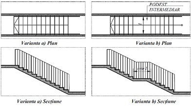

Figura 191 - Scări cu o rampă dreaptă

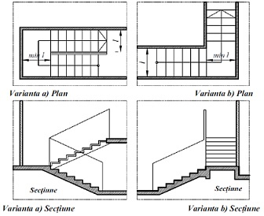

Figura 192 - Scări cu două rampe drepte

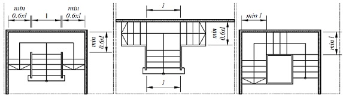

Figura 193 - Scări cu trei rampe drepte -
se pot realiza cu una sau mai multe rampe

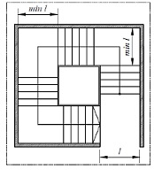

Figura 194 - Scări cu patru rampe drepte

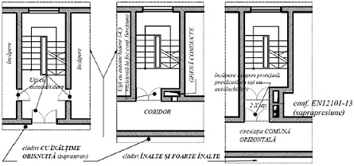

Figura 195 - Tipologii scări
(133) Rampele scărilor închise de evacuare ale nivelurilor supraterane se separă de rampele subterane conform prevederilor stipulate la Art. 2.5.6.2.3. alin. (1) și (2), Art. 3.2.11.8., Art. 4.1.5.10., Art. 4.2.5.10., Art. 5.5.4., Art. 6.1.5.12., Art. 7.5.6. și a celorlalte prevederi stipulate în normativ. Fac excepție situațiile prevăzute la Art. 2.5.6.2.3. alin. (3) și (4) și a celorlalte prevederi stipulate în normativ.
(134) Rampele subterane ale scărilor închise interioare dispuse în continuarea rampelor supraterane, se separă de rampele aferente nivelurilor supraterane prin pereți rezistenți la foc minimum EI/REI 120 și planșee rezistente la foc minimum REI 60. Comunicarea funcțională dintre rampele scărilor subterane și rampele scărilor supraterane ale clădirii este admisă numai printr-o ușă rezistentă la foc EI2 90-C5S200, dispusă la cota parterului sau a palierului intermediar dintre subsol și parter, cu deschidere în sensul de evacuare. Atunci când nu există comunicare între rampele subterane și cele supraterane, golul de ieșire în holul de la parter al rampei subterane se protejează cu ușă rezistentă la foc minimum EI2 30-C5S200 (dacă normativul nu stabilește valori mai mari).

  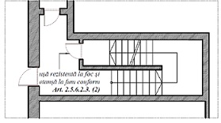

  Figura 196 - Separarea rampelor supraterane de cele subterane
Scări cu rampe încrucișate

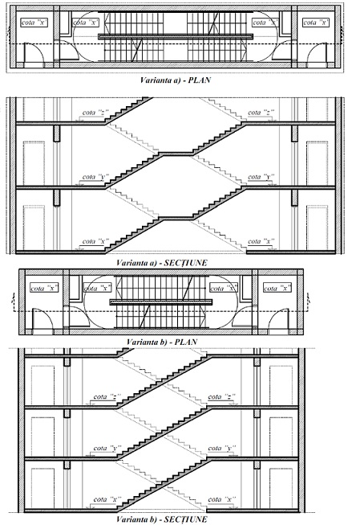

Figura 197 - Scări cu rampe încrucișate la
clădiri înalte/foarte înalte și în subteran
(135) Scările cu rampe încrucișate sunt constituite dintr-o combinație între două scări cu rampe drepte (fiecare) și care conduce la realizarea a două scări (două căi de evacuare distincte).
Scări cu rampe elicoidale
(136) Scările cu rampe elicoidale, cu una sau mai multe rampe, pot fi curbe sau în spirală.
(137) Caracteristica acestor scări elicoidale o constituie convergența muchiilor treptelor într-un singur punct.
(138) În cazul scărilor cu rampe elicoidale, indiferent de lățimea rampei realizată din considerente arhitecturale, poate constitui cale de evacuare numai porțiunea de rampă în care lățimea minimă a treptei este de 18 cm (respectiv 20 cm la săli aglomerate), iar lățimea maximă de 40 cm.
(139) O scară cu formă mixtă, compusă din rampe elicoidale combinată cu porțiuni de rampe drepte, din punct de vedere al securității la incendiu se consideră scară cu trepte balansate.

  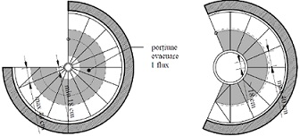

  Figura 198 - Scară în spirală (un flux de evacuare)

  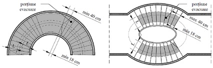

  Figura 199 - Scară cu rampa curbă
(140) Înclinarea rampelor scărilor de evacuare, suprafața și forma treptelor și a podestelor, trebuie să permită circulația ușoară și sigură a utilizatorilor, potrivit prevederilor reglementărilor tehnice aplicabile.
Scări cu trepte balansate
(141) Scările cu trepte balansate, indiferent de gabaritul acestora, pot fi considerate căi de evacuare numai pentru o unitate de trecere (flux) de evacuare a utilizatorilor, atunci când îndeplinesc condițiile de alcătuire și dimensionare prevăzute în normativ și reglementările tehnice specifice scărilor.
(142) Scara cu trepte balansate se deosebește de celelalte scări prin forma diferită în plan a treptelor.
Conformare scări
(143) În funcție de înălțimea nivelurilor clădirii, rampele unei scări pot fi cu sau fără paliere intermediare.
(144) Golurile de acces la scară se protejează, de regulă, cu uși sau, după caz, încăperi tampon, la clădirile înalte și foarte înalte. În afară de condițiile normate pe care trebuie să le îndeplinească ușile respective, ele trebuie echipate și cu dispozitive de autoînchidere.
(145) Prin deschidere, ușile de acces în casele de scări nu trebuie să reducă lățimea normală a podestelor.

  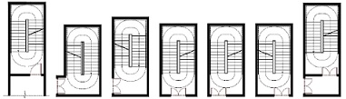

  Figura 200 - Scheme de principiu uși de
  acces în casele de scări (scară cu două rampe)

  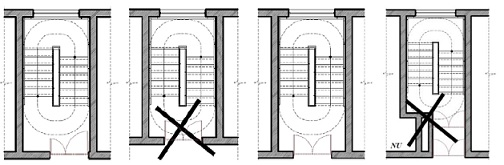

  Figura 201 - Clădiri cu înălțime obișnuită - suprateran (prin deschidere,
  ușile de acces în casele de scări nu
  trebuie să reducă lățimea normată a podestelor)

  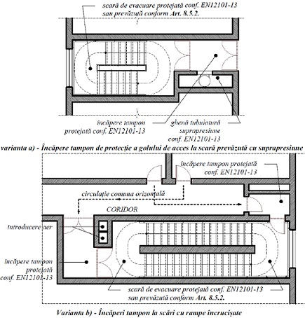

  Figura 202 - Clădiri înalte/foarte înalte - golurile de acces la
  scările de evacuare se protejează obligatoriu cu
  încăperi tampon la clădirile înalte și foarte înalte (prin deschidere, ușile
  de acces în casele de scări nu trebuie să reducă lățimea normată a podestelor)
Scări exterioare

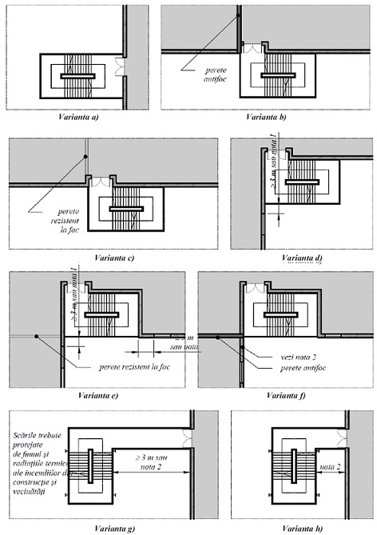

Figura 203 - Scări exterioare
Note Figura 203:
(1) În cazul în care scările exterioare sunt amplasate la colțurile întrânde ale clădirilor civile în formă de L, T sau U sub un unghi α, golurile din pereții exteriori adiacenți se dispun astfel încât distanța dintre ele să fie în funcție de nivelul de stabilitate la incendiu al compartimentelor pe care le desparte (se aplică conform Art. 2.3.2.1.9.).
(2) Se aplică conform Art. 2.5.6.4.1. Se vor avea în vedere și prevederea distanței de min. 1,20 m precum și a celorlalte prevederi normate în cazul în cazul în care pereții antifoc sunt amplasați pe fațade, sub un unghi α, α = 180°.
(3) Scările trebuie executate din materiale A1 sau A2-s1,d0, rezistente la foc minimum R 15 (R 30 la clădiri înalte și/sau foarte înalte și R 60 la clădiri foarte înalte cu înălțimea ≥ 125 m).
(4) Ușile de evacuare prevăzute spre scările exterioare deschise vor avea rezistența la foc (EI) de aceeași valoare cât a fațadelor în care sunt integrate (conform Capitol 2.3.6.1. Prevederi generale privind limitarea propagării pe fațadă din normativ), fără a fi mai mici de EI2 15-C5S_a.
