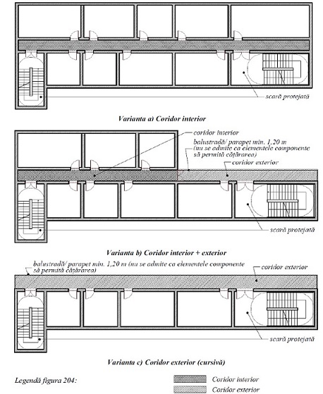
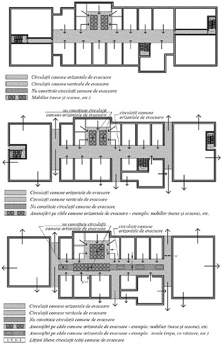

# Anexa nr. 5.3 – CORIDOARE
CORIDOARE
Generalități
(146) "Coridor" se referă la o circulație liberă care oferă mijloace de evacuare dintre camere sau spații către o ieșire (ieșire în exterior finală, scară, încăpere tampon ventilată în suprapresiune, degajament protejat etc.), fiind o încăpere lungă și îngustă (cu lungimea de cel puțin două ori cât lățimea), de-a lungul unei serii de încăperi care servește ca loc de trecere și legătură cu acestea.
(147) Coridoarele pot fi interioare și exterioare ("cursivă") sau o combinație dintre cele două.

  

  Figura 204 - Coridoare
  Spațiu de circulație și evacuare (Cale de evacuare)
(148) "Spațiu de circulație" (utilizat pentru evacuare) se referă la accesul neobstrucționat dintre o încăpere și o ieșire din clădire sau compartiment. Nu include zone utilizate pentru activități comerciale, ghișee de informații sau de recepție, zone utilizate pentru expoziții etc.
(149) În general, spațiul de circulație și evacuare se referă la circulații comune verticale (scări) sau orizontale (coridoare, holuri, încăperi tampon ventilate în suprapresiune, degajamente protejate etc.) de evacuare. Este o zonă comună a traseului utilizatorilor dintr-o încăpere către o ieșire finală. Astfel de zone comune sunt separate de alte zone cu pereți despărțitori rezistenți la foc sau echivalent (cu excepțiile permise de normativ).
(150) Parcarea nu este considerată spațiu comun de circulație de evacuare.

  

  Figura 205 - Circulații de evacuare - exemple
Coridor înfundat
(151) Coridorul înfundat se referă la o situație dintr-o zonă de circulație comună/coridor de evacuare, unde ieșirea spre scări (sau direct afară) este posibilă doar într-un capăt (către o singură direcție/scară sau către o singură ieșire spre exterior), fără a se putea evacua spre celălalt capăt.
