# Anexa nr. 5.4 – EVACUARE
EVACUARE
Generalități
(152) "Evacuare într-o singură direcție" se referă la o situație în care utilizatorii dintr-un spațiu au doar un singur traseu/o singură direcție, din punctul cel mai îndepărtat (sau de la ușa încăperii), până la o ieșire sau până la un punct de despărțire (conform prevederi), pentru a ajunge la mai multe ieșiri.
(153) "Evacuare în două direcții" se referă la o situație în care utilizatorii dintr-un spațiu au posibilitatea de a alege două direcții dintr-un punct pentru a ajunge la două ieșiri diferite (uși direct în exterior, degajamente protejate, încăperi tampon ventilate în suprapresiune, scări).
(154) "Evacuare în multiple direcții" se referă la o situație în care utilizatorii dintr-un spațiu au posibilitatea de a alege multiple direcții dintr-un punct pentru a ajunge la ieșiri diferite (uși direct în exterior, scări, degajamente protejate, încăperi tampon ventilate în suprapresiune etc.). În acest caz se consideră direcția cea mai scurtă (doar una dintre lungimile căii de evacuare trebuie să îndeplinească condițiile normate) atunci când evacuarea se face către mai multe direcții diferite, dintre care minimum două trebuie să fie opuse (într-un unghi de minimum 90°), de la locul cel mai îndepărtat considerat, până la ușa scării, a degajamentului protejat sau a încăperii tampon protejată de acces la cea mai apropiată scară de evacuare ori la o ușă/ieșire direct în exterior.
(155) Evacuarea dintr-un compartiment de incendiu prin spații aparținând unui alt compartiment de incendiu se poate face numai dacă circulația nu poate fi blocată din cauza flăcărilor sau a fumului.
(156) În construcții, compartimente de incendiu sau porțiuni de construcții independente din punctul de vedere al circulației, de regulă, persoanele trebuie să aibă acces la cel puțin o cale de evacuare, cea de-a doua cale de evacuare (atunci când aceasta este obligatorie) trebuie să ducă, pe cât posibil, în direcții opuse și poate aparține unui alt compartiment de incendiu.
(157) Căile de evacuare, nu trebuie să conducă spre exterior prin locuri în care circulația poate fi blocată în caz de incendiu, din cauza flăcărilor, fumului, radiațiilor termice etc.

  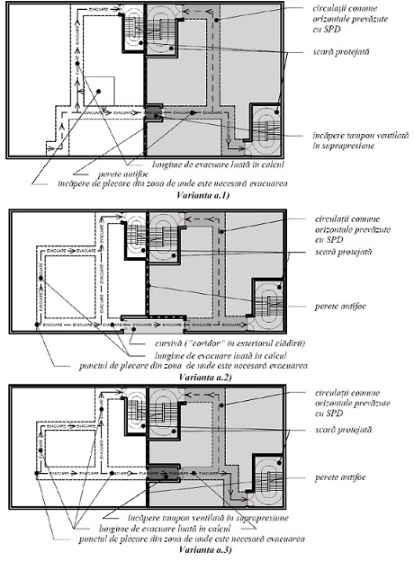

  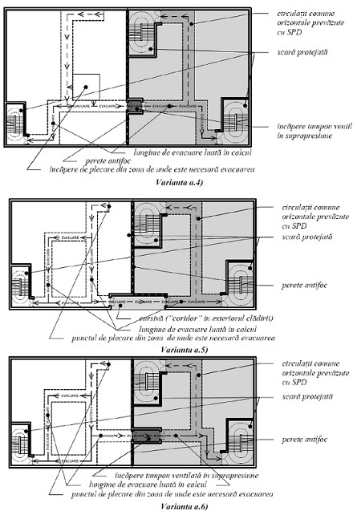

  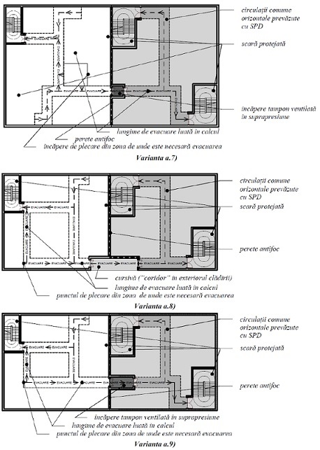

  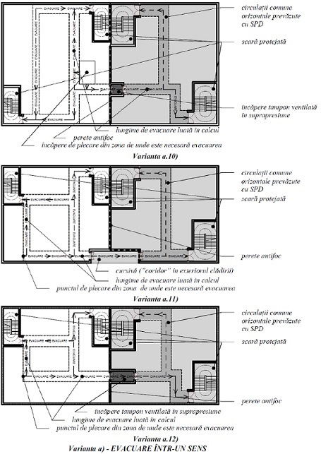

  Notă Figura 206 varianta a): Evacuarea se realizează din Compartimentul 1 de incendiu din stânga imaginilor în Compartimentul 2 de incendiu din dreapta imaginilor (prin încăperi tampon ventilate în suprapresiune aparținând Compartimentului 2 de incendiu) sau prin cursive (coridor exterior). Circulațiile comune orizontale din compartimentul de incendiu către care se realizează evacuarea (din Compartimentul 2 de incendiu din dreapta imaginilor) se prevăd cu SPD sau sisteme de evacuare a fumului și a gazelor fierbinți (din considerente de evacuare dintr-un compartiment de incendiu în altul). Atunci când evacuarea se realizează prin încăperi tampon, se prevăd SPD în încăperile tampon precum și pe circulațiile comune orizontale din compartimentul de incendiu către care se realizează evacuarea. Se admite neprevederea SPD pe circulațiile comune orizontale din compartimentul de incendiu către care se realizează evacuarea, atunci când evacuarea se realizează printr-o cursivă exterioară, justificându-se această neprevedere.

  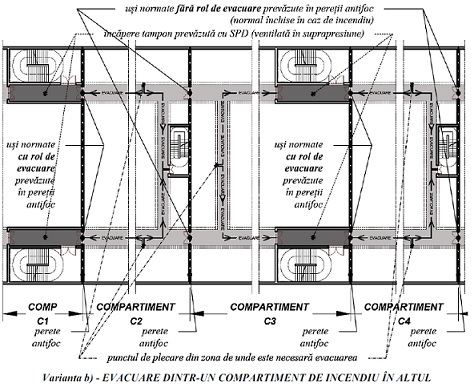

  Notă Figura 206 varianta b): Evacuarea se realizează din Compartimentul 2 de incendiu în Compartimentul 1 de incendiu (prin încăperi tampon ventilate în suprapresiune aparținând Compartimentului 1 de incendiu) și din Compartimentul 4 de incendiu în Compartimentul 3 de incendiu (prin încăperi tampon ventilate în suprapresiune aparținând Compartimentului 3 de incendiu). Nu este obligatorie prevederea SPD pe circulațiile comune orizontale din compartimentul de incendiu către care se realizează evacuarea precum și din cel din cere se realizează evacuarea (din considerente de evacuare către alt compartiment de incendiu), atunci când evacuarea se realizează printr-o încăpere tampon comună direct către o scară de evacuare sau direct în exterior (încăperea tampon comună aparținând compartimentului de incendiu prin care se realizează evacuarea).
  Notă Figura 206 varianta a) și varianta b): Compartimentele de incendiu prevăzute cu SPD trebuie prevăzute, de asemenea, cu instalație automată de detectare, semnalizare și alarmare a incendiului cu acoperire totală. În toate cazurile se va ține cont de prevederile Art. 8.1.8. (1) din normativ. Ușile încăperilor tampon prin care se realizează evacuarea către alt compartiment de incendiu din clădiri civile se vor prevedea conform cu Tabelul 123 (Uși pentru circulație funcțională și/sau evacuare practicate în pereții antifoc din clădiri civile).
  Figura 206 - Evacuarea într-un sens
  (dintr-un compartiment de incendiu în altul)

  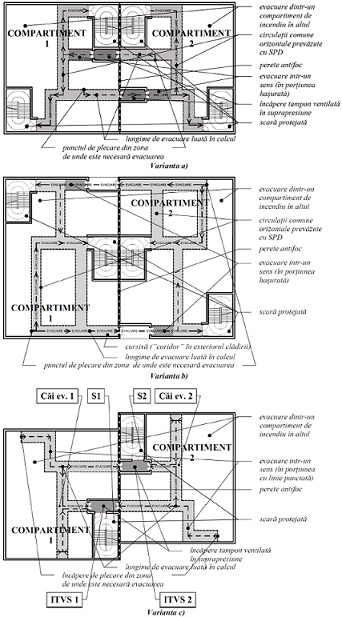

  Notă Figura 207 varianta c): Evacuarea se realizează din Compartimentul 1 de incendiu în Compartimentul 2 de incendiu (prin încăpere tampon ventilată în suprapresiune denumită "ITVS 2" aparținând Compartimentului 2 de incendiu) precum și din Compartimentul 2 de incendiu în Compartimentul 1 de incendiu (prin încăpere tampon ventilată în suprapresiune denumită "ITVS 1" aparținând Compartimentului 1 de incendiu). Nu este obligatorie prevederea SPD pe circulațiile comune orizontale din compartimentele de incendiu (către care se realizează evacuarea precum și din cel din cere se realizează evacuarea) din considerente de evacuare către alt compartiment de incendiu, atunci când evacuarea se realizează printr-o încăpere tampon comună ("ITVS 1" și "ITVS 2") direct către o scară de evacuare sau direct în exterior (fiecare "ITVS" comună aparține compartimentului de incendiu prin care se realizează evacuarea).

  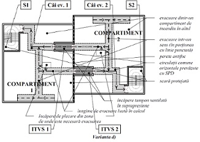

  Notă Figura 207 varianta d): Evacuarea se realizează din Compartimentul 1 de incendiu în Compartimentul 2 de incendiu (prin încăpere tampon ventilată în suprapresiune denumită "ITVS 2" aparținând Compartimentului 2 de incendiu) precum și din Compartimentul 2 de incendiu în Compartimentul 1 de incendiu (prin încăpere tampon ventilată în suprapresiune denumită "ITVS 1" aparținând Compartimentului 1 de incendiu). Atunci când evacuarea se realizează prin încăperi tampon, se prevăd obligatoriu SPD în încăperile tampon precum și pe circulațiile comune orizontale din compartimentul de incendiu către care se realizează evacuarea. În cazul specific prezentat în imagine căile de evacuare din ambele compartimente de incendiu (denumite "Căi ev.1" și "Căi ev. 2") precum și încăperile tampon din ambele compartimente se prevăd cu SPD. Este obligatoriu ca din matricea de incendiu să se automatizeze SPD din Compartimentul 2 de incendiu (al încăperii tampon denumită "ITVS 2" precum și al/ale circulațiilor comune orizontale denumite "Căi ev. 2" în directă legătură cu scara protejată către care se face evacuarea din Compartimentul 2 de incendiu denumită "S2"), atunci când se detectează incendiu în Compartimentul 1 de incendiu. Similar, este obligatoriu ca din matricea de incendiu să se automatizeze SPD din Compartimentul 1 de incendiu (al încăperii tampon denumită "ITVS 1" precum și al/ale circulațiilor comune orizontale denumite "Căi ev. 1" în directă legătură cu scara protejată către care se face evacuarea din Compartimentul 1 de incendiu denumită "S1"), atunci când se detectează incendiu în Compartimentul 2 de incendiu. Ambele compartimente de incendiu trebuie prevăzute cu instalație automată de detectare, semnalizare și alarmare a incendiului cu acoperire totală.
  Notă Figura 207 variantele a), c) și d): Compartimentele de incendiu prevăzute cu SPD trebuie prevăzute, de asemenea, cu instalație automată de detectare, semnalizare și alarmare a incendiului cu acoperire totală. În toate cazurile se va ține cont de prevederile Art. 8.1.8. (1) din normativ. Ușile încăperilor tampon prin care se realizează evacuarea către alt compartiment de incendiu din clădiri civile se vor prevedea conform Tabelul 123 (Uși pentru circulație funcțională și/sau evacuare practicate în pereții antifoc din clădiri civile).
  Figura 207 - Evacuarea în ambele sensuri
  (dintr-un compartiment de incendiu în altul)
Lungimea căii de evacuare
(158) Lungimea căii de evacuare a utilizatorilor construcțiilor, se determină pe traseul ce trebuie parcurs în axul căilor de evacuare, de la punctul de plecare al utilizatorului până la cea mai apropiată ușă de evacuare (directă în exterior, de acces într-o scară de evacuare sau de acces într-un degajament protejat) sau până la prima treaptă a scării deschise, ținând seama de poziția diferitelor echipamente sau obiecte cu amplasament fix și care trebuie ocolite. Schimbările de direcție de pe traseul parcurs se vor realiza în unghiuri cu grade funcție de axul căii de evacuare.
Coridoare
(159) Distanțele pe căile de evacuare se măsoară pe orizontală în axul căilor de circulație și evacuare și în direcția cea mai scurtă, după caz, de la ușa încăperii sau spațiului (atunci când în interiorul încăperilor/spațiilor lungimea căii de evacuare este mai mică decât lungimea de coridor înfundat specifică fiecărei funcțiuni sau tip de construcție) până la ușa scării, a degajamentului protejat sau a încăperii tampon de acces la cea mai apropiată scară de evacuare sau până la o ușă directă în exterior.

  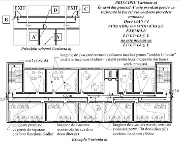

  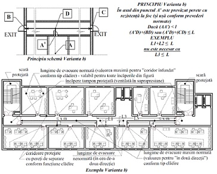

  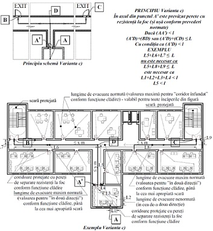

  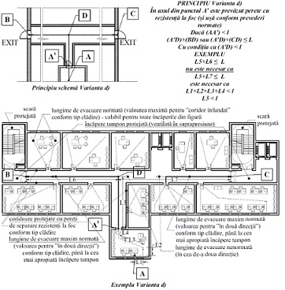

  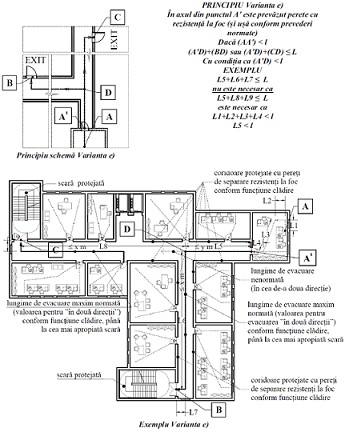

  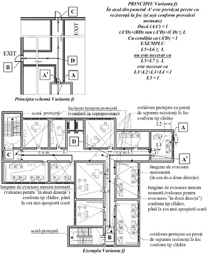

  Figura 208 - Principii privind lungimea
  căii de evacuare pe coridoare
  Notă Figura 208: "l" reprezintă lungimea de evacuare maxim normată într-o direcție ("coridor înfundat") și "L" reprezintă lungimea de evacuare maxim normată în două direcții, conform funcțiune sau tip clădire.
Open space
(160) Distanțele pe căile de evacuare se măsoară pe orizontală în axul căilor de circulație și evacuare și în direcția cea mai scurtă, după caz, de la locul cel mai îndepărtat dintr-o încăpere sau spațiu (atunci când în interiorul încăperilor/spațiilor lungimea căii de evacuare este mai mare decât lungimea de coridor înfundat specifică fiecărei funcțiuni sau tip de construcție) până la ușa scării, a degajamentului protejat sau a încăperii tampon de acces la cea mai apropiată scară de evacuare sau până la o ușă directă în exterior.

  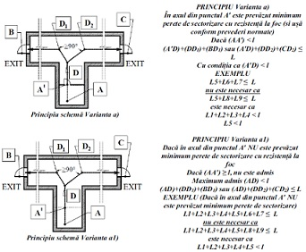

  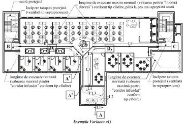

  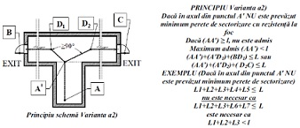

  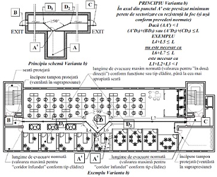

  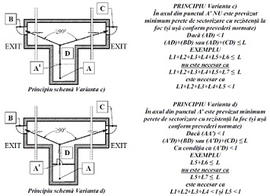

  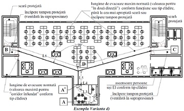

  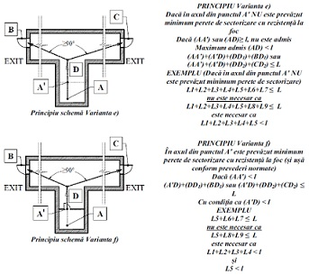

  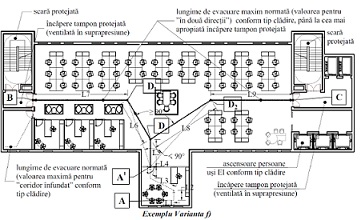

  Figura 209 - Principii privind lungimea căii de
  evacuare în interiorul spațiilor de tip open space
  Notă Figura 209: "l" reprezintă lungimea de evacuare maxim normată într-o direcție ("coridor înfundat") și "L" reprezintă lungimea de evacuare maxim normată în două direcții, conform funcțiune sau tip clădire.

  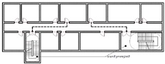

  Figura 210 - Distanțe pe căi de evacuare
  (lungimea căii de evacuare)

  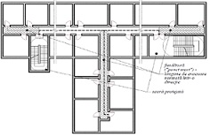

  Figura 211 - Joncțiune în "T" cu coridorul principal de evacuare
  (în cazul coridoarelor delimitate de pereți
  rezistenți la foc conform condiții normate)

  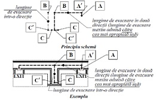

  Figura 212 - Diagramă joncțiune în "T"
  cu coridor principal de evacuare
  Notă Figura 212:
  Lungimea de evacuare într-o direcție ("l") este lungimea maximă însumată a segmentelor (CC')+(C'B)
  l = (CC') + (C'B) și
  Lungimea de evacuare în două direcții ("L") este lungimea maximă însumată a segmentelor
  (CC') + (C'B) + (BA') + (A'A)
  L = (CC') + (C'B) + (BA') + (A'A)
Caz particular - coridoare cu evacuare în "Y"
(161) Lungimea măsurată până la o scară de acces în două direcții diferite, amplasate în direcții diferite, este considerată cale de evacuare admisă dacă distanța totală a fiecărei lungimi până la o ușă a scării, nu depășește lungimea normată în două direcții.

  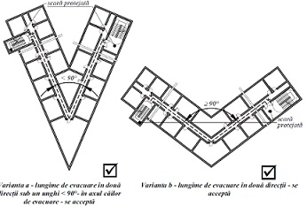

  Figura 213 - Distanțe pe căi de evacuare
  (lungimea căii de evacuare)
(162) Un coridor înfundat cu lungimea mai mică decât cea normată pentru fiecare funcțiune/tip de clădire, măsurată de la o cale de evacuare cu acces la două scări, încăperi tampon, degajamente protejate sau ieșiri în exterior amplasate în direcții opuse, este considerat cale de evacuare admisă dacă distanța totală până la o scară, încăpere tampon, degajament protejat sau ieșire în exterior nu depășește lungimea de evacuare în două direcții.

  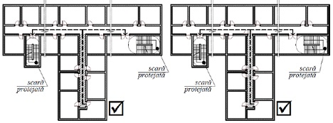

  Figura 214 - Caz particular - coridoare înfundate (lungime de evacuare
  într-o singură direcție), evacuare în "T" (un unghi = 180°) - se acceptă

  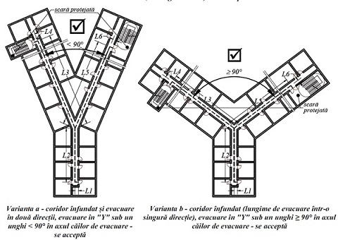

  Figura 215 - Caz particular - coridoare înfundate (lungime de evacuare
  într-o singură direcție), evacuare în "Y" - în axul căilor de evacuare
  Notă Figura 215: Conform calcul Figura 212 (Diagramă joncțiune în "T" cu coridor principal de evacuare). Lungimea de evacuare într-o direcție ("l") este lungimea maximă însumată a segmentelor (L1) + (L2)
  l = (L1) + (L2) și
  Lungimea de evacuare în două direcții ("L") este lungimea maximă însumată a segmentelor
  (L1) + (L2) + (L3) + (L4) sau (L1) + (L2) + (L5) + (L6)
  L = (L1) + (L2) + (L3) + (L4) sau L = (L1) + (L2) + (L5) + (L6)
Lungimea căii de evacuare
(163) Lungimea căii de evacuare ("distanța de evacuare") se referă la distanța necesară pentru a fi parcursă de la cel mai îndepărtat punct din orice cameră sau spațiu (cu excepția celor stipulate explicit în normativ) sau de la ușile camerelor sau spațiilor (în condițiile în care lungimea de evacuare din interiorul acestora este mai mică decât lungimea de coridor înfundat pentru fiecare funcțiune sau tip înalt sau foarte înalt de construcție în parte), până la marginea deschiderii ușii, direct la:
  - – o scară de evacuare închisă sau o încăpere tampon protejată (ventilată în suprapresiune) a unei scări de evacuare, sau
  - – o scară exterioară, sau
  - – un degajament protejat, tunel, sau
  - – direct în exterior, sau
  - – până la prima treaptă a scării deschise,
  cu excepția cazului în care se permite altfel în temeiul prezentului normativ (precum în cazul ieșirilor în zonele de refugiu).
(164) Măsurarea începe de la 40 cm de la partea interioară a peretelui în cazul în care se specifică "cel mai îndepărtat loc/punct" sau "punctul de plecare" din orice cameră/încăpere sau spațiu.

  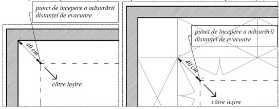

  Figura 216 - Măsurare distanța de evacuare
(165) În interiorul încăperilor acolo unde este necesar, lungimea măsurată până la o cale de evacuare cu acces în două direcții diferite, amplasate în direcții opuse, este considerată cale de evacuare admisă dacă distanța totală a fiecărei lungimi până la o ușa nu depășește lungimea normată într-o direcție iar unghiul format între cele două direcții trebuie să fie mai mare sau egal de 90°.

  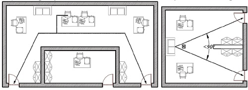

  Figura 217 - Evacuare mai mică sau egală sau mai
  mare de 90° în interiorul încăperilor clădirilor noi

  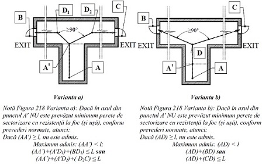

  Figura 218 - Evacuare la 90° în
  interiorul încăperilor (spațiilor) de tip open space
  (* Sensul deschiderii ușilor din desene este pur informativ)
  Notă: În toate încăperile din clădiri noi unde sunt necesare două căi de evacuare, precum și la clădirile înalte, foarte înalte (unde sunt necesare două căi de evacuare, obligatoriu la open space) sau cu săli aglomerate (unde sunt obligatorii două căi de evacuare), este obligatoriu ca evacuarea să se realizeze doar într-un unghi de minimum 90 de grade (către două direcții diferite).
Evacuare la clădiri existente
(166) La clădiri existente se pot aplica și prevederile Art. 2.5.14.1. din normativ.

  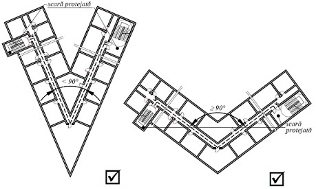

  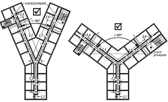

  Figura 219 - Caz particular - coridoare
  înfundate (lungime de evacuare într-o singură direcție),
  evacuare în "Y" - în axul căilor de evacuare la clădiri existente
  Notă Figura 219: Conform calcul Figura 212 (Diagramă joncțiune în "T" cu coridor principal de evacuare).
  Lungimea de evacuare într-o direcție ("l") este lungimea maximă însumată a segmentelor (L1)+(L2)
  l = (L1) + (L2) și
  Lungimea de evacuare în două direcții ("L") este lungimea maximă însumată a segmentelor
  (L1) + (L2) + (L3) + (L4) sau (L1) + (L2) + (L5) + (L6)
  L = (L1) + (L2) + (L3) + (L4) sau L = (L1) + (L2) + (L5) + (L6)
Lungimea de evacuare
(167) "Lungime de evacuare" înseamnă distanța reală pe care trebuie să o parcurgă o persoană din orice punct al unei suprafețe de pardoseală a unei camere (sau de la ușa acesteia atunci când în interiorul încăperii nu se depășește lungimea de evacuare de coridor înfundat) până la ieșirea relevantă (scară, încăpere tampon, degajament protejat, tunel, ieșire direct în exterior), ținând cont de dispunerea pereților, a pereților despărțitori, a ușilor intermediare și a amplasamentelor fixe specifice amenajării.
(168) Lungimea căii de evacuare a utilizatorilor construcțiilor, se determină pe traseul ce trebuie parcurs - în axul căilor de evacuare, de la punctul de plecare al utilizatorului până la cea mai apropiată ușă de evacuare (directă în exterior, de acces într-o scară de evacuare, încăpere tampon sau de acces într-un degajament protejat), sau până la prima treapta a scării deschise, ținând seama de poziția diferitelor echipamente sau obiecte cu amplasament fix sau mobilier și care trebuie ocolite conform subcapitolului 2.5.14. Lungimea căii de evacuare (din normativ).

  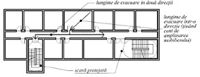

  Figura 220 - Lungime de evacuare
