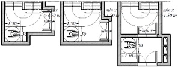
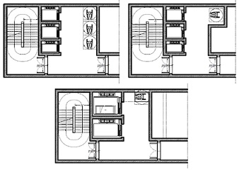
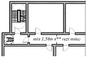
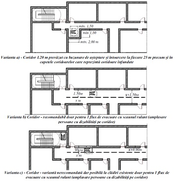

# Anexa nr. 5.5 – CERINȚE SPECIALE PENTRU EVACUAREA PERSOANELOR CU DIZABILITĂȚI
CERINȚE SPECIALE PENTRU EVACUAREA PERSOANELOR CU DIZABILITĂȚI
Terminologie
(169) Se utilizează următoarea terminologie, în acord cu Legea nr. 448/2006 privind protecția și promovarea drepturilor persoanelor cu handicap, cu modificările și completările ulterioare și reglementarea tehnică "Normativ privind adaptarea clădirilor civile și spațiului urban la nevoile individuale ale persoanelor cu handicap, indicativ NP 051/2012", aprobat prin Ordinul ministrului dezvoltării regionale și administrației publice nr. 189/2013:
  Căi și mijloace de acces - elementele prin care se asigură accesul în clădirile publice și care asigură posibilitatea deplasării persoanelor cu handicap în interiorul clădirii;
  Clădiri de utilitate publică - clădirile aparținând instituțiilor publice și private care oferă populației diferite tipuri de servicii.
Prevederi generale
(170) Clădirile de utilitate publică, căile de acces, clădirile de locuit, stațiile de transport în comun, peroanele principalelor stații de transport feroviar, spațiile de parcare precum și celelalte funcțiuni/destinații prevăzute de Legea nr. 448/2006, cu modificările și completările ulterioare, vor fi adaptate conform prevederilor legale în domeniu, astfel încât să permită accesul neîngrădit al persoanelor cu handicap precum și evacuarea acestora.
(171) Clădirile de patrimoniu și cele istorice (monumente istorice) se vor adapta, cu respectarea caracteristicilor arhitectonice, conform prevederilor legale în domeniu.
(172) Următoarele clădiri/funcțiuni sunt exceptate de la modalitățile normate (ascensoare sau puncte de staționare în casa scării) de evacuare a persoanelor cu dizabilități:
  - (1) anumite clădiri de producție/funcțiunile de producție care sunt exceptate de la respectarea accesibilității pentru persoane cu dizabilități, conform cerințelor normate cu privire la accesibilitatea în mediul construit;
  - (2) clădirile parter cu sau fără niveluri de subsol/demisol (subsolul/demisolul fără activități permanente de muncă, la care nu se prevăd ascensoare sau puncte de staționare în casa scării, dar la parter se prevăd celelalte modalități normate de evacuare, ca de exemplu rampe).
(173) Clădirile cu funcțiune medicală (spitale, instituții de îngrijire medicală etc.) se prevăd obligatoriu cu ascensoare de evacuare a persoanelor cu dizabilități.
(174) Căile de evacuare trebuie să fie libere de orice obstacol care poate cauza întârzieri nejustificate în timpul evacuării persoanelor cu dizabilități, de exemplu praguri ridicate sau trepte.
(175) Sunt interzise rampe de scară cu mai puțin de 3 trepte în conformitate cu prevederile din Normativul privind criteriile de performanță specifice rampelor și scărilor pentru circulația pietonală în construcții, indicativ NP 063-2002, aprobat prin Ordinul ministrului lucrărilor publice, transporturilor și locuinței nr. 1.994/2002 coroborat cu Art. 2.5.6.1.1. alin. (3) din normativ.
Cerințe generale a punctelor de staționare a persoanelor cu dizabilități
(176) Un punct de staționare a persoanelor cu dizabilități trebuie prevăzut pe toate etajele, inclusiv toate nivelurile subsolului (cu excepția subsolului tehnic), cu excepția parterului, pentru ca persoanele cu dizabilități să aștepte în siguranță asistența pentru evacuare.
(177) Se recomandă să existe cel puțin două puncte de staționare a persoanelor cu dizabilități pe fiecare etaj al unei clădiri/compartiment de incendiu, cu excepția unei clădiri/compartiment proiectate cu o singură scară de evacuare permisă în temeiul prezentului normativ. Coridorul care este cale de evacuare a persoanelor cu dizabilități (cu căruciorul) se recomandă să aibă o lățime liberă minimă de 1,20 m (1,30 m la clădiri cu funcțiune sanitară) și să respecte reglementările tehnice în vigoare. Se recomandă să fie prevăzute de asemenea buzunare de manevră și așteptare cu lățime minim 1.80 m și lungime min. 2.00 m. În cazul în care acestea nu se prevăd, se va avea în vedere Art. 2.4.4.3.3. din normativ.
Cerințe speciale pentru evacuarea persoanelor cu dizabilități a punctelor de staționare
(178) Punctul de staționare a persoanelor cu dizabilități trebuie amplasat și păstrat în timpul exploatării fără elemente care să-l obstrucționeze, și poate fi amplasat în următoarele locații/zone:
  - (a) încăperea tampon ventilată în suprapresiune a ascensorului prevăzut pentru transportul persoanelor cu căruciorul sau a persoanelor cu dizabilități care pot fi utilizate și pentru evacuarea asistată a acestora în caz de incendiu;
  - (b) încăperea tampon ventilată în suprapresiune a ascensorului de intervenție (de pompieri);
  - (c) într-un coridor prevăzut cu sisteme de evacuare a fumului și a gazelor fierbinți sau ventilat în suprapresiune, într-un degajament protejat sau într-un coridor exterior, într-un buzunar de manevră așteptare pentru a nu reduce gabaritul de evacuare al coridorului/degajamentului protejat;
  - (d) în incinta unei încăperi tampon ventilată în suprapresiune dacă nu reduce gabaritul de evacuare a acesteia;
  - (e) în incinta unei scări de evacuare dacă nu reduce gabaritul de evacuare a acesteia.
(179) Punctul de staționare a persoanelor cu dizabilități situat în incinta unei scări de evacuare trebuie să fie poziționat departe de marginea primei trepte a scării de evacuare și în toate cazurile trebuie să nu influențeze lățimea normată rezultată din calcul a căii de evacuare a persoanelor.

  

  Figura 221 - Gabarit punct de staționare a
  persoanelor cu dizabilități - amplasare în scara de evacuare.
(180) Punctul de staționare a persoanelor cu dizabilități situat în orice zonă permisă (conform Art. 178) lit. (a), (b), (c) sau (d) nu trebuie să se reducă/să pătrundă în dimensiunile/spațiile necesare evacuării pentru zonele mai sus amintite).

  

  Figura 222 - Punct de staționare a persoanelor cu
  dizabilități - amplasare în încăpere tampon ventilată în suprapresiune
(181) În cazul în care se află un punct de staționare a persoanelor cu dizabilități, trebuie afișat în mod vizibil un marcaj cu "Punct de staționare a persoanelor cu dizabilități"/"Zona de refugiu a persoanelor cu dizabilități".
(182) Trebuie prevăzut un mijloc de comunicare/alarmare, pentru ca persoanele cu dizabilități să apeleze pentru asistență în caz de urgență de incendiu. Mijloacele de comunicare trebuie:
  - a) să fie situate între 80 cm și 1,20 m deasupra nivelului finit al pardoselii;
  - b) să fie etichetate corespunzător;
  - c) să fie prevăzute cu un semn de instrucțiuni clar afișat în mod vizibil asupra funcționării, și
  - d) să genereze o indicație vizuală clară pentru a indica faptul că semnalul de primejdie a fost transmis.
Cerințe suplimentare ale punctelor de staționare a persoanelor cu dizabilități
(183) Un punct de staționare a persoanelor cu dizabilități trebuie să fie dimensionat corespunzător, astfel încât să poată oferi spațiu unui utilizator de scaun cu rotile și să permită utilizatorului să manevreze cu ușurință scaunul cu rotile.
(184) Punctul de staționare a persoanelor cu dizabilități trebuie să îndeplinească cumulativ următoarele cerințe:
  - a) spațiul prevăzut pentru un scaun cu rotile într-un punct de staționare a persoanelor cu dizabilități trebuie să fie de cel puțin 1,50 m x 1,50 m pentru a permite manevrarea scaunului cu rotile;
  - b) în cazul în care un punct de staționare a persoanelor cu dizabilități este amplasat în interiorul unei scări de evacuare protejate, a unei încăperi tampon prevăzută cu suprapresiune sau a unei încăperi tampon ventilată în suprapresiune a ascensorului de intervenție sau a ascensorului prevăzut pentru transportul persoanelor cu căruciorul sau a persoanelor cu dizabilități care pot fi utilizate și pentru evacuarea asistată a acestora în caz de incendiu, spațiul pentru scaunul cu rotile nu va micșora dimensiunile rezultate prin calculul necesar evacuării sau intervenției ale acestor spații și accesul persoanelor în scaunul cu rotile nu trebuie să obstrucționeze fluxul de evacuare, și
  - c) punctul de staționare a persoanelor cu dizabilități trebuie marcat la sol cu un simbol al scaunului cu rotile în alb pe fundal contrastant, cu un contur dreptunghiular vizibil (de obicei alb) punctat.
(185) Un punct de staționare a persoanelor cu dizabilități trebuie să fie închis cu o construcție rezistentă la foc conform prevederilor normate (pereți și planșee rezistente la foc ale scărilor, coridoarelor ventilate în suprapresiune, încăperilor tampon ventilate în suprapresiune sau a altor încăperi ventilate în suprapresiune, cu excepția pereților exteriori ai unei clădiri care trebuie să îndeplinească doar condițiile normate proprii) și trebuie deservit direct de o cale de evacuare către o ieșire din etaj, scară, ascensor utilizat și pentru evacuare sau ieșire finală la parter.
(186) Balustradele din ochiul interior al unei scări de evacuare protejate, trebuie să fie continue.
(187) Un ascensor dedicat pentru utilizatorii de scaun cu rotile (prevăzut pentru transportul persoanelor cu căruciorul sau a persoanelor cu dizabilități care poate fi utilizat și pentru evacuarea asistată a acestora în caz de incendiu), acolo unde este instalat, trebuie amplasat conform prevederilor normate. Un astfel de ascensor, atunci când se află în poziția de funcționare, nu trebuie să micșoreze dimensiunile normate ale căii de evacuare a utilizatorilor clădirii.
(188) Rampele de ieșire interioare și exterioare pot fi utilizate ca ieșiri de evacuare în locul scărilor de evacuare interioare și exterioare sau a ascensoarelor folosite și pentru evacuarea persoanelor cu dizabilități, dacă respectă prevederile normativelor specifice și rampele interioare au performanța echivalentă acestora.

  

  Figura 223 - Punct de staționare a persoanelor cu dizabilități
  Notă Figura 223: Amplasare în incinta unei încăperi tampon ventilată în suprapresiune (la clădirile pentru sănătate supraterane cu înălțimi obișnuite în care evacuarea utilizatorilor în caz de incendiu trebuie efectuată cu targa sau cu căruciorul, lățimile libere ale căilor de circulație funcțională și de evacuare, vor fi de minimum 2,20 m** pentru coridoare).
  Notă generală Figuri 221-223: Lățimea liberă a coridoarelor va fi: minim 1.20 m în clădirile de utilitate publică. Pentru ca un coridor cu lățimea de 1.20 m să poată fi utilizat de către o persoană care se deplasează în fotoliu rulant fără însoțitor, vor fi prevăzute în mod obligatoriu buzunare de manevră și așteptare cu o lățime de 1.80 m și o lungime de 2.00 m, la fiecare 20.00 m. Un coridor cu o lățime liberă de 1.50 m permite circulația unul pe lângă celălalt a unui utilizator de fotoliu rulant fără însoțitor și a unei persoane care se deplasează normal. Pentru ca un coridor cu lățime de 1.50 m să permită deplasarea a două persoane în fotoliu rulant sau a două persoane în cârje una pe lângă cealaltă, vor fi prevăzute buzunare de manevră și așteptare cu lățime de 1.80 m și lungime de 2.00 m, la fiecare 20,00 m. Un coridor cu o lățime liberă de 1.80 m permite circulația unul pe lângă celălalt a doi utilizatori ai fotoliului rulant, fără însoțitor. La coridoare înfundate trebuie realizată o lărgire cu dimensiunile de 1.50 m lățime și 2.00 m lungime, pentru crearea spațiului de manevră necesar întoarcerii la 180° a fotoliului rulant.
Zona de refugiu - caz general
(189) Punctele de staționare a persoanelor cu dizabilități pot fi situate în incinta:
  - – caselor de scară,
  - – încăperilor tampon protejate,
  - – degajamentelor protejate,
  - – coridoarelor/holurilor protejate împotriva fumului,
  - – circulațiilor comune a unui compartiment adiacent cu care comunică.
  Notă. Prin realizarea punctelor de staționare pentru persoanele cu dizabilități se va avea în vedere să nu se îngusteze lățimea normată a căii de evacuare. Fiecare punct de staționare va trebui să asigure dimensiunile de 1,50 m x 1,50 m.
(190) Zona de refugiu (în cazul în care la clădiri existente, cu excepția funcțiunii de sănătate, nu se prevăd puncte de staționare a persoanelor cu dizabilități) poate fi:
  - – o încăpere din interiorul unei clădiri (în cadrul aceluiași compartiment de incendiu), sau
  - – o zonă din interiorul unei alte clădiri aparținând aceluiași compartiment de incendiu, sau
  - – o zonă (determinată ca și încăpere distinctă sau nu) din interiorul unui compartiment distinct de incendiu alăturat.

  

  Figura 224 - Zonă de refugiu
(191) "Zona de refugiu" se referă la o zonă unde persoanele evacuate se pot refugia temporar, zonă la care se ajunge printr-un coridor (protejat sau nu) interior sau coridor exterior sau printr-o încăpere tampon (protejată sau nu).
(192) Atunci când evacuarea către zona de refugiu se realizează într-un singur sens, sunt necesare următoarele condiții:
  - – zona de refugiu are realizat un ascensor pentru evacuare a persoanelor cu dizabilități;
  - – există încăpere dedicată pentru refugiu cu următoarele caracteristici: pereți EI 180, ușă EI 90-C5S_200;
  Notă: Încăperea dedicată pentru refugiu trebuie poziționată astfel încât să fie cât mai apropiată de casa de scară.
  - – încăperea dedicată pentru refugiu trebuie să poată fi accesibilă din exterior printr-o fereastră cu posibilitatea accesului echipelor de intervenție pentru salvarea persoanelor de la înălțime;
  - – numărul de paturi stabilit se calculează ținându-se cont de 2/3 (două treimi) din numărul total de paturi, iar pentru fiecare pat se va aloca o suprafață de 1 m x 2 m.
Ascensoare prevăzute pentru persoane cu dizabilități
(193) Pentru a corespunde nevoilor persoanelor cu dizabilități, ascensoarele folosite și pentru evacuarea acestora trebuie să fie proiectate (în clădiri care nu au funcțiune medicală), astfel:
  - – dimensiunile minime ale cabinei ascensorului accesibil utilizat pentru o persoană utilizatoare de fotoliu rulant, cu însoțitor sau pentru o persoană care folosește alte obiecte ajutătoare pentru a se deplasa și are un însoțitor sunt 1,10 m x 1,40 m, fiind recomandată o deschidere liberă a ușii de min 90 cm. Ușa trebuie poziționată pe latura îngustă a cabinei;
  - – dimensiunile minime ale cabinei ascensorului accesibil utilizat pentru două persoane utilizatoare de fotoliu rulant este de 1,10 m x 2,10 m, fiind recomandată o deschidere liberă a ușii de min 90 cm. Ușa trebuie poziționată pe latura îngustă a cabinei.
(194) În cazul în care cabina ascensorului are două uși poziționate pe pereți alăturați, dimensiunea minimă a cabinei utilizată pentru o persoană utilizatoare de fotoliu rulant este 1,60 m x 1,40 m, cu deschidere liberă a ușii de 1,10 m.
