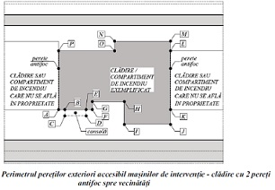
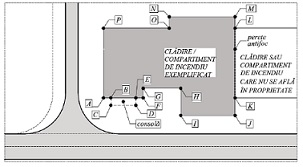
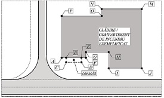

# Anexa nr. 6.2 – PERIMETRUL PEREȚILOR EXTERIORI
PERIMETRUL PEREȚILOR EXTERIORI
(199) Planul clădirii ABCDEFGHIJKLMNOP (conform Figura 225) unde AP și KL sunt pereți în comun cu alte clădiri (sau compartimente de incendiu). Amprenta la sol a clădirii este perimetrul maxim al planului obținut de proiecția verticală (pe orizontală) a oricărui punct ce definește un etaj în consolă (respectiv conturul definit de punctele ABCDEFGHIJKLMNOP). Perimetrul clădirii în sensul prevederilor normate este suma lungimilor pereților exteriori, ținând cont de amprenta la sol a etajelor în consolă, respectiv (A la B la C la D la E la F la G la H la I la J la K) + (L la M la N la O la P).

  

  Figura 225 - Perimetrul pereților exteriori accesibil
  mașinilor de intervenție - clădire cu 2 pereți antifoc spre vecinătăți
(200) Planul clădirii ABCDEFGHIJKLMNOPA (conform Figura 226) unde KL este perete în comun cu altă clădire (sau compartimente de incendiu). Amprenta la sol a clădirii este perimetrul maxim al planului obținut de proiecția verticală (pe orizontală) a oricărui punct ce definește un etaj în consolă (respectiv conturul definit de punctele ABCDEFGHIJKLMNOPA). Perimetrul clădirii în sensul prevederilor normate este suma lungimilor pereților exteriori, ținând cont de amprenta la sol a etajelor în consolă, respectiv (A la B la C la D la E la F la G la H la I la J la K) + (L la M la N la O la P la A).

  

  Figura 226 - Perimetrul pereților exteriori accesibil
  mașinilor de intervenție - clădire cu 1 perete antifoc spre vecinătate
(201) Planul clădirii ABCDEFGHIJMNOPA (conform Figura 227) și nu are pereți în comun cu alte clădiri (sau compartimente de incendiu). Amprenta la sol a clădirii este perimetrul maxim al planului obținut de proiecția verticală (pe orizontală) a oricărui punct ce definește un etaj în consolă (respectiv conturul definit de punctele ABCDEFGHIJMNOPA). Perimetrul clădirii în sensul prevederilor normate este suma lungimilor pereților exteriori, ținând cont de amprenta la sol a etajelor în consolă, respectiv (A la B la C la D la E la F la G la H la I la J la M la N la O la P la A).

  

  Figura 227 - Perimetrul pereților
  exteriori accesibil mașinilor de intervenție - clădire fără
  pereți antifoc spre vecinătăți (amplasată la distanțe de siguranță)
