# Anexa nr. 7.1 – CLĂDIRI CIVILE CU ÎNĂLȚIMI OBIȘNUITE - CLĂDIRI PENTRU SĂNĂTATE
CLĂDIRI CIVILE CU ÎNĂLȚIMI OBIȘNUITE - CLĂDIRI PENTRU SĂNĂTATE
Generalități (la funcțiuni sanitare: spitale, policlinici, dispensare, creșe, case de copii, cămine de bătrâni și persoane cu dizabilități, sanatorii etc.)
(202) "Spitalul" este o clădire utilizată pentru îngrijiri medicale și chirurgicale și trebuie să includă funcțiuni de asistență medicală cu servicii continue (de 24 de ore), astfel de clădiri includ, fără a se limita la, următoarele:
  - a) spitale generale (universitare, de urgență, regionale etc.);
  - b) spitale psihiatrice (institut de sănătate mintală);
  - c) spitale pentru copii (copii și părinți) și
  - d) spitale comunitare (semiregionale).
  (Spitalul este unitatea sanitară cu paturi, de utilitate publică, cu personalitate juridică, proprietate publică sau privată, care asigură servicii medicale. Serviciile medicale acordate de spital sunt: preventive, curative, de recuperare și paleative, de îngrijire în caz de graviditate și maternitate, precum și a nou-născutului etc.)
(203) "Funcțiune de îngrijire medicală" se referă la o clădire sau o parte a acesteia, utilizată pentru adăpostirea și îngrijirea medicală continuă a persoanelor (24 de ore din 24), care, din cauza incapacității fizice, nu pot avea grijă de propriile nevoi și siguranță fără asistență asistată (a altor persoane). Aceste funcțiuni oferă îngrijire medicală internată și includ următoarele:
  - a) azile;
  - b) cămine de bătrâni și persoane cu dizabilități;
  - c) ospicii, și
  - d) altele similar.
(204) "Funcțiune de îngrijire ambulatorie" este o clădire sau o parte a acesteia, utilizată pentru servicii medicale în ambulatoriu pentru tratamentul pacienților, pacienți incapabili să ia măsuri pentru autoconservare sau siguranță în condiții de urgență, fără posibilitate de evacuare singuri (fără asistență asistată). Aceste funcțiuni includ următoarele:
  - – clinici de zi pentru dializă renală;
  - – clinici estetice și alte clinici cu tratament chirurgical care necesită anestezie generală;
  - – clinici de zi de reabilitare non-mentală;
  - – clinici de endoscopie;
  - – altele similar.
(205) "Funcțiune de îngrijire asistată" este o clădire sau o parte a acesteia, fără ședere în camere de cazare (nocturnă), folosită de persoane care, din cauza vârstei sau a dizabilităților fizice sau psihice, nu pot să-și autoconserve siguranța. Astfel de funcțiuni includ următoarele:
  - A. (Ante)Preșcolar (case de copii - pentru copii cu vârsta antepreșcolară, de exemplu, creșe, centre de zi pentru îngrijirea copiilor etc.);
  - B. Centre de zi de îngrijire:
    - – centre de zi pentru îngrijirea persoanelor în vârstă;
    - – centre de zi pentru persoane cu dizabilități mintale;
    - – centre de îngrijire de zi pentru persoane cu dizabilități intelectuale;
    - – centre de zi de reabilitare mintală/ psihiatrice și
    - – case de copii - pentru copii cu vârsta școlară;
    - – altele similar.
Funcțiune sanitară - circulații orizontale și verticale
(206) La clădirile pentru sănătate supraterane cu înălțimi obișnuite în care evacuarea utilizatorilor în caz de incendiu trebuie efectuată cu targa sau cu căruciorul, lățimile libere ale scărilor de circulație funcțională și de evacuare, vor fi de minimum 1,40 m pentru rampele scărilor și a planurilor înclinate, prevăzute cu paliere/podeste de 2,20 m adâncime (1 flux de evacuare cu targa, atunci când în compartimentul de incendiu se prevăd mai puțin de 120 de paturi) sau minimum 2,20 m pentru rampele scărilor și a planurilor înclinate, prevăzute cu paliere/podeste de 2,60 m adâncime (2 fluxuri de evacuare cu targa, atunci când în compartimentul de incendiu se prevăd de 120 de paturi sau mai mult).
(207) Înălțimea liberă minimă de trecere pe căile comune de evacuare (coridoare, holuri, încăperi tampon, degajamente protejate, scări, tuneluri de evacuare etc.) prin care se realizează evacuarea persoanelor cu targa va fi: h = min. 2,20 m iar scările, indiferent de lățimea liberă, vor avea prevăzută mâna curentă pe ambele părți (fixată pe parapet, balustradă sau pe perete).

  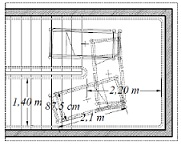

  Figura 228 - Gabaritele scărilor de circulație
  funcțională și de evacuare - caz general pentru 1 flux de evacuare

  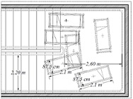

  Figura 229 - Gabaritele scărilor de circulație
  funcțională și de evacuare - caz general pentru 2 fluxuri de evacuare
(208) Alternativ prevederilor de mai sus, pentru rampele, palierele și podestele scărilor și a planurilor înclinate, în care evacuarea utilizatorilor în caz de incendiu trebuie efectuată cu targa sau cu căruciorul, se admite adoptarea alternativă a următoarelor valori prevăzute în Tabelul 129, putând fi aplicată în cazuri particulare, fiind obligatorie justificarea ei în proiect.
  Tabelul 129: Alternative dimensionare scări de circulație funcțională și de evacuare la clădiri cu funcțiune de sănătate

| Nr. Crt. | lățime rampe (m) | lățime palier (m) | adâncime palier/ podest (m) | Observații |
|---|---|---|---|---|
| 1 | 1,60 | 3,20 (3,40 cu 20 cm distanță între rampe) | 1,60 | Permite doar evacuarea tărgii și evacuarea restricționată a pacienților în ambulatoriu pentru maximum 1 flux. |
| 2 | 1,80 | 3,60 (3,80 cu 20 cm distanță între rampe) | 1.35 (1.80 normat) | Permite evacuarea patului sau a tărgii și evacuarea pacienților în ambulatoriu pentru 2 fluxuri. |
| 3 | 2,00 | 4,00 (4,20 cu 20 cm distanță între rampe) | 1.25 (2.00 normat) |  |

  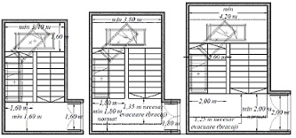

  Figura 230 - Alternative dimensionare scări de
  circulație funcțională și de evacuare - funcțiune sanitară
(209) Numărul de ascensoare pentru evacuarea persoanelor cu dizabilități se calculează în funcție de structura medicală și de numărul de paturi, considerând 1 ascensor la 120 paturi (cu condiția ca orice compartiment de incendiu cu funcțiune de spitalizare, indiferent de capacitatea acestuia, să fie dotat cu minimum 2 ascensoare pentru utilizatori, dintre care minimum unul trebuie să fie conformat pentru persoanele cu dizabilități.
(210) Ascensoarele pentru evacuarea persoanelor cu dizabilități se vor realiza după cum urmează:
  - (a) dimensiunile cabinei vor fi:
    - i. pentru evacuare cu 2 tărgi:
      - (i) min. 2,20 m lățime;
      - (ii) min. 2,70 m adâncime;
    - ii. pentru evacuare cu 1 targă:
      - (i) min. 1,80 m lățime;
      - (ii) min. 2,70 m adâncime;

      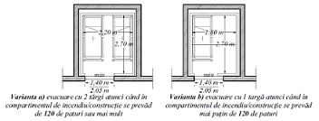

      Notă Figura 231: figurile reliefează doar dimensiunile ascensoarelor. Separarea ascensoarelor pentru transportul bolnavilor cu patul cu rotile, cu targa sau cu căruciorul sau a persoanelor cu dizabilități care pot fi utilizate și pentru evacuarea asistată a acestora în caz de incendiu se regăsesc în anexa privind ascensoarele.
      Figura 231 - Cabină ascensor evacuare persoane cu dizabilități
  - (b) dimensiunile ușilor cabinei vor fi:
    - (i) min. 1,40 m lățime liberă;
    - (ii) min. 2,05 m înălțime liberă;
  - (c) ușile cabinei vor fi culisante cu deschidere - închidere automată;
  - (d) dimensiunile platformei de evacuare în fața ascensorului vor fi:
    - (i) min. 2,50 m x 3,30 m grupare pe un front;
    - (ii) min. 2,50 m x 5,40 m - grupare pe două fronturi (recomandabil 3,00 m x 5,40 m);

    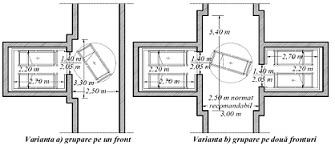

    Notă Figura 232: figurile reliefează doar dimensiunile ascensoarelor și a platformelor din fața acestora. Separarea ascensoarelor pentru transportul bolnavilor cu patul cu rotile, cu targa sau cu căruciorul sau a persoanelor cu dizabilități care pot fi utilizate și pentru evacuarea asistată a acestora în caz de incendiu se regăsesc în anexa privind ascensoarele.
    Figura 232 - Dimensiuni platformă în fața
    ascensorului de evacuare persoane cu dizabilități
(211) În interiorul compartimentelor de incendiu cu funcțiune de spitalizare, pentru dimensionarea căilor de evacuare se vor utiliza următoarele valori:
  - (a) lățimea liberă a coridoarelor principale în unitățile de îngrijire, diagnostic și tratament va fi:
    - (i) min. 2,20 m pentru evacuare cu targa;
    - (ii) min. 2,40 m pentru evacuare cu pat cu rotile;
  - (b) lățimea liberă a coridoarelor protejate cu zone de așteptare (de refugiu) de-a lungul pereților va fi:
    - (i) min. 2,40 m cu așteptare pe o latură;
    - (ii) min. 3,50 m cu așteptare pe două laturi;
  - (c) lățimea liberă pentru circulația cu targa:
    - (i) min. 1,80 m întoarcere în unghi drept;
    - (ii) min. 2,20 m - spațiu pentru manevră.
Zona de refugiu în clădiri de sănătate
Prevederi generale
(212) Zona de refugiu în clădiri de sănătate poate fi:
  - – o zonă din interiorul unei clădiri (în cadrul aceluiași compartiment de incendiu), sau
  - – o zonă din interiorul unei alte clădiri aparținând aceluiași compartiment de incendiu, sau
  - – o zonă (determinată ca și încăpere distinctă sau nu) din interiorul unui compartiment distinct de incendiu alăturat.
(213) Atunci când evacuarea către zona de refugiu se realizează într-un singur sens, sunt necesare următoarele condiții:
  - – zona de refugiu are realizat un ascensor pentru evacuare a persoanelor cu dizabilități;
  - – există încăpere dedicată pentru refugiu cu următoarele caracteristici: pereți EI 180, ușă EI 90-C5S_200;
  Notă: Încăperea dedicată pentru refugiu trebuie poziționată astfel încât să fie cât mai apropiată de casa de scară.
  - – încăperea dedicată pentru refugiu trebuie să poată fi accesibilă din exterior printr-o fereastră cu posibilitatea accesului echipelor de intervenție pentru salvarea persoanelor de la înălțime;
  - – numărul de paturi stabilit se calculează ținându-se cont de 2/3 (două treimi) din numărul total de paturi din zona refugiată, iar pentru fiecare pat se va aloca o suprafață de 1m x 2m.
"Zona de refugiu" situată în același compartiment de incendiu
(214) În cazul în care "zona de refugiu" este situată în același compartiment de incendiu cu funcțiune de sănătate și este conectată printr-un coridor închis sau deschis (exterior), în locul cerinței pentru asigurarea normată a simultaneității proprii clădirii de sănătate care deservește ca și zonă de refugiu privind căile de evacuare, se determină numărul de utilizatori pentru care se asigură condițiile de evacuare în caz de incendiu.
(215) În acest sens se ia în calcul suma capacităților celor două, respectiv capacitatea maxim simultană de utilizatori însumată, folosind factorii de ocupare prezentați pentru utilizatorii care provin din zona evacuată precum și 100% din cei care provin din zona de refugiu netransmutați.
(216) Căile de evacuare orizontale și verticale ale clădirii (sau a porțiunii de clădire) care servește ca zonă de refugiu, trebuie să fie conformate în acest sens (din punct de vedere al capacităților normate necesare evacuării).
(217) Trebuie respectată lungimea normată a căilor de evacuare, reprezentată de lungimea parcursă de la punctul de plecare din zona de unde este necesară evacuarea, către porțiunea de clădire care deservește ca zonă de refugiu, până la intrarea în scările de evacuare (respectiv a încăperilor tampon ale acestora, dacă acestea sunt prevăzute) sau direct în exterior, ale porțiunii de clădire care deservește ca zonă de refugiu.
(218) Această zonă de refugiu temporară trebuie să fie separată în mod adecvat de restul clădirii de sănătate în care se află sau a clădirii adiacente de sănătate, printr-o construcție rezistentă la foc (minimum pereți de sectorizare cu performanță la foc normată și uși din pereții de sectorizare cu performanță la foc normată sau cele mai restrictive alte condiții generate de densitatea sarcinii termice sau riscul din încăperile alăturate) și conectată printr-un coridor extern (sau o cale de circulație deschisă în exterior).
(219) Zona de refugiu precum și coridorul închis sau deschis (exterior) de acces trebuie să fie întotdeauna practicabile și accesibile. În sensul acesta, dacă refugierea temporară se face și pe coridoare (la construcții existente), acestea trebuie prevăzute cu sisteme de evacuare a fumului și a gazelor fierbinți (sau suprapresiune), iar gabaritul normat al acestora, necesar evacuării, nu trebuie diminuat prin amplasarea temporară a evacuaților din porțiunea de clădire alăturată.
"Zona de refugiu" situată în interiorul unui alt compartiment de incendiu
(220) În cazul în care "zona de refugiu" este situată în interiorul unui alt compartiment de incendiu cu funcțiune de sănătate, aceasta trebuie conectată printr-un coridor exterior deschis sau printr-un coridor închis prevăzut cu suprapresiune sau sisteme de evacuare a fumului și a gazelor fierbinți (între acestea, la limita compartimentelor de incendiu fiind dispusă obligatoriu încăpere tampon prevăzută cu suprapresiune) între cele două zone (zona necesar de evacuat aparținând unui compartiment de incendiu și zona de refugiu aparținând unui alt compartiment de incendiu).
(221) În cazul în care "zona de refugiu" este situată într-un alt compartiment de incendiu cu funcțiune de sănătate, se asigură simultaneitatea totală, pentru determinarea numărului de utilizatori pentru care se asigură condițiile de evacuare în caz de incendiu.
(222) În acest sens se ia în calcul suma reală a capacităților celor două, respectiv capacitatea maxim simultană de utilizatori însumată, însemnând 100% din utilizatorii care provin din zona de refugiu precum și 100% din cei care provin din zona din care se refugiază.
(223) Căile de evacuare orizontale și verticale ale compartimentului care servește ca zonă de refugiu trebuie să fie conformate în acest sens (din punct de vedere al capacităților normate necesare evacuării).
(224) Trebuie respectată lungimea normată a căilor de evacuare, reprezentată de lungimea parcursă de la punctul de plecare din zona de unde este necesară evacuarea, către compartimentul distinct care deservește ca zonă de refugiu, până la intrarea în scările de evacuare (respectiv a încăperilor tampon ale acestora, dacă acestea sunt prevăzute) sau direct în exterior, ale compartimentul distinct care deservește ca zonă de refugiu.
(225) Această zonă de refugiu temporar aparținând unui compartiment de incendiu cu funcțiune de sănătate, trebuie să fie separată în mod adecvat de zona de unde este necesară evacuarea (aparținând unui alt compartiment de incendiu), prin pereți antifoc și obligatoriu cu încăpere tampon ventilată în suprapresiune prevăzută cu uși cu performanțe la foc normate sau cele mai restrictive generate din alte condiții ale încăperilor alăturate) între un coridor exterior deschis sau un coridor închis prevăzut cu suprapresiune sau sisteme de evacuare a fumului și a gazelor fierbinți între cele două compartimente.
(226) Zona de refugiu precum și coridorul exterior sau interior și încăperea tampon de acces trebuie să fie întotdeauna practicabile și accesibile.
(227) În sensul acesta, dacă refugierea temporară se face și pe coridoare (la construcții existente), acestea trebuie prevăzute cu sisteme de evacuare a fumului și a gazelor fierbinți (sau suprapresiune), iar gabaritul normat al acestora, necesar evacuării, nu trebuie diminuat prin amplasarea temporară a evacuaților din compartimentul de incendiu (cu funcțiune de sănătate) alăturat.
  Observație generală 1:
  Trebuie respectată lungimea normată a căilor de evacuare reprezentată de lungimea parcursă de la ușa de ieșire a încăperii care deservește ca zonă de refugiu precum și a lungimii parcurse de la punctul de plecare din zona de unde este necesară evacuarea, până la cea mai apropiată ușă prevăzută la scările de evacuare care se iau în calcul pentru acest aspect (respectiv a încăperilor tampon ale acestora, dacă acestea sunt prevăzute sau a degajamentului protejat către scară) sau direct către exterior.
  Notă: Indiferent de poziționarea acestor zone (de unde este necesară evacuarea precum și zona de refugiu) și căi de evacuare orizontale și/sau verticale utilizabile în cadrul aceluiași compartiment de incendiu, sau a două sau mai multe compartimente de incendiu, se ia în calcul distanța parcursă de la cel mai îndepărtat punct din zona de unde este necesară evacuarea până la cea mai apropiată dintre scările de evacuare situată în zona de refugiu. În mod similar, la parter, trebuie îndeplinită aceeași condiție, luându-se în calcul distanța parcursă de la cel mai îndepărtat punct din zona de unde este necesară evacuarea până la cea mai apropiată ușă cu acces în exterior situată în zona de refugiu.
  Observație generală 2:
  În cazul în care cele două zone (zona de unde este necesară evacuarea și zona de refugiu) sunt situate în compartimente de incendiu diferite (ambele cu funcțiune de sănătate), unul dintre compartimente (sau anumite spații amplasate în acesta) poate deveni zonă de refugiu pentru cel de-al doilea (sau oricare alt) compartiment de incendiu.
  Notă: În cazul în care două compartimente de incendiu cu funcțiune de sănătate devin reversibil zone de refugiu (unul pentru celălalt), este obligatoriu ca rutele de evacuare să fie în totalitate distincte (să nu fie suprapusă evacuarea în ambele sensuri), cel puțin până la prima intersecție cu o cale orizontală de evacuare (cu evacuare în două direcții), prevăzută în zona de refugiu.

  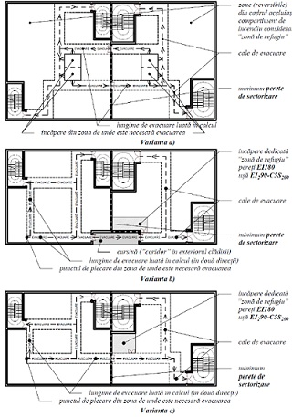

  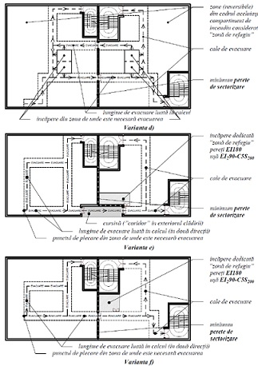

  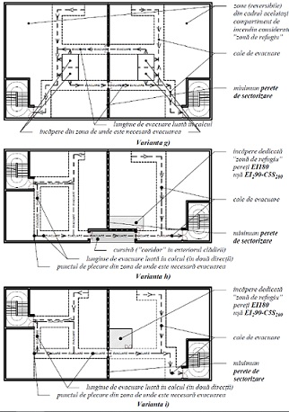

  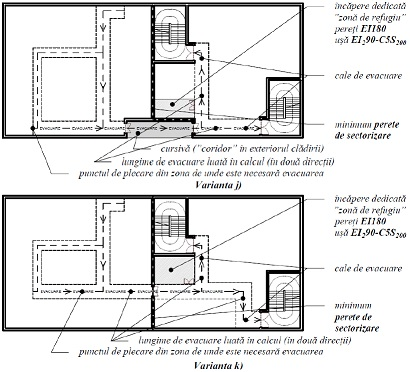

  Figura 233 - Scheme principiu evacuare către altă zonă

  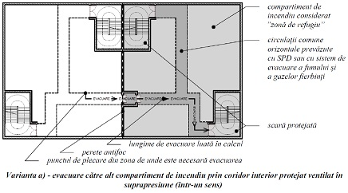

  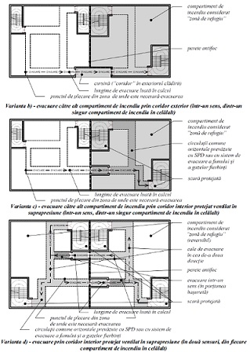

  Notă Figura 234 varianta d): Similar explicații cu Figura 207 varianta d).

  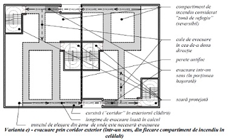

  Note Figura 234:
  - (a) Circulațiile comune orizontale din compartimentul de incendiu către care se realizează evacuarea, se prevăd cu SPD sau sisteme de evacuare a fumului și a gazelor fierbinți. Atunci când sunt prevăzute cu încăperi tampon, se prevăd cu SPD încăperile tampon precum și circulațiile comune orizontale din compartimentul de incendiu către care se realizează evacuarea. Nu este obligatorie prevederea SPD pe circulațiile comune orizontale din compartimentul de incendiu către care se realizează evacuarea, atunci când evacuarea se realizează printr-o încăpere tampon comună direct către o scară de evacuare sau direct în exterior (încăperea tampon comună aparținând compartimentului de incendiu prin care se realizează evacuarea). Se admite neprevederea SPD pe circulațiile comune orizontale din compartimentul de incendiu către care se realizează evacuarea, atunci când evacuarea se realizează printr-o cursivă exterioară, justificându-se această neprevedere.
  - (b) Se vor vedea explicații Figura 234 varianta d): Similar explicații cu Figura 207 varianta d).
  - (c) Compartimentele de incendiu prevăzute cu SPD trebuie prevăzute, de asemenea, cu instalație automată de detectare, semnalizare și alarmare a incendiului cu acoperire totală.
  - (d) În toate cazurile, se va ține cont de prevederile Art. 8.1.8. (1) din normativ. Ușile încăperilor tampon prin care se realizează evacuarea către alt compartiment de incendiu din clădiri civile, se vor prevedea conform Tabelul 123 (Uși pentru circulație funcțională și/sau evacuare practicate în pereții antifoc din clădiri civile).
  Figura 234 - Schemă principiu zonă evacuare către alt compartiment de incendiu
  (din fiecare compartiment de incendiu în celălalt)

  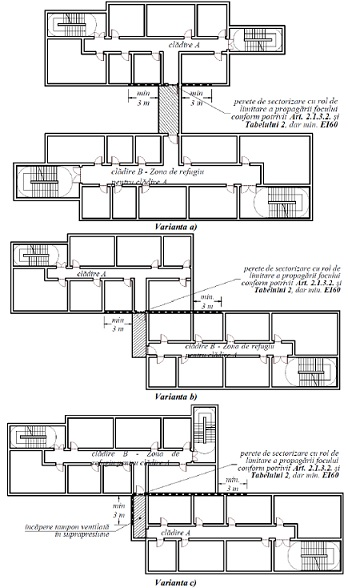

  Figura 235 - Zone de refugiu (în) clădiri
(228) Pentru evacuare spre zona de refugiu se pot utiliza următorii factori de ocupare, pentru conformarea acesteia:
  - – funcțiune de sănătate cu evacuare cu targa ori patul cu rotile îngrijire ambulatorie: 2 mp/persoană;
  - – alte funcțiuni cu evacuare asistată sau evacuare cu căruciorul a persoanelor cu dizabilități: 1 mp/persoană.
  Notă: Zona de refugiu în clădirile cu funcțiune de sănătate este o zonă de utilizare/exploatare TEMPORARĂ, destinată EXCLUSIV persoanelor cu dizabilități. Prin urmare, căile de evacuare trebuie să fie proiectate pentru a putea primi/evacua toate persoanele care vor ocupa zona de refugiu (respectiv numărul de paturi stabilit se calculează ținându-se cont de 2/3 (două treimi) din numărul total de paturi din zona evacuată, iar pentru fiecare pat se va aloca o suprafață de 1m x 2m) în caz de urgență iar în zona de refugiu trebuie realizat un ascensor pentru evacuare a persoanelor cu dizabilități (cu targa sau patul cu rotile). Zona de refugiu proiectată poate fi reprezentată și de spații existente, încăperi care îndeplinesc condițiile normate (pereți EI180 și ușă EI90-C5S_200), cu spații libere care pot temporar să primească și numărul de persoane evacuate din porțiunea evacuată, însumarea în întregime a numărului de persoane într-o situație temporară netrebuind să îndeplinească condițiile normate.
(229) Zonele de refugiu trebuie să dispună de minimum două căi de evacuare distincte și independente (cu excepția celor către alte zone de refugiu), direct către exterior (sau prin intermediul scărilor de evacuare direct către exterior, dacă aceste zone nu sunt amplasate la parter) în condițiile în care toate zonele se află în același compartiment de incendiu.

  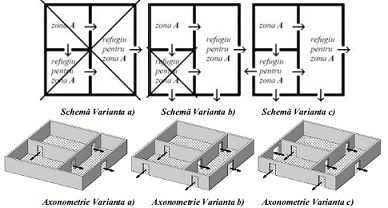

  Figura 236 - Căi de evacuare pentru zonele de refugiu

  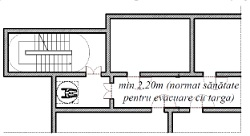

  Figura 237 - Exemplu de punct de staționare a persoanelor cu dizabilități
  (exemplu la clădiri de sănătate)
