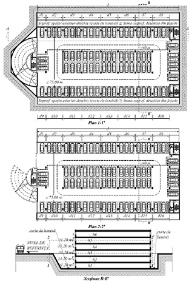
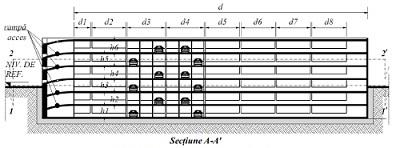
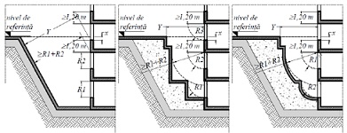
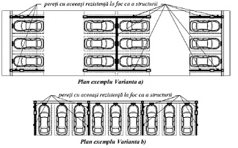
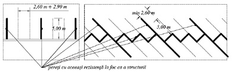
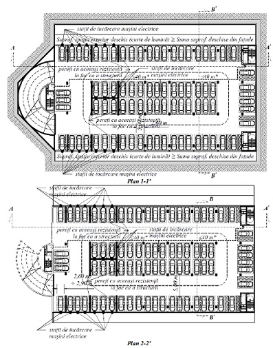

# Anexa nr. 7.2 – PARCAJE
PARCAJE
Parcaj deschis (suprateran)
(230) Parcajele supraterane pot fi:
  Parcaj deschis suprateran - construcție deschisă care are goluri permanent deschise pe cel puțin 50% din suprafața pereților exteriori, destinată adăpostirii autovehiculelor și remorcilor acestora (în care nu se efectuează lucrări de reparații).
  La parcajele deschise supraterane golurile de evacuare a fumului și a gazelor fierbinți dispuse în pereții exteriori se iau în considerare numai pentru adâncimea de maximum 30 m, situație în care se consideră că au asigurate condițiile pentru evacuarea fumului și gazelor fierbinți. Dacă golurile de evacuare a fumului dispuse în pereții exteriori nu îndeplinesc cerința menționată mai sus, atunci este necesară evacuarea fumului și gazelor fierbinți din parcajele deschise supraterane potrivit prevederilor normativului NP 127-2009.
  Parcaj suprateran puternic ventilat natural - categorie distinctă a parcajelor deschise supraterane cu unul sau mai multe niveluri libere perimetral (deschise spre exterior) și care îndeplinește simultan condițiile prevăzute la Art. 1.2.1 din normativ, definiția nr. 57), astfel:
  - i. pe fiecare nivel de parcare, suprafețele libere din pereții laterali deschiși spre exterior sunt amplasate pe cel puțin două fațade opuse și fiecare reprezintă minimum 50% din suprafața totală a fațadei deschise, înălțimea luată în considerare fiind distanța liberă dintre pardoseala finită și plafon (tavan);
  - ii. distanța dintre fațadele libere opuse, deschise spre exterior, este de cel mult 75,00 m;
  - iii. suprafețele libere perimetrale, deschise spre exterior, la fiecare nivel de parcare, reprezintă procentul normat din aria utilă a spațiului de parcare a nivelului respectiv; nu se iau în considerare suprafețele spațiilor închise destinate circulațiilor pietonale orizontale și verticale, precum și al spațiilor cu alte destinații (anexelor funcționale, activităților conexe etc.);
    - – Suma suprafețelor totale ale golurilor deschise ≥ procentul normat din Arie planșeu nivel de parcare.
    - – Arie planșeu nivel de parcare *:
      * - nu se iau în considerare ariile spațiilor închise destinate circulațiilor pietonale orizontale și verticale, anexelor funcționale, activităților conexe;
    - – nu se iau în considerare ariile elementelor de construcție portante (stâlpi, diafragme verticale) și neportante (închideri perimetrale, pereți compartimentare).
    - – Arie spațiu exterior deschis (sau curte de lumină) > Suma suprafețelor verticale deschise
    - – Ariile spațiilor exterioare (sau a curților lumină sunt mai mari sau cel puțin egale cu suma suprafețelor deschiderilor din pereții exteriori).
    - – Suma suprafețelor deschise din pereții exteriori ≥ 50% din suprafața totală a fațadei deschise (hx x d1 + hx x d2 + hx x d2 + hx x d2 ... etc.).
    - – Spațiul exterior deschis are aria orizontală cel puțin egală cu suma suprafețelor libere adiacente perimetrale. Parcajele supraterane puternic ventilate natural se consideră că au asigurată evacuarea fumului și gazelor fierbinți.

  

  

  Figura 238 - Exemplu parcaj deschis

  

  Figura 239 - Detalii aport aer parcaje deschise
Stații de încărcare mașini electrice
(231) De regulă este necesară prevederea de pereți/partiții din planșeu în planșeu rezistenți la foc (EI/REI cu aceeași rezistență la foc ca a structurii portante a construcției parcajului) grupate pe pachete de câte maxim 3 locuri de parcare, pe laturile lungi și scurte dintre locurile de parcare care conțin stații de încărcare mașini electrice (pentru parcarea la 45°, 60°, 75° sau 90°). Nu se recomandă poziționarea stațiilor de încărcare în sensul în care încărcarea se face în sens longitudinal cu calea de circulație. Se vor prevedea aceleași măsuri pentru stațiile de încărcare ale motocicletelor și bicicletelor, considerând dimensiunile de 1,00 m x 2,60 m (pentru parcarea la 90°).

  

  Figura 240 - Parcarea la stații de încărcare cu prevederea unor
  elemente de construcție (pereți) cu aceeași rezistență la foc ca a structurii
(232) Poziționarea rigolelor de scurgere a apei meteorice nu vor întrerupe rezistența la foc a planșeelor. Conductele din mase plastice pentru canalizare se vor prevedea cu sisteme de obturare cu închidere automată, rezistente la foc minimum EI cu aceeași valoare cât rezistența la foc normată a planșeelor. Spațiile libere în jurul tuturor conductelor, cablurilor, conductoarelor electrice (indiferent de dimensiunile acestora) etc., inclusiv cele montate în canale, se închid cu materiale având aceeași rezistență la foc cu a planșeelor pe care le intersectează (rezistența la foc a planșeelor minimum prevăzută de Tabelul 2 (Condiții minime pentru încadrarea construcției sau a compartimentului de incendiu în niveluri de stabilitate la incendiu pentru construcții civile) și Tabelul 3 (Condiții minime pentru încadrarea construcției sau a compartimentului de incendiu în niveluri de stabilitate la incendiu pentru construcții de producție și/sau depozitare).

  

  Figura 241 - Schemă parcare cu prevederea unor elemente de construcție
  (pereți) cu aceeași rezistență la foc ca a structurii, la stații de încărcare
  Notă Figura 241: În conformitate cu normativul de profil, atunci când elemente de construcție verticale sau alte obstacole permanente se prevăd, locurile de parcare trebuie conformate având dimensiunile de: 2,60 m x 5,00 m (de regulă se vor utiliza dimensiunile de 2,90 m x 5,00 m pentru parcarea la 90°).

  

  Figura 242 - Amplasare stații de încărcare
(233) În cazul în care, la construcții noi sau la cele existente, nu este posibilă prevederea de pereți rezistenți la foc conform Anexa 7.2, Art. (231), se vor prevedea mijloace alternative pentru limitarea propagării incendiului către autovehicule învecinate.
