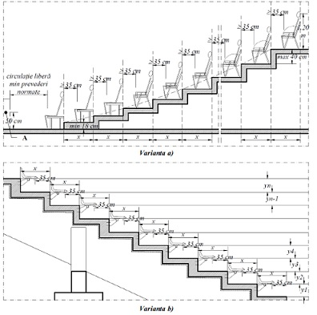
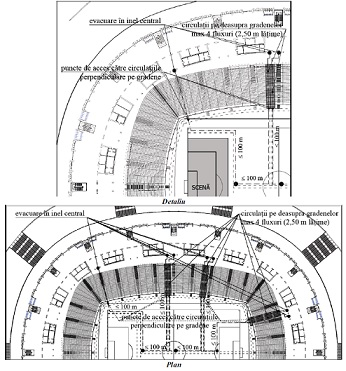

# Anexa nr. 7.3 – ARENE ȘI STADIOANE
ARENE ȘI STADIOANE
(234) Lățimea căilor de circulație funcțională și de evacuare a utilizatorilor din tribune, a scărilor de evacuare, și a circulațiilor dintre sectoare (paralele și perpendiculare pe gradene) se stabilește potrivit Art. 3.3.2.11.
(235) Distanța de la fiecare loc până la o ieșire de evacuare într-un spațiu de siguranță, la un acces la nivelul terenului sau o circulație carosabilă, va fi:
  - – max 45,00 m - pentru nivelul de stabilitate la incendiu I sau II;
  - – max 35,00 m - pentru nivelul de stabilitate la incendiu III;
  - – max 25,00 m - pentru nivelul de stabilitate la incendiu IV;
  - – max 15,00 m - pentru nivelul de stabilitate la incendiu V.
(236) Scaunele (băncile) trebuie să fie fixe (solidarizate pe structură de rezistență).
(237) Accesul la tribune se poate face prin combinarea, parțial sau total, a următoarelor trei sisteme:
  - a) lateral sau din spatele tribunei;
  - b) din față (în acest caz prima gradenă va fi supraînălțată cu aproximativ 1,00 m deasupra terenului de sport);
  - c) cu vomitorii (se recomandă accese în partea de spate-sus a gradenelor, debușând în favoarea circulației de distribuție adecvată, vomitoriile prezentând dezavantajul de a genera ambuscade în cazul evacuării de urgență).
(238) Numărul intrărilor în tribune este determinat de numărul spectatorilor, respectiv al căilor de evacuare, precum și de necesarul de controlori (care trebuie să fie cât mai redus).
(239) Distanța maximă de parcurs dintre un loc în tribună și ieșirea cea mai apropiată (evacuarea tribunei reprezentând părăsirea locurilor din tribună a tuturor spectatorilor și trecerea acestora de "punctele de acces în tribună" spre incinta exterioară tribunei) trebuie să fie de 45,00 m (pentru nivelul de stabilitate la incendiu I sau II, pentru alte încadrări în nivel de stabilitate se vor utiliza valorile prevăzute la Art. 3.3.2.9.).
(240) Dimensionarea căilor de acces și evacuare în tribune va respecta Art. 3.3.2.10.
(241) Pentru accesul, circulația și evacuarea utilizatorilor de pe gradene, treptele vor avea lățimi (de minimum 1,20 m pentru evacuarea a maximum 200 utilizatori și minimum 1,60 m pentru evacuarea a mai mult de 200 utilizatori) și adâncimi egale.
(242) Dimensiunea elementelor ce alcătuiesc tribuna trebuie să respecte datele rezultate din studiul curbei de vizibilitate, rezultând fie un profil drept al tribunelor, fie unul parabolic. În situația în care profilul transversal al gradenelor este o curbă parabolică, se va ține seama de următoarele elemente convenționale:
  - – prima gradenă va avea cca. 18 cm înălțime, iar ultima maximum 40 cm;
  - – în fața primei gradene se va rezerva un spațiu de circulație și evacuare de minim 1,20 m;
  - – lățimea gradenei în funcție de tipul de scaun, cu/fără spătar va fi minimum 75 cm și maximum 85 cm;
  - – înălțimea gradenei rezultă din calculul curbei de vizibilitate (implicit a treptelor prevăzute pe circulațiile perpendiculare pe gradene utilizabile și pentru evacuare).
(243) Dimensiunile gradenelor, respectiv înălțimea (h) și adâncimea (l), rezultă din calculul curbei de vizibilitate valorile lor maxime, respectiv minime fiind în funcție de tipul gradenei (cu locuri în picioare sau așezate) după cum urmează:
  - a) gradene cu locuri în picioare: h maxim = 20 cm și l minim ≥ 35 cm (recomandat 40 cm);
  - b) gradene cu locuri de stat jos (cu locurile de stat jos amplasate direct pe gradenă); h maxim = 40 cm și l minim = 70 cm (recomandat 80 cm). În situația amplasării acestora prin fixare pe gradene sau în condițiile în care sunt scaune individuale se ține cont de distanța minim normată de trecere între rânduri (mai mare sau egală de 35 cm) și de caracteristicile acestora.

  

  Figura 243 - Secțiune tribune cu profil parabolic
  (la arene, stadione, săli de spectacole etc.)
  Nota Figura 243: Valoarea x (lățimea gradenei) este constantă. Treptele vor avea lățimi și adâncimi egale. Înălțimea gradenei rezultă din calculul curbei de vizibilitate (y1 ≥ y2 ≥ y3 ≥ y4 ... ≥ yn) și implicit a treptelor prevăzute pe circulațiile perpendiculare pe gradene utilizabile și pentru evacuare.
(244) Locurile de stat jos în gradene pot fi pe bănci sau pe scaune individuale, ale căror dimensiuni minime, respectiv adâncimea (l_b pentru bănci și l_s pentru scaune) și lățimea (L) sunt următoarele:
  - – locuri pe bănci: l_b ≥ 30 cm, l_t (lățimea minimă de trecere între rânduri) ≥ 35 cm și l_gradenă (gradena) ≥ 65 cm;
  - – locuri pe scaune individuale (scaune cu limite laterale cu sau fără brațe și cu spătar): L ≥ 50 cm (distanța între limitele laterale ale scaunului), l_s ≥ 35 cm (recomandat 40 cm) și l_t ≥ 35 cm (lățimea minimă suport picioare) recomandat ≥ 40 cm. Dacă spătarul scaunului este peste 30 cm înălțime, atunci lățimea minimă a suportului pentru picioare este de 40 cm.
(245) Rândurile de locuri pe scaune individuale vor fi astfel dimensionate încât să lase o lățime de trecere (lățime suport picioare) de minimum 35 cm, scaunele fiind în poziția așezat. Când scaunele sunt rabatabile, lățimea minimă de trecere între scaune (scaunele având bancheta ridicată) este recomandată să fie 50 cm. Bancheta se va așeza în consolă, astfel ca marginea anterioară să avanseze cu 20-30 cm față de peretele vertical al gradenei pe care este așezată.
(246) Distanța liberă de circulație între rândurile de scaune va fi de minimum 35 cm.
(247) Circulațiile perpendiculare pentru mai mult de 15 gradene care au pantă mai mare de 25°, se prevăd cu puncte de sprijin pentru utilizatori.
(248) La stadioanele deschise și arenele sportive în aer liber:
  - – numărul maxim de locuri admise pe un rând de scaune, este normat în funcție de nivelul de stabilitate la incendiu asigurat și de modul în care se face evacuarea utilizatorilor din rând, potrivit prevederilor din Tabelul 130, și
    Tabelul 130: Număr maxim de locuri admise pe un rând de scaune la arene și stadioane în aer liber

| Modul de evacuare al utilizatorilor aflați pe un rând de scaune | Nivelul de stabilitate la incendiu al clădirii | Nivelul de stabilitate la incendiu al clădirii | Nivelul de stabilitate la incendiu al clădirii |
|---|---|---|---|
| Modul de evacuare al utilizatorilor aflați pe un rând de scaune | I și/sau II | III | IV și/sau V |
| Modul de evacuare al utilizatorilor aflați pe un rând de scaune | Numărul de locuri dispuse pe un rând | Numărul de locuri dispuse pe un rând | Numărul de locuri dispuse pe un rând |
| Pe la un capăt al rândului | 25 | 15 | 10* |
| Pe la ambele capete ale rândului | 50 | 25 | 20 |

    Notă Tabelul 130: * - La stadioanele, arenele și amenajările deschise cu nivelul de stabilitate la incendiu IV sau V, se asigură obligatoriu evacuarea rândurilor de scaune la ambele capete.
  - – numărul maxim de rânduri de scaune, dintre 2 căi de circulație, în funcție de nivelul de stabilitate la incendiu al construcției, va fi potrivit prevederilor din Tabelul 131.
    Tabelul 131: Număr maxim de rânduri de scaune la arene și stadioane în aer liber

| Nivelul de stabilitate la incendiu al clădirii | I | II și/sau III | IV și/sau V |
|---|---|---|---|
| Numărul de rânduri | 30 | 20 | 15 |

(249) În toate categoriile de stadioane și arene se asigură condițiile speciale de siguranță și confort pentru spectatorii cu dizabilități. Pentru aceasta, trebuie să se prevadă locuri special amenajate în tribune astfel încât să asigure persoanelor cu handicap o bună vizibilitate și un acces comod (rampe pentru scaune cu rotile), precum și servicii sanitare și de asistență adecvate, proiectate pentru această categorie de spectatori, în conformitate cu normele specifice în vigoare.
(250) Trebuie asigurat spectatorilor cu dizabilități, inclusiv celor în scaune cu rotile, accesul în tribune (încă de la intrarea în stadion prin porțile închiderii exterioare), astfel încât să nu se creeze dificultăți în uz nici acestora și nici celorlalți spectatori. Spectatorii cu dizabilități locomotorii nu trebuie să se afle în nici o zonă a stadionului în care imposibilitatea lor de a se mișca repede ar reprezenta un risc pentru ceilalți spectatori în cazul evacuării în situații de urgență.
(251) Holurile și spațiile pentru circulație și odihnă se află în cea mai mare parte pe marile "inele de distribuție" din spatele tribunelor. Circulațiile de distribuire și degajament care constituie căi comune de evacuare din spatele tribunelor trebuie să aibă o lățime suficient de mare pentru a prelua aceste funcțiuni. Dacă aceste circulații sunt acoperite, vor avea o înălțime sub plafon de minimum 2,40 m (sub 2,40 m nu se vor prevedea elemente cu potențial de accidentare) și vor fi libere de orice obstacol. Se va da o atenție deosebită rezistenței materialelor folosite și a parapetelor sau mâinilor curente (cu înălțime de min 1,20 m și prevăzute cu bare care să împiedice cățărarea în cazul balustradelor). Legătura dintre accesul în stadion și circulațiile din spatele tribunelor se face prin scări largi sau rampe, obligatoriu cu rampe drepte, debușând într-o zonă largă, liberă, amplasată între tribune și incinta exterioară. Se vor evita efectele de "pâlnie" și schimbările bruște de direcție. Numărul porților aflate pe traseul acestor circulații care constituie căi comune de evacuare, trebuie limitat la minimum.
(252) Porțile de evacuare din incinta exterioară (ieșire din stadion) vor fi în număr cât mai mare. Toate porțile se vor deschide către exterior (în sensul evacuării). Nu este recomandabilă utilizarea porților culisante. Ideal ar fi ca aproximativ jumătate din închiderea exterioară să se poată deschide în momentul ieșirii publicului, fiind astfel prevăzută încât să nu încurajeze intruziunile (înălțime minimă de 2,50 m, detalii care să nu permită escaladarea etc.).
(253) Amenajările de alimentație publică se amplasează, de regulă în spatele tribunelor, în apropierea ieșirilor, dar astfel încât să nu constituie un impediment în calea fluxului de evacuare. Amplasarea mobilierului se face astfel încât să se asigure căi de acces și circulație, prin treceri cu lățimi determinate prin calcul. La amplasarea mobilierului cu locuri la mese, trebuie să se asigure treceri cu lățimi normate determinate prin calcul și prin care utilizatorii să se poată evacua în caz de incendiu, se amplasează în funcție de reglementările în vigoare luând în calcul și riscul privind conflictul, agresivitatea și violența în sport, factorii și formele de manifestare ale violenței în sport precum și metodele de combatere a acesteia.
(254) Spațiile destinate serviciului medical (care se iau în calcul în funcție de capacitatea stadionului sau arenei, respectiv, cabinet medical, infirmerie și/sau posturi de prim ajutor) trebuie să asigure evacuarea în condiții de securitate și urgență a pacienților. In cazul dotării cu cabinet medical sau infirmerie, trebuie să existe un traseu distinct, dimensionat corespunzător pentru transportul cu targa, care nu se intersectează cu celelalte circulații sau să nu poată fi obstrucționat de celelalte circulații și să aibă o parcare proprie în care staționează o salvare.
(255) Anexele cu rol în siguranța spectatorilor (post de supraveghere, spațiu regrupare personal civil de securitate, spații pentru forțele poliției cu posibilitatea de vizualizare a întregii suprafețe a stadionului și spații pentru pompieri) se amplasează în funcție de reglementările în vigoare luând în calcul și riscul care este constituit din efectul panicii asupra unei mari aglomerări de oameni.
(256) Suprafața destinată spectatorilor, precum și suprafața de joc, inclusiv căile de acces și ieșire/ evacuare jucători, trebuie supravegheate prin diverse sisteme de control și avertizare (sistemul de protecție adoptat trebuie astfel ales, încât să nu constituie pericol pentru spectatori și să nu creeze panică în timpul evacuării de urgență).
(257)
  - 1) În cazul prevederii unor bariere de dirijare a circulației, acestea vor fi astfel realizate și amplasate încât să nu împiedice circulația și evacuarea în siguranță a utilizatorilor în caz de incendiu. Dispoziția barierelor, scărilor, pasajelor și ieșirilor trebuie astfel realizată încât să asigure o evacuare fluidă, rapidă și în siguranță urmărindu-se evitarea efectului de pâlnie (căi de acces/ieșire prea înguste).
  - 2) Atunci când, pentru activități de cultură, divertisment, întruniri sau alte activități similare, pe terenul de joc al arenelor în aer liber sau al stadioanelor noi sau existente, se amenajează scene precum și/sau locuri în picioare, pe bănci sau locuri pe scaune pentru publicul utilizator, se vor lua următoarele măsuri:
    - a) distanța maximă de parcurs dintre un loc dispus pe terenul de joc al stadioanelor și ieșirea cea mai apropiată (evacuare în inel central, spre incinta exterioară tribunelor) trebuie să fie de maximum 100,00 m (pentru nivelul de stabilitate la incendiu I sau II), astfel:
      - – pentru locuri în picioare această distanță este linia ce unește locul respectiv cu cea mai apropiată ieșire (cu acces către circulațiile perpendiculare pe gradene); distanța maximă de parcurs dintre oricare loc în picioare dispus pe terenul de joc al arenelor în aer liber și al stadioanelor până la punctul de acces către circulațiile perpendiculare pe gradene nu trebuie să depășească 1/10 din perimetrul ariei de evoluție a suprafeței de joc* (așa cum este definită în reglementările de specialitate);
      - – pentru locuri pe bănci sau pe scaune, această distanță reprezintă suma dintre lungimea rândului și aceea a căii laterale de parcurs de la locul respectiv la cea mai apropiată ieșire (măsurată în axul acestora); distanța maximă de parcurs dintre oricare loc pe bănci sau pe scaune dispus pe terenul de joc al arenelor în aer liber și al stadioanelor până la punctul de acces către circulațiile perpendiculare pe gradene nu trebuie să depășească 1/8 din perimetrul ariei de evoluție a suprafeței de joc* (așa cum este definită în reglementările de specialitate);
    - b) un flux de evacuare al utilizatorilor dispuși pe terenul de joc este de 150 persoane; lățimea căilor de circulație funcțională și de evacuare a utilizatorilor dispuși pe terenul de joc se stabilește în funcție de modul de dispunere al locurilor și al numărului de utilizatori ce trebuie evacuat, dar minimum 1,20 m pentru evacuarea unui flux, minimum 1,60 m pentru evacuarea a două fluxuri, minimum 2,00 m pentru evacuarea a trei fluxuri și 2,50 m pentru evacuarea a patru fluxuri;
    - c) tunelele de acces ale mașinilor de intervenție în interiorul stadionului nu se vor utiliza ca și căi de evacuare pentru publicul utilizator dispus pe terenul de joc al stadioanelor;
    - d) circulațiile existente ale arenelor în aer liber și ale stadioanelor, perpendiculare pe gradene, se pot utiliza ca și căi de evacuare pentru publicul utilizator dispus pe terenul de joc al stadioanelor, în funcție de încărcarea acestora din tribune și doar în condițiile în care circulațiile existente perpendiculare pe gradene nu sunt utilizate la capacitate maxim admisă conform prevederilor Art. 3.3.2.11. alin. (3) de către publicul din tribune.

      

      Figura 244 - Circulații pe gradene **
      la stadioane și arene în aer liber
      Notă Figura 244: ** = Atunci când, pentru activități de cultură, divertisment, întruniri sau alte activități similare, pe terenul de joc al arenelor în aer liber sau al stadioanelor noi sau existente se amenajează scene precum și locuri în picioare, pe bănci sau locuri pe scaune pentru publicul utilizator.
  - 3) Atunci când, pentru activități de cultură, divertisment, întruniri sau alte activități similare, pe terenul de joc al arenelor considerate construcții închise, în acord cu definiția de la Art. 1.2.1. pct. 21) nr. 1), noi sau existente, se amenajează scene precum și/sau locuri în picioare, pe bănci sau locuri pe scaune pentru publicul utilizator, se vor lua următoarele măsuri:
    - a) distanța maximă de parcurs dintre oricare loc dispus pe terenul de joc arenelor considerate construcții închise până la punctul de acces către circulațiile perpendiculare pe gradene sau până la o ieșire în exterior, în funcție de forma și dimensiunile terenului pentru jocuri sportive așa cum sunt definite în reglementările de specialitate, nu trebuie să depășească:
      - – 1/10 din perimetrul ariei de evoluție a suprafeței de joc* (așa cum este definită în reglementările de specialitate) pentru distanța maximă de parcurs dintre oricare loc în picioare dispus pe terenul de joc al arenelor considerate construcții închise, până la punctul de acces către circulațiile perpendiculare pe gradene;
      - – 1/8 din perimetrul ariei de evoluție a suprafeței de joc* (așa cum este definită în reglementările de specialitate) pentru distanța maximă de parcurs dintre oricare loc amenajat pe bănci sau pe scaune dispus pe terenul de joc al arenelor considerate construcții închise, până la punctul de acces către circulațiile perpendiculare pe gradene;
    - b) un flux de evacuare al utilizatorilor dispuși pe terenul de joc al arenelor considerate construcții închise este funcție de tipul și/sau funcțiunea construcției arenei închise (de exemplu, construcția arenei poate fi tip sală aglomerată); lățimea căilor de circulație funcțională și de evacuare a utilizatorilor dispuși pe terenul de joc se stabilește de asemenea în acord cu tipul și/sau funcțiunea construcției arenei închise;
    - c) circulațiile existente ale arenelor considerate construcții închise, perpendiculare pe gradene, se pot utiliza ca și căi de evacuare pentru publicul utilizator dispus pe terenul de joc al stadioanelor în funcție de încărcarea acestora din tribune și doar în condițiile în care circulațiile existente perpendiculare pe gradene nu sunt utilizate la capacitate maxim admisă, conform prevederilor normate, de către publicul din tribune.
  Note Art. (257):
  - (a) În anumite cazuri, la calculul perimetrului ariei de evoluție a suprafeței de joc* aferente terenurilor de sport, este necesar să se însumeze lățimile diferitelor piste dacă acestea există, luându-se în calcul conturul exterior maxim al terenului generat pentru jocuri sportive.
  - (b) Oricare loc dispus pe terenul de joc al stadioanelor sau arenelor (în aer liber sau construcții închise) necesită evacuare cel puțin în două direcții.
