# Anexa nr. 7.4 – CLĂDIRI CIVILE ÎNALTE, FOARTE ÎNALTE SAU CU SĂLI AGLOMERATE
CLĂDIRI CIVILE ÎNALTE, FOARTE ÎNALTE SAU CU SĂLI AGLOMERATE
Clădiri înalte și foarte înalte
(258) Clădire înaltă - clădire civilă (publică) supraterană, la care cota superioară a stratului de uzură al pardoselii ultimului nivel folosit de utilizatori este situat la peste 28 m și la mai puțin de 45 m față de cota nivelului de referință (28 m < h <45 m). Clădirile înalte trebuie să permită accesul autospecialelor serviciilor pentru situații de urgență pe minimum două (2) laturi alăturate și pe minimum 50% din perimetrul pereților exteriori atunci când forma acestora este atipică.
(259) Nu sunt considerate clădiri înalte:
  - – construcțiile pentru producție și/sau depozitare;
  - – clădirile pentru locuit colective care au maximum 12 niveluri supraterane;
(260) Clădirile civile (indiferent de destinație), la care deasupra nivelului limită normat se află un singur nivel construit ce ocupă maximum 50% din aria construită a nivelului inferior acestuia și cuprinde numai spații tehnice aferente clădirii (încăperi pentru ascensoare, centrale termice, centrale de ventilare etc.), circulații funcționale (holuri, coridoare, încăperi tampon etc.) sau spații anexă (spălătorii, călcătorii, uscătorii etc ), fără prezență permanentă de persoane.

  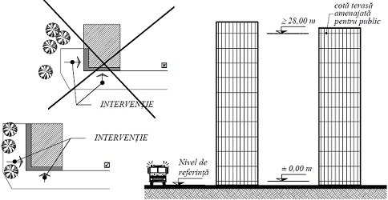

  Figura 245 - Clădire înaltă
  Notă Figura 245: cota ultimului nivel folosibil poate fi și terasa de pe clădire (în cazul amenajărilor pentru public pe aceasta), caz în care înalțimea se raportrează la acea cotă

  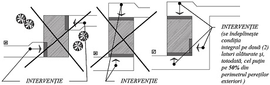

  Figura 246 - Căi de acces și intervenție la clădiri înalte

  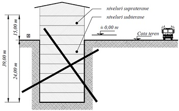

  Figura 247 - Clădiri înalte sunt numai
  porțiunile/nivelurile SUPRATERANE.
(261) Nivelurile subterane nu se iau în considerare la stabilirea tipului de clădire înaltă.

  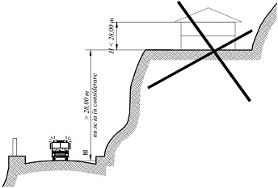

  Figura 248 - Clădirile amplasate la cote mai ridicate
  față de șosele, drumuri etc, nu sunt clădiri înalte

  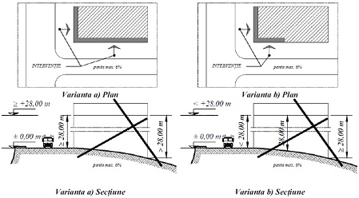

  Figura 249 - Clădiri dispuse adiacent străzilor în pantă
(262) Clădirile dispuse adiacent străzilor în pantă, nu sunt considerate înalte atunci când au asigurate accese de intervenție pe două laturi în porțiuni cu înălțimea (cota) ultimului planșeu utilizabil sub 28,00 m.
(263) La clădirile înalte si/sau foarte înalte se prevăd obligatoriu căi de acces și de intervenție pentru autospecialele de intervenție în caz de incendiu, cel puțin integral pe două (2) laturi alăturate și, totodată, cel puțin pe 50% din perimetrul pereților exteriori

  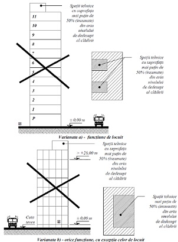

  Figura 250 - Nu sunt considerate clădiri înalte
(264) Nu sunt considerate clădiri înalte, clădirile civile (publice) la care deasupra nivelului limită (28,00 m) se află un singur nivel ce ocupă maximum 50% din aria construită a clădirii și cuprinde spații tehnice.
(265) Nu sunt considerate clădiri înalte, blocurile de locuințe colective care au maximum 12 niveluri supraterane, fiind admis deasupra nivelului limită, un singur nivel care ocupă max. 50% din arie și este destinat EXCLUSIV spațiilor tehnice, spălătorii, călcătorii.

  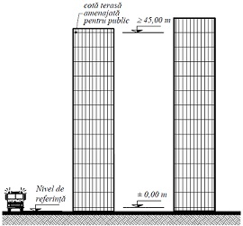

  Figura 251 - Clădire foarte înaltă construcție civilă (publică)
  la care pardoseala ultimului nivel folosibil este situată la
  înălțimea de 45,00 m sau mai mult, măsurată conform precizărilor
  de la clădiri înalte
  Notă: cota ultimului nivel folosibil poate fi și terasa de pe clădire (în cazul amenajărilor pentru public pe aceasta), caz în care înalțimea se raportează la acea cotă (similar la clădiri înalte)

  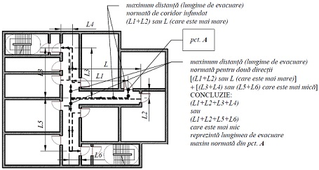

  Figura 252 - Soluție corecta la clădiri înalte și foarte
  înalte - minimum două scări de evacuare

  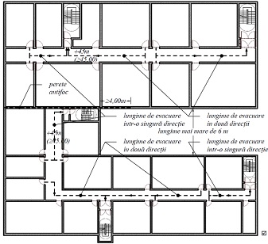

  Figura 253 - Asigurarea a cel puțin două căi de evacuare
(266) In clădiri înalte și foarte înalte este obligatorie asigurarea a cel puțin două căi de evacuare, distincte și independente, astfel amplasate încât să asigure distribuția lor judicioasă și posibilitatea ca persoanele să recunoască cu ușurință traseul spre exterior.

  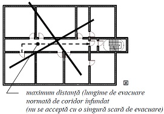

  Figura 254 - Soluție neadmisă la clădiri înalte și foarte
  înalte - doar cu o scară de evacuare
Clădiri cu săli aglomerate (lungimi de evacuare la sălile aglomerate)
(267) Sălile aglomerate trebuie să aibă minimum două căi de evacuare distincte și independente.
(268) Lungimile căilor de evacuare la săli aglomerate trebuie să respecte condițiile normate, în funcție de categoria sălii aglomerate (S1, S2) și nivelul de stabilitate la incendiu al construcției.

  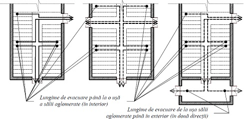

  Figura 255 - Distanțe de evacuare în interiorul
  sălilor aglomerate - variante

  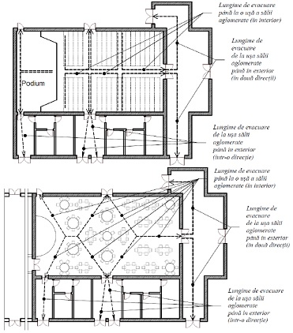

  Figura 256 - Distanțe de evacuare la săli
  aglomerate - interior și exterior
