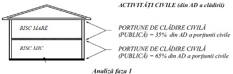
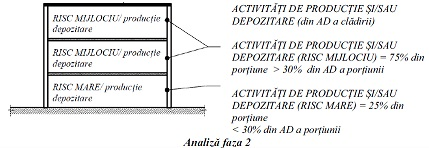
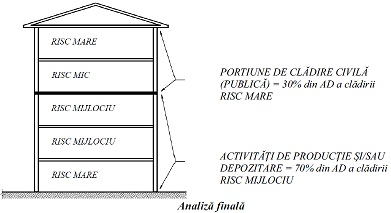
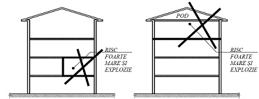

# Anexa nr. 7.5 – CONSTRUCȚII CU FUNCȚIUNI MIXTE
CONSTRUCȚII CU FUNCȚIUNI MIXTE
(269) Clădire cu funcțiuni mixte - construcție supraterană care cuprinde diferite funcțiuni principale civile-civile sau civile-de producție și/sau depozitare ori producție-depozitare.
(270) Funcțiunea distinctă (civilă sau de producție sau de depozitare) care depășește 50% din aria desfășurată totală a construcției (Ad), determină încadrarea construcției respective în:
  - – clădire cu funcțiuni mixte predominat civile, sau
  - – clădire cu funcțiuni mixte predominat producție, sau
  - – clădire cu funcțiuni mixte predominat depozitare.
  Notă: Atunci când în clădire sunt mai multe destinații diferite civile, respectiv de producție și/sau depozitare, funcțiunea cu aria totală desfășurată cea mai mare din cea a construcției (Ad), determină funcțiunea civilă ori funcțiunea de producție sau de depozitare a clădirii.
(271) In situația în care funcțiunea de construcție civilă este 50% din aria desfășurată a construcției (Ad), determină încadrarea construcției respective în clădire cu funcțiuni mixte predominat civile.
(272) Riscul de incendiu pe compartiment de incendiu/construcție, se consideră riscul cel mai mare al încăperilor și zonelor:
  - – ale căror volume însumate reprezintă mai mult de 30% din volumul construcției sau al compartimentului de incendiu, indiferent de destinația acestora, dacă în construcție sunt zone cu risc foarte mare de incendiu, cu pericol de explozie volumetrică;
  - – ale căror suprafețe însumate reprezintă mai mult de 30% din aria desfășurată a construcției sau al compartimentului de incendiu, indiferent de destinația acestora.
(273) Determinarea riscului de incendiu al clădirii civilă (publică) sau de producție și/sau depozitare se realizează făcând media aritmetică a sarcinii termice raportat la procentul ocupat de riscul respectiv de incendiu pe compartiment/construcție (se raportează la aria desfășurată a riscului respectiv).
  Exemplu:
  Dacă o clădire are 60% risc mic, 20% risc mijlociu și 20% risc mare, riscul pe întreaga clădire este Risc MIJLOCIU.
(274) Intr-o clădire cu funcțiuni mixte, determinarea riscului de incendiu se face astfel:
  - – cel mai periculos risc de incendiu care reprezintă peste 30% din aria desfășurată (Ad) a unei porțiuni de construcție (separată cu pereți și planșee rezistente la foc), determină riscul de incendiu pentru întreaga porțiune și
  - – cel mai periculos risc de incendiu al unei porțiuni de construcție, a cărui arie desfășurată (Ad) reprezintă mai mult de 30% din aria desfășurată (Ad) a construcției respective, determină riscul de incendiu al întregii construcții cu funcțiuni mixte.
  Notă: La construcții existente, determinarea caracterului de clădire mixtă civilă (publică) sau de producție și/sau depozitare se poate analiza pe porțiuni de clădire, apoi pe ansamblu (luându-se în calcul valoarea cea mai restrictivă rezultată), după cum urmează:
  ANALIZA FAZA I
  Riscul cel mai mare care reprezintă cel puțin 30% din aria desfășurată a porțiunii construcției civile (publice) pentru risc mare este considerat pentru toată porțiunea.
  Porțiunea de clădire este considerată civilă (publică) este cu risc mare.

  

  ANALIZA FAZA II
  Riscul cel mai mare care reprezintă cel puțin 30% din aria desfășurată a porțiunii construcției este considerat pentru toată porțiunea.
  Porțiunea de clădire cu activitate de producție și/sau depozitare este considerată cu risc mijlociu.

  

  CONCLUZIE/DETERMINARE FINALĂ
  Porțiunea de clădire civilă (publică) sau de producție și/sau depozitare) care reprezintă mai mult de 60 % din aria desfășurată a întregii clădiri existente, determină caracterul construcției (Clădire de producție și/sau depozitare sau civilă) luat în considerare.
  Concluzie: Clădire de producție și/sau depozitare cu risc mijlociu.

  

  Figura 257 - Determinare construcții cu funcțiuni mixte
  (la construcții existente)
(275) Riscul de incendiu indiferent de funcțiunea distinctă (civilă sau de producție sau de depozitare care depășește 50% din aria desfășurată a construcției Ad și care determină încadrarea construcției respective), se consideră riscul cel mai mare al încăperilor și zonelor ale căror arii însumate reprezintă mai mult de 30% din aria desfășurată totală a construcției sau al compartimentului de incendiu, indiferent de destinația acestora. Dacă în construcție sunt zone cu risc foarte mare de incendiu, cu pericol de explozie volumetrică, riscul de incendiu pe compartiment de incendiu/construcție, se consideră riscul cel mai mare al încăperilor și zonelor ale căror volume însumate reprezintă mai mult de 30% din volumul construcției sau al compartimentului de incendiu.
(276) în cazul în care riscul cel mai mare al ariilor însumate ale încăperilor și zonelor clădirii, indiferent de funcțiunea distinctă a clădirii reprezintă mai mult de 30% din aria desfășurată totală a construcției sau al compartimentului de incendiu, acest risc este considerat relevant pentru toată construcția.
(277) În construcții cu funcțiuni mixte civile (publice) nu este admisă dispunerea unor spații sau încăperi cu pericol de explozie, cu excepția celor admise explicit (centrale termice, depozitare gaze/ fluide medicale etc.).

  

  Figura 258 - Clădiri cu funcțiuni mixte civile
  (publice) - dispunerea unor spații sau încăperi cu
  pericol de explozie
