# Anexa nr. 7.6 – CONSTRUCȚII DE PRODUCȚIE ȘI/SAU DEPOZITARE
CONSTRUCȚII DE PRODUCȚIE ȘI/SAU DEPOZITARE
Amplasare
(278) Condițiile normate de limitare a posibilităților de propagare a incendiilor între construcții și compartimente de incendiu sunt obligatorii și se realizează prin amplasarea la distanțele minime de siguranță stabilite în Tabelul 4 (Distanțe minime de siguranță între construcții sau compartimente de incendiu supraterane (civile, de producție și/sau depozitare)) sau se delimitează cu pereți rezistenți la foc de separare a compartimentelor de incendiu (pereți antifoc) și, după caz, cu planșee rezistente la foc de separare a compartimentelor de incendiu (planșee antifoc), aplicându-se prevederile stabilite la Capitolul II, Secțiunea III/2.3. - "Limitarea propagării incendiilor"/2.3.2. - "Elemente rezistente la foc pentru separarea compartimentelor de incendiu și protecția golurilor funcționale de trecere" precum și indicațiile din această anexă.
(279) Construcțiile de producție și/sau depozitare se pot amplasa la distanțe de siguranță normate sau compartimentate corespunzător față de vecinătăți.

  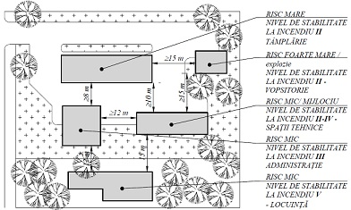

  Figura 259 - Amplasare la distanțe de siguranță

  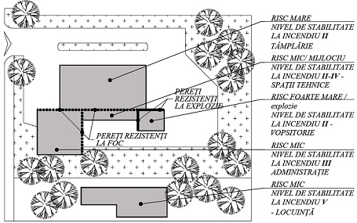

  Figura 260 - Amplasare compartimentată
Lungimi de evacuare la clădiri de producție și/sau depozitare
(280) În clădiri de producție și/sau depozitare, lungimile de evacuare vor respecta valorile normate în funcție de nivelul de stabilitate la incendiu (se are în vedere Tabelul 114 (Condiții de corelare a ariilor construite (Ac) și a numărului de niveluri al construcțiilor și compartimentelor de incendiu supraterane de producție și/sau depozitare)]).
(281) Construcție etajată, cu evacuare în minimum două direcții (conform Tabelul 116 (Lungimi de evacuare în construcții de producție și/sau depozitare)).

  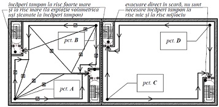

  Figura 261 - Construcție etajată de producție și/sau
  depozitare, cu evacuare în două direcții -
  principii evacuare etaj
(282) În construcțiile de producție și/sau depozitare, pot fi considerate căi de evacuare a utilizatorilor și cele care trec prin:
  - a) încăperi sau spații cu riscuri mici de incendiu, dacă servesc la evacuarea utilizatorilor spațiilor de producție/depozitare învecinate sau din anexele tehnico-sociale ale acestora, precum și în cazurile stabilite în normele tehnice specifice acestora;
  - b) încăperi sau spații cu risc mijlociu de incendiu, dacă servesc la evacuarea utilizatorilor spațiilor învecinate și nu constituie singura lor cale de evacuare, situație în care a doua cale de evacuare poate fi constituită tot de un spațiu cu risc mijlociu de incendiu dacă traseele sunt distincte și separate între ele prin pereți rezistenți la foc minimum EI/REI 60 iar golurile de circulație din aceștia sunt protejate cu elemente de închidere EI_2 45-C5S_200;
  - c) încăperi sau spații cu risc mare sau foarte mare de incendiu, dacă servesc la evacuarea utilizatorilor spațiilor de producție sau depozitare cu același risc de incendiu și nu constituie singura lor posibilitate de evacuare.
(283) În construcțiile de producție și/sau depozitare, pot fi considerate căi de evacuare și circulațiile care trec prin încăperi sau spații cu riscuri de incendiu mai mici sau cel mult egale cu cel din care se evacuează utilizatorii.

  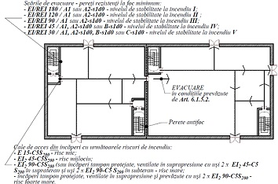

  Figura 262 - Construcție etajată, cu evacuare în două
  direcții - principii evacuare parter
(284) În construcțiile de producție și/sau depozitare, pot fi considerate căi de evacuare și circulațiile care trec prin încăperi sau spații cu riscuri de incendiu mai mici sau cel mult egale cu cel din care se evacuează utilizatorii.

  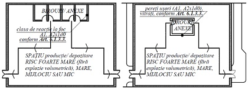

  Figura 263 - Evacuare birouri/anexe prin spațiul în care sunt dispuse
Scări de evacuare închise din construcții de producție și/sau depozitare
(285) Scările de evacuare a utilizatorilor din construcții de producție și/sau depozitare supraterane se separă față de restul construcției prin minimum:
  - a) pereți EI/REI 180 clasa de reacție la foc A1 sau A2-s1,d0, planșee REI 90 clasa de reacție la foc A1 sau A2-s1,d0 și uși conform Art. 6.1.5.6. (1) și (2) în construcțiile cu nivelul de stabilitate la incendiu I;
  - b) pereți EI/REI 120 clasa de reacție la foc A1 sau A2-s1,d0, planșee REI 60 clasa de reacție la foc A1 sau A2-s1,d0 și uși conform Art. 6.1.5.6. (1) și (2) în construcțiile cu nivelul de stabilitate la incendiu II;
  - c) pereți EI/REI 90 clasa de reacție la foc A1 sau A2-s1,d0, planșee REI 45 clasa de reacție la foc A1 sau A2-s1,d0 și uși conform Art. 6.1.5.6. (1) și (2) în construcțiile cu nivelul de stabilitate la incendiu III;
  - d) pereți EI/REI 45 clasa de reacție la foc A1, A2-s1,d0 sau B-s1,d0, planșee REI 30 clasa de reacție la foc A1, A2-s1,d0 sau B-s1,d0 și uși conform Art. 6.1.5.6. (1) și (2) în construcțiile cu nivelul de stabilitate la incendiu IV;
  - e) pereți EI/REI 30 clasa de reacție la foc A1, A2-s1,d0, B-s1,d0 sau C-s1,d0, planșee REI 15 clasa de reacție la foc A1, A2-s1,d0, B-s1,d0 sau C-s1,d0 și uși conform Art. 6.1.5.6. (1) și (2) în construcțiile cu nivelul de stabilitate la incendiu V;
(286) Podestele, rampele și grinzile scărilor interioare de evacuare vor îndeplini condițiile de comportare la foc stabilite la Art. 2.4.2.5. și Art. 2.4.2.6.

  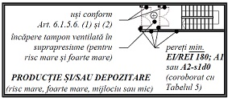

  Varianta a) - construcție cu nivel de stabilitate la incendiu I

  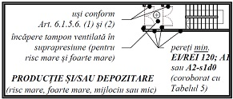

  Varianta b) - construcție cu nivel de stabilitate la incendiu II

  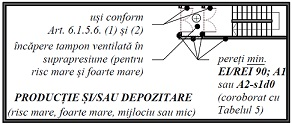

  Varianta c) - construcție cu nivel de stabilitate la incendiu III

  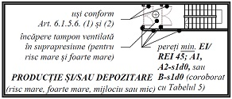

  Varianta d) - construcție cu nivel de stabilitate la incendiu IV

  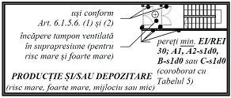

  Varianta e) - construcție cu nivel de stabilitate la incendiu V
  Figura 264 - Scări de evacuare închise din
  construcții de producție și/sau depozitare
Goluri de acces la scări de evacuare închise din construcțiile de producție și/sau depozitare
(287) Pereții de separare ai caselor de scări închise de circulație funcțională și de evacuare a utilizatorilor față de restul construcției, vor îndeplini și condițiile specifice respectivelor riscuri de incendiu și/sau explozie volumetrică din încăperile adiacente.
(288) Se au în vedere și clasele de periculozitate a materialelor la stabilirea rezistenței la foc a acestora.
(289) Golurile prin care utilizatorii construcțiilor de producție și/sau depozitare au acces la scările de evacuare închise, se protejează cu:
  - a) uși etanșe la foc E 30-C5S_200, atunci când constituie cale de acces din încăperi cu risc mic de incendiu;
  - b) uși rezistente la foc EI_2 45-C5S_200, atunci când constituie cale de acces din încăperi cu risc mijlociu de incendiu;
  - c) uși rezistente la foc EI_2 90-C5S_200 sau încăperi tampon protejate, ventilate în suprapresiune (atunci când nu au ferestre directe spre exterior), prevăzute cu uși rezistente la foc EI_2 45-C5 S_200 la nivelurile supraterane ale clădirii și respectiv, cu uși EI_2 90-C5 S_200 la nivelurile subterane, atunci când constituie cale de acces din încăperi cu risc mare de incendiu;
  - d) încăperi tampon protejate, ventilate în suprapresiune și prevăzute cu uși rezistente la foc EI_2 90-C5S_200, atunci când constituie cale de acces din încăperi cu risc foarte mare de incendiu.

  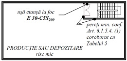

  Varianta a) - risc mic (producție sau depozitare)

  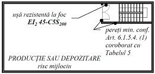

  Varianta b) - risc mijlociu (producție sau depozitare)

  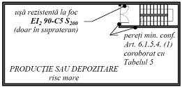

  Varianta c) - risc mare (producție sau depozitare)

  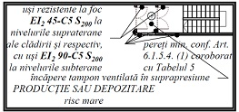

  Varianta d) - risc mare (producție sau depozitare)

  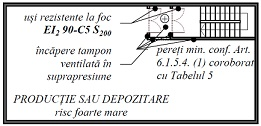

  Varianta e) - risc foarte mare (producție sau depozitare)

  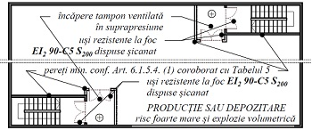

  Varianta f) - risc foarte mare și explozie volumetrică
  (producție sau depozitare)
  Figura 265 - Goluri de acces la scări de evacuare închise
  din construcțiile de producție și/sau depozitare
Circulații comune orizontale din construcții de producție și/sau depozitare
(290) Circulațiile comune orizontale funcționale și de evacuare a utilizatorilor din construcții de producție și/sau depozitare supraterane, se separă față de restul construcției prin minimum:
  - a) EI/REI 90 și clasa de reacție la foc A1 sau A2-s1,d0 în construcțiile cu nivelul de stabilitate la incendiu I;
  - b) EI/REI 60 și clasa de reacție la foc A1 sau A2-s1,d0 în construcțiile cu nivelul de stabilitate la incendiu II;
  - c) EI/REI 45 și clasa de reacție la foc A1 sau A2-s1,d0 în construcțiile cu nivelul de stabilitate la incendiu III;
  - d) EI/REI 30 și clasa de reacție la foc A1, A2-s1,d0 sau B-s1,d0 în construcțiile cu nivelul de stabilitate la incendiu IV;
  - e) EI/REI 15 și clasa de reacție la foc A1, A2-s1,d0, B-s1,d0, B-s2,d0, C-s1,d0 sau C- s2,d0 în construcțiile cu nivelul de stabilitate la incendiu V.
(291) Pereții de separare a circulațiilor comune orizontale funcționale și de evacuare față de restul construcției, vor îndeplini și condițiile specifice respectivelor riscuri de incendiu și/sau explozie volumetrică din încăperile adiacente.

  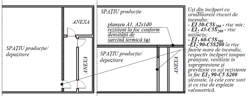

  Figura 266 - Separare circulații comune orizontale din
  construcții de producție și/sau depozitare
  (general)

  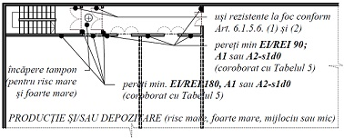

  Varianta a) - construcție cu nivel de stabilitate la incendiu I

  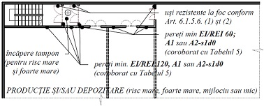

  Varianta b) - construcție cu nivel de stabilitate la incendiu II

  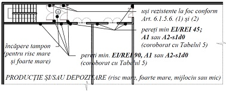

  Varianta c) - construcție cu nivel de stabilitate la incendiu III

  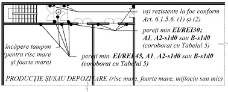

  Varianta d) - construcție cu nivel de stabilitate la incendiu IV

  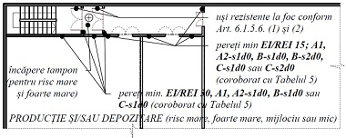

  Varianta e) - construcție cu nivel de stabilitate la incendiu V
  Figura 267 - Circulații comune orizontale din construcții
  de producție și/sau depozitare
Goluri de acces la circulații comune orizontale din construcții de producție și/sau depozitare
(292) Golurile de circulație dispuse în pereții de separare a circulațiilor comune orizontale din construcțiile de producție și/sau depozitare, se protejează corespunzător riscurilor de incendiu specifice încăperilor adiacente, respectiv cu uși care asigură minimum:
  - a) E15-C5S_200 la risc mic de incendiu;
  - b) EI_2 30-C5S_200 la risc mijlociu de incendiu;
  - c) EI_2 60-C5S_200 la risc mare de incendiu;
  - d) EI_2 90-C5S_200 la risc foarte mare de incendiu, respectiv încăperi tampon protejate, ventilate în suprapresiune și prevăzute cu uși rezistente la foc EI_290-C5 S_200, la cele care sunt și cu risc de explozie volumetrică.

  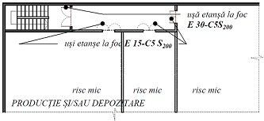

  Varianta a) - risc mic

  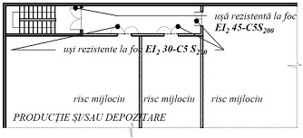

  Varianta b) - risc mijlociu

  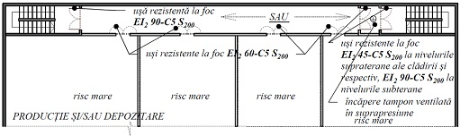

  Varianta c) - risc mare

  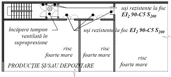

  Varianta d) - risc foarte mare

  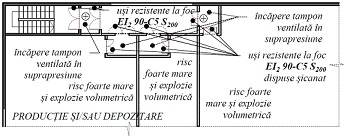

  Varianta e) - risc foarte mare și explozie volumetrică
  Figura 268 - Goluri de acces la circulații comune
  orizontale din construcții de producție și/sau depozitare
Goluri de acces la ascensoare de persoane, de marfă sau la alte mijloace mecanice de transport pe verticală din construcții de producție și/sau depozitare
(293) Golurile de palier prin care utilizatorii au acces la ascensoare de persoane, de marfă sau la alte mijloace mecanice de transport pe verticală din construcțiile de producție și/sau depozitare, se protejează cu:
  - a) uși etanșe la foc E 30, atunci când constituie cale de acces din încăperi cu risc mic de incendiu;
  - b) uși rezistente la foc EI 45, atunci când constituie cale de acces din încăperi cu risc mijlociu de incendiu;
  - c) uși rezistente la foc EI 90 sau încăperi tampon protejate, ventilate în suprapresiune (atunci când nu au ferestre directe spre exterior) prevăzute cu uși rezistente la foc EI 45- C5S_200 la nivelurile supraterane ale construcției și respectiv încăperi tampon protejate, ventilate în suprapresiune prevăzute cu EI 90-C5S_200 la nivelurile subterane, atunci când constituie cale de acces din încăperi cu risc mare de incendiu; încăperi tampon protejate, ventilate în suprapresiune și prevăzute cu uși rezistente la foc EI 90-C5S_200, atunci când constituie cale de acces din încăperi cu risc foarte mare de incendiu.

  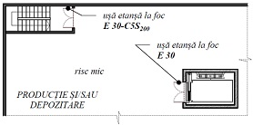

  Varianta a) - risc mic

  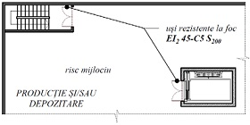

  Varianta b) - risc mijlociu

  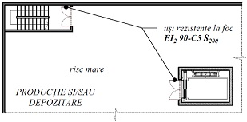

  Varianta c) - risc mare

  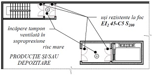

  Varianta d) - risc mare

  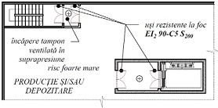

  Varianta e) - risc foarte mare

  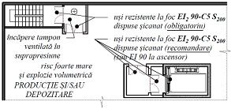

  Varianta f) - risc foarte mare și explozie volumetrică
  Figura 269 - Goluri de acces la ascensoare de persoane, de marfă sau
  la alte mijloace mecanice de transport pe verticală din construcții
  de producție și/sau depozitare
Evacuarea fumului și a gazelor fierbinți din construcții de producție și/sau depozitare
(294) Dispozitivele de admisie a aerului și de evacuare a fumului prin tiraj natural-organizat asigură evacuarea fumului pe maximum 30 m adâncime a încăperii din spații de producție si/sau depozitare.

  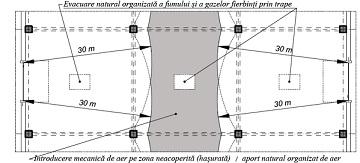

  Figura 270 - Admisie de aer și evacuare a fumului prin sistem
  natural organizat la încăperi, spații și construcții de depozitare
Cerințe suplimentare la construcții de producție și/sau depozitare
(295) Construcțiile și încăperile de depozitare a bateriilor de litiu-ion trebuie prevăzute cu pereți minimum REI 180, uși EI2 90-C5S_200 (uși EI2120-C5S_200pentru depozitări de celule LiFePO4 cu aria mai mare de 36 mp precum și pentru depozitări de celule cu litiu nichel/mangan/cobalt indiferent de suprafață) și planșee min REI 120. In toate situațiile, trebuie asigurată o distanță minimă de 1,80 m pornind de la fața accesibilă a raftului cu baterii până la alte substanțe și materiale incombustibile depozitate precum și până la elemente de construcție clasa de reacție la foc A1 și până la fețele accesibile ale rafturilor adiacente cu baterii. Trebuie asigurată o distanță minimă de 2,70 m pornind de la fețele accesibile ale rafturilor cu baterii față de alte substanțe și materiale combustibile și față de elementele de construcție diferite de clasa de reacție la foc A1. Pentru mai multe rafturi instalate pe un singur rând sau instalate spate în spate, trebuie prevăzute partiții clasa de reacție la foc A1, solide, fără goluri, între rafturile adiacente. Se prevăd pereți despărțitori incombustibili sau partiții incombustibile de la planșeu până la planșeu (dacă acesta există) sau de la planșeu până la acoperiș, între rafturile adiacente, perpendicular pe deschiderile accesibile ale rafturilor, pentru a preveni răspândirea incendiului. In condițiile halelor de depozitare se prevăd pereți despărțitori sau se prevăd partiții despărțitoare clasa de reacție la foc A1, care trebuie să se extindă cu cel 0,30 m de la fața depozitărilor. Determinarea distanței orizontale dintre partițiile despărțitoare clasa de reacție la foc A1 se face în funcție de numărul rafturilor și a suprafeței aferente acestora ce pot fi protejate de instalația automată de stingere (în funcție de aria de declanșare a instalației automate de sprinklere).
(296) Containerele amplasate în exterior de depozitare a bateriilor de litiu-ion (prevăzute cu sisteme controlate de menținere a temperaturii) trebuie să fie prevăzute cu pereți minimum REI60 și uși minimum EI_2 30-C5S_200 (uși EI_2 6O-C5S_200pentru cele cu aria mai mare de 36 mp) și trebuie să respecte următoarele criterii:
  - – se amplasează la o distanță de minimum 10 m față de construcțiile adiacente (cu excepția distanțelor față de alte containere exterioare de depozitare a bateriilor de litiu-ion);
  - – trebuie asigurată o lățime între containere de minimum 1,50 m spre părțile care conțin uși de acces sau orificii de deflagrație pentru containere cu celule LiFePO4 (litiu-fier-fosfat);
  - – în cazul containerelor cu celule litiu nichel/mangan/cobalt trebuie asigurată o lățime între containere de minimum 4,00 m pe părțile care conțin uși de acces sau orificii de deflagrație pentru containerele prevăzute cu pereți REI 60 și uși EI_2 30-C5S_200 și o lățime între containere de minimum 2,40 m pe părțile care conțin uși de acces sau orificii de deflagrație pentru containerele amplasate în exterior prevăzute cu pereți minimum REI 120 și uși EI_2 60-C5S_200

  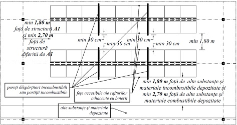

  Figura 271 - Depozitare baterii li-ion în spații și construcții de depozitare
