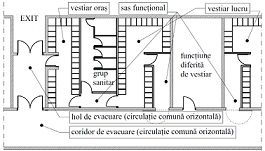
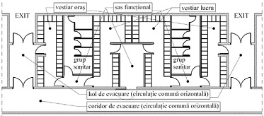

# Anexa nr. 7.7 – SPAȚII DE TIP OPEN-SPACE
SPAȚII DE TIP OPEN-SPACE
(297) Exemple de spații de tip open-space sunt prezentate în Figura 272.

  

  Varianta a) - Vestiare cu sasuri (funcționale) de acces independente

  

  Varianta b) - Vestiare cu sas (funcțional) de acces comun
  Figura 272 - Exemple de spații tip open-space
