# Art. 1.2.1
În sensul prezentului normativ, terminologia și clasificările utilizate au următoarele semnificații:
1) Acoperiș - parte a construcției care închide construcția față de exterior peste ultimul nivel construit, format din elemente de construcție și componente structurale și nestructurale. Acesta poate fi în pantă (tip șarpantă sau tip terasă.)
  - a) Acoperiș în pantă (tip șarpantă) - acoperiș la care panta acoperișului față de proiecția orizontală a acestuia formează un unghi alfa (α). Cu pantă mică (denumite "acoperișuri plate*") sunt considerate acoperișurile cu unghiul (α), α ≤ 10°, cu pantă mare sunt considerate acoperișurile cu unghiul 10° < α ≤ 80°, precum și cele cu o suprafață curbă. Panta unui acoperiș sau a versantului de acoperiș este determinată de linia de cea mai mare pantă. Tipurile de suprafețe - versanți pot fi:
    - – cu suprafață plană
    - – continuă, într-un singur plan în conformitate cu Figura 1 varianta a);
    - – discontinuă:
    - – cu rupere de pantă în conformitate cu Figura 1 varianta b) sau cu rupere de nivel;
    - – cu rupere de nivel și pantă în conformitate cu Figura 1 varianta c);
    - – cu suprafață curbă (cu o singură curbură în conformitate cu Figura 1 varianta d) sau cu dublă curbură).
    Notă: Atunci când acoperișurile în pantă reprezintă acoperișuri plate (cu o înclinare de până la 10°) acestea trebuie testate pe orizontală. Rezultatele testelor obținute cu o înclinare de 0° (orizontală) pot fi valabile pentru acoperișuri plate (cu o înclinare de până la 10°).

    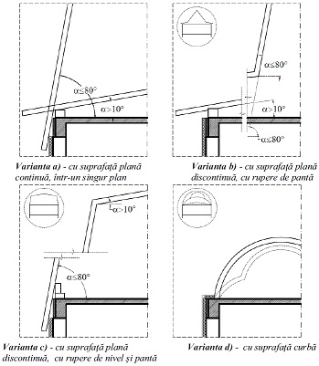

    Figura 1 - Tipuri de acoperișuri în pantă
  - b) Acoperiș terasă - element de construcție orizontal sau înclinat care închide construcția la partea superioară, peste ultimul nivel construit, obligatoriu prevăzut cu capacitate portantă R (aptitudinea acestuia de a rezista la o expunere la foc, pe o față sau pe mai multe fețe, pe timpul normat, sub acțiuni mecanice specificate, fără pierderea stabilității structurale). Se consideră că îndeplinește această prevedere orice acoperiș cu structura din beton armat sau precomprimat, cu panta mai mică sau egală de 10°. Precum performanțele privind clasa de reacție la foc și cele de rezistența la foc (în funcție de încadrare în nivel de stabilitate la incendiu)
  - c) Acoperișul terasă amenajat pentru diverse funcțiuni cum ar fi parcaje, comerț etc., trebuie să respecte cerințele de proiectare specifice funcțiunii amenajate precum și tipului de clădire.
    Note:
    - (1) Pentru planșeele și acoperișurile portante fără funcție de separare la foc (încercate și clasificate pentru foc aplicat numai de dedesubt doar în cazuri excepționale, când un planșeu sau un acoperiș portant este expus la foc simultan pe ambele fețe, trebuie încercat ca balcon/pasarelă), criteriul de performanță este capacitatea portantă și sunt definite prin clasa R. Pentru planșeele și acoperișurile portante cu funcție de separare la foc (încercate și clasificate pentru foc aplicat numai de dedesubt), criteriile de performanță sunt capacitatea portantă și etanșeitatea la foc sau capacitatea portantă, etanșeitatea la foc și izolarea termică, fiind definite prin clasa RE sau REI.
    - (2) În situația în care, peste stratul final de hidroizolație se aplică dispozitive fotovoltaice, se vor avea în vedere prevederile din Tabelul 2, nr. crt. 10, lit. b sau Tabelul 3 nr. crt. 10, lit. b.
    - (3) În situația poziționării termoizolației între planșeul din beton armat și un strat de beton de pantă, de minimum 3,00 cm, se admite utilizarea materialelor conform prevederilor Art. 2.3.6.2.1. (4).
  - c) Acoperiș verde - acoperiș pe care este prevăzută în mod deliberat, prin proiect, vegetație, peste stratul care realizează protecția la intemperii. Așa cum este definit în reglementarea tehnică "Ghid privind proiectarea și execuția acoperișurilor verzi la clădiri noi și existente, indicativ GP 120/2013", aprobat prin Ordinul ministrului dezvoltării regionale și administrației publice nr. 3383/2013.
2) Anvelopa clădirii - Ansamblul constructiv de închidere perimetrală a clădirii, compus din fațade, indiferent de materiale și sistem de realizare, precum și sistem de acoperire etc., reprezentând totalitatea suprafețelor elementelor de construcție perimetrale, care delimitează volumul interior (încălzit) al unei clădiri, de mediul exterior sau de spații neîncălzite din exteriorul clădirii.
3) Ardere - reacție exotermă a unei substanțe cu un oxidant. Arderea emite în general efluenți ai incendiului însoțiți de flăcări și/sau incandescență.
  - a. Oxidare - reacție chimică în care proporția de oxigen sau de alt element electronegativ într-o substanță este mărită.
  - b. Oxidant - substanță susceptibilă de a produce o reacție de oxidare. Arderea este o oxidare.
4) Aria construită (Ac) - aria secțiunii orizontale a clădirii, la cota ± 0,00, a parterului, măsurată conform STAS 4908 - Clădiri civile, industriale și agrozootehnice. Arii și volume convenționale.
  Notă: Se au în vedere următoarele:
  - a) Aria construită - aria secțiunii orizontale a clădirii, la cota ± 0,000 a parterului, măsurată pe conturul exterior al pereților (sau proiecția pe sol a conturului nivelurilor supraterane dacă suprafața acestora este mai mare);
    Observații:
    - (1) În aria construită, nu intră:
      - i. - rezaliturile cu aria mai mică de 0,4 mp și nișele cu aria mai mare de 0,4 mp;
      - ii. - treptele exterioare și terasele neacoperite;
      - iii. - terasele descoperite ale parterului care depășesc planul fațadei, platformele, scările de acces. Proiecția la sol a balcoanelor a căror cotă de nivel este sub 3,00 m de la nivelul solului amenajat și a logiilor închise ale etajelor se include în aria construită;
      - iv. - ariile curților interioare, ale curților exterioare de lumină sau de acces (denumite în mod curent curți englezești) mai mari de 4 mp.
    - (2) Pentru construcțiile subterane și subsoluri, aria construită se măsoară la cota finită a pardoselii și se consideră aria secțiunii orizontale cuprinsă în conturul exterior al pereților, inclusiv grosimea zidului de protecție a izolației. În cazul construcției amplasate pe teren în pantă, aria construcției se calculează în plane orizontale în trepte, funcție de teren și specificul construcției.
    - (3) Întrucât nu sunt luate în calculul ariei construite a construcției, elementele de construcție dispuse pentru accesul în clădiri (planuri înclinate exterioare, scări exterioare - trepte exterioare și terase neacoperite) nu trebuie să îndeplinească cerințele pentru scări exterioare de evacuare.
  - b) Aria construită pe apartament - conform STAS 4908 - "Clădiri civile, industriale și agrozootehnice. Arii și volume convenționale";
  - c) Aria nivelului - Aria secțiunii orizontale a clădirii la nivelul respectiv delimitată de conturul său exterior.
    Observație: Podul nu se consideră etaj. Mansardele, mezaninele și supantele (a căror arie este mai mare de 40% din cea a încăperii în care sunt realizate) se consideră etaje (niveluri).
    Aria nivelului se măsoară la 1 m deasupra pardoselii finite.
    În aria nivelului se cuprind și ariile nivelurilor intermediare sau anexe interioare sau exterioare cum sunt:
    - – ariile teraselor circulabile pentru diferite funcțiuni;
    - – ariile logiilor și a balcoanelor interioare (în cazul teatrelor, cinematografelor, aulelor sau ale altor săli similare);
    - – ariile supantelor (a căror arie este mai mică sau egală de 40% din cea a încăperii în care sunt realizate);
    - – ariile balcoanelor și logiilor;
    - – ariile porticelor de circulație și gangurilor de trecere dacă acestea nu au înălțimea mai mare decât a unui etaj, se consideră, aferente numai primului nivel deservit;
    - – aria coridoarelor exterioare;
    - – aria scărilor exterioare de acces între niveluri, intră în calculul ariei nivelului deservit;
    - – aria încăperilor cu înălțime liberă mai mare de 1,80 m (de exemplu subsol, încăperile motoarelor de ascensor, pompe etc., părți ieșite și închise pentru iluminatul subsolurilor, încăperi la mansarde etc.);
    - – ariile rampelor exterioare și a scărilor de acces de la magazii, depozite etc.;
    - – aria aferentă lucarnelor în cazul mansardelor dacă înălțimea h ≥ 1,80 m.
    În aria nivelului nu se cuprind:
    - – copertinele cu suprafețe mai mici de 4 mp și adâncimea mai mică de 2 m, profilele ornamentale și cornișele;
    - – învelitoarele, terasele necirculabile (rezultate din retragere) de peste nivelul imediat inferior;
    - – golurile mai mari de 4 m2, fiecare în parte numai la curți de lumină și curți englezești.
    - – ariile prevăzute la definiția "aria construită ", alin. (1);
    - – aria aferentă lucarnelor în cazul mansardelor, dacă înălțimea h < 1,80 m.
    La clădiri, cu excepția locuințelor, care au porțiuni cu număr diferit de niveluri sau cu niveluri denivelate de înălțimi egale sau diferite, deservite de o aceeași scară, numărul de niveluri se determină conform figurilor din STAS 4908 - "Clădiri civile, industriale și agrozootehnice. Arii și volume convenționale".
  - d) Aria pereților, Aria utilă, Aria utilă a apartamentului - conform STAS 4908 - "Clădiri civile, industriale și agrozootehnice. Arii și volume convenționale".
5) Aria desfășurată, Aria desfășurată construită (la locuințe) - conform STAS 4908 - "Clădiri civile, industriale și agrozootehnice. Arii și volume convenționale"
  Notă: Se asigură măsurile de securitate la incendiu specifice inclusiv la suprafața subsolurilor cu înălțimea liberă de la 1,80 m până la 2,10 m, la suprafața subsolurilor cu destinație strictă pentru gararea autovehiculelor, la spațiile tehnice sau la balcoanele, logiile, terasele deschise și neacoperite prevăzute pentru evacuare, precum și a separării podurilor (neamenajabile) față de spații utilizate, precum și a scărilor exterioare de evacuare.
6) Atrium - volumul liber din interiorul unei clădiri, sau volumul generat de mai multe clădiri, delimitat pe una sau mai multe laturi de cel puțin patru niveluri ale clădirii și care nu este necesar să fie aliniat pe verticală. Atriumurile pot fi descoperite, acoperite închise sau acoperite deschise (conform Figura 2 și Figura 3). Pentru mai multe informații a se consulta Anexa 4.2 "Atriumuri".

  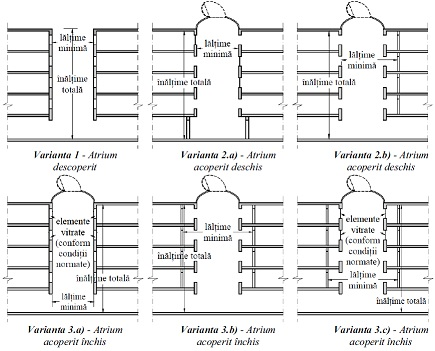

  Figura 2 - Tipuri de atriumuri

  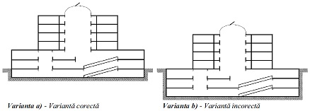

  Figura 3 - Atrium interconectat în subteran
  Note Figura 3:
  - (a) Întreaga suprafață a părții supraterane a spațiului interconectat prin atrium este deschisă și neobstrucționată, astfel încât un incendiu în orice parte a spațiului interconectat prin atrium va fi ușor vizibil pentru utilizatorii spațiului înainte de momentul în care acesta devine un pericol pentru ei. Se acceptă un singur nivel subteran interconectat cu porțiunea supraterană a construcției, interconectat prin atrium, (Figura 3 varianta a).
  - (b) În vederea diminuării consecințelor efectului de panică, pentru clădirile cu atrium a căror capacitate maximă simultană este mai mare de 1.500 de persoane, numărul fluxurilor pentru care trebuie asigurată evacuarea în exteriorul clădirii prin ușile exterioare care constituie și accese folosite în mod curent în utilizare de către public sau vizitatori (persoane străine de construcție) trebuie să fie mărite prin înmulțire cu un coeficient de minimum 1,25.
7) Cale de evacuare - circulație comună funcțională (orizontală sau verticală) înglobată sau alipită construcției, destinată evacuării utilizatorilor în caz de incendiu, separată de restul construcției cu elemente rezistente la foc. Sunt considerate căi de evacuare circulațiile libere (fără obstacole) care, îndeplinind condițiile stabilite prin prezentul normativ, asigură evacuarea prin uși, coridoare, degajamente protejate, tuneluri, holuri sau vestibuluri etc,. la nivelul terenului circulabil sau al unor suprafețe carosabile sau către compartimente de incendiu învecinate (în condițiile permise de normativ), astfel: direct; prin case de scări de evacuare; prin terase, cursive, logii, pasaje de evacuare.
  Căile de evacuare în caz de incendiu pot fi:
  - a) căile de circulație comune orizontale sau verticale înglobate sau alipite construcției și separate de restul acesteia cu elemente cu performanță privind rezistența și clasa de reacție la foc;
  - b) căile special destinate evacuării care se prevăd numai atunci când cele funcționale sunt insuficiente sau nu pot satisface condițiile de siguranță la foc, separate de restul construcției cu elemente cu performanță privind rezistența și clasa de reacție la foc.

  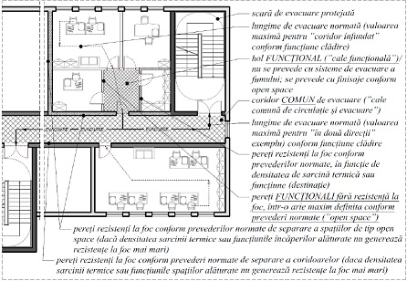

  Figura 4 - Circulații de evacuare
  Notă Figura 4: Este admisă gruparea încăperilor de tip open space cu risc mic de incendiu și aceeași destinație compartimentate cu parapete, panouri opace sau vitrate, fixe sau mobile folosite ca separări funcționale, incluzând și destinații colaterale, inclusiv cele de comunicări funcționale orizontale. Gruparea încăperilor de tip open space se compartimentează la limita față de circulațiile comune de evacuare (coridoare, degajamente protejate, încăperi tampon, scări închise etc.) precum și față de spații cu risc diferit de incendiu (provenit din densitatea de sarcină termică și/sau din funcțiune), cu pereți rezistenți la foc specifici spațiilor tip open space sau conform prevederilor spațiilor alăturate (obligatoriu se aleg cerințele cele mai restrictive), conform încadrării fiecărei funcțiuni sau tip de construcție. În interiorul grupării spațiilor de tip open space, încăperile cu risc diferit de incendiu (provenit din densitatea de sarcină termică și/sau din funcțiune) se compartimentează cu pereți rezistenți la foc specifici acestor încăperi. Comunicarea funcțională dintre spații de tip open space și circulații comune orizontale se poate face prin spații comune ce aparțin open space (circulații funcționale) care trebuie să îndeplinească condițiile specific spațiilor de tip open space.
8) Căi/circulații de acces, intervenție și salvare - căi de acces, intervenție și salvare, corespunzător alcătuite dimensionate și marcate, astfel încât să poată fi utilizate de personalul care intervine în caz de incendiu.
  Căile de acces, intervenție și salvare sunt:
  - a) Exterioare - pentru accesul ușor al autospecialelor de intervenție ale pompierilor, fiind marcate și menținute permanent libere. De regulă, vor asigura intervenția cel puțin la o fațadă a clădirii, cu excepția situațiilor precizate în normativ.
  - b) Interioare - pentru accesul ușor la principalele circulații funcționale (orizontale și verticale), precum și la spațiile cu risc sau pericol de incendiu.
9) Cale de circulație interioară - traseu orizontal/circulație funcțională orizontală destinată circulației într-o încăpere.
10) Conducte de control al fumului - conducte utilizate într-un sistem de control al mișcării și/sau reținerii fumului și căldurii.
  Conductă de evacuare a fumului dintr-un compartiment unic - conductă de control al fumului proiectată pentru a oferi un grad de rezistență la foc pentru utilizare într-un singur compartiment.
  Conductă rezistentă la foc de evacuare a fumului multicompartiment - conductă de control al fumului concepută pentru a oferi un grad de rezistență la foc pentru utilizare în mai multe compartimente.
  Volet de control al fumului - dispozitiv care poate fi deschis sau închis pentru a controla curgerea fumului și gazelor fierbinți.
  Nota 1: În poziția de funcționare la incendiu, voletul de control al fumului poate fi deschis (pentru a evacua fumul din compartimentul incendiat) sau închis (pentru a evita propagarea fumului la alte zone).
  Nota 2: Clasificările se referă la termenul "compartiment" reprezentând un spațiu închis, care cuprinde unul sau mai multe spații separate, limitat de elemente de construcție care au o rezistență la foc specificată, pentru ca să împiedice propagarea incendiului în orice direcție pentru o perioadă de timp dată. Termenul în această accepțiune se va referi strict la clasificările acestor produse.
  Ecran de fum (bariera de fum) - dispozitiv proiectat pentru a canaliza, a reține și/sau a preveni migrarea fumului, utilizat pentru a limita și/sau a împiedica propagarea fumului, clasificat DH sau D_600.
  Note: Barierele de fum mai sunt denumite perdele de fum, jaluzele antifum sau ecrane de fum.
  Notă: Alternativ prevederilor prezentului normativ, înălțimea ecranelor sistemelor de evacuare a fumului și gazelor fierbinți (pentru structuri nestandardizate sau clădiri unde dimensiunile mari, forma sau configurația fac necesare controlul fumului și/sau conform criteriilor de proiectare sau la solicitarea autorităților competente se cer niveluri de performanță adecvate privind înălțimea stratului de aer fără fum, temperatura din stratul de aer, influențe externe etc.), poate fi diferită, fără a fi mai mică de 50 cm.
  Ventilator de evacuare a fumului și căldurii - dispozitiv special conceput pentru a evacua fumul și gazele fierbinți dintr-o construcție în condiții de incendiu.
  Ventilator natural de evacuare a fumului și a căldurii (trapă de evacuare fum) - dispozitiv special conceput pentru a scoate fumul și gazele fierbinți din lucrările de construcție prin forța de flotabilitate.
  Ventilare naturală - ventilare cauzată de forțe ascendente care rezultă din diferențele de densitate dintre gazele cu fum și cele din aerul ambiant, datorită diferențelor de temperatură.
  Aria geometrică - aria unei secțiuni printr-un ventilator, măsurată în planul definit de suprafața clădirii care este în contact cu structura ventilatorului.
  Notă: Aria geometrică este exprimată ca Av. Nu se face vreo reducere pentru ghidaje, fante de ventilare sau alte obstrucții.
  Ventilare mecanică - ventilare care este provocată de aplicarea unei energii externe pentru a deplasa gazele printr-un ventilator.
11)
  - i) Coridor (culoar)/cursivă - încăpere de tranzit, lungă și îngustă (cu lungimea de cel puțin două ori cât lățimea);
  - ii) Hol (vestibul) - încăpere de tranzit care nu îndeplinește condițiile de coridor.
12) Clasă de reacție la foc - expresie cantitativă, formulată în termeni de performanță, pentru modul de comportare a unui produs în condiții de utilizare finală, care prin propria sa descompunere alimentează un foc la care este expus; este exprimată prin nivelul parametrilor specifici, determinați în urma unor încercări standardizate. Structurarea în niveluri de performanță a claselor de reacție la foc este stabilită prin Regulamentul privind clasificarea și încadrarea produselor pentru construcții pe baza performanțelor de comportare la foc, aprobat prin Ordinul comun al ministrului transporturilor, construcțiilor și turismului și al ministrului administrației și internelor nr. 1.822/394/2004, cu modificările și completările ulterioare. În cuprinsul prezentului normativ prin clasa de reacție la foc minimă se înțelege un criteriu de performanță minim pentru clasă A ÷ F, minim pentru emisiile de fum s1, s2 și s3 și minim pentru picături d0, d1 și d2. Exemplu: minim C-s2,d0, înseamnă că se admite aceasta sau orice clasă de reacție la foc superioară acesteia, pentru emisiile de fum numai s1 și s2, iar pentru picături numai d0.
  Atunci când în normativ se precizează "minimum" sau "cel puțin", acestea se referă la fiecare din componenții indicației (litere și sufixuri).
13) Clase de comportare la foc a produselor pentru construcții
  - (13.1) Clasele de performanță privind reacția la foc a produselor pentru construcții (cu excepția pardoselilor, produselor termoizolante pentru tubulaturi liniare și a cablurilor electrice), sunt A1, A2, B, C, D, E și F, respectiv:
    - 1. A1 - produse incombustibile care nu contribuie deloc la dezvoltarea incendiului;
    - 2. A2 - produse care nu se pot aprinde cu flacără și a căror contribuție la dezvoltarea incendiului este extrem de limitată;
    - 3. B - produse care se sting în lipsa unei flăcări de întreținere și al căror aport la dezvoltarea incendiului este foarte mic;
    - 4. C - produse combustibile care contribuie la dezvoltarea incendiului în anumite limite;
    - 5. D - produse combustibile care contribuie la dezvoltarea și propagarea incendiului;
    - 6. E - produse combustibile a căror contribuție la propagarea rapidă a incendiului este importantă;
    - 7. F - produse combustibile a căror contribuție la propagarea rapidă a incendiului este foarte importantă.
    La fiecare produs se specifică emisia de fum (s1, s2 și s3) și a picăturilor/particulelor arzânde (d0, d1 și d2), conform Regulamentului privind clasificarea și încadrarea produselor pentru construcții pe baza performanțelor de comportare la foc.
  - (13.2) Clasele de performanță privind reacția la foc a pardoselilor pentru construcții sunt: A1_FL, A2_FL, B_FL, C_FL, D_FL, E_FL și F_FL, cu specificarea emisiei de fum (s1 sau s2).
  - (13.3) Clasele de performanță privind reacția la foc a produselor termoizolante pentru tubulaturi lineare, sunt: A1_L, A2_L, B_L, C_L, D_L, E_L și F_L cu specificarea emisiei de fum (s1, s2 și s3) și a picăturilor/particulelor arzânde (d0, d1 și d2).
  - (13.4) Clasele de reacție la foc ale cablurilor electrice, sunt: A_ca, B1_ca, B2_ca, C_ca, D_ca, E_ca și F_ca, cu specificarea emisiei de fum (s1, s1a, s1b, s2 sau s3) și a picăturilor/particulelor arzânde (d0, d1 sau d2) și a conductivității (a1, a2 sau a3) .
14) Clădire civilă - construcție destinată utilizatorilor, cu excepția celor destinate activităților pentru producție și/sau depozitare și celor agrozootehnice; în contextul prezentului normativ, se definesc tipuri de clădiri (clădiri cu înălțime obișnuită, clădiri înalte, clădiri subterane, clădiri foarte înalte și clădiri cu săli aglomerate).
15) Clădire înaltă - clădire civilă (publică) supraterană, la care cota superioară a stratului de uzură al pardoselii ultimului nivel folosit de utilizatori este situat la peste 28 m și la mai puțin de 45 m față de cota nivelului de referință conform definiție (28 m < h < 45 m). Clădirile înalte trebuie să permită accesul autospecialelor serviciilor pentru situații de urgență integral pe minimum două (2) laturi alăturate și totodată, cel puțin pe 50% din perimetrul pereților exteriori. Stabilirea înălțimii clădirilor la care acoperișul terasă este amenajat pentru diverse funcțiuni cum ar fi parcaje, comerț etc. se face ținând cont de cota de călcare a terasei circulabile în raport cu nivelul de referință.
  Nu sunt considerate clădiri înalte (conform Figura 5):
  - 1. construcțiile pentru producție și/sau depozitare;
  - 2. clădirile pentru locuit colective care au maximum 12 niveluri supraterane și clădirile civile cu funcțiuni mixte care au maximum 12 niveluri supraterane atunci când funcțiunea de locuințe colective are aria desfășurată mai mare de 75% din cea a clădirii mixte analizate;
  - 3. atunci când la ultimele niveluri sunt locuințe de tip duplex sau triplex, la stabilirea înălțimii construcției se ia în considerare numai nivelul de acces la acestea din circulațiile comune orizontale ale clădirii, nivel de acces care determină încadrarea în clădire înaltă sau în clădire cu înălțime obișnuită. Se admite ca un singur nivel să fie constituit tip duplex sau tip triplex cu acces conform alineatului precedent, cele două niveluri la tip duplex sau cele trei niveluri la triplex fiind considerate un singur nivel, reprezentând ultimul nivel al construcției. Dacă nivelurile de acces la locuințele de tip duplex sau triplex se află la alte niveluri față de cel precizat anterior, la stabilirea înălțimii construcției se iau în considerare toate nivelurile din care sunt constituite locuințele de tip duplex sau triplex;
  - 4. clădirile civile (indiferent de destinație), la care deasupra nivelului limită normat se află un singur nivel construit ce ocupă maximum 50% din aria construită a nivelului inferior acestuia și cuprinde numai spații tehnice aferente clădirii (încăperi pentru ascensoare, centrale termice, centrale de ventilare etc), circulații funcționale și de evacuare (holuri, coridoare, încăperi tampon ventilate în suprapresiune etc.) sau spații anexă (spălătorii, călcătorii, uscătorii etc.), fără prezență permanentă de persoane.

  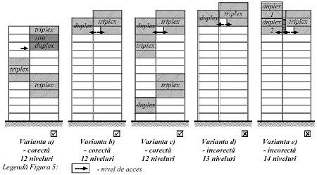

  Figura 5 - Locuințe de tip duplex sau triplex la clădiri cu înălțime obișnuită
16) Clădire foarte înaltă - clădire civilă (publică) supraterană la care cota superioară a stratului de uzură al pardoselii ultimului nivel folosibil este situată la înălțimea de 45 m sau mai mult față de cota nivelului de referință. Clădirile foarte înalte trebuie să permită accesul autospecialelor serviciilor pentru situații de urgență integral pe minimum două (2) laturi alăturate și totodată, cel puțin pe 50% din perimetrul pereților exteriori. Sunt considerate foarte înalte, clădirile de locuit la care pardoseala ultimului nivel locuibil este situată la înălțimea de peste 50 m față de cota nivelului de referință (conform definiție). Stabilirea înălțimii clădirilor la care acoperișul terasă este amenajat pentru diverse funcțiuni cum ar fi parcaje, comerț etc., se face ținând cont de cota de călcare a terasei circulabile în raport cu nivelul de referință.
  Nu sunt considerate clădiri foarte înalte:
  - a. construcțiile pentru producție și/sau depozitare;
  - b. clădirile civile (indiferent de destinație), la care deasupra nivelului limită normat se află un singur nivel construit ce ocupă maximum 50% din aria construită a nivelului inferior acestuia și cuprinde numai spații tehnice aferente clădirii (încăperi pentru ascensoare, centrale termice, centrale de ventilare etc), circulații funcționale și de evacuare (holuri, coridoare, încăperi tampon ventilate în suprapresiune etc.) sau spații anexă (spălătorii, călcătorii, uscătorii etc.), fără prezență permanentă de persoane.
17) Clădire cu înălțime obișnuită - clădire civilă supraterană care nu este clădire înaltă sau foarte înaltă.
18) Clădire cu funcțiuni mixte - construcție care cuprinde diferite funcțiuni principale civile-civile sau civile-de producție și/sau depozitare sau producție- depozitare.
19) Clădire agrozootehnică - construcție destinată diferitelor procese de producție din sectorul zootehnic (grajduri și adăposturi pentru animale și păsări) și cel agrovegetal (răsadnițe, sere, fabrici de nutrețuri, crame, secții de vinificație etc.). Din această categorie fac parte și construcțiile auxiliare producției: magazii de cereale pentru furajare animale, silozuri de nutrețuri, garaje, remize, ateliere etc.
20) Compartiment de incendiu - poate fi constituit din:
  - a. construcție independentă, amplasată la distanțe de siguranță față de clădirile adiacente;
  - b. porțiune a unei clădiri înalte sau foarte înalte delimitată cu pereți și/sau planșee rezistenți/rezistente la foc de separare a compartimentelor de incendiu (pereți antifoc și planșee antifoc) față de restul construcției;
  - c. grup de construcții comasate în limita ariilor construite (Ac) maxime normate; în interiorul unui astfel de grup, construcțiile pot fi amplasate la distanțe mai mici decât distanțele de siguranță normate și pot să fie delimitate între ele numai prin elementele de compartimentare rezistente la foc necesare în interiorul compartimentului de incendiu; un grup de clădiri care constituie un compartiment de incendiu trebuie să fie, însă, amplasat față de alte clădiri la distanțele de siguranță normate, sau să fie delimitat față de acestea prin elemente de compartimentare rezistente la foc de separare a compartimentelor de incendiu;
  - 1) Clădirile înalte sau foarte înalte se pot compartimenta în maximum trei porțiuni volumetrice a câte trei niveluri fiecare, cu aria totală desfășurată (Ad) de maximum 3.500 mp (cu excepția clădirilor de locuit foarte înalte la care se respectă dispozițiile specifice) și oricâte compartimente delimitate de pereți antifoc ce secționează clădirea integral pe verticală, conform prevederilor normativului. Compartimentele formate din porțiuni volumetrice sunt constituite din unul până la trei niveluri construite succesiv, delimitate de planșee de separare a compartimentelor de incendiu rezistente la foc (planșee antifoc) și după caz, pereți de compartimentare rezistenți la foc (pereți antifoc), conform situații prezentate în Figura 8 și Figura 9.
  - 2) Clădirile subterane (și porțiunile subterane ale clădirilor supraterane) cu excepția parcajelor subterane (exemplu: Figura 6), se pot compartimenta pe toată înălțimea lor cu pereți rezistenți la foc de delimitare a compartimentelor de incendiu (pe aceeași verticală), în limita ariei construite (Ac) de maximum 3.500 mp sau se pot compartimenta în porțiuni volumetrice ale acestora cu aria totală desfășurată (Ad) de maximum 3.500 mp, porțiuni constituite din unul până la trei niveluri construite succesive, delimitate de planșee și, după caz, pereți de compartimentare rezistenți la foc (planșee antifoc și pereți antifoc).

    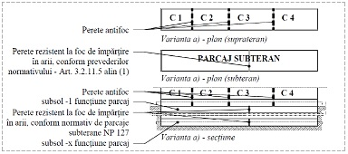

    Varianta a) Compartimentare antifoc la clădirile și compartimentele de incendiu supraterane civile cu înălțime obișnuită (nivel II de stabilitate la incendiu) prevăzute cu parcaj subteran

    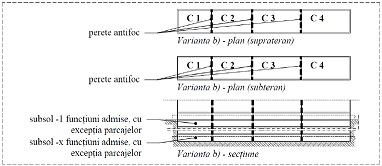

    Varianta b) Compartimentare antifoc la clădirile și compartimentele de incendiu supraterane civile cu înălțime obișnuită (nivel II de stabilitate la incendiu) care nu sunt prevăzute cu parcaj suprateran și/sau subteran

    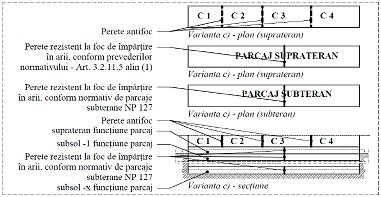

    Varianta c) Compartimentare antifoc la clădirile și compartimentele de incendiu supraterane civile cu înălțime obișnuită (nivel II de stabilitate la incendiu) prevăzute cu parcaj suprateran și subteran
    Figura 6 - Compartimentare antifoc la partea supraterană și subterană
    la clădirile și compartimentele de incendiu civile
    cu înălțime obișnuită (nivel II de stabilitate la incendiu)
  - 3) Construcțiile pot fi constituite din mai multe compartimente de incendiu alipite, înglobate sau suprapuse, în condițiile alineatelor anterioare (exemple: Figura 7, Figura 8 și Figura 9).

    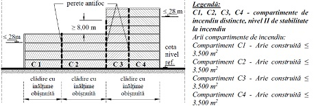

    Varianta a): neechipate cu instalație automată de stingere a incendiilor sau cu instalație de detectare, semnalizare și alarmare la incendiu

    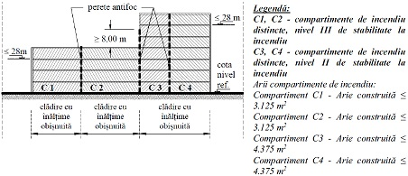

    Varianta b): prevăzute cu instalație de detectare, semnalizare și alarmare la incendiu cu acoperire totală (toate compartimentele sunt prevăzute cu instalație de detectare, semnalizare și alarmare la incendiu cu acoperire totală)

    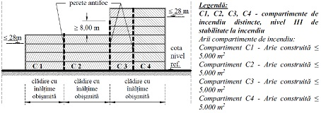

    Varianta c): echipate cu instalație automată de stingere a incendiilor și instalații automate de detectare, semnalizare și alarmare a incendiului (toate compartimentele sunt prevăzute cu instalații automate de detectare, semnalizare și alarmare a incendiului, cu acoperire totală și instalație automată de stingere a incendiilor)

    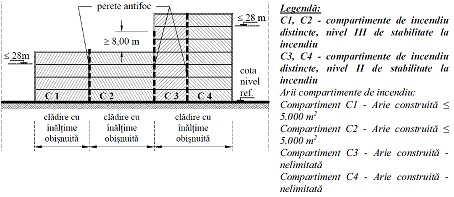

    Varianta d): echipate cu instalație automată de stingere a incendiilor, instalații de detectare, semnalizare și alarmare a incendiului cu acoperire totală și sisteme de control al fumului și gazelor fierbinți din circulațiile comune orizontale (coridoare/holuri) și casele de scări (toate compartimentele sunt prevăzute cu aceste instalații)
    Figura 7 - Compartimentare antifoc și arii compartimente de incendiu
    la clădirile și compartimentele de incendiu supraterane civile cu înălțime obișnuită

    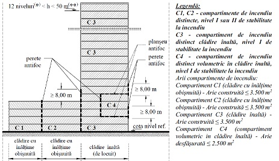

    Varianta a): clădiri cu înălțime obișnuită și clădire înaltă cu funcțiune de locuit, neechipate cu instalație automată de stingere a incendiilor sau cu instalații de detectare, semnalizare și alarmare a incendiului cu acoperire totală

    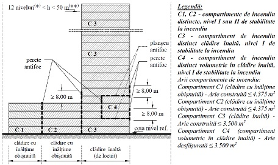

    Varianta b): clădiri cu înălțime obișnuită și clădire înaltă cu funcțiune de locuit, neechipate cu instalație automată de stingere a incendiilor (toate compartimentele sunt echipate cu instalații de detectare, semnalizare și alarmare a incendiului cu acoperire totală)

    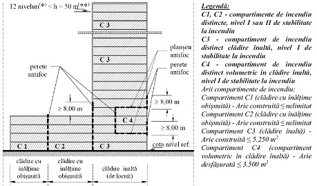

    Varianta c): clădiri cu înălțime obișnuită și clădire înaltă cu funcțiune de locuit, echipate cu instalație automată de stingere a incendiilor (toate compartimentele sunt prevăzute cu instalație automată de stingere a incendiilor și cu instalații de detectare, semnalizare și alarmare a incendiului cu acoperire totală, precum și cu sisteme de control al fumului și gazelor fierbinți din circulațiile comune orizontale (coridoare/holuri) și casele de scări)
    Notă Figura 8, variantele a), b) și c): Regimul de înălțime se referă la clădirile pentru locuit colective care au mai mult de 12 niveluri supraterane (*) precum și clădirile civile cu funcțiuni mixte care au mai mult de 12 niveluri supraterane (*) (atunci când funcțiunea de locuințe colective are aria desfășurată mai mare de 75% din cea a clădirii mixte analizate) și la care pardoseala ultimului nivel locuibil este situată la înălțimea mai mică sau egală de 50 m (**) față de cota nivelului de referință (conform definiție).

    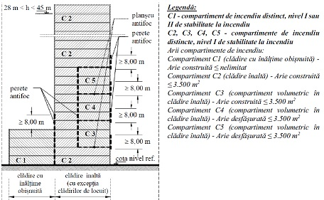

    Varianta d): clădire cu înălțime obișnuită și clădire înaltă cu excepția funcțiunii de locuit, echipate cu instalație automată de stingere a incendiilor (toate compartimentele sunt prevăzute cu instalație automată de stingere a incendiilor și cu instalații de detectare, semnalizare și alarmare a incendiului cu acoperire totală, precum și cu sisteme de control al fumului și gazelor fierbinți din circulațiile comune orizontale (coridoare/holuri) și casele de scări)

    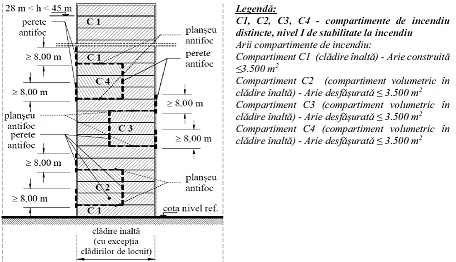

    Varianta e): clădire înaltă cu orice funcțiune, cu excepția celei de locuit, echipată cu instalație automată de stingere a incendiilor (toate compartimentele sunt prevăzute cu instalație automată de stingere a incendiilor și cu instalații de detectare, semnalizare și alarmare a incendiului cu acoperire totală, precum și cu sisteme de control al fumului și gazelor fierbinți din circulațiile comune orizontale (coridoare/holuri) și casele de scări)
    Figura 8 - Compartimentare antifoc și arii compartimente de incendiu
    la clădirile și compartimentele de incendiu supraterane civile înalte

    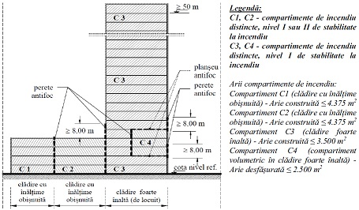

    Varianta a): clădire cu înălțime obișnuită și clădire foarte înaltă cu funcțiune de locuit, neechipate cu instalație automată de stingere a incendiilor (toate compartimentele sunt prevăzute cu instalații de detectare, semnalizare și alarmare a incendiului cu acoperire totală)

    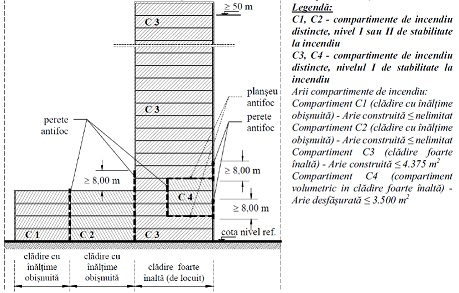

    Varianta b): clădire cu înălțime obișnuită și clădire foarte înaltă cu funcțiune de locuit, echipate cu instalație automată de stingere a incendiilor (toate compartimentele sunt prevăzute cu instalație automată de stingere a incendiilor și cu instalații de detectare, semnalizare și alarmare a incendiului cu acoperire totală, precum și cu sisteme de control al fumului și gazelor fierbinți din circulațiile comune orizontale (coridoare/holuri) și casele de scări)

    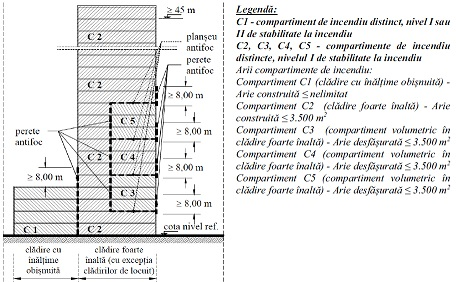

    Varianta c): clădire cu înălțime obișnuită și clădire foarte înaltă cu orice funcțiune, cu excepția celei de locuit, echipate cu instalație automată de stingere a incendiilor (toate compartimentele sunt prevăzute cu instalație automată de stingere a incendiilor și cu instalații de detectare, semnalizare și alarmare a incendiului cu acoperire totală, precum și cu sisteme de control al fumului și gazelor fierbinți din circulațiile comune orizontale (coridoare/holuri) și casele de scări)

    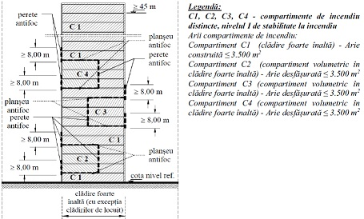

    Varianta d): clădire foarte înaltă cu orice funcțiune, cu excepția celei de locuit, echipată cu instalație automată de stingere a incendiilor (toate compartimentele sunt prevăzute cu instalație automată de stingere a incendiilor și cu instalații de detectare, semnalizare și alarmare a incendiului cu acoperire totală, precum și cu sisteme de control al fumului și gazelor fierbinți din circulațiile comune orizontale (coridoare/holuri) și casele de scări)
    Figura 9 - Compartimentare antifoc și arii compartimente de incendiu
    la clădirile și compartimentele de incendiu supraterane civile foarte înalte
21) Construcție - este sistemul tehnic definit prin ansamblul constructiv și instalațiile aferente acesteia, inclusiv mijloacele tehnice de contracarare a incendiilor prevăzute; în contextul prezentului normativ, se definesc "Categorii de construcții din punct de vedere al securității la incendiu" - clădiri/construcții (civile, industriale, mixte), corturi, platforme exterioare și depozite deschise.
  - 1) Construcție închisă - construcție supraterană/subterană închisă perimetral cu pereți care nu îndeplinesc criteriile prevăzute la pct. 2) lit. ii) și prevăzută cu acoperiș;
  - 2) Construcție deschisă - construcție supraterană/subterană care îndeplinește una din următoarele condiții:
    - i. este descoperită (fără acoperiș);
    - ii. construcție acoperită care are goluri permanent deschise pe cel puțin 50% din suprafața pereților exteriori.
    Cu excepția spațiilor amenajate sub tribune, stadioanele acoperite sunt considerate construcții deschise dacă la partea superioară (ultima cota de nivel accesibilă publicului), în cadrul închiderilor perimetrale sunt prevăzute goluri deschise permanent spre exterior cu înălțimea de minimum 1 m și lungimea lor însumată reprezintă cel puțin 75% din perimetru (Figura 10).
    Construcțiile care nu îndeplinesc unul din criteriile prevăzute la lit. i) și lit. ii) sunt considerate construcții închise.

    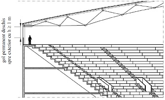

    Figura 10 - Stadion acoperit - construcție deschisă
    (Notă: "gol" Figura 10 = goluri perimetrale deschise permanent spre exterior cu înălțimea de minimum 1 m și lungimea lor însumată de cel puțin 75% din perimetru)
  - 3) Construcții/clădiri destinate persoanelor care nu se pot evacua singure sunt considerate următoarele, în contextul prezentului normativ: clădiri pentru copii de vârstă preșcolară (3 - 6 ani)/clădiri de învățământ nivelul antepreșcolar (0 - 3 ani) (creșe și case de copii), unități sanitare cu spitalizare continuă (definite conform legislației de specialitate), aziluri sau cămine pentru bătrâni și persoane cu dizabilități, ospicii pentru alienați mintal etc).
22) Construcție subterană - construcție independentă realizată în întregime sub nivelul terenului înconjurător (natural sau amenajat), având numai căi pentru acces și pentru evacuare la nivelul terenului.
23) Construcție supraterană - construcție realizată peste cota terenului înconjurător natural sau amenajat, cu sau fără subsoluri.
24) Construcție independentă - construcție cu fundație și structură proprie.
25) Cort - construcție în care forma structurală a membranei este asigurată de cabluri tensionate sau elemente portante de tipul grinzilor, stâlpilor sau arcelor. Pentru a fi considerat cort, membrana trebuie să constituie minim 75% din anvelopa clădirii.
26) Cortină de siguranță rezistentă la foc - element mobil de protecție în caz de incendiu a golurilor funcționale din pereții care delimitează încăperi, spații sau compartimente de incendiu.
27) Criterii de performanță - condiții specifice în raport de care se evaluează îndeplinirea unei cerințe de performanță. Criteriile de performanță pentru rezistența la foc sunt simbolizate astfel:
  R - capacitate portantă (aptitudinea elementului de construcție să reziste la o expunere la foc sub acțiuni mecanice specificate, pe o față sau pe mai multe fețe, pe timpul normat, sub acțiuni mecanice specificate, fără pierderea stabilității structurale);
  E - etanșeitate la foc (capacitatea unui element de construcție cu funcție de separare, de a rezista la expunere la foc pe o față, fără transmiterea focului la fața neexpusă ca rezultat al trecerii flăcărilor sau a gazelor fierbinți și care pot provoca aprinderea feței neexpuse sau a oricărui material situat adiacent acestei suprafețe);
  I - izolare termică la foc (capacitatea elementului de construcție de a rezista la expunere la foc numai pe o față, fără propagarea focului ca rezultat al transferului important de căldură de la fața expusă la fața neexpusă. Propagarea trebuie limitată, astfel încât, nici suprafața neexpusă, nici orice material din imediata vecinătate a acelei suprafețe, să nu se aprindă. De asemenea, elementul trebuie să asigure o barieră împotriva căldurii, suficientă pentru a proteja persoanele din apropierea sa. În cazul în care un element de construcție a fost evaluat pentru diferite niveluri de performanță termică corespunzătoare cu diverse suprafețe distincte, clasificarea elementului ca ansamblu trebuie dată pe baza timpului cel mai scurt pentru care sunt îndeplinite criteriile de creștere a temperaturii maxime sau medii pe oricare din suprafețele distincte.);
  Note (în conformitate cu SR EN13501-2):
  Izolarea termică a elementelor cu excepția ușilor, obloanelor și ansamblurilor de închidere sisteme de conveiere
  Pentru toate elementele având funcție de separare cu excepția ușilor și obloanelor, nivelul de performanță folosit pentru a defini izolarea termică trebuie să fie creșterea temperaturii medii pe fața neexpusă limitată la 140°C peste temperatura medie inițială, cu creșterea temperaturii maxime în orice punct limitată la 180°C peste temperatura medie inițială.
  În cazul elementelor cu suprafețe mici (precum etanșări de rost) conceptul de creștere a temperaturii medii este irelevant și izolarea termică trebuie evaluată numai pe baza temperaturii maxime.
  Neîndeplinirea oricărui criteriu de capacitate portantă sau de etanșeitate la foc trebuie să însemne, de asemenea, și neîndeplinirea criteriului de izolare termică, indiferent dacă au fost depășite sau nu limitele de temperatură ale izolării termice specifice.
  Izolarea termică a ușilor și obloanelor
  În cazul specific al ușilor și obloanelor, trebuie utilizată una dintre cele două opțiuni pentru criteriul de izolare termică:
  - – Izolare termică I_1
    Creșterea temperaturii medii pe fața neexpusă a canatului ușii nu trebuie să depășească 140°C peste temperatura medie inițială, cu creșterea temperaturii maxime în orice punct al canatului ușii limitată la 180°C. Nu trebuie efectuate măsurători de temperatură pe canatul ușii la mai puțin de 25 mm de limita părții vizibile a canatului ușii. Creșterea temperaturii în orice punct pe cadru nu trebuie să depășească 180°C, măsurată la 100 mm de marginea vizibilă (pe fața neexpusă) a canatului ușii, în cazul în care cadrul este mai lat de 100 mm, altfel trebuie măsurată amplasând centrul discului la 20 mm de joncțiunea dintre cadrul ușii și construcția suport.
  - – Izolare termică I_2
    Creșterea temperaturii medii pe fața neexpusă a canatului ușii nu trebuie să depășească 140°C peste temperatura medie inițială, cu creșterea temperaturii maxime în orice punct al canatului ușii limitată la 180°C. Nu trebuie efectuate măsurători de temperatură pe canatul ușii la mai puțin de 100 mm de limita părții vizibile a canatului ușii. Creșterea temperaturii în orice punct pe cadru nu trebuie să depășească 360°C, măsurată la 100 mm de marginea vizibilă (pe fața neexpusă) a canatului ușii, în cazul în care cadrul este mai lat de 100 mm, în caz contrar trebuie măsurată la limita de separație cadru/construcție suport.
  Clasificarea izolării termice trebuie specificată prin utilizarea sufixelor 1 și 2 care corespund, respectiv, celor două definiții de mai sus (de exemplu I_1). Aceste sufixe trebuie utilizate numai pentru uși și obloane rezistente la foc și închideri pentru sisteme de conveiere, însă nu pentru oricare alt element cu o clasificare I.
  Neîndeplinirea criteriului de etanșeitate la foc trebuie să însemne de asemenea și neîndeplinirea criteriului de izolare termică, indiferent dacă au fost depășite sau nu limitele de temperatură ale izolării termice specifice.
  Izolarea termică a ansamblurilor de închidere sisteme de conveiere
  În cazul specific al ansamblurilor de închidere sisteme de conveiere, trebuie utilizată una dintre cele trei opțiuni ale criteriului de izolare termică:
  Izolare termică I_1
  Creșterea temperaturii medii pe fața neexpusă a canatului închiderii nu trebuie să depășească 140°C, peste temperatura medie inițială, cu creșterea temperaturii maxime în orice punct al canatului închiderii limitată la 180°C. Nu trebuie efectuate măsurători de temperatură pe canatul închiderii la mai puțin de 25 mm de limita părții vizibile a canatului închiderii. Creșterea temperaturii în orice punct pe cadru/ghidaj nu trebuie să depășească 180°C, măsurată la 100 mm de marginea vizibilă (pe fața neexpusă) a canatului închiderii, în cazul în care cadrul/ghidajul este mai lat de 100 mm, altfel trebuie măsurată la limita de separație cadru/construcție suport.
  Izolare termică I_2
  Creșterea temperaturii medii pe fața neexpusă a canatului închiderii nu trebuie să depășească 140°C peste temperatura medie inițială, cu creșterea temperaturii maxime în orice punct al canatului închiderii limitată la 180°C. Nu trebuie efectuate măsurători de temperatură pe canatul ușii la mai puțin de 100 mm de limita părții vizibile a canatului închiderii. Creșterea temperaturii în orice punct pe cadru/ghidaj nu trebuie să depășească 360°C, măsurată la 100 mm de marginea vizibilă (pe fața neexpusă) a canatului închiderii, în cazul în care cadrul este mai lat de 100 mm, altfel trebuie măsurată la limita de separație cadru/construcție suport.
  Izolare termică I
  În acele cazuri în care epruveta are o configurație tip țeavă sau o conductă fără nici o evaluare a închiderii pentru sistemul conveier, nu este posibilă o clasificare I1 sau I2. În acest caz trebuie utilizată o clasificare I.
  Atunci când o epruvetă încorporează o închidere pentru un sistem conveier împreună cu o trecere și componentele sale de trecere, aceasta trebuie să aibă drept rezultat o clasificare I alocată componentei de trecere sau etanșării pătrunderii. Ansamblul complet închidere și sistem de transport, trebuie clasificat totuși folosind indicele corespunzător pentru I1 sau I2 pentru a distinge între două posibile căi de evaluare a închiderii pentru sistemul de transport.
  Neîndeplinirea oricărui criteriu de etanșeitate la foc trebuie să însemne, de asemenea, și neîndeplinirea criteriului de izolare termică, indiferent dacă au fost depășite sau nu limitele de temperatură ale izolării termice specifice.
  Clasificări specifice
  Uși și obloane rezistente la foc
  În cazul specific al ușilor și obloanelor, pentru criteriul de izolare termică sunt definite două criterii diferite. De aceea clasificarea trebuie făcută în mod specific prin utilizarea unuia din sufixele 1 sau 2, pentru a indica subclasa.
  Atunci când rezultatele încercării și rezultatele aplicării extinse conduc la o diferență în timpul de neîndeplinire pentru I_1 și I_2, elementul poate avea mai mult decât o clasificare. De exemplu, o ușă care nu îndeplinește primul criteriu de izolare termică după 50 min și al doilea criteriu după 70 min (E nefiind îndeplinit după 95 min) trebuie clasificat EI_1 45/EI_2 60/E 90.
  Atunci când diferența de performanță nu conduce la o diferență de clasificare, elementul trebuie clasificat cu sufixul cerinței celei mai severe. Sufixul 1 indică aici că ușa îndeplinește de asemenea cel de al doilea criteriu de izolare termică. De exemplu, o ușă care nu îndeplinește primul criteriu de izolare după 50 min și pe cel de al doilea după 55 min (E nefiind îndeplinit după 70 min) trebuie clasificat EI_1 45/E 60.
  Închideri de trecere pentru sisteme de conveiere
  În cazul specific al ansamblurilor de închidere sisteme conveiere, pentru criteriul de izolare termică sunt definite trei niveluri diferite. De aceea clasificarea trebuie făcută specific prin utilizarea unuia din sufixele 1 sau 2, după caz, pentru a indica orice subclasă. De exemplu ansamblul complet de închidere sisteme conveiere, trebuie să aibă una sau mai multe din următoarele clasificări pentru diferite epruvete: EI_1 45, EI_2 60, EI 90, E 120. De asemenea, trebuie aplicate principiile clasificării etanșeității la foc date la ansamblurile de închidere sisteme conveiere.
  W - radiație termică (capacitatea unui element de construcție de a rezista la expunerea la foc numai pe o față, astfel încât să reducă posibilitatea propagării focului ca rezultat al radiației de căldură fie prin element, fie de la fața neexpusă la foc la materialele situate adiacent acestei suprafețe/la materialele adiacente);
  M - acțiune mecanică (capacitatea unui element de construcție de a rezista la impactul generat de afectarea structurală a unui alt element de construcție expus la foc fără ca performanțele R, E și/sau I să fie compromise);
  C - autoînchidere este capacitatea unui element de protecție (ușă, fereastră deschisă, oblon etc. precum și a elementului de închidere pentru sisteme de conveiere deschise), de a se închide complet în rama sa (în cadrul său) și de a acționa orice dispozitiv de zăvorâre fără intervenție umană, prin energia acumulată sau prin redarea energiei acumulate în cazul întreruperii alimentării cu energie. Indicele atașat literei "C" reprezintă clasa de autoînchidere/închidere automată și se precizează în documentația tehnică de proiectare în conformitate cu Tabelul 1;
  Tabelul 1: Clasa de autoînchidere (închidere automată) a ușilor

| Clasa | Grad de utilizare | Cicluri |
|---|---|---|
| C5 | folosire frecventă; | ≥ 200.000 |
| C4 | frecvență mare în utilizare (folosire publică, fără atenție în folosire); | ≥ 100.000 |
| C3 | frecvență medie de utilizare (utilizare de către personalul clădirii); | ≥ 50.000 |
| C2 | frecvență redusă de utilizare (de la locuințe unifamiliale, până la ușile mari industriale); | ≥ 10.000 |
| C1 | frecvență pentru uși în poziție normală „deschisă”; | ≥ 500 |
| C0 | frecvență pentru uși fără performanțe stabilite (determinate). | de la 1 până la 499 |

  S - etanșeitate la fum (capacitatea unui element de construcție de a reduce sau elimina trecerea gazelor sau a fumului de pe o parte, pe cealaltă parte a sa). S_a ia în considerare etanșeitatea la fum numai la temperatura ambiantă, iar S_200 ia în considerare etanșeitatea la fum atât la temperatura ambiantă cât și la cea de 200°C. În cazul tubulaturii de evacuare a fumului, "S" indică un debit de trecere mai mic de 5 mc/(h●mp).
  Notă (în conformitate cu SR EN13501-2): Pentru elemente rezistente la foc trebuie adăugat S la clasificarea de rezistență la foc (de exemplu EI_2 60-S_200). Atunci când nu este relevantă clasificarea de rezistență la foc, elementul trebuie clasificat pur și simplu S. Clasificarea S trebuie determinată în condiții de temperatură ambiantă S_a și/sau temperatură medie S_200 în funcție de clasificarea preconizată.
  Sunt definite următoarele niveluri de performanță:
  - – etanșeitate la fum S_200 când viteza maximă de scurgere măsurată atât la temperatura ambiantă cât și la 200°C și până la o presiune de 50 Pa nu depășește 20 mc/h pentru o ușă simplă (cu o singură parte/canat) sau 30 mc/h pentru o ușă dublă (cu două părți/canaturi);
  - – etanșeitate la fum S_a când viteza maximă de scurgere măsurată numai la temperatura ambiantă și până la o presiune de 25 Pa nu depășește 3 mc/h pe metru din lungimea golului dintre componentele fixe și mobile ale setului de ușă (de exemplu între foaia și cadrul ușii), excluzând pierderea la prag.
  Notă: Atunci când în cerințele normate pentru elemente de construcție rezistente la foc este adăugat S200 la clasificarea de rezistență la foc (de exemplu EI_2 60-S_200) și acest element de construcție (de exemplu ușă) se află dispus între două spații presurizate diferențial (de exemplu între un degajament protejat și o încăpere tampon ventilată în suprapresiune) se poate folosi etanșeitatea la fum S_a, respectiv EI_2 60-S_a în loc de EI_2 60- S_200).
  P sau PH (continuitate în alimentarea cu energie electrică și/sau transmisie de semnal pe durata incendiului);
  G - rezistența la foc de funingine (capacitatea coșului și a produselor pentru coșuri cum ar fi hornuri și racorduri, de a rezista la foc de funingine; include aspecte de etanșeitate la fum și de izolare termică; clasificarea G trebuie însoțită de indicarea distanței necesare față de produse cu clasă de reacție la foc diferită de A1 în condiții de exploatare normală);
  K - capacitatea de protecție la foc (capacitatea unei acoperiri de perete sau plafon de a asigura pentru materialul de sub acoperire, protecție la aprindere, carbonizare sau altă deteriorare, pentru o durată de timp specificată; acoperirile sunt părțile exterioare ale elementelor de construcții precum pereți, pardoseli și acoperișuri.);
  r - dacă este determinată performanța față de curba de expunere la un atac termic de 500°C (expunere la temperatură redusă) în locul expunerii standardizate temperatură/timp, clasificarea elementului trebuie astfel identificată, de exemplu RE 30-r;
  DH - durata de stabilitate la curba standard temperatură - timp.
28) Degajament protejat - spațiu construit închis cu lungimea maximă de 200 m destinat evacuării utilizatorilor în caz de incendiu, precum și intervenției pompierilor, separat de restul construcției cu elemente A1 sau A2-s1,d0 rezistente la foc (pereți, planșee și uși rezistente la foc conform prevederilor normativului) și prevăzut cu sistem de control al fumului și gazelor fierbinți (sistem pentru evacuarea fumului și a gazelor fierbinți în caz de incendiu sau cu suprapresiune) conform prevederilor normativului, astfel alcătuit, realizat și echipat încât să nu fie inundat cu fum și afectat de temperatură într-un timp normat. Degajamentul protejat nu se ia în calculul lungimii căii de evacuare.
  - 28.1 Tunel de evacuare - degajament protejat care are ieșire direct la nivelul terenului sau al unor suprafețe exterioare carosabile. Tunelul de evacuare nu se ia în calculul lungimii căii de evacuare.
29) Densitatea sarcinii termice (q) - potențial calorific total al unei încăperi, spațiu, compartiment de incendiu sau construcții, raportat la aria pardoselii luată în considerare (sarcină termică pe unitatea de suprafață), exprimată în MJ/mp. Determinarea densității sarcinii termice se realizează conform SR 10903-2 Măsuri de protecție contra incendiilor. Determinarea sarcinii termice în construcții.
  - 1. 29.1 Sarcină termică - cantitatea de căldură care poate fi produsă prin arderea completă a tuturor materialelor combustibile conținute într-un spațiu, inclusiv finisajele tuturor suprafețelor laterale. În contextul normativului, termenul este utilizat pentru a desemna energia. Se exprimă în kJ sau MJ.30. Demisol - nivel construit al construcției având pardoseala situată sub nivelul terenului (carosabilului) adiacent cu cel mult jumătate din înălțimea lui liberă- Din perspectiva securității la incendiu, în raport cu prezentul normativ, demisolul se consideră nivel suprateran al construcției atunci când pardoseala lui este situată sub nivelul terenului (carosabilului) înconjurător, cu h_l ≤ 1/2 h amplasată sub nivelul terenului și se include în numărul de niveluri supraterane. Pe terenurile în pantă, demisolul este considerat nivel suprateran atunci când are îndeplinită condiția de suprateran pe 50% sau mai mult din perimetru (Figura 11). Circulațiile comune din demisol cu funcțiuni tehnice, fără lumină și ventilare naturală, nu se prevăd cu sisteme de evacuare a fumului și gazelor fierbinți în caz de incendiu
  - 2. Subsol - nivel construit al construcției având pardoseala situată sub nivelul terenului (carosabilului) adiacent cu mai mult de jumătate din înălțimea lui liberă. Subsolurile se includ în numărul nivelurilor subterane ale construcției.

  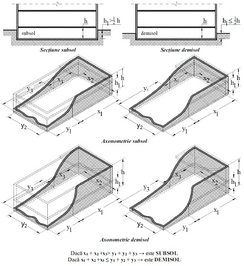

  Figura 11 - Determinare demisol/subsol
30) Dispozitiv (gură) pentru evacuarea fumului în caz de incendiu - gol permanent deschis sau închis cu dispozitiv de protecție care se deschide automat în caz de incendiu (prevăzut și cu acționare manuală), practicat în treimea superioară a închiderilor perimetrale ale încăperii (pereții exteriori) sau în acoperiș și care permite evacuarea fumului produs în caz de incendiu (conform Figura 12), certificate potrivit SR EN 12101-2.

  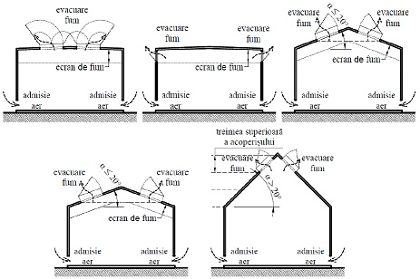

  Figura 12 - Dispozitive (guri) pentru evacuarea fumului în caz de incendiu
  Notă Figura 12: Atunci când se prevede sistem pentru evacuarea fumului și gazelor fierbinți în caz de incendiu, cu evacuare natural-organizată și admisie de aer conform prevederilor normate, cu excepția coridoarelor comune orizontale, evacuarea natural-organizată a fumului și gazelor fierbinți se realizează obligatoriu prin trape (orizontale sau verticale) certificate, care trebuie să îndeplinească condițiile normate.
31) Dispozitiv (gură) pentru admisia aerului în caz de incendiu - gol permanent deschis sau închis cu dispozitiv de protecție care se deschide automat în caz de incendiu, fiind prevăzut și cu acționare manuală, practicat în partea inferioară a închiderilor perimetrale ale încăperii din care se evacuează fumul (pereții exteriori), fiind dispus cât mai aproape de pardoseală (practicat în treimea inferioară, conform Figura 13).

  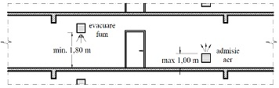

  Figura 13 - Dispozitiv (gură) pentru admisia aerului în caz de incendiu
  și pentru evacuarea fumului în caz de incendiu
  Notă Figura 13: Amplasarea dispozitivelor pentru admisia aerului (în treimea inferioară, la max 1,00 m față de statul finit al pardoselii) în caz de incendiu și pentru evacuarea fumului în caz de incendiu din Figura 13 se utilizează pentru spatii/încăperi cu înălțimea liberă de maxim 3,00 m. Pentru cele cu înălțimea mai mare de 3,00 m dispozitivele pentru admisia aerului în caz de incendiu se amplasează în treimea inferioară iar cele pentru evacuarea fumului în caz de incendiu se amplasează în treimea superioară, raportat la înălțimea spațiului/încăperii.
32) Elemente structurale - elemente portante ale unei construcții, care asigură stabilitatea acesteia în caz de incendiu.
33) Element pentru construcții - parte integrantă a unei construcții (planșee, pereți, grinzi, stâlpi, uși și treceri, fațade etc.)
34) Element de separare - barieră materială destinată să reziste la propagarea incendiului de la o parte a barierei pe partea opusă.
  - 1. Perete de separare a compartimentelor de incendiu (perete antifoc) - element vertical de separare a două construcții sau porțiuni ale unei construcții, alcătuit cu materiale clasa de reacție la foc A1 sau A2-s1,d0, conceput și realizat astfel încât să asigure rezistența la foc normată minimum REI180 sau EI-M180 (include și rezistența la acțiuni orizontale care se manifestă pe durata incendiului în gruparea de încărcări specifică acestei situații de proiectare), împiedicând propagarea focului dincolo de perete în cazul prăbușirii structurii pe una din părțile peretelui de separare.
  - 2. Planșeu de separare a compartimentelor de incendiu (planșeu antifoc) - element orizontal sau înclinat de separare a două porțiuni de construcție, realizat din materiale clasa de reacție la foc A1 sau A2-s1,d0, conceput și realizat astfel încât să asigure rezistența la foc normată minimum REI 120.
  - 3. Perete sau planșeu rezistent la foc - element al construcției, vertical/orizontal sau înclinat, având rezistența la foc cel puțin egală cu nivelul normat (funcție de rolul de protecție la foc pe care îl are).
  - 4. Perete sau planșeu rezistent la explozie - element de construcție vertical, orizontal sau înclinat, realizat din materiale fără goluri interioare, clasa de reacție la foc A1, (cu excepțiile prevăzute de către normativ în capitolele dedicate "exploziei"), alcătuit și dimensionat astfel încât să reziste la presiunea exploziei volumetrice dintr-un spațiu închis. Atunci când separă compartimente de incendiu, elementele trebuie să îndeplinească și condițiile normate de rezistență la foc.
  - 5. Element de construcție rezistent la explozie - produs certificat conform Directivei 2014/34/UE a Parlamentului European și a Consiliului din 26 februarie 2014 privind armonizarea legislațiilor statelor membre referitoare la echipamentele și sistemele de protecție destinate utilizării în atmosfere potențial explozive (reformare) - ATEX, transpusă în legislația națională prin Hotărârea Guvernului nr. 245/2016 privind stabilirea condițiilor pentru punerea la dispoziție pe piață a echipamentelor și sistemelor de protecție destinate utilizării în atmosfere potențial explozive.
    - a) Explozie (volumetrică) - expansiune bruscă a unui gaz care poate rezulta dintr-o reacție rapidă de oxidare sau de descompunere, cu sau fără creștere de temperatură.
    Notă: Perete rezistent la explozie poate fi considerat (în lipsa altor calcule) un perete alcătuit din materiale care la lovire nu produc scântei, respectiv un perete din beton armat minimum clasa C12/15, cu grosimea de minimum 15 cm, cu un procent de armare de cel puțin 0,1%, sau din cărămidă roșie plină, armat cu plasă sudată de oțel pe ambele fețe, cu grosime de 37,5 cm și mortar marca M 25.
  - 6. Perete portant - element de construcție vertical cu rol structural.
  - 7. Perete neportant - element de construcție vertical sau înclinat, fără rol structural.
35) Element de vitraj izolant - ansamblu constituit din cel puțin două panouri de sticlă, separate de una sau mai multe baghete-distanțier, sigilate ermetic de-a lungul perimetrului, stabil și rezistent din punct de vedere mecanic. Panourile de sticlă pot fi de tip monolitic sau de tip stratificat, acestea din urmă fiind alcătuite din cel puțin două panouri de sticlă lipite între ele cu una sau mai multe folii speciale.
36) Element de vitraj simplu - panou format dintr-o sticlă de tip monolitic sau de tip stratificat.
37) Evacuare - o acțiune efectuată pentru a ajunge la un refugiu sigur sau într-o zonă de securitate.
  - 1. Refugiu sigur - amplasament temporar care asigură protecție la un pericol imediat datorat efectelor incendiului (conform Figura 14).
    Notă: De exemplu, un loc în care o persoană într-un fotoliu rulant poate aștepta ajutoare într-o securitate relativă. De asemenea, poate fi o zonă de așteptare în clădirile înalte, foarte înalte sau cu persoane care nu se pot evacua singure (conform definiție), care lasă persoanelor șansa de a se odihni înainte de a continua evacuarea lor spre o zonă de securitate (sau de a aștepta echipele de salvare pentru a le evacua către o zona de siguranță).

    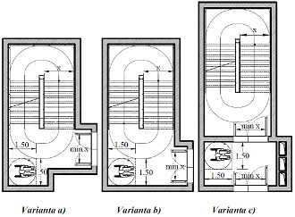

    Figura 14 - Refugiu sigur (reprezentat printr-un punct de staționare
    a persoanelor cu dizabilități, fiind o zonă de securitate
    relativă de amplasare temporară a acestora)
    Notă Figura 14: Punct de staționare a persoanelor cu dizabilități - amplasare în scara de evacuare (varianta a și varianta b) sau în încăperea tampon ventilată în suprapresiune (varianta c).
  - 2. Zonă de securitate la incendiu - zonă fără pericol datorat unui incendiu în desfășurare și din care este posibilă deplasarea liberă fără expunere la efectele acestuia. În general, în cazul unui incendiu într-o clădire, zona de securitate este un loc în afara clădirii. Zonele protejate din interiorul unei clădiri pot fi considerate zone de securitate relativă înainte de evacuarea din clădire.
  - 3. Lungime cale de evacuare (evacuare în caz de incendiu) - distanță care trebuie parcursă, ocolind elementele de mobilier sau alte obstacole, de o persoană, de la un punct oarecare dintr-o construcție până la cea mai apropiată ieșire în exterior, încăpere tampon protejată, degajament protejat sau scară de evacuare. Lungimea căii de evacuare se calculează în axul traseului parcurs de la punctul de plecare al utilizatorului până la cea mai apropiată ușă de evacuare (conform Figura 15). Prin axul traseului parcurs se înțelege prin axul căilor de evacuare pe circulații comune orizontale și verticale (scări), precum și prin axul circulațiilor funcționale interioare din încăperi sau spații tip open space (ocolind obiecte de mobilier sau alte obstacole).

    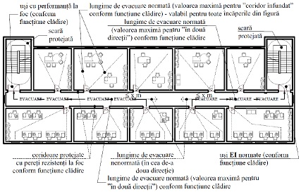

    Varianta a) - Lungimi de evacuare la clădiri cu înălțime obișnuită în interiorul încăperilor prin axul circulațiilor funcționale interioare (ocolind obiecte de mobilier sau alte obstacole) și lungimi pe circulații comune orizontale (în axul căii de evacuare)

    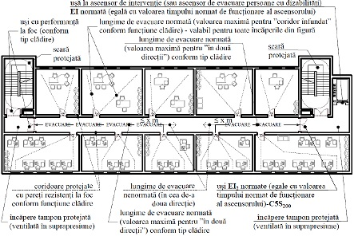

    Varianta b) - Lungimi de evacuare la clădiri înalte sau foarte înalte în interiorul încăperilor prin axul circulațiilor funcționale interioare (ocolind obiecte de mobilier sau alte obstacole) și lungimi pe circulații comune orizontale (în axul căii de evacuare)
    Notă Figura 15 Varianta a) și Varianta b):
    Liniile punctate din interiorul încăperilor reprezintă lungimea de evacuare normată (valoarea maximă pentru o direcție/"coridor înfundat") conform funcțiune sau tip clădire.

    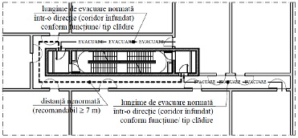

    Varianta c) - Lungimi de evacuare în situația de "coridor înfundat" (coridoarele sunt prevăzute cu pereți rezistenți la foc)
    Note Figura 15, varianta c):
    - (a) În cazul încăperilor delimitate de elemente de separare (perete) cu performanțe de rezistență la foc și doar în condițiile în care în interiorul încăperii nu se depășește lungimea stabilită pentru evacuarea într-o direcție (lungime de coridor înfundat), lungimea căii de evacuare se măsoară de la ușa de acces din elementul de separare (perete) cu performanțe de rezistență la foc, către circulațiile comune orizontale.
    - (b) În cazul coridoarelor înfundate, pentru construcțiile la care sunt obligatorii două căi de evacuare, pentru încăperile delimitate de elemente de separare (perete) cu performanțe de rezistență la foc, lungimea căii de evacuare, măsurată de la ultima ușă a încăperii de la care se evacuează utilizatorii până la cea mai apropiată ieșire (ușa scării, a degajamentului protejat sau a a încăperii tampon protejată de acces la cea mai apropiată scară de evacuare sau la o ușă/ieșire direct în exterior), trebuie să fie maximul valorii stabilite de normativ pentru o direcție.
    - (c) Lungimea de evacuare în cazul coridoarelor înfundate până la cea de a doua ieșire (ușa scării, a degajamentului protejat sau a încăperii tampon protejată de acces la cea mai apropiată scară de evacuare sau la o ușă/ieșire direct în exterior) nu este normată. De asemenea, distanța dintre ușile de evacuare prevăzute între cele două scări de evacuare în foarfecă nu este limitată (se recomandă ca aceasta să fie ≥ 7 m), fiind generată de configurațiile ușilor de acces în spațiile pe care le deservește calea de evacuare.

    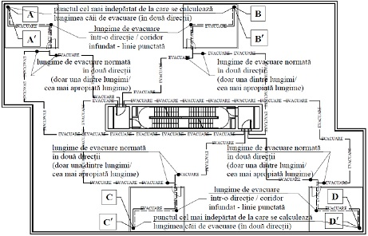

    Varianta d1) - Lungimi de evacuare în spații "open space" prevăzute cu partiții fără rezistență la foc

    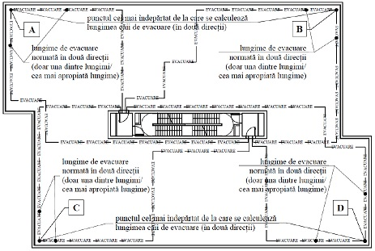

    Varianta d2) - Lungimi de evacuare în spații "open space" nepartiționate

    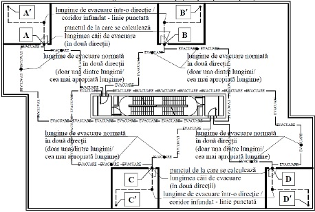

    Varianta d3) - Lungimi de evacuare în spații "open space" prevăzute cu partiții cu rezistență la foc
    Notă Figura 15, variantele d1), d2) și d3): În cazul încăperilor care au în componență spații nedelimitate de elemente de separare cu performanțe la foc (compartimentate cu mobilier și/sau parapete, panouri opace sau vitrate care generează plenum nepartiționat sau pardoseală supraînălțată continuă), în interiorul cărora nu se depășește lungimea de coridor înfundat, lungimea căii de evacuare se calculează pornind de la punctul cel mai îndepărtat (la maximum 40 cm față de perete sau potrivit planului de mobilare) al spațiilor nedelimitate până la intrarea în cel mai apropiat spațiu protejat (încăpere tamon protejată, degajament protejat, scară de evacuare etc.) sau până la cea mai apropiată ieșire în exterior. Lungimea căii de evacuare, măsurată de la punctul cel mai îndepărtat (la maximum 40 cm față de perete sau potrivit planului de mobilare) al spațiilor nedelimitate de elemente de separare cu performanțe la foc prin care se evacuează utilizatorii până la cel mai apropiat spațiu protejat (încăpere tampon protejată, degajament protejat, scară de evacuare etc.) sau până la cea mai apropiată ieșire în exterior, să fie maximul valorii stabilite de normativ pentru 2 direcții, atunci când acestea sunt necesare. Pentru spațiile de tip open space se recomandă să se asigure minimum două căi de evacuare distincte și independente, inclusiv atunci când se folosesc partiții, situație în care partițiile fără performanță la foc se dispun la minimum 1.80 m de pereții rezistenți la foc aferenți nodurilor de circulație.
    Figura 15 - Lungimi de evacuare
  - 4. Timp de evacuare - interval de timp care se scurge între declanșarea alarmei de incendiu emisă către utilizatori și momentul în care utilizatorii unei părți specificate din clădire sau a întregii clădiri sunt capabili să pătrundă într-o zonă de securitate.
  - 5. Mijloace de evacuare - mijloace constructive (structurale sau independente de structura clădirii) prin care sunt amenajate căi destinate a fi sigure, permițând persoanelor să se deplaseze dintr-un punct în altul al unei construcții până la o zonă de securitate.
38) Factor de secțiune (pentru un element metalic) - este raportul dintre aria suprafeței expuse la foc pe unitatea de lungime și volumul elementului metalic pe unitatea de lungime. Pentru un element metalic a cărui suprafață nu este expusă direct la acțiunea focului, factorul de secțiune este raportul dintre suprafața interioară pe unitatea de lungime a învelișului expus la foc și volumul elementului metalic pe unitatea de lungime.
  - – Temperatura critică a elementului structural metalic - pentru un anumit nivel de încărcare* temperatura critică este temperatura corespunzătoare cedării elementului structural (în ipoteza unei distribuții uniforme a temperaturii pe elementul metalic).
  - – Factor de masivitate (m^-1) - raportul dintre perimetrul profilului metalic și aria secțiunii.
  Note:
  - 1) * - se referă la combinația de încărcări corespunzătoare situației accidentale, care include acțiunea focului
  - 2) Temperatura, funcție de factorul de secțiune, se calculează astfel:
    - – Pentru structură de oțel interioare neprotejate - conform 4.2.5.1 din Eurocod 1993-1-2:2006 unde factorul de secțiune Am/V pentru elemente de oțel neprotejate se calculează conform tabel 4.2 din Eurocod 1993 -1-2:2006;
    - – Pentru structură interioară din oțel protejată cu un material de protecție la foc - conform 4.2.5.2 din Eurocod 1993-1-2:2006 unde factorul de secțiune Ap/V pentru elementul de oțel izolat prin materialul de protecție se calculează conform tabel 4.3 din Eurocod 1993-1-2:2006;
    - – Pentru elemente structurale interioare din oțel protejate prin ecrane termice - conform 4.2.5.3 din Eurocod 1993-1-2:2006;
    - – Pentru elemente structurale exterioare din oțel - conform 4.2.5.4 din Eurocod 1993-1-2:2006.
39) Fațadă - închidere perimetrală a construcției - elemente de construcție, cu excepția acoperișului, care alcătuiesc anvelopa clădirii și o izolează pe aceasta față de exterior.
  - 1. Fațadă dublă ("double skin" - construcție alcătuită dintr-un înveliș interior și unul exterior cu un spațiu de aer intermediar, ventilat, concepută astfel încât să îndeplinească rolul unui perete cortină. Fațadele duble sunt de mai multe tipuri, în funcție de sistemul de ventilare al spațiului de aer intermediar (mecanic, natural sau mixt) și de compartimentare al acestuia (conform Figura 16).

    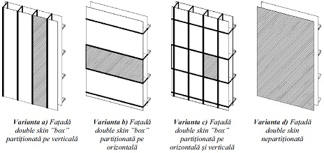

    Figura 16 - Fațade duble (cu două foi de sticlă/"double skin") - tipuri
  - 2. Fațada neventilată (fațadă cu alcătuire neventilată) - partea exterioară a unui perete de închidere exterior, constând dintr-un sistem de închidere perimetrală cu alcătuire neventilată (compact sau cu strat de aer neventilat).
  - 3. Fațadă ventilată fațadă cu alcătuire ventilată) - sistem de fațadă în care finisajul are alcătuire ventilată. Una dintre componentele sistemului de finisare este prevăzută cu o lamă de aer (slab sau puternic) ventilată natural. Lama de aer este amplasată între fața exterioară a peretelui suport sau a stratului termoizolant (dacă acesta există) și fața interioară a elementului de construcție aflat între stratul de aer ventilat și atmosfera exterioară (structură care poate fi sau nu termoizolată, fața exterioară putând fi opacă sau vitrată). - conform normativului de proiectare fațade ventilate NP 135/2013
  - 4. Perete de închidere la exterior - element de construcție structural sau nestructural, realizat din zidărie, beton, pe structuri moare metalice, lemn, tablă cutată, panouri sandwich din tablă cutată și termoizolație etc. (perete exterior - perete care formează anvelopa exterioară a unei construcții, inclusiv elemente vitrate, care poate fi expus separat la un foc din interior sau exterior - Conform SR EN13501- 2; SR EN 1364-1 și SR EN 1365-1).
40) Ghenă - canal vertical închis în construcție destinat instalațiilor (conducte, cabluri, tubulaturi etc.).
41) Incendiu (termen general) - proces de ardere caracterizat prin emisie de căldură și de efluenți ai incendiului și în general însoțit de fum, flăcări, incandescență sau de o combinație a acestor elemente.
  - 1. Incendiu (necontrolat) - ardere autoîntreținută care nu a fost deliberat organizată pentru a produce efecte utile, și a cărei propagare în timp și spațiu nu este controlată.
  - 2. Incendiu generalizat - fază în care ansamblul materialelor combustibile sunt implicate într-un incendiu; stare de ardere cu flacără a tuturor materialelor combustibile pe durata unui incendiu.
  - 3. "Flashover"/Inflamare generalizată <moment al incendiului> - trecere la faza de ardere generalizată a suprafeței tuturor materialelor combustibile expuse la un incendiu într-o incintă.
  - 4. Clasificare a incendiilor - sistem standardizat de clasificare a incendiilor în funcție de natura combustibilului. Există șase clase de incendii:
    - 1) Clasa A: incendiu care implică materiale solide, în general de natură organică, a căror ardere are loc în mod normal cu formarea de jar incandescent;
    - 2) Clasa B: incendiu care implică lichide sau solide lichefiabile;
    - 3) Clasa C: incendiu care implică gaze;
    - 4) Clasa D: incendiu care implică metale;
    - 5) Clasa E: incendiu care implică pericole de origine electrică (În SR EN 2 nu este menționată clasa E);
    - 6) Clasa F: incendiu care implică uleiuri sau grăsimi pentru gătit.
  - 5. Efluenți ai incendiului - totalitatea gazelor și aerosolilor, inclusiv particule în suspensie, degajate prin ardere sau piroliză și emise și difuzate în mediu;
  - 6. Fum - parte vizibilă a efluenților incendiului;
  - 7. Flacără - propagare rapidă, autoîntreținută și subsonică a arderii într-un mediu gazos, în general însoțită de emisie de lumină;
42) Incombustibil - material sau produs incapabil să ardă în condiții specificate.
  - 1. combustibil, adjectiv - capabil de a fi aprins și de a arde;
  - 2. combustibil, substantiv - obiect capabil de a iniția o ardere.
  Notă 1: În decursul normativului sunt considerate materiale sau produse incombustibile cele care au clasa de reacție la foc A1 sau A2-s1,d0.
  Notă 2: Materialele sau produsele capabile să ardă în condiții specificate (în decursul normativului fiind considerate materiale sau produse combustibile) au clasa de reacție la foc diferită de A1 sau A2-s1,d0.
43) Inflamabilitate - aptitudine a unui material sau produs, de a arde cu flacără în condiții specificate.
  - 1. Inflamabil - material sau produs capabil să ardă cu flacără în condiții specificate;
  - 2. Neinflamabil - incapabil de a arde cu flacără în condiții specificate.
44) Încăpere - unitate specifică construcțiilor, delimitată de pereți și planșee cu performanțe de comportare la foc prevăzute în normativ funcție de destinația acesteia și/sau riscul de incendiu.
  - 1. Încăpere tampon - încăpere de protecție a golurilor de circulație funcțională și de evacuare din pereți, astfel conformată, alcătuită și echipată, încât să corespundă rolului pe care îl are în caz de incendiu (Figura 17). încăperile tampon trebuie prevăzute cu unul din următoarele sisteme:
    - i. cu sisteme mecanice de evacuare a fumului și a gazelor fierbinți (admisie mecanică de aer și evacuare mecanică de fum);
    - ii. cu sisteme cu presiune diferențială (SPD) (în suprapresiune) - în conformitate cu standardele SR EN 12101-6 - Sisteme pentru controlul fumului și gazelor fierbinți. Partea 6: Specificații pentru sisteme cu presiune diferențială. Kituri și SR EN 12101-13 - Sisteme pentru controlul fumului și gazelor fierbinți. Partea 13: Sisteme cu presiune diferențială (SPD). Metode de proiectare și de calcul, instalare, încercări în vederea recepției, încercări periodice și mentenanță, încăperile tampon se echipează cu sisteme cu presiune diferențială în conformitate cu prevederile acestor standarde.

    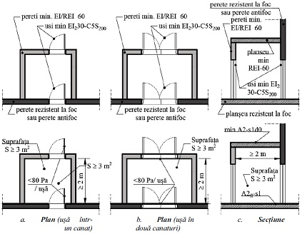

    Figura 17 - Încăpere tampon protejată
  - 2. Încăperi cu aglomerări de persoane - încăperi sau grup de încăperi care comunică direct între ele prin goluri neprotejate în care se pot afla simultan cel puțin 50 de persoane, fiecăreia din acestea revenindu-i o arie de pardoseală de maximum 4 mp.
45) Învelitoare - element component exterior al acoperișurilor tip șarpantă sau terasă, cu rol de asigurare a etanșeității construcției față de intemperii (hidroizolație). Învelitoarea poate fi continuă (din produse aplicate prin lipiri/suduri, realizate cu membrane hidroizolante, bituminoase, cu suprapunerile sudate etc.); semicontinuă (din produse montate prin suprapuneri sau prin îmbinări, realizate din foi metalice plane, îmbinate prin falț și din panouri metalice profilate și panouri prefabricate, termoizolate, cu suprapunerile etanșe); discontinuă (din materiale/produse pozate și montate prin suprapuneri). Învelitorile pot fi plane (la terase plate); cu pantă (într-o apă, în shed, în două ape) sau cu pantă constantă (conice etc.) sau cu pantă variabilă (forme de cilindru, cupolă, elipsoid, suprafețe riglate etc., forme evazate).
46) Limitarea propagării incendiilor - ansamblul măsurilor constructive și al echipării cu instalații de protecție împotriva incendiilor, prevăzute pentru împiedicarea extinderii incendiului pe durate normate de timp, în interiorul construcției sau în afara acesteia.
47) Mansardă - spațiu construit (realizat funcțional conform reglementărilor tehnice specifice) sau amenajat funcțional în volumul acoperișului construcției, situat între ultimul planșeu utilizat pentru diferite destinații al clădirii și acoperișul în pantă (sau a podului neamenajat), care asigură respectarea cerințelor de siguranță (securitate) și confort corespunzătoare utilizării specifice. Înălțimea liberă a suprafețelor considerate utile ale mansardei poate fi de min 1,90 metri, determinând și calculul suprafeței utile a mansardei. Numărul de niveluri al mansardei se include în numărul de niveluri supraterane ale construcției și se ia în calcul la determinarea nivelului de stabilitate la incendiu al construcției.
  Notă: atunci când la ultimele niveluri ale mansardei sunt locuințe de tip duplex sau triplex, la stabilirea înălțimii construcției din perspectiva securității la incendiu, se ia în considerare numai nivelul de acces la acestea din circulațiile comune orizontale ale clădirii, nivel de acces care determină numărul de niveluri și/sau încadrarea în clădire înaltă sau în clădire cu înălțime obișnuită. Se admite ca un singur nivel să fie constituit tip duplex sau tip triplex cu acces conform alineatului precedent, cele două niveluri la tip duplex sau cele trei niveluri la triplex fiind considerate din perspectiva securității la incendiu ca un singur nivel, reprezentând ultimul nivel al construcției. Dacă nivelurile de acces la locuințele de tip duplex sau triplex se află la alte niveluri față de cel precizat anterior, la stabilirea înălțimii construcției se iau în considerare toate nivelurile din care sunt constituite locuințele de tip duplex sau triplex. Prezenta notă nu se aplică la calcularea indicatorilor urbanistici - regim de înălțime, coeficienți de utilizare a terenului.
48) Material - substanță unică de bază sau amestec uniform distribuit de substanțe, de exemplu metal, piatră, lemn, beton, vată minerală cu liant uniform distribuit sau polimeri (din care este constituit un produs).
  - 48.1 Component substanțial - material care constituie o parte semnificativă dintr-un produs neomogen. Este considerat un component substanțial un strat cu masa/unitatea de suprafață ≥ 1,0 kg/mp sau cu o grosime ≥ 1,0 mm.
  - 1. 48.2 Component nesubstanțial - material care nu constituie o parte semnificativă dintr-un produs neomogen. Este considerat un component nesubstanțial un strat cu masa/unitatea de suprafață < 1,0 kg/mp și o grosime < 1,0 mm. Două sau mai multe straturi nesubstanțiale adiacente (adică fără niciun component(e) substanțial(e) între straturi) sunt considerate ca un singur component nesubstanțial atunci când îndeplinesc împreună cerințele aplicabile unui strat care constituie un component nesubstanțial.
    - a) Component nesubstanțial interior - component nesubstanțial care este acoperit pe ambele fețe de cel puțin un component substanțial;
    - b) Component nesubstanțial exterior - component nesubstanțial care nu este acoperit de un component substanțial, pe una din fețe.
  - 2. 48.3 Material compozit - asociere structurată a două sau mai multe materiale distincte.
  - 48.4 Material combustibil, material capabil să fie aprins și să ardă.
  - 3. 48.5 Material polimeric - material compus din molecule de mari dimensiuni constituite din unități chimice mai mici, repetitive, legate între ele, numite polimeri. Un polimer este o moleculă de mari dimensiuni constituită din numeroase unități chimice mai mici, repetitive, legate între ele, numite monomeri. Unii polimeri sunt naturali, alții sunt sintetici.
  - 48.6 Substrat - material care este utilizat imediat sub produsul despre care se cer informații (ex: pentru pardoseală, este solul pe care aceasta este montată sau de materialul care reprezintă acest sol).
    Substrat standardizat - material care este reprezentativ pentru substratul utilizat în condițiile de utilizare finală.
49) Mezanin - nivel intercalat între parter și etajul întâi care se deosebește de celelalte niveluri fie prin înălțimea liberă mai mică, fie prin lipsa balcoanelor sau a altor ieșinduri în planul fațadelor. Mezaninul se include în numărul de niveluri supraterane ale construcției și se ia în calcul la determinarea nivelului de stabilitate la incendiu al construcției.
50) Niveluri (etaje) - spații construite supraterane și/sau subterane ale construcției, închise sau deschise, delimitate de planșee. Constituie nivel al construcției supanta a cărei arie este mai mare de 40% din cea a spațiului în care este realizată.
  - 1. Nivel tehnic - etaj tehnic - spațiu special construit suprateran sau subteran delimitat de planșee, în care sunt amplasate instalații aferente construcției (de apă, de canalizare, termice, electrice, de ventilare, telefonie etc. și utilaje și/sau aparatură aferentă acestora pentru funcționarea optimă a imobilului în raport cu destinația acestuia). Aceste spații pot avea compartimentări interioare în funcție de necesitățile de separare a instalațiilor, aparaturii și protecției acesteia. În aceste spații nu sunt admise încăperi cu alte funcțiuni ca de exemplu de locuit, ateliere pentru intervenții (reparații) și nici vestiare sau spații de odihnă pentru personalul de întreținere. Spatiile tehnice nu pot fi transformate în spații locuibile după recepția la terminarea lucrărilor.
    Nivelurile tehnice pot fi de trei tipuri:
    - a) nivel tehnic amplasat deasupra nivelului limită normat al construcției - spațiu special construit suprateran, delimitat de planșee, aflat deasupra nivelului limită normat din punct de vedere al securității la incendiu al construcției, ce ocupă maximum 50% din aria construită a nivelului de dedesubtul acestuia. Nivelul tehnic nu se ia în considerare la înălțimea construcției și la numărul de niveluri al construcției în ceea ce privește securitate la incendiu.
    - b) nivel tehnic intermediar - etaj tehnic intermediar - spațiu special construit suprateran, delimitat de planșee, aflat intermediar între alte niveluri utilizate ale construcției, cu înălțime liberă de 1,80 m și care se ia în considerare la înălțimea construcției și la numărul de niveluri al construcției, în ceea ce privește securitate ala incediu. Nivelul tehnic intermediar nu poate fi modificat din punct de vedere funcțional în perioada execuției lucrărilor de construcții sau ulterior, fiind interzisă transformarea în spații locuibile.
    - c) nivel tehnic subteran - etaj tehnic subteran - spațiu special construit subteran, delimitat de pereți și planșee, aflat sub ultimul nivel de referință/utilizat al construcției, cu înălțime liberă mai mică de 1,80 m și se ia în considerare la înălțimea construcției și la numărul de niveluri subterane al construcției. Din perspectiva securității la incendiu, canivourile și canalele tehnice subterane cu înălțime liberă de maximum 1,80 m nu constituie nivel.
51) Nivel de referință - nivelul terenului sau al carosabilului exterior cel mai de jos, accesibil autospecialelor de intervenție în caz de incendiu la care se face evacuarea utilizatorilor în exterior și accesul forțelor de intervenție în clădire (Figura 18).

  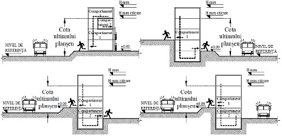

  Varianta a): clădiri fără spații amenajate pe acoperișul tip terasă

  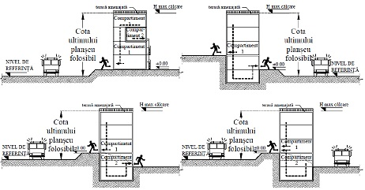

  Varianta b): clădiri cu spații amenajate pe acoperișul tip terasă
  Notă Figura 18, Varianta b): Stabilirea înălțimii clădirilor la care acoperișul terasă este amenajat pentru diverse funcțiuni cum ar fi parcaje, comerț etc., se face ținând cont de cota de călcare a terasei circulabile în raport cu nivelul de referință.
  Figura 18 - Nivel de referință
52) Nivel de stabilitate la incendiu - capacitatea globală normată a unei construcții sau a unui compartiment de incendiu de a răspunde la acțiunea unui incendiu standard. Nivelul de stabilitate la incendiu al construcției sau al compartimentului de incendiu, este determinat de elementul său cu cea mai defavorabilă încadrare în valorile normate.
53) "Open space" - spațiu () deschis, pentru activități care necesită o comunicare frecventă, sau grupare de încăperi cu același risc de incendiu și aceeași destinație (proprie sau complementară folosită în exploatarea curentă) compartimentate prin mobilier și/sau parapete, panouri opace sau vitrate, fixe sau mobile folosite ca separări funcționale și/sau izolante fonic (Figura 20). Panourile opace sau vitrate de delimitare care întrerup spațiul dintre plafonul (autoportant sau suspendat) incombustibil față de planșeu și/sau spațiul dintre pardoseala supraînalțată incombustibilă și planșeul inferior din cadrul unor grupări cu suprafața normată coroborată cu lungimile căilor de evacuare, trebuie realizate astfel încât să nu fie influențată funcționarea instalațiilor de protecție împotriva incendiilor. Este admisă gruparea încăperilor cu risc mic de incendiu și aceeași destinație, incluzând și destinații colaterale, inclusiv cele de comunicări funcționale orizontale. Gruparea încăperilor de tip open space se compartimentează la limita față de circulațiile comune de evacuare (coridoare, degajamente protejate, încăperi tampon, scări închise etc.) precum și față de spații cu risc diferit de incendiu (provenit din densitatea de sarcină termică și/sau din funcțiune), cu pereți rezistenți la foc specifici spațiilor tip open space sau conform prevederilor spațiilor alăturate (obligatoriu se aleg cerințele cele mai restrictive), conform încadrării fiecărei funcțiuni sau tip de construcție. În interiorul grupării spațiilor de tip open space, încăperile cu risc mai mare de incendiu (provenit din densitatea de sarcină termică și/sau din funcțiune) se compartimentează cu pereți rezistenți la foc specifici acestor încăperi.
  - 1. încăperile tip "open space" cu aglomerări de persoane se prevăd cu instalații de detectare, semnalizare și alarmare la incendiu cu acoperire totală și nu se recomandă a fi dispuse în spații care nu sunt prevăzute cu instalații automate de stingere a incendiilor.
  - 2. Nu se admit grupări tip "open space" care includ săli aglomerate, cu excepția clădirilor de comerț prevăzute în prezentul normativ.
  - 3. Nu se admit grupări tip "open space" în clădiri destinate persoanelor care nu se pot evacua singure, cu excepția celor explicit nominalizate în prezentul normativ la clădirile cu funcțiunea de sănătate.
  - 4. încăperile de dormit (dormitoare comune) sau cu locuri de dormit sau spitalizare (saloane, rezerve din clădiri de sănătate, cabinete medicale etc.), spațiile de dormit (chilii) situate în ansambluri mănăstirești, încăperile de dormit din hoteluri, hosteluri, moteluri, vile, bungalouri, cabane, pensiuni etc., sau cele situate în afara zonelor construite ale localităților (cabane, refugii, hoteluri, moteluri, pensiuni, sanatorii etc.), spitale și altele similare, cămine/dormitoare comune sau camere de cămin/internat, nu se pot constitui în spații deschise de tip open space, acestea trebuind să fie delimitate între ele (minimum prin pereți neportanți despărțitori interiori cu rol de limitare a propagării focului (EI)) precum și la limita către căile de circulație comune conform încadrării construcției/compartimentului de incendiu în nivel de stabilitate.
  - 5. Grupările de încăperi cu același risc de incendiu și aceeași destinație (proprie sau complementară) de tip open space se compartimentează între ele și la limita față de circulațiile comune de evacuare (coridoare, degajamente protejate, încăperi tampon protejate sau neprotejate, scări închise etc.) precum și față de spații cu risc diferit de incendiu (conform densităților sarcinilor termice (q) din spațiile adiacente și/sau densităților sarcinilor termice (q) cele mai mari din spațiile pe care le despart și/sau cele cu risc diferit de incendiu provenit din funcțiune), în funcție de încadrarea acestora în funcțiuni sau tip de construcție, prin pereți de sectorizare cu rol de limitare a propagării focului REI/EI (de protecție contra incendiilor care limitează propagarea în interiorul compartimentelor de incendiu), conform încadrării construcției/compartimentului de incendiu în nivelul de stabilitate la incendiu, dacă densitatea sarcinii termice din spațiile adiacente nu generează performanțe mai mari.
  - 6. Fiecare grupare de încăperi cu același risc de incendiu și aceeași destinație (proprie sau complementară de tip open space, cu excepția celor prezentate la alineatele anterioare) compartimentate cu panouri opace sau vitrate, fixe sau mobile folosite ca separări funcționale și/sau izolante fonic sau pereți interiori despărțitori funcționali, se admit în limita următoarelor arii construite:
    - – nelimitat, cu condiția ca aria construită a încăperilor de tip open space să fie de maximum 75% din cea a ariei construite a nivelului respectiv pentru construcții încadrate în nivelul I de stabilitate la incendiu;
    - – maximum 400 mp fiecare grupare, cu condiția ca aria construită a tuturor grupărilor de pe nivel (de tip open space) să fie de maximum 75% din cea a ariei construite a nivelului respectiv pentru construcții încadrate în nivelul II de stabilitate la incendiu;
    - – maximum 200 mp fiecare grupare, cu condiția ca aria construită a tuturor grupărilor de pe nivel (de tip open space) să fie de maximum 50% din cea a ariei construite a nivelului respectiv pentru construcții încadrate în nivelul III de stabilitate la incendiu;
    - – maximum 100 mp fiecare grupare, cu condiția ca aria construită a tuturor grupărilor de pe nivel (de tip open space) să fie de maximum 25% din cea a ariei construite a nivelului respectiv pentru construcții încadrate în nivelul IV de stabilitate la incendiu;
    - – maximum 50 mp fiecare grupare, cu condiția ca aria construită a tuturor grupărilor de pe nivel (de tip open space) să fie de maximum 25% din cea a ariei construite a nivelului respectiv pentru construcții încadrate în nivelul V de stabilitate la incendiu.
  - 7. Gruparea încăperilor cu risc mic de incendiu și aceeași destinație, incluzând și destinații colaterale, inclusiv cele de comunicări funcționale orizontale (precum vestiare + grupuri sanitare; birouri + sas funcțional acces; camera RMN + camera de comanda + sas acces; cameră computer tomograf + camera de comanda + sas acces etc.) se compartimentează în limitele suprafețelor stabilite la alineatul precedent, prin pereți de sectorizare cu rol de limitare a propagării focului REI/EI (de protecție contra incendiilor care limitează propagarea în interiorul compartimentelor de incendiu), conform încadrării construcției/compartimentului de incendiu în nivelul de stabilitate la incendiu, dacă densitatea sarcinii termice din spațiile adiacente nu generează performanțe mai mari.
  Nu sunt considerate spații open-space încăperile prevăzute în interiorul acestora cu pereți cu performanță privind rezistența la foc (din planșeu în planșeu), conform Figura 19. Acestea se partiționează față de încăperile adiacente prin pereți cu performanță la foc (din planșeu în planșeu), conform prevederi normate.

  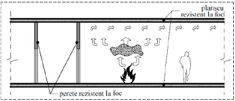

  Varianta a) Încăpere prevăzută cu pereți cu rezistență la foc față de încăperile adiacente: fără pardoseală supraînălțată și fără plafon (autoportant sau suspendat) - nu creează plenum

  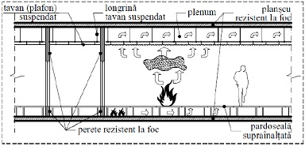

  Varianta b) Încăpere prevăzută cu pereți cu rezistență la foc față de încăperile adiacente: cu pardoseală supraînălțată și cu plafon (autoportant sau suspendat); spațiile din plafonul (autoportant sau suspendat) și din pardoseala supraînălțată sunt delimitate prin elemente de separare (pereți cu rezistență la foc) față de încăperile adiacente - nu creează plenum
  Notă Varianta b): spațiile adiacente delimitate prin pereți rezistenți la foc pot avea sau nu plafoane (autoportante sau suspendate).

  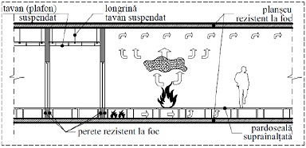

  Varianta c) încăpere prevăzută cu pereți cu rezistență la foc față de încăperile adiacente: cu pardoseală supraînălțată și fără plafon (autoportant sau suspendat); spațiile din pardoseala supraînălțată sunt delimitate prin elemente de separare (pereți cu rezistență la foc) față de încăperile adiacente - nu creează plenum
  Notă Varianta c): spațiile adiacente delimitate prin pereți rezistenți la foc pot avea sau nu plafoane (autoportante sau suspendate).

  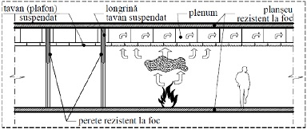

  Varianta d) încăpere prevăzută cu pereți cu rezistență la foc față de încăperile adiacente: fără pardoseală supraînălțată și cu plafon (autoportant sau suspendat); spațiile din tavanul suspendat sunt delimitate prin elemente de separare (pereți cu rezistență la foc) față de încăperile adiacente - nu creează plenum
  Notă Varianta d): spațiile adiacente delimitate prin pereți rezistenți la foc pot avea sau nu plafoane (autoportante sau suspendate).
  Figura 19 - Încăperi închise, delimitate prin pereți cu
  rezistență la foc față de încăperile adiacente

  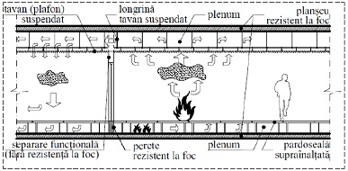

  Varianta a) Spațiu prevăzut cu separări funcționale fără rezistență la foc față de spațiile adiacente: cu pardoseală supraînălțată și cu plafon (autoportant sau suspendat), spațiile din plafonul (autoportant sau suspendat) nu sunt delimitate prin pereți cu rezistență la foc față de spațiile adiacente - creează plenum prin plafonul (autoportant sau suspendat) continuu nedelimitat

  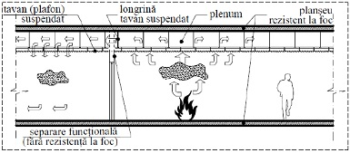

  Varianta b) Spațiu prevăzut cu separări funcționale fără rezistență la foc față de spațiile adiacente: fără pardoseală supraînălțată și cu plafon (autoportant sau suspendat), spațiile din plafonul (autoportant sau suspendat) nu sunt delimitate prin pereți cu rezistență la foc față de spațiile adiacente - creează plenum prin plafonul (autoportant sau suspendat) continuu nedelimitat

  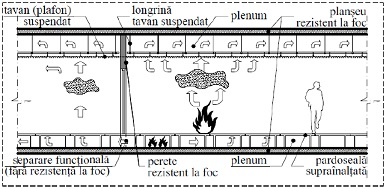

  Varianta c) Spațiu prevăzut cu separări funcționale fără rezistență la foc față de spațiile adiacente: cu pardoseală supraînălțată și cu plafon (autoportant sau suspendat), spațiile din pardoseala supraînălțată nu sunt delimitate prin pereți cu rezistență la foc față de spațiile adiacente - creează plenum prin pardoseala supraînălțată continuă nedelimitată

  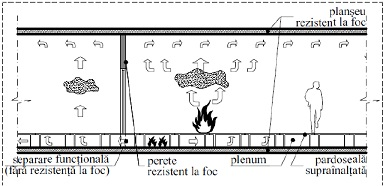

  Varianta d) Spațiu prevăzut cu separări funcționale fără rezistență la foc față de spațiile adiacente: cu pardoseală supraînălțată și fără plafon (autoportant sau suspendat), spațiile din pardoseala supraînălțată nu sunt delimitate prin pereți cu rezistență la foc față de spațiile adiacente - creează plenum prin pardoseala supraînălțată continuă nedelimitată

  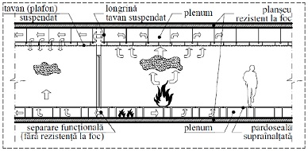

  Varianta e) Spațiu prevăzut cu separări funcționale fără rezistență la foc față de spațiile adiacente: cu pardoseală supraînălțată și cu plafon (autoportant sau suspendat), spațiile din plafonul (autoportant sau suspendat) și din pardoseala supraînălțată nu sunt delimitate prin pereți cu rezistență la foc față de spațiile adiacente - creează plenum prin plafonul (autoportant sau suspendat) continuu nedelimitat și prin pardoseala supraînălțată continuă nedelimitată
  Figura 20 - Spații deschise de tip open space

  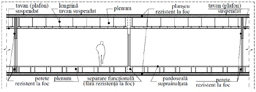

  Figura 21 - Spații deschise de tip open space, delimitate prin pereți
  cu rezistență la foc față de încăperile adiacente
54) Panouri de învelitoare - elemente autoportante montate pe șarpantele acoperișurilor construcțiilor, cu rol de izolare hidrofugă și după caz, termică.
55) Panou de tâmplărie - ramă nestructurală, fixată perimetral ori, după caz, prin ancorarea profilelor verticale sau orizontale, de structura clădirii, care conține elemente de umplere transparente și/sau opace, fixe și/sau mobile (deschizibile).
56) Parcaj - construcție supraterană sau subterană închisă sau deschisă, cu unul sau mai multe niveluri, destinată exclusiv parcării autovehiculelor și remorcilor acestora (în care nu se efectuează lucrări de reparații).
  - 1. Parcaj închis - construcție închisă cu pereți exteriori perimetrali și planșeu.
  - 2. Parcaj deschis suprateran - construcție deschisă care are goluri permanent deschise pe cel puțin 50% din suprafața pereților exteriori destinată adăpostirii autovehiculelor și remorcilor acestora (în care nu se efectuează lucrări de reparații). La parcajele deschise supraterane evacuarea fumului se asigură prin deschiderile perimetrale existente, în condițiile normativului (golurile de evacuare a fumului dispuse în pereții exteriori se iau în considerare numai pentru adâncimea de maximum 30 m).
  - 3. Parcaj suprateran puternic ventilat natural - categorie distinctă a parcajelor deschise supraterane care îndeplinește cumulativ următoarele condiții:
    - i. pe fiecare nivel de parcare, suprafețele libere din pereții laterali deschiși spre exterior sunt amplasate pe cel puțin două fațade opuse și fiecare reprezintă minimum 50% din suprafața totală a fațadei deschise, înălțimea luată în considerare fiind distanța liberă dintre pardoseala finită și plafon;
    - ii. distanța dintre fațadele libere opuse, deschise spre exterior, este de cel mult 75,00 m;
    - iii. suprafețele libere perimetrale, deschise spre exterior, la fiecare nivel de parcare reprezintă cel puțin 5% din aria utilă a spațiului de parcare a nivelului respectiv; nu se iau în considerare suprafețele spațiilor închise destinate circulațiilor pietonale orizontale și verticale precum și al spațiilor cu alte destinații;
    - iv. spațiul exterior deschis are aria orizontală cel puțin egală cu suma suprafețelor libere adiacente perimetrale.
  Parcajele supraterane puternic ventilate natural se consideră că au asigurată evacuarea fumului și gazelor fierbinți.
57) Pardoseală - subansamblu nestructural de elemente de finisaj, permanent, al încăperilor și spațiilor exterioare, format din totalitatea straturilor executate peste sol sau peste un element structural plan, de regulă orizontal (înclinat la rampe), cu scopul de a realiza o suprafață orizontală care să îndeplinească cerințele specifice de utilizare.
58) Pardoseală supraînălțată - pardoseală independentă, montată peste planșeul de rezistență;pardoseala flotantă
59) Perete - element de construcție vertical sau înclinat până la un unghi maxim de 10° (caz general) față de verticală sau de maxim 15° în cazul fațadelor cu pereți cortină, realizat între planșeele unei construcții (Figura 22).

  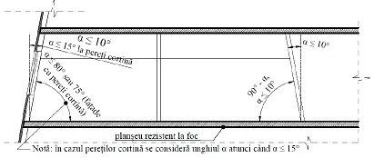

  Figura 22 - Perete - înclinare
60) Perete cortină - perete exterior neportant ancorat (prins) de structura portană a clădirii, alcătuit, în general, dintr-o rețea de profile verticale și profile orizontale asamblate între ele. Un perete cortină include montanți și traverse, element/e vitrat/e, element/e opac/e, etanșări, elemente de fixare și elemente mobile (ferestre sau uși). Peretele cortină este proiectat astfel încât să aibă o structură proprie care transmite sarcini moarte - permanente sau statice proprii/încărcări statice permanente provenite din greutate proprie, sarcini impuse - temporare și dinamice generate de traficul auto etc. (încărcări utile variabile dinamice de scurtă durată provenite din traficul auto), sarcini de mediu (vânt, zăpadă etc.)/încărcări climatice (vânt, zăpadă, variații de temperatură), sarcini generate de seism care se transmit structurii principale a clădirii/încărcări seismice. Peretele cortină se realizează conform reglementărilor tehnice specifice, cerințele privind securitatea la incendiu se asigură conform cerințelor prezentului normativ.
61) Performanță la foc exterior - Expresie convențională a modului de comportare a unui acoperiș sau a unei învelitori de acoperiș pentru situația în care, în condiții de utilizare finală, este expus(ă) la un incendiu din afara construcției.
  Clasificarea performanței la foc exterior a acoperișurilor și învelitorilor de acoperiș:
  - – B_ROOF (t1), F_ROOF (t1) unde t1 = Numai corpuri arzânde;
  - – B_ROOF (t2), F_ROOF (t2) unde t2 = Corpuri arzânde + vânt;
  - – B_ROOF (t3), C_ROOF (t3), D_ROOF (t3), F_ROOF (t3) unde t3 = Corpuri arzânde + vânt + radiație;
  - – B_ROOF (t4), C_ROOF (t4), D_ROOF (t4), E_ROOF (t4), F_ROOF (t4) unde t4 = Corpuri arzânde + vânt + radiație suplimentară.
  Note:
  - – Comisia Europeana a elaborat o listă cu produsele care, în anumite condiții, pot fi încadrate în clasa B_ROOF fără a fi încercate. Aceasta informație este prezentată în Decizia Comisiei din 6 septembrie 2009, care stabilește lista produselor încadrate în clasele B_ROOF (Decizia 2000/553/CE - 2005/403/CE - 2006/600/CE).
  - – Suplimentar, există o procedură care permite ca anumitor produse să li se atribuie o clasificare specifică la foc, fără a fi necesar să fie încercate. Astfel de produse trebuie să aibă performanțe de reacție la foc bine stabilite și să fie omologate de Comitetul permanent pentru construcții al CE. Agrementele tehnice europene referitoare la aceste produse, care pot fi "clasificate fără încercări suplimentare" (CWFT^N1)), sunt publicate în Jurnalul oficial al UE.
    ^N1) NOTA NAȚIONALĂ- Acronimul CWFT provine din limba engleză, "classified without further testing".
  - – Pentru clasificarea unui acoperiș/a unei învelitori pentru acoperiș este necesar să fie aplicate doar acele metode de încercare și acele reguli de aplicare pentru care este preconizată clasificarea corespunzătoare.
  - – Produsele sunt analizate în raport cu utilizarea finală a acestora.
  - – Se consideră că produsele clasificate într-o clasă dată, îndeplinesc toate cerințele oricărei clase inferioare pentru aceeași metodă de încercare/scenariu de pericol de incendiu.
  - – Performanța la foc exterior a unui acoperiș/a unei învelitori pentru acoperiș nu depinde numai de proprietățile intrinseci ale componentelor acestuia/acesteia și de condițiile de acțiune a focului, ci, în mare măsură, și de panta acoperișului.
  - – Încercări și domenii de aplicare (conform SR EN 13501-5):
    Încercarea 2
    - – Panta de încercare standardizata este de 30°.
    - – Substaturile standardizate sunt:
      - a) placă aglomerată de lemn (neignifugată), cu densitatea de (680 ± 50) kg/mc și grosimea de (19 ± 2) mm;
      - b) polistiren expandat (EPS) (neignifugat), cu densitatea de (20 ± 5) kg/mc și grosimea de (50 ± 10) mm;
      - c) placă armată de silicat de calciu, cu densitatea de (680 ± 50) kg/mc și grosimea de (10 ± 2) mm;
      - d) vată minerală, cu densitatea de (150 ± 20) kg/mc și grosimea de (50 ± 10) mm.
    - – Încercările pot fi efectuate cu substratul din utilizarea finală, dar, în acest caz, rezultatul încercării obținut este aplicabil doar pentru această utilizare finală.
    - – Domeniu direct de aplicare a rezultatelor încercării:
      - a) Rezultatele încercării obținute cu o pantă de 30° sunt valabile pentru toate pantele.
      - b) Rezultatele încercării obținute pentru o învelitoare pentru acoperiș fixată pe un substrat se aplică numai pentru învelitoarea pentru acoperiș pe substraturi care au o densitate mai mare sau egala cu de 0,75 înmulțită cu densitatea utilizată la încercare.
      - c) Rezultatele încercării obținute pe un substrat incombustibil standardizat se aplică numai pentru substraturi incombustibile care respectă și cerința de la lit. b).
      - d) Rezultatele încercării obținute pe un substrat combustibil standardizat se aplică pentru substraturi combustibile și incombustibile care respectă și cerința de la lit. b).
      - e) Rezultatele încercării obținute pe un substrat nestandardizat se aplică numai pentru substratul respectiv, care respecta și cerința de la lit. b).
    Încercarea 3
    - – Pantele de încercare standardizate sunt 5° și 30°. Încercările pot fi efectuate și cu panta preconizată efectivă. Clasificarea astfel obținută este valabilă numai pentru panta respectivă.
    - – Suporturile standardizate sunt:
      - a) suport din placă aglomerată de lemn, construit din scânduri de 250 mm lățime x 16 mm grosime, cu o densitate de (680 ± 50) kg/mc, cu margini drepte și îmbinate strâns una lângă alta, astfel încât rosturile dintre scânduri să nu depășească 0,5 mm;
      - b) suport din scânduri din plăci aglomerate de lemn ca la a), cu margini drepte, cu rosturi de (5 ± 0,5) mm;
      - c) suport din placă armată de silicat de calciu, de (12 ± 2) mm grosime, cu densitatea în stare uscată de (680 ± 50) kg/mc;
      - d) suport din oțel cu profil trapezoidal;
      - e) fără niciun suport continuu.
    - – Încercările pot fi, de asemenea, efectuate cu suportul efectiv preconizat. Clasificarea obținută astfel este valabilă doar pentru suportul încercat.
    - – Domeniu direct de aplicare a rezultatelor încercării:
      - 1) Panta:
        - – Rezultatele încercării obținute pentru o pantă de 5° se aplică la acoperișuri cu pante < 10°.
        - – Rezultatele încercării obținute pentru o panta de 30° se aplică la acoperișuri cu pante > 10° și < 70°.
        - – Rezultatele încercării obținute pentru o altă pantă specificată se aplică numai la acoperișurile cu panta respectivă.
      - 2) Natura suportului:
        - 2.1) Încercare cu suporturi standardizate:
          Rezultatele încercării obținute cu suporturi standardizate trebuie aplicate la toate sistemele cu aceleași componente (inclusiv grosimea), montate în același mod, dar cu suporturi diferite, după cum urmează:
          - a) Rezultatele încercării obținute cu un suport din plăci aglomerate de lemn cu rosturi între scânduri care nu depășesc 0,5 mm se utilizează la:
            - – orice suport continuu de lemn cu o grosime minimă de 12 mm și cu rosturi care nu depășesc 0,5 mm;
            - – orice suport continuu incombustibil cu o grosime minimă de 10 mm, fără rosturi.
          - b) Rezultatele încercării obținute cu un suport de plăci aglomerate de lemn, cu rosturi între scânduri de (5,0 ± 0,5) mm se utilizează la:
            - – orice suport continuu de lemn cu o grosime minimă de 12 mm;
            - – orice suport din scânduri de lemn cu margini netede;
            - – orice suport incombustibil cu rosturi care nu depășesc 5 mm.
          - c) Rezultatele încercării obținute cu o placă armată de silicat de calciu se utilizează la:
            - – orice suport continuu incombustibil cu o grosime minimă de 10 mm.
          - d) Rezultatele încercării obținute cu un suport de oțel cu profil trapezoidal se utilizează la:
            - – orice suport de oțel profilat și neperforat;
            - – orice suport continuu incombustibil cu o grosime minimă de 10 mm.
          - e) Rezultatele încercării obținute fără niciun suport continuu se utilizează numai la sisteme fără suport continuu.
        - 2.2) Încercare cu un alt suport:
          Rezultatele încercării obținute cu un alt suport se utilizează numai pentru sistemul de acoperiș respectiv (de exemplu, componența, materialele, dimensiunile componentelor și grosimea sunt identice).
    Încercarea 4
    - – Panta de încercare standardizată este de 45°, cu excepția cazului în care epruvetele reprezintă acoperișuri plate (cu o panta de până la 10°) și trebuie încercate orizontal. Încercările pot fi efectuate și cu panta preconizată efectivă. Clasificarea obținută astfel este valabilă numai pentru panta respectivă.
    - – Natura suportului: încercările trebuie efectuate pe o epruveta cu structura completă a acoperișului, reprezentativă pentru construcția completă a acoperișului în utilizare finală, care include suportul și structura de susținere efectivă.
    - – Includerea îmbinărilor: cel puțin una dintre epruvetele utilizate în încercarea de penetrare trebuie să includă cel puțin un exemplu de îmbinare în fiecare strat al sistemului de acoperiș care se încearcă.
    - – Domeniu direct de aplicare a rezultatelor încercării:
      - 1) Panta:
        - a) Rezultatele încercării obținute cu o pantă de 0° (orizontală) sunt valabile pentru acoperișuri plane (cu o pantă de până la 10°);
        - b) Rezultatele încercării obținute cu o pantă de 45° sunt valabile pentru acoperișuri cu pante mai mari de 10°.
        - c) Rezultatele încercării obținute cu o altă pantă specificate se aplică numai la acoperișurile cu panta respectivă.
      - 2) Natura suportului și a structurii de susținere:
        - – Clasificarea este valabilă numai pentru suportul și structura de susținere încercate. Regulile de extindere a domeniului de aplicare sunt detaliate în standardul SR EN13501-5.
62) Plafon - element de construcție nestructural reprezentând o suprafață orizontală sau înclinată de închidere/separare a unui spațiu/plenum cu destinație tehnică sau nu, poziționat sub un planșeu, acoperiș sau alt element de rezistență. Plafonul poate fi autoportant (fixat pe contur, fără alte susțineri) sau suspendat (fixat direct sau la o distanță oarecare de planșeu, acoperiș).
  - 1. plafon (suspendat) - tavan suspendat de elementul structural de construcție, inclusiv structura de prindere și atunci când este prevăzut, materialul izolant;
  - 2. sistem de plafon - ansamblu complet al unui plafon supus încercării, incluzând structura de prindere și de exemplu corpurile de iluminat, panourile de acces etc.
63) Planșeu - element de construcție structural, orizontal sau înclinat, care delimitează oricare 2 niveluri ale construcției.
64) Platformă - element de construcție orizontal plin sau perforat maximum 50%, destinat accesului și circulației ocazionale, de maximum 8 ori pe schimb (fără loc permanent de activitate). Platformele nu se iau în calcul la determinarea nivelului de stabilitate la incendiu și a numărului de niveluri ale construcției.
65) Platformă exterioară - construcție deschisă destinată depozitării materialelor/utilajelor.
66) Plenum - spațiu delimitat de o pardoseală supraînălțată și planșeu și/sau de un plafon suspendat sau autoportant și planșeu (Figura 23), mărginit de pereți rezistenți la foc.

  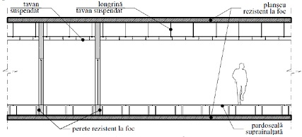

  Varianta a) - nu este plenum

  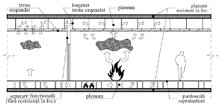

  Varianta b) - este plenum

  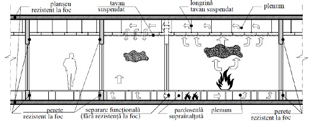

  Varianta c) - delimitare plenum cu pereți rezistenți la foc
  Figura 23 - Plenum pentru spații de tip open-space
67) Pod - volum construit fără funcțiuni, neîncălzit, cuprins între ultimul planșeu sau plafon al construcției și învelitoarea acoperișului de tip șarpantă al acesteia. Podul nu este considerat nivel.
68) Produs - material, element sau component despre care sunt cerute informații
  - 1. Produs omogen - produs constând dintr-un singur material, având densitate și compoziție uniforme în tot produsul.
  - 2. Produs neomogen - produs care nu satisface cerințele pentru un produs omogen. Este un produs realizat din unul sau mai multe componente, substanțiale și/sau nesubstanțiale.
  - 3. Produs termoizolant pentru tubulatură liniară - lungime de produs de izolare proiectată să fie montată în jurul conductelor, cu un diametru exterior maxim de izolare de 300 mm.
69) Protecție împotriva incendiului - metodă utilizată pentru a reduce propagarea și efectele incendiului.
  - 1. Protecție activă împotriva incendiului - metodă(e) utilizată(e) pentru a reduce sau preveni propagarea sau efectele incendiului, căldurii sau fumului prin detectarea și/sau stingerea incendiului și care necesită o anumită acțiune sau un răspuns pentru a deveni activă.
  - 2. Protecție pasivă împotriva incendiului - metodă utilizată pentru a reduce sau a împiedica propagarea și efectele incendiului, căldurii și fumului prin proiectarea, utilizarea, protejarea și amplasarea adecvată a produselor și elementelor de construcție și a materialelor din componența acestora și/sau prin utilizarea adecvată a materialelor și care nu necesită o detectare și/sau o activare ca urmare a unei detectări.
70) Reacție la foc - comportare a unui produs care, în condiții specificate, alimentează prin propria sa descompunere un foc la care este expus.
71) Risc de incendiu - estimare a pierderilor așteptate datorate unui incendiu, care combină pagubele potențiale asociate diferitelor scenarii de incendiu ce se pot produce și probabilitățile ca aceste scenarii să aibă loc (o definiție alternativă pentru riscul de incendiu este "combinația probabilității unui incendiu și măsura cuantificată a consecințelor sale"; riscul de incendiu este adesea calculat ca produsul dintre probabilitate și consecințe).
72) Rezistență la foc - aptitudinea unui produs/element de construcție de a răspunde funcției sau funcțiilor cerute prin criterii de performanță (și/sau capacitate portantă și/sau etanșeitate și/sau izolare termică la foc; ex: R, REI, RE, EI etc.), pe o durată de timp determinată și/sau orice altă funcție, determinată într-o încercare standardizată de rezistență la foc sau în baza modelelor de calcul din standardele SR EN 1991-1-2, SR EN 1992-1-2, SR EN 1993-1-2, SR EN 1994-1-2, SR EN 1995-1-2, SR EN 1996-1-2, precum și SR EN 1999-1-2, împreună cu amendamentele, eratele și Anexele naționale ale acestora.
73) Sală aglomerată - construcție independentă sau încăpere/grup de încăperi care comunică direct între ele prin goluri (protejate sau neprotejate) practicate în pereții care le despart și, în care se pot întruni simultan cel puțin 200 de utilizatori la nivelul/nivelurile de la care se poate face evacuarea direct la cota nivelului de referință sau 150 la alte niveluri ale construcției de la care nu se poate face evacuarea direct la cota nivelului de referință, iar aria de pardoseală ce-i revine unei persoane este mai mică sau egală cu 4 mp.
  - 1. Săli cu aglomerări de persoane - vezi "încăperi cu aglomerări de persoane"
74) Sarcină termică - energie termică care poate fi produsă prin arderea completă a tuturor materialelor și produselor combustibile dintr-o incintă, inclusiv elementele de construcție și finisajele suprafețelor construite (exprimată în MJ).
75) Scară de evacuare - circulație verticală (realizată conform reglementărilor tehnice specifice) închisă sau deschisă, corespunzător dispusă, alcătuită, conformată, dimensionată și protejată conform prevederilor normativului, astfel încât să asigure condiții corespunzătoare de evacuare în condiții de siguranță a utilizatorilor în caz de incendiu.
76) Scară cu trepte balansate - scară (realizată conform reglementărilor tehnice specifice și Figura 24) la care forma în plan a unor trepte este diferită de celelalte trepte (pe înălțimea uneia sau a mai multor rampe).

  

  Figura 24 - Scări cu trepte balansate
  ("Linia pasului - linia pe care se măsoară în proiecție orizontală lățimea treptelor "L" și care indică grafic sensul de urcare", în conformitate cu normativul specific)
  Notă Figura 24: Scările cu trepte balansate pot fi considerate căi de evacuare numai pentru o (1) unitate de trecere (flux) de evacuare a utilizatorilor, atunci când îndeplinesc condițiile de alcătuire și dimensionare prevăzute în normativ și reglementările tehnice specifice scărilor (în porțiunea de rampă în care lățimea minimă a treptei este de 18 cm, iar lățimea maximă de 40 cm).
77) Scară monumentală - scară care urmărește realizarea unui efect arhitectural deosebit, astfel alcătuită încât să asigure (dacă este cazul) și evacuarea în caz de pericol.
78) Scenariu de securitate la incendiu - document, parte a pieselor scrise ale proiectului construcției, instalației sau amenajării, care sintetizează regulile și măsurile de apărare împotriva incendiilor stabilite prin documentațiile tehnice de proiectare/execuție elaborate; măsurile adoptate prin scenariul de securitate la incendiu se reflectă în piesele desenate ale documentațiilor de proiectare/execuție; _ conform Legii 307/2006 privind apărarea contra incendiilor, cu modificările și completările ulterioare
79) Scena amenajată - spațiu de joc aferent sălilor de spectacole, cu aria minimă de 150 mp (inclusiv buzunarele și depozitele acesteia), prevăzut cu turn de scenă, cu sau fără trape în pardoseală și echipat cu dispozitive de manevrare a decorurilor.
80) Sistem de evacuare a fumului și a gazelor fierbinți - sistem de limitare a propagării incendiilor în construcții, constituit din dispozitive de evacuare a fumului și a gazelor fierbinți dispuse în acoperiș sau în treimea superioară a pereților exteriori, precum și ecrane continue verticale dispuse sub planșee sau acoperiș, având și admisii de aer amplasate la partea inferioară a spațiului respectiv.
  Sistem de evacuare a fumului și gazelor fierbinți (SHEVS) - sistem în care componentele sunt selectate în comun pentru a evacua fumul și gazele fierbinți pentru a stabili un strat plutitor de gaze calde deasupra aerului mai rece și mai curat.
  Presurizare - controlul fumului folosind diferențe de presiune între spațiul protejat și spațiul neprotejat, cu o presiune mai mare în spațiul protejat.
  Sistem diferențial de presiune (PDS) - combinație de cel puțin un kit și componente suplimentare, menite să producă diferența de presiune și fluxul de aer între spațiile protejate și neprotejate.
  Notă: SHEVS și PDS reprezintă sisteme de control al fumului și gazelor fierbinți.
81) Sisteme solare - În sensul acestui normativ, această expresie include atât instalațiile fotovoltaice, cât și instalațiile solare termice.
  Sistem fotovoltaic (PV) - Dispozitiv care convertește direct radiația solară în energie electrică, folosind celule fotovoltaice.
  Sistem integrat fotovoltaic (BIPV) - sistem integrat în fațadă sau acoperiș (parte funcțională a anvelopei clădirii) care trebuie să respecte SR EN IEC 61730-2 (reguli privind rezistența la foc și aprinderea modulelor fotovoltaice) și standardele de construcție privind securitatea la incendiu, definite în funcție de categoria de montaj a modulelor BIPV incluse în fațade conform SR EN 50583.
82) Structură flotantă - structură în care forma structurală a membranei este asigurată prin elemente presurizate cu aer, iar utilizatorii folosesc spațiul nepresurizat.
83) Structură presurizată - în care forma structurală este asigurată de presiunea aerului, iar utilizatorii folosesc spațiul presurizat.
84) Structuri anexe - construcții edificate în proximitatea corturilor pe care le deservesc funcțional, de tipul bucătării, toalete, depozite de mobilier, garderobe, rulote.
85) Supantă - planșeu parțial plin, deschis pe una sau mai multe laturi față de încăperea în care este dispus. Supantele (planșeele parțiale), care ocupă mai mult de 40% din aria încăperii în care sunt dispuse, sunt considerate niveluri și se iau în calcul la determinarea nivelului de stabilitate la incendiu al construcției.
86) Șarpantă - ansamblul structural înclinat al acoperișului unei construcții, pe care se dispun suportul învelitorii și învelitoarea sau panourile de învelitoare (Figura 25).

  

  Figura 25 - Șarpantă - elemente componente
87) Subsol - nivel construit al construcției având pardoseala situată sub nivelul terenului (carosabilului) adiacent cu mai mult de jumătate din înălțimea lui liberă. Subsolurile se includ în numărul nivelurilor subterane ale construcției.
  Notă: a se vedea definiția "demisol" și Figura 11 (demisol).
88) Tambur deschis - sistem de protecție a golurilor de circulație comune funcționale și de evacuare din pereții antifoc sau rezistenți la foc (Figura 26), folosit atunci când motivat tehnic nu pot fi utilizate ușile sau încăperile tampon. Se prevede câte un cap sprinkler la fiecare 1 mp de suprafață orizontală a tamburului.

  

  Varianta a) - amplasare integrală de o parte a peretelui de compartimentare rezistent la foc

  

  Varianta b) - amplasare intercalată, de o parte și de alta a peretelui de compartimentare rezistent la foc
  Figura 26 - Tambur deschis
89) Uși, cortine și obloane rezistente la foc - elemente mobile de protecție a golurilor (de circulație funcțională sau nu) din elementele de construcție cu rol de limitare a propagării incendiilor, alcătuite și echipate corespunzător prevederilor normativului.
90) Uși de evacuare - elemente mobile cu deschidere normală, pe balamale sau pivoți, sau uși cu deschidere pe balamale sau pivoți echipate cu sisteme de încuiere și dispozitive de ieșire care să permită deschiderea lor din interior, chiar și dacă acestea sunt încuiate cu cheia, prin simplă apăsare pe mâner, sau uși culisante automate cu "break-out" sau uși culisante automate redundante, sau uși turnante prevăzute cu posibilitatea plierii ușoare a foilor de ușă și prin aceasta se asigură lățimea liberă necesară evacuării, sau alte tipuri de uși prevăzute în normativ, utilizate pentru închiderea golurilor din pereți și destinate circulației funcționale și de evacuare a utilizatorilor.
  Nota 1: Echiparea ușilor cu dispozitive de ieșire antipanică sau dispozitive pentru ieșiri de urgență este stabilită în normativ.
  Nota 2: Pot fi considerate uși de evacuare și alte tipuri de uși, în condițiile în care sunt conformate în acord cu condițiile normate și sunt prevăzute exclusiv în scopul și condițiile prevăzute de către normativ.
  - a) Ușă de evacuare cu deschidere normală - element mobil cu deschidere normală, pe balamale sau pivoți, neechipat cu sistem de încuiere.
  - b) Ușă de evacuare echipată cu sistem de încuiere și dispozitiv de ieșire - ușă cu deschidere pe balamale sau pivoți echipată cu sistem de încuiere și dispozitiv de ieșire care să permită deschiderea acesteia din interior, chiar și dacă aceasta este încuiată cu cheia, prin simplă apăsare pe mâner, utilizată pentru închiderea golurilor din pereți și destinată circulației funcționale și de evacuare a utilizatorilor.
    - – Atunci când ușa de evacuare cu deschidere pe balamale sau pivoți este amplasată într-o zonă cu acces cu public (cu vizitatori) ușa va fi echipată cu dispozitiv de ieșire antipanică, acționat mecanic, fie printr-o bară orizontală de împingere, fie printr-o bară orizontală de apăsare, ca dispozitiv de acționare pe fața interioară și este denumită în continuare usă antipanică (SR EN1125).
    - – Atunci când ușa de evacuare cu deschidere pe balamale sau pivoți este amplasată într-o zonă fără acces cu public, ci numai cu persoane care cunosc atât tipologia clădirii (fără vizitatori) cât și funcțiile ușii de evacuare, ușa va fi echipată cu dispozitiv pentru ieșiri de urgență acționat mecanic fie printr-un mâner tip clanță (care respectă cerințele SR EN 179) fie printr-o placă de împingere pe fața interioară și este denumită în continuare ușă de ieșire de urgență (SR EN 179).
  - c) Ușă de evacuare culisantă automată cu "break-out" - ușă culisantă acționată de un sistem complet de automatizare care pe lângă mișcarea de culisare pentru deschidere automată prin senzor de prezență are și posibilitatea de a se deschide pivotant prin împingerea canatelor de către fluxul de persoane și plierea acestora (a canatelor) înspre sensul de evacuare.
  - d) Ușa de evacuare culisantă automată redundantă: ușă acționată de un sistem complet de automatizare în care pentru fiecare echipament component esențial (motor, procesor, detector de mișcare, acumulator) există constituită o rezervă care garantează ca în cazul unei pene de curent, defect sau incendiu, ușa culisantă se va deschide automat în siguranță fără să fie necesară acționarea mecanică.
  - e) Ușa de evacuare turnantă: ușă prevăzută cu posibilitatea plierii foilor de ușă, prin pliere se asigură numărul de fluxuri.
91) Utilizatori - persoane și animale care folosesc construcția.
92) Volum - produsul dintre arie și înălțime
  - 1. Volumul nivelului (V_niv) - Volumul obținut din produsul dintre aria nivelului și înălțimea lui, determinat conform STAS 4908 - Clădiri civile, industriale și agrozootehnice. Arii și volume convenționale. Volumul de aer din încăpere se raportează la fețele interioare, reprezentând volumul obținut din produsul dintre aria încăperii și înălțimea acesteia.
  - 2. Volumul total (Vt) - Suma volumelor nivelurilor, conform STAS 4908 - Clădiri civile, industriale și agrozootehnice. Arii și volume convenționale, raportat la contururile exterioare ale construcției.
