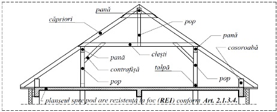
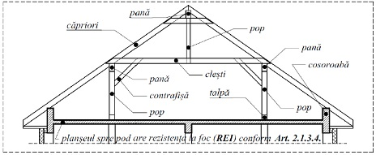
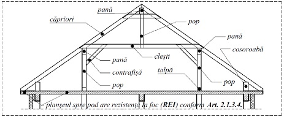
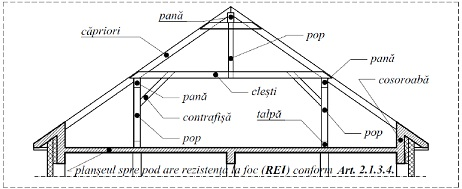
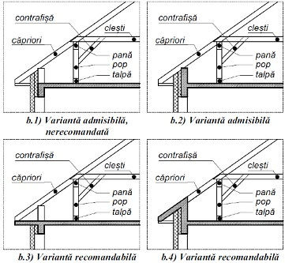

# Art. 2.1.3.4
La determinarea nivelului de stabilitate la incendiu al construcției sau al compartimentului de incendiu, nu se iau în considerare următoarele:
a) șarpanta și suportul învelitorii construcțiilor cu pod (Figura 27):
  - – pentru nivelul I de stabilitate la incendiu, dacă planșeul spre pod are rezistența la foc REI 90 și nu este suspendat de șarpanta acoperișului, iar golurile din planșeul spre pod sunt protejate cu elemente de închidere rezistente la foc minimum EI 90, normal închise;
  - – pentru nivelul II de stabilitate la incendiu, dacă planșeul spre pod are rezistența la foc REI 60 și nu este suspendat de șarpanta acoperișului, iar golurile din planșeul spre pod sunt protejate cu elemente de închidere rezistente la foc minimum EI 60, normal închise;
  - – pentru nivelul III de stabilitate la incendiu, dacă planșeul spre pod are rezistența la foc REI 45 și nu este suspendat de șarpanta acoperișului, iar golurile din planșeul spre pod sunt protejate cu elemente de închidere rezistente la foc minimum EI 45, normal închise;
  - – pentru nivelul IV de stabilitate la incendiu la care elementele componente ale structurii (stâlpi, grinzi, pereți structurali) au rezistența la foc de 30 minute, dacă planșeul spre pod are rezistența la foc REI 30 și nu este suspendat de șarpanta acoperișului, iar golurile din planșeul spre pod sunt protejate cu elemente de închidere rezistente la foc minimum EI 30, normal închise;
  - – pentru nivelul V de stabilitate la incendiu (pentru situațiile prevăzute la Nota c) de la Tabelul 42 (Condiții de corelare între destinație, capacitatea maximă simultană și numărul de niveluri supraterane ale clădirilor civile, cu nivel de stabilitate la incendiu III, IV sau V), pentru nivelul de stabilitate la incendiu V), dacă planșeul spre pod are rezistența la foc REI 15 și nu este suspendat de șarpanta acoperișului, iar golurile din planșeul spre pod sunt protejate cu elemente de închidere rezistente la foc minimum EI 15, normal închise.

  

  - a.1) Variantă admisibilă nerecomandată, necesar a fi justificată tehnic privind propagarea incendiului la șarpantă

  

  - a.2) Variantă admisibilă, necesar a fi justificată tehnic privind propagarea incendiului la șarpantă

  

  - a.3) Variantă recomandată

  

  - a.4) Variantă recomandată
  - a) delimitarea șarpantei acoperișului cu pod (exemple)

  

  - b) detalii de delimitare a șarpantei acoperișului cu pod (exemple)
  Figura 27 - Șarpanta acoperișului cu pod - delimitare minimală prin planșeu rezistent la foc
  Note Figura 27:
  - (a) În condițiile în care nu sunt îndeplinite măsurile de mai sus, șarpanta acoperișului cu pod va îndeplini cerințele prevăzute în Tabelul 2 nr. crt. 9 și Tabelul 3 nr. crt. 9, corespunzătoare nivelului de stabilitate la incendiu. La clădirile înalte și foarte înalte, acoperișurile cu pod vor fi realizate integral din materiale A1, iar la clădirile cu săli aglomerate se va prevedea conform Art. 2.1.3.3. alin. (2).
  - (b) Exemple streașină înfundată. Respectând aceleași principii de delimitare minimală prin planșeu rezistent la foc (conform Art. 2.1.3.4., în funcție de încadrarea construcției în nivel de stabilitate la incendiu), se pot alege și soluții arhitecturale cu streașină semiînfundată sau neînfundată.
b) învelitorile acoperișurilor de orice fel, cu excepția panourilor de învelitoare precizate la Tabelul 2 nr. crt. 10. și Tabelul 3 nr. crt. 10, precum și termoizolațiile și hidroizolațiile montate deasupra unui suport continuu rezistent la foc conform Tabelul 2 nr. crt. 3 și nr. crt. 4 și Tabelul 3 nr. crt. 3 și nr. crt. 4;
c) luminatoarele dispuse pe acoperiș, a căror arie însumată (în proiecție orizontală) este mai mică de 25% din aria spațiului în care sunt dispuse, dar nu mai mult de 25 mp, indiferent de clasa lor de reacție la foc;
d) luminatoarele atriumurilor (indiferent de aria lor) sau luminatoarele dispuse în acoperiș cu aria mai mare de 25% din aria spațiului în care sunt amplasate, atunci când sunt realizate cu structuri din profile având clasa de reacție la foc A1 sau A2-s1,d0, cu excepția componentelor nesubstanțiale, a izolatorilor și garniturilor, prevăzute cu panouri de umplere din elemente de vitraj/sticlă simplu sau izolant sau din produse clasa de reacție la foc A1 sau A2-s1,d0;
e) contravântuirile structurilor, platformele și elementele metalice necesare funcțional sau tehnologic, care nu sunt luate în calcul la rezistența și stabilitatea construcției în caz de incendiu;
f) elementele constructive ale marchizelor, windfangurilor, verandelor, pridvoarelor, cerdacurilor și serelor;
g) componentele nesubstanțiale, garniturile, izolatorii, elementele de vitraj simplu sau izolant (realizate din sticlă) ale ușilor și ferestrelor exterioare, inclusiv cele inserate în pereții cortină;
h) ușile și ferestrele exterioare, inclusiv cele inserate în pereții cortină.
i) parapetele, panourile și pereții interiori despărțitori funcționali având clasa de reacție la foc A1 sau A2-s1,d0 din cadrul unor grupări de spații de tip open space, cu suprafața maxim normată;
j) parapetele și/sau panourile din materiale combustibile dacă înălțimea însumată a panourilor pline combustibile este de cel mult 1,20 m din cadrul unor grupări de spații de tip open space, cu suprafața maxim normată. Parapetele și/sau panourile din materiale combustibile de cel mult 1,20 m trebuie să îndeplinească și următoarele condiții:
  - – minimum clasa de reacție la foc D-s2,d0 sau a căror finisaje îndeplinesc criteriile de performanță la foc minim K2 10 (la niv. IV și/sau V de stabilitate la incendiu);
  - – minimum clasa de reacție la foc C-s2,d0 sau a căror finisaje îndeplinesc criteriile de performanță la foc minim K2 30 (la niv. III de stabilitate la incendiu);
  - – minimum clasa de reacție la foc B-s1,d0 sau a căror finisaje îndeplinesc criteriile de performanță la foc minim K2 60 (la niv. II de stabilitate la incendiu);
  - – nu se admit (la niv. I de stabilitate la incendiu).
