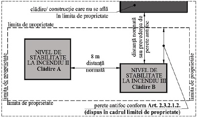
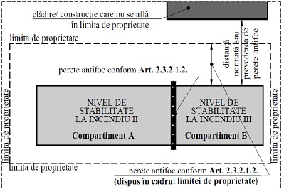
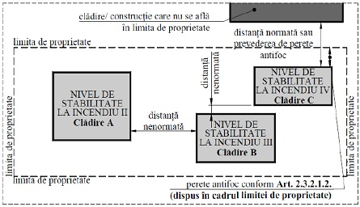

# Art. 2.2.1.1
(1) Construcțiile supraterane civile, de producție și/sau depozitare sau mixte, pot fi:
  - a) amplasate independent la distanțele normate față de vecinătăți (Figura 28);
  - b) delimitate cu pereți rezistenți la foc de separare a compartimentelor de incendiu (pereți antifoc) și, după caz, planșee rezistente la foc de separare a compartimentelor de incendiu (planșee antifoc) (Figura 29);
  - c) amplasate comasat, în limita ariei construite maxim admisă de normativ (Figura 30).
(2) Distanțele dintre construcțiile care se comasează nu sunt normate, dar prin însumarea ariilor construite ale clădirilor respective (Ac) trebuie respectate valorile maximum admise pentru compartimentele de incendiu, în funcție de destinația și nivelul cel mai defavorabil de stabilitate la incendiu asigurat (de ex, între nivel II de stabilitate la incendiu și nivel IV de stabilitate la incendiu, se alege nivel IV de stabilitate la incendiu), de riscul de incendiu cel mai mare și numărul de niveluri cel mai mare normat. Compartimentele de incendiu rezultate din comasarea construcțiilor vor avea nivelul de stabilitate la incendiu determinat de clădirea cu cel mai defavorabil nivel, riscul de incendiu cel mai mare și numărul de niveluri normat.
(3) Comasarea construcțiilor se poate realiza numai în cadrul limitei de proprietate, cu excepția clădirilor de locuit reprezentând unități individuale cu regim normal de înălțime (maximum S+P+2+M), care se pot comasa și în afara limitei de proprietate. Astfel, clădirile de locuit reprezentând unități individuale cu regim normal de înălțime (maximum S+P+2+M) se amplasează fără normarea distanțelor între ele în interiorul cvartalurilor noi de construcții civile reprezentând unități individuale pentru care există rețele de hidranți exteriori dimensionate pentru cea mai defavorabilă situație, prevăzându-se măsuri compensatorii care vizează limitarea propagării incendiilor de la o construcție la alta, în limita maxim admisă pentru un compartiment de incendiu (nivelul de stabilitate la incendiu al construcției sau al compartimentului de incendiu, este determinat de elementul său, sau de construcția comasată cu cea mai defavorabilă încadrare în valorile normate). Ariile maxim admise pentru un compartiment de incendiu nu pot fi mărite pe proprie răspundere.
(4) Construcțiile destinate persoanelor care nu se pot evacua singure (definite conform terminologie), precum și cele pentru obiecte, echipamente sau aparatură de importanță deosebită, clădirile civile supraterane înalte și/sau foarte înalte sau cu săli aglomerate, nu se comasează cu alte construcții.
(5) În cazul delimitării cu pereți rezistenți la foc de separare a compartimentelor de incendiu (pereți antifoc) și, după caz, planșee rezistente la foc de separare a compartimentelor de incendiu (planșee antifoc) compartimentarea față de construcțiile prevăzute la alin. (3) se poate realiza în limitele compartimentelor de incendiu stabilite pentru fiecare tip sau funcțiune distincte, potrivit prevederilor normativului.
(6) Pentru construcțiile prevăzute la alin. (3) se asigură separarea tipurilor și/sau a funcțiunilor diferite din compartimente diferite cu elemente de construcție antifoc verticale și orizontale cu rezistențe la foc determinate în funcție de densitatea sarcinii termice (q) din spațiile adiacente, dar nu mai puțin de REI 180 sau EI-M 180 pentru pereți și minimum REI 120 pentru planșee și protecții ale golurilor conform prevederilor normativului, asigurându-se pentru fiecare compartiment de incendiu distinct căi de acces și de evacuare pentru utilizatori, precum și căi de acces carosabile, corespunzător dimensionate pentru circulația și amplasarea autospecialelor pentru intervenție de stingere și salvare în caz de incendiu, cel puțin pe două laturi, cu posibilitate de acces în clădire de pe fațadă.
(6) Funcțiunile înglobate (comasate) într-o clădire se constituie într-o clădire cu funcțiuni mixte.

  

  Figura 28 - Amplasare independentă a construcțiilor (la distanțe normate)

  

  Figura 29 - Amplasare compartimentată

  

  Figura 30 - Amplasare comasată a construcțiilor în limita ariilor
  compartimentelor de incendiu normate
  (Ac compartiment de incendiu = suma Ac construcții comasate)
