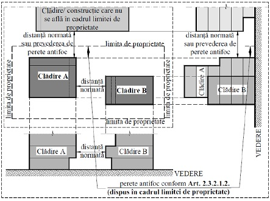

# Art. 2.2.2.4
(1) Activitățile diferite din construcție și din compartimentele de incendiu se separă cu pereți (EI/REI) și planșee (REI), cu rezistența la foc corespunzătoare riscurilor de incendiu și a densității sarcinii termice (q) din încăperile adiacente, potrivit prevederilor normativului și a celor stabilite la Tabelul 5 și Tabelul 6. Pereții și planșeele rezistente la foc cu rol de separare a compartimentelor de incendiu vor îndeplini cerințele prevăzute în normativ.
(2) Atunci când nu întrunesc distanțele minime de siguranță normate între construcții independente care nu sunt comasate și a căror delimitare antifoc trebuie realizată spre fațade prevăzute cu pereți cortină, prin excepție de la prevederile Art. 2.3.2.1.2 lit. d), se admit în cadrul limitei de proprietate elemente de construcție verticale de separare a compartimentelor de incendiu realizate din pereți cortină cu rezistențe la foc minimum EI 120 (o<-> i), în condițiile în care cel puțin una dintre cele două construcții independente este echipată integral cu instalații de stingere a incendiului cu sprinklere, conform prevederilor normativului P118:2/2013 (Figura 31). Nu se admit spații cu densitate de sarcină termică mai mare 630 MJ/mp sau spații cu risc foarte mare de incendiu și explozie volumetrică spre peretele antifoc constituit din perete cortină EI 120 (o <-> i).

  

  Figura 31 - Distanțe minime de siguranță între construcții independente
