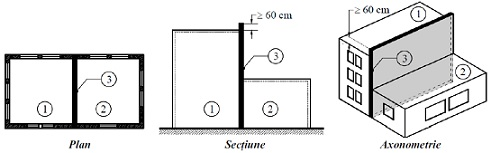
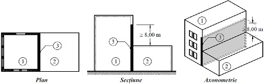
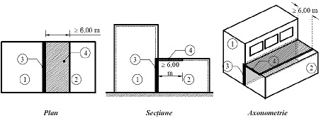
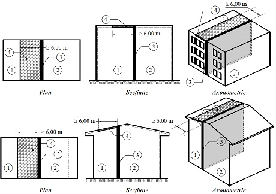
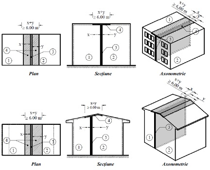
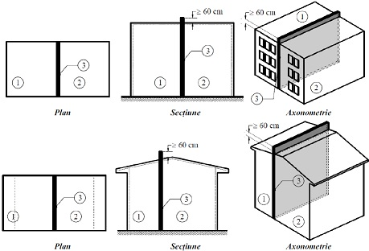
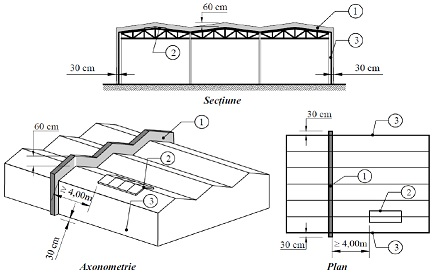
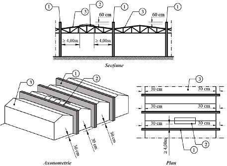

# Art. 2.3.2.1.7
Pe acoperișuri tip terasă sau șarpantă, pe distanța de cel puțin 4,00 m de o parte și de alta a peretelui rezistent la foc care delimitează compartimente de incendiu, luminatoarele trebuie să fie fixe, cu rezistența la foc minimum 30 de minute în funcție de unghiul de înclinare al acestora.

Legendă Figura 32:1 - compartiment 1 de incendiu; 2 - compartiment 2 de incendiu; 3 - perete antifoc conform Art. 2.3.2.1.2.
Figura 32 - Perete rezistent la foc de separare a compartimentelor
de incendiu (perete antifoc A1 sau A2-s1,d0 conform Art. 2.3.2.1.2.)
care secționează construcția pe toată înălțimea acesteia

Legendă Figura 33:1 - compartiment 1 de incendiu; 2 - compartiment 2 de incendiu; 3 - perete antifoc conform Art. 2.3.2.1.2.
Figura 33 - Separare compartimente de incendiu la construcții
cu înălțimi diferite - separare la clădirea mai înaltă

Legendă Figura 34:1 - compartiment 1 de incendiu; 2 - compartiment 2 de incendiu; 3 - perete antifoc conform Art. 2.3.2.1.2.; 4 - planșeu rezistent (fâșie rezistentă) la foc min. REI 60
Figura 34 - Separare compartimente de incendiu la construcții cu
înălțimi diferite - separare la clădirea cu înălțime mai mică

Varianta a) Separare compartimente de incendiu cu înălțimi egale cu fâșia REI 60 amplasată integral de o parte sau de alta a peretelui antifoc

Varianta b) Separare compartimente de incendiu cu înălțimi egale cu fâșia REI 60 amplasată intercalat, de o parte și alta a peretelui antifoc
Legendă Figura 35:1 - compartiment 1 de incendiu; 2 - compartiment 2 de incendiu; 3 - perete antifoc conform Art. 2.3.2.1.2.; 4 - fâșie rezistentă la foc min. REI 60
Figura 35 - Separare compartimente de incendiu cu înălțimi egale cu fâșie REI 60

Legendă Figura 36:1 - compartiment 1 de incendiu; 2 - compartiment 2 de incendiu; 3 - perete antifoc conform Art. 2.3.2.1.2.
Figura 36 - Separare compartimente de incendiu cu înălțimi egale
prin depășirea acoperișului cu minimum 60 cm (a peretelui antifoc)
Notă Figura 36: Separare compartimente de incendiu cu înălțimi egale prin depășire cu minimum 60 cm (măsurat pe verticală) a peretelui antifoc, față de orice astfel de element combustibil al acoperișurilor.

Varianta a) perete antifoc transversal

Varianta b) perete antifoc longitudinal
Legendă Figura 37: 1 - perete rezistent la foc de separare a compartimentelor de incendiu (antifoc) conform Art. 2.3.2.1.2,; 2 - luminator dispus la distanța de min. 4 m (nu este realizat din produse clasa de reacție la foc A1 sau A2-s1,d0); 3 - acoperiș combustibil (nu este realizat din produse clasa de reacție la foc A1 sau A2-s1,d0).
Figura 37 - Depășirea planurilor exterioare ale acoperișurilor și pereților combustibili
