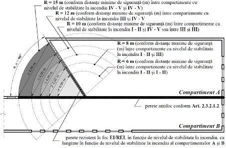
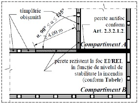
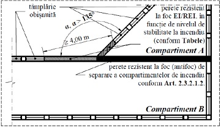

# Art. 2.3.2.1.9
(1) În cazul în care pereții de compartimentare sunt amplasați la colțurile întrânde ale clădirilor civile în formă de L, T sau U sub un unghi α, α < 90° (Figura 38), golurile din pereții exteriori adiacenți se dispun astfel încât distanța dintre ele să fie de cel puțin 4 m, în funcție de nivelul de stabilitate la incendiu al compartimentelor pe care le desparte (se calculează radial, conform Figura 38). Este obligatoriu ca pe lungimile generate în funcție de nivelul de stabilitate la incendiu al compartimentelor pe care le desparte, pe distanța mai mică sau egală de 4 m calculată echidistant dintre acestea, pereții exteriori de pe toate laturile exterioare din această porțiune, precum și golurile funcționale din aceasta, trebuie protejate cu elemente rezistente la foc conform Tabelul 7 și Tabelul 8. În toate cazurile în care unghiul α < 90°, se prevede rezistența la foc a pereților exteriori de pe toate laturile exterioare din această porțiune conform Tabelul 7 și Tabelul 8 pe o lungime de minimum 4 m în fiecare parte (de la inflexiune).
  Tabelul 7: Rezistența la foc a pereților din exterior și ale elementelor de închidere rezistente la foc ale golurilor funcționale prevăzute în pereții din exterior amplasate la colțurile întrânde ale construcțiilor civile (cu regim parter, cu excepția clădirilor cu persoane care nu se pot evacua singure și clădirilor cu săli aglomerate) în formă de L, T sau U sub un unghi α, α < 90°, unde golurile din pereții exteriori adiacenți sunt dispuse astfel încât distanța dintre ele este mai mică de 4 m

| În cazul pereților antifoc care separă compartimentele de incendiu | Densitatea sarcinii termice (q) din încăperi perimetrale (pe o distanță mai mică de 4 m)/ construcție (MJ/mp) | Rezistența la foc (EI/REI) minimă a pereților din exterior - pe o distanță de minimum 4 m | Elementul de închidere rezistent la foc*2) |
|---|---|---|---|
| 1 | 2 | 3 | 4 |
| Pentru construcțiile cu regim de înălțime parter*1) | pentru q ≤ 420 MJ/mp | EI 45/ REI45 (EI 30/REI 30 *) | EI 30 (EI 15*) |
| Pentru construcțiile cu regim de înălțime parter*1) | 420 MJ/mp < q ≤ 630 MJ/mp | EI 60/ REI 60 (EI 45/ REI 45 *) | EI 45 (EI 30*) |
| Pentru construcțiile cu regim de înălțime parter*1) | 630 MJ/mp < q ≤ 840 MJ/mp | EI 90/ REI 90 (EI 60/REI 60 *) | EI 60 (EI 45*) |
| Pentru construcțiile cu regim de înălțime parter*1) | 840 MJ/mp < q ≤ 1.680 MJ/mp | EI 120/ REI 120 (EI 90/REI 90 *) | EI 90 (EI 60*) |
| Pentru construcțiile cu regim de înălțime parter*1) | q > 1.680 MJ/mp și/sau există pericol de explozie volumetrică) | EI 180/ REI 180 (EI 120/ REI 120 *) | EI 120 (EI 90*) |

  Observații Tabelul 7:
  *1) - Se referă la "Pereți antifoc pentru construcțiile cu regim de înălțime parter" așa cum sunt definiți la Art. 2.3.2.1.2. lit. a);
  *2) - Se referă la "Elemente de închidere rezistente la foc (uși, ferestre) prevăzute cu autoînchidere "C" sau fixe, dacă distanța dintre deschideri este mai mică de 4 m".
  Note Tabelul 7:
  - (a) Pentru clădiri închise se aplică specificația EW sau EI la elemente de închidere rezistente la foc (uși, ferestre), în funcție de apropierea dintre deschideri (dacă este mai mică de 1 m obligatoriu se aplică performanța la foc EI). Pentru clădiri deschise se poate aplica specificația E la elemente de închidere rezistente la foc (uși, ferestre).
  - (b) Pentru construcțiile încadrate în nivelul de stabilitate I, II și/sau III, clasa de reacție la foc a pereților (din exterior) definiți în tabel, este A1 sau A2-s1,d0. Pentru construcțiile încadrate în nivelul de stabilitate I, II și/sau III, clasa de reacție la foc a elementelor de închidere rezistente la foc definite în tabel, este A1 sau A2-s1,d0, cu excepția componetelor nesubstanțiale, garniturilor, izolatorilor, elementelor de vitraj (din sticlă) simplu sau izolant (realizate din sticlă) ale ușilor și ferestrelor (exterioare), inclusiv cele inserate în pereții cortină.
  - (c) Rezistența la foc a tuturor elementelor definite în coloanele 3 și 4 din tabel este în minute.
  - (d) * - Valorile din paranteze se aplică în cazurile în care încăperile sunt echipate cu instalații automate de stingere a incendiilor (conform prevederilor normativului P118:2/2013, cu excepțiile prevăzute ale spațiilor care se dotează cu alte instalații automate de stingere.
  Tabelul 8: Rezistența la foc a pereților din exterior și ale elementelor de închidere rezistente la foc ale golurilor funcționale prevăzute în pereții din exterior amplasate la colțurile întrânde ale construcțiilor civile [cu excepția clădirilor prevăzute la Art. 2.3.2.1.2. lit. a)] în formă de L, T sau U sub un unghi unghi α, α < 90°, unde golurile din pereții exteriori adiacenți sunt dispuse astfel încât distanța dintre ele este mai mică de 4 m

| Nivel de stabilitate la incendiu | α < 90° | α < 90° | α < 90° | α < 90° | α < 90° | α < 90° |
|---|---|---|---|---|---|---|
| Nivel de stabilitate la incendiu | În cazul pereților antifoc min EI-M 240/ REI240*1) | În cazul pereților antifoc min EI-M 240/ REI240*1) | În cazul pereților antifoc min EI-M 180/ REI 180*2) | În cazul pereților antifoc min EI-M 180/ REI 180*2) | În cazul pereților antifoc min EI-M 120/REI 120*3) | În cazul pereților antifoc min EI-M 120/REI 120*3) |
| Nivel de stabilitate la incendiu | Rezistența la foc (EI/REI) a pereților din exterior*4) | Elemente de închidere rezistente la foc*5) | Rezistența la foc (EI/REI) a pereților din exterior*4) | Elemente de închidere rezistente la foc*5) | Rezistența la foc (EI/REI) a pereților din exterior*4) | Elemente de închidere rezistente la foc*5) |
| 1 | 2 | 3 | 4 | 5 | 6 | 7 |
| V | EI/REI 30 | EI 15 | EI/REI 15 | EI 15 | EI/REI 15 | EI 15 |
| IV | EI/REI 45 (EI/REI 30*) | EI 30 | EI/REI 30 | EI 15 | EI/REI 30 | EI 15 |
| III | EI/REI 60 (EI/REI 45*) | EI 45 (EI 30*) | EI/REI 45 (EI/REI 30*) | EI 30 (EI 15*) | EI/REI 45 (EI/REI 30*) | EI30 (EI 15*) |
| II | EI/REI 90 (EI/REI 60*) | EI 60 (EI 45*) | EI/REI 60 (EI/REI 45*) | EI 45 (EI 30*) | EI/REI 60 (EI/REI 45*) | EI 45 (EI 30*) |
| I h ≤ 28m | EI/REI 90 (EI/REI 60*) | EI 60 (EI 45*) | EI/REI 60 (EI/REI 45*) | EI 45 (EI 30*) | EI/REI 60 (EI/REI 45*) | EI 45 (EI 30*) |
| I 28m < h < 45m | EI/REI 120 (EI/REI 90*) | EI 90 (EI 60*) | EI/REI 90 (EI/REI 60*) | EI 60 (EI 45*) | - | - |
| I 45m ≤ h < 75m | EI/REI 180 (EI/REI 120*) | EI 120 (EI 90*) | EI/REI 120 (EI/REI 90*) | EI 90 (EI 60*) |  |  |
| I 75m ≤ h < 125m | - - | - - | EI/REI 180 (EI/REI 120*) | EI 120 (EI 90*) | - | - |
| I h ≥ 125m | - | - | - | - | - | - |

  Observații Tabelul 8:
  *1) - Se referă la "Pereți antifoc minimum EI-M 240/REI 240 pentru construcțiile cu risc foarte mare de incendiu (atunci când densitatea sarcinii termice (q) este mai mare de 1.680 MJ/m2 și/sau există pericol de explozie volumetrică)" așa cum sunt definiți la Art. 2.3.2.1.2. lit. b);
  *2) - Se referă la "Pereți antifoc minimum EI-M 180/REI 180 pentru clădirile destinate persoanelor care nu se pot evacua singure (definite conform terminologie), pentru construcțiile cu risc mare de incendiu, precum și cele pentru obiecte, echipamente sau aparatură de importanță deosebită, pentru clădiri civile supraterane înalte și/sau foarte înalte sau clădiri cu săli aglomerate" așa cum sunt definiți la Art. 2.3.2.1.2. lit. c);
  *3) - Se referă la "Pereți antifoc minimum EI-M 120/REI120" așa cum sunt definiți la Art. 2.3.2.1.2. lit. d);
  *4) - Se referă la "Rezistența la foc (EI/REI) a pereților din exterior, pe o distanță de minimum 4 m";
  *5) - Se referă la "Elemente de închidere rezistente la foc (uși, ferestre) prevăzute cu autoînchidere "C" sau fixe, dacă distanța dintre deschideri este mai mică de 4 m";
  "h" - Cota ultimului planșeu accesibil/folosibil al construcției, față de nivelul de referință.
  Note Tabelul 8:
  - (a) Pentru construcțiile încadrate în nivelul de stabilitate I, II și/sau III, clasa de reacție la foc a pereților (din exterior) definiți în coloanele 2, 4 și 6 din tabel, este A1 sau A2-s1,d0. Pentru construcțiile încadrate în nivelul de stabilitate I, II și/sau III, clasa de reacție la foc a elementelor de închidere rezistente la foc definite în coloanele 3, 5 și 7 din tabel, este A1 sau A2-s1,d0, cu excepția componetelor nesubstanțiale, garniturilor, izolatorilor, elementelor de vitraj (din sticlă) simplu sau izolant (realizate din sticlă) ale ușilor și ferestrelor (exterioare), inclusiv cele inserate în pereții cortină.
  - (b) Pentru clădiri închise, se aplică specificația EW sau EI la elemente de închidere rezistente la foc (uși, ferestre), în funcție de apropierea dintre deschideri (dacă este mai mică de 1 m obligatoriu se aplică performanța la foc EI). Pentru clădiri deschise se poate aplica specificația E la elemente de închidere rezistente la foc (uși, ferestre).
  - (c) Rezistența la foc a tuturor elementelor definite în coloanele 2, 3, 4, 5, 6 și 7 din tabel este în minute.

  

  Figura 38 - Perete rezistent la foc (în continuarea pereților antifoc
  conform Art. 2.3.2.1.2) dispus la exterior, la colțurile întrânde ale
  clădirilor civile în formă de L, T sau U sub un unghi α, α < 90°
(2) În cazul în care pereții antifoc sunt amplasați la colțurile întrânde ale clădirilor civile în formă de L, T sau U sub un unghi α, 90° ≤ α ≤ 135° (Figura 39), golurile din pereții exteriori adiacenți se dispun astfel încât distanța dintre ele să fie de cel puțin patru 4 m și trebuie îndeplinită doar performanța privind rezistența la foc a peretelui exterior sau pereților exteriori pe distanța de 4 m. Atunci când se prevăd goluri funcționale în această porțiune, pereții exteriori precum și golurile funcționale din această porțiune trebuie protejate cu elemente rezistente la foc conform Tabelul 9 sau Tabelul 10.
  Tabelul 9: Rezistența la foc a pereților din exterior și ale elementelor de închidere rezistente la foc ale golurilor funcționale prevăzute în pereții din exterior amplasate la colțurile întrânde ale construcțiilor civile (cu regim parter, cu excepția clădirilor cu persoane care nu se pot evacua singure și clădirilor cu săli aglomerate) în formă de L, T sau U sub un unghi α, 90° ≤ α < 135°, unde golurile din pereții exteriori adiacenți sunt dispuse astfel încât distanța dintre ele este mai mică de 4 m

| În cazul pereților antifoc care separă compartimentele de incendiu | Densitatea sarcinii termice(q) din încăperi perimetrale (pe o distanță mai mică de 4 m)/ construcție (MJ/mp) | Rezistența la foc (EI/REI) minimă a pereților din exterior - pe o distanță de minimum 4 m | Elemente de închidere rezistente la . foc*2) |
|---|---|---|---|
| 1 | 2 | 3 | 4 |
| Pentru construcțiile cu regim de înălțime parter*1) | pentru q ≤ 420 MJ/mp | EI 30/ REI30 (EI 15/ REI 15 *) | EI 15 (fixe) |
| Pentru construcțiile cu regim de înălțime parter*1) | 420 MJ/mp < q 630 ≤ MJ/mp | EI 45/ REI 45 (EI 30/REI 30 *) | EI 30 (EI 15*) |
| Pentru construcțiile cu regim de înălțime parter*1) | 630 MJ/mp < q ≤ 840 MJ/mp | EI 60/REI 60 (EI 45/ REI 45 *) | EI 45 (EI 30*) |
| Pentru construcțiile cu regim de înălțime parter*1) | 840 MJ/mp < q ≤ 1 680 MJ/mp | EI 90/REI 90 (EI 60/REI 60 *) | EI 60 (EI 45*) |
| Pentru construcțiile cu regim de înălțime parter*1) | q > 1.680 MJ/mp și/sau există pericol de explozie volumetrică) | EI 120/ REI 120 (EI 90/REI 90 *) | EI 90 (EI 60*) |

  Observații Tabelul 9:
  *1) - Se referă la "Pereți antifoc pentru construcțiile cu regim de înălțime parter " așa cum sunt definiți la Art. 2.3.2.1.2. lit. a);
  *2) - Se referă la "Elemente de închidere rezistente la foc (uși, ferestre) prevăzute cu autoînchidere "C" sau fixe, dacă distanța dintre deschideri este mai mică de 4 m".
  Note Tabelul 9:
  - (a) Pentru clădiri închise, se aplică specificația EW sau EI la elemente de închidere rezistente la foc (uși, ferestre), în funcție de apropierea dintre deschideri (dacă este mai mică de 1 m obligatoriu se aplică performanța la foc EI). Pentru clădiri deschise se poate aplica specificația E la elemente de închidere rezistente la foc (uși, ferestre).
  - (b) Pentru construcțiile încadrate în nivelul de stabilitate I, II și/sau III, clasa de reacție la foc a pereților (din exterior) definiți în tabel, este A1 sau A2-s1,d0. Pentru construcțiile încadrate în nivelul de stabilitate I, II și/sau III, clasa de reacție la foc a elementelor de închidere rezistente la foc definite în tabel, este A1 sau A2-s1,d0, cu excepția componetelor nesubstanțiale, garniturilor, izolatorilor, elementelor de vitraj (din sticlă) simplu sau izolant (realizate din sticlă) ale ușilor și ferestrelor (exterioare), inclusiv cele inserate în pereții cortină.
  - (c) Rezistența la foc a tuturor elementelor definite în coloanele 3 și 4 din tabel este în minute.
  - (d) * - Valorile din paranteze se aplică în cazurile în care încăperile sunt echipate cu instalații automate de stingere a incendiilor (conform prevederilor normativului P118:2/2013, cu excepțiile prevăzute ale spațiilor care se dotează cu alte instalații automate de stingere).
  Tabelul 10: Rezistența la foc a pereților din exterior și ale elementelor de închidere rezistente la foc ale golurilor funcționale prevăzute în pereții din exterior amplasate la colțurile întrânde ale construcțiilor civile (cu excepția clădirilor prevăzute la Art. 2.3.2.1.2. lit. a)) în formă de L, T sau U sub un unghi α, 90° ≤ α ≤ 135°, unde golurile din pereții exteriori adiacenți sunt dispuse astfel încât distanța dintre ele este mai mică de 4 m

| Nivel de stabilitate la incendiu | 90° ≤ α ≤ 135° | 90° ≤ α ≤ 135° | 90° ≤ α ≤ 135° | 90° ≤ α ≤ 135° | 90° ≤ α ≤ 135° | 90° ≤ α ≤ 135° |
|---|---|---|---|---|---|---|
| Nivel de stabilitate la incendiu | În cazul pereților antifoc min EI-M 240/ REI 240*1) | În cazul pereților antifoc min EI-M 240/ REI 240*1) | În cazul pereților antifoc min EI-M 180/ REI 180*2) | În cazul pereților antifoc min EI-M 180/ REI 180*2) | În cazul pereților antifoc min EI-M 120/ REI 120*3) | În cazul pereților antifoc min EI-M 120/ REI 120*3) |
| Nivel de stabilitate la incendiu | Rezistența la foc (EI/REI) a pereților din exterior*4) | Elemente de închidere rezistente la foc*5) | Rezistența la foc (EI/REI) a pereților din exterior*4) | Elemente de închidere rezistente la foc*5) | Rezistența la foc (EI/REI) a pereților din exterior*4) | Elemente de închidere rezistente la foc*5) |
| 1 | 2 | 3 | 4 | 5 | 6 | 7 |
| V | EI/REI 15 | fixe | EI/REI 15 | fixe | EI/REI 15 | fixe |
| IV | EI/REI 30 | EI 15 | EI/REI 15 | EI 15 | EI/REI 15 | EI 15 |
| III | EI/REI 45 (EI/REI 30*) | EI 30 | EI/REI 30 (EI/REI 30*) | EI 15 | EI/REI 30 (EI/REI 15*) | EI 15 (EI 15*) |
| II | EI/REI 60 (EI/REI 45*) | EI 45 (EI 30*) | EI/REI 45 (EI/REI 30*) | EI 30 (EI 15*) | EI/REI 45 (EI/REI 30*) | EI 30 (EI 15*) |
| I h ≤ 28m | EI/REI 60 (EI/REI 45*) | EI 45 (EI 30*) | EI/REI 45 (EI/REI 30*) | EI 30 (EI 15*) | EI/REI 45 (EI/REI 30*) | EI 30 (EI 15*) |
| I 28m < h < 45m | EI/REI90 (EI/REI60*) | EI 60 (EI 45*) | EI/REI 60 (EI/REI 45*) | EI 45 (EI 30*) | - | - |
| I 45m ≤ h < 75m | EI/REI 120 (EI/REI 90*) | EI 90 (EI 60*) | EI/REI 90 (EI/REI 60*) | EI 60 (EI 45*) | - | - |
| I 75m ≤ h < 125m | - | - | EI/REI 120 (EI/REI 90*) | EI 90 (EI 60*) | - | - |
| I h ≥ 125m | - | - | EI/REI 180 (EI/REI 120*) | EI 120 (EI 90*) | - | - |

  Observații Tabelul 10:
  *1) - Se referă la "Pereți antifoc minimum EI-M 240/ REI 240 pentru construcțiile cu risc foarte mare de incendiu (atunci când densitatea sarcinii termice (q) este mai mare de 1.680 MJ/mp și/sau există pericol de explozie volumetrică)" așa cum sunt definiți la Art. 2.3.2.1.2. lit. b).
  *2) - Se referă la "Pereți antifoc minimum EI-M 180/REI 180 pentru clădirile destinate persoanelor care nu se pot evacua singure (definite conform terminologie), pentru construcțiile cu risc mare de incendiu, precum și cele pentru obiecte, echipamente sau aparatură de importanță deosebită, pentru clădiri civile supraterane înalte și/sau foarte înalte sau clădiri cu săli aglomerate" așa cum sunt definiți la Art. 2.3.2.1.2. lit. c).
  *3) - Se referă la "Pereți antifoc minimum EI-M 120/REI 120" așa cum sunt definiți la Art. 2.3.2.1.2. lit. d).
  *4) - Se referă la "Rezistența la foc (EI/REI) a pereților din exterior, pe o distanță de minimum 4 m".
  *5) - Se referă la "Elemente de închidere rezistente la foc (uși, ferestre) prevăzute cu autoînchidere "C" sau fixe, dacă distanța dintre deschideri este mai mică de 4 m".
  "h" - Cota ultimului planșeu accesibil/folosibil al construcției, față de nivelul de referință.
  Note Tabelul 10:
  - (a) Pentru construcțiile încadrate în nivelul de stabilitate I, II și/sau III, clasa de reacție la foc a pereților (din exterior) definiți în coloanele 2, 4 și 6 din tabel, este A1 sau A2-s1,d0. Pentru construcțiile încadrate în nivelul de stabilitate I, II și/sau III, clasa de reacție la foc a elementelor de închidere rezistente la foc definite în coloanele 3, 5 și 7 din tabel, este A1 sau A2-s1,d0, cu excepția componetelor nesubstanțiale, garniturilor, izolatorilor, elementelor de vitraj (din sticlă) simplu sau izolant (realizate din sticlă) ale ușilor și ferestrelor (exterioare), inclusiv cele inserate în pereții cortină.
  - (b) Pentru clădiri închise, se aplică specificația EW sau EI la elemente de închidere rezistente la foc (uși, ferestre), în funcție de apropierea dintre deschideri (dacă este mai mică de 1 m obligatoriu se aplică performanța la foc EI). Pentru clădiri deschise se poate aplica specificația E la elemente de închidere rezistente la foc (uși, ferestre).
  - (c) Rezistența la foc a tuturor elementelor definite în coloanele 2, 3, 4, 5, 6 și 7 din tabel este în minute.
  - (d) * - Valorile din paranteze se aplică în cazurile în care încăperile sunt echipate cu instalații automate de stingere a incendiilor (conform prevederilor normativului P118:2/2013, cu excepțiile prevăzute ale spațiilor care se dotează cu alte instalații automate de stingere.

  

  Figura 39 - Perete rezistent la foc (în continuarea pereților antifoc
  conform Art. 2.3.2.1.2) dispus la exterior, la colțurile întrânde ale
  clădirilor civile în formă de L, T sau U sub un unghi α, 90° ≤ α < 135°
(3) În cazul în care pereții antifoc sunt amplasați la colțurile întrânde ale clădirilor civile în formă de L, T sau U sub un unghi α, α > 135° (Figura 40), golurile din pereții exteriori adiacenți se dispun astfel încât distanța dintre ele să fie de cel puțin patru 4 m și trebuie îndeplinită doar performanța privind rezistența la foc a peretelui exterior sau pereților exteriori pe distanța de 4 m. Atunci când se prevăd goluri funcționale în această porțiune, pereții exteriori precum și golurile funcționale din această porțiune trebuie protejate cu elemente rezistente la foc conform Tabelul 11 sau Tabelul 12.
  Tabelul 11: Rezistența la foc a pereților din exterior și ale elementelor de închidere rezistente la foc ale golurilor funcționale prevăzute în pereții din exterior amplasate la colțurile întrânde ale construcțiilor civile (cu regim parter, cu excepția clădirilor cu persoane care nu se pot evacua singure și clădirilor cu săli aglomerate) în formă de L, T sau U sub un unghi α, α > 135°, unde golurile din pereții exteriori adiacenți sunt dispuse astfel încât distanța dintre ele este mai mică de 4 m

| În cazul pereților antifoc care separă compartimentele de incendiu | Densitatea sarcinii termice (q) din încăperi perimetrale (pe o distanță mai mică de 4 m)/ construcție (MJ/mp) | Rezistența la foc (EI/REI) minimă a pereților din exterior - pe o distanță de minimum 4 m | Elemente de închidere rezistente la . foc*2) |
|---|---|---|---|
| 1 | 2 | 3 | 4 |
| Pentru construcțiile cu regim de înălțime parter*1) | pentru q ≤ 420 MJ/mp | EI 15/ REI 15 | fixe |
| Pentru construcțiile cu regim de înălțime parter*1) | 420 MJ/mp < q ≤ 630 MJ/mp | EI 30/ REI 30 (EI 15/ REI 15 *) | EI 15 (fixă) |
| Pentru construcțiile cu regim de înălțime parter*1) | 630 MJ/mp < q ≤ 840 MJ/mp | EI 45/ REI 45 (EI 30/ REI 30 *) | EI 30 (EI 15*) |
| Pentru construcțiile cu regim de înălțime parter*1) | 840 MJ/mp < q ≤ 1.680 MJ/mp | EI 60/REI 60 (EI 45/ REI 45 *) | EI 45 (EI 30*) |
| Pentru construcțiile cu regim de înălțime parter*1) | q > 1.680 MJ/mp și/sau există pericol de explozie volumetrică) | EI 90/ REI 90 (EI 60/REI 60 *) | EI 60 (EI 45*) |

  Observații Tabelul 11:
  *1) - Se referă la "Pereți antifoc pentru construcțiile cu regim de înălțime parter" așa cum sunt definiți la Art. 2.3.2.1.2. lit. a).
  *2) - Se referă la "Elemente de închidere rezistente la foc (uși, ferestre) prevăzute cu autoînchidere "C" sau fixe, dacă distanța dintre deschideri este mai mică de 4 m".
  Note Tabelul 11:
  - (a) Pentru clădiri închise, se aplică specificația EW sau EI la elemente de închidere rezistente la foc (uși, ferestre), în funcție de apropierea dintre deschideri (dacă este mai mică de 1 m obligatoriu se aplică performanța la foc EI). Pentru clădiri deschise se poate aplica specificația E la elemente de închidere rezistente la foc (uși, ferestre).
  - (b) Pentru construcțiile încadrate în nivelul de stabilitate I, II și/sau III, clasa de reacție la foc a pereților (din exterior) definiți în tabel, este A1 sau A2-s1,d0. Pentru construcțiile încadrate în nivelul de stabilitate I, II și/sau III, clasa de reacție la foc a elementelor de închidere rezistente la foc definite în tabel, este A1 sau A2-s1,d0, cu excepția componetelor nesubstanțiale, garniturilor, izolatorilor, elementelor de vitraj (din sticlă) simplu sau izolant (realizate din sticlă) ale ușilor și ferestrelor (exterioare), inclusiv cele inserate în pereții cortină.
  - (c) Rezistența la foc a tuturor elementelor definite în coloanele 3 și 4 din tabel este în minute.
  - (d) * - Valorile din paranteze se aplică în cazurile în care încăperile sunt echipate cu instalații automate de stingere a incendiilor (conform prevederilor normativului P118:2/2013, cu excepțiile prevăzute ale spațiilor care se dotează cu alte instalații automate de stingere).
  Tabelul 12: Rezistența la foc a pereților din exterior și ale elementelor de închidere rezistente la foc ale golurilor funcționale prevăzute în pereții din exterior amplasate la colțurile întrânde ale construcțiilor civile (cu excepția clădirilor prevăzute la Art. 2.3.2.1.2. lit. a)) în formă de L, T sau U sub un unghi unghi α, α > 135°, unde golurile din pereții exteriori adiacenți sunt dispuse astfel încât distanța dintre ele este mai mică de 4 m

| Nivel de stabilitate la incendiu | α > 135° | α > 135° | α > 135° | α > 135° | α > 135° | α > 135° |
|---|---|---|---|---|---|---|
| Nivel de stabilitate la incendiu | În cazul pereților antifoc minimum EI-M 240/REI 240*1) | În cazul pereților antifoc minimum EI-M 240/REI 240*1) | În cazul pereților antifoc minimum EI-M 180/ REI 180*2) | În cazul pereților antifoc minimum EI-M 180/ REI 180*2) | În cazul pereților antifoc minimum EI-M 120/REI 120*3) | În cazul pereților antifoc minimum EI-M 120/REI 120*3) |
| Nivel de stabilitate la incendiu | Rezistența la foc (EI/REI) a pereților din exterior*4) | Elemente de închidere rezistente la foc*5) | Rezistența la foc (EI/REI) a pereților din exterior*4) | Elemente de închidere rezistente la foc*5) | Rezistența la foc (EI/REI) a pereților din exterior*4) | Elemente de închidere rezistente la foc*5) |
| 1 | 2 | 3 | 4 | 5 | 6 | 7 |
| V | - | fixe | - | fixe | - | fixe |
| IV | EI/REI 15 | fixe | EI/REI 15 | fixe | EI/REI 15 | fixe |
| III | EI/REI 30 | EI 15 | EI/REI 15 | EI 15 | EI/REI 15 | EI 15 |
| II | EI/REI 45 (EI/REI 30*) | EI 30 (EI 15*) | EI/REI 30 (EI/REI 30*) | EI 15 | EI/REI 30 (EI/REI 30*) | EI 15 |
| I h ≤ 28m | EI/REI 60 (EI/REI 45*) | EI 45 (EI 30*) | EI/REI 45 (EI/REI 30*) | EI 30 (EI 15*) | EI/REI 45 (EI/REI 30*) | EI 30 (EI 15*) |
| I 28m < h < 45m | EI/REI 90 (EI/REI 60*) | EI 60 (EI 45*) | EI/REI 60 (EI/REI 45*) | EI 45 (EI 30*) | - | - |
| I 45m ≤ h < 75m | EI/REI 90 (EI/REI 60*) | EI 60 (EI 45*) | EI/REI 60 (EI/REI 45*) | EI 45 (EI 30*) | - | - |
| I 75m ≤ h < 125m | EI/REI 120 (EI/REI 90*) | EI 90 (EI 60*) | EI/REI 90 (EI/REI 60*) | EI 60 (EI 45*) | - | - |
| I h ≥ 125m | - | - | EI/REI 120 (EI/REI 90*) | EI 90 (EI 60*) | - | - |

  Observații Tabelul 12:
  *1) - Se referă la "Pereți antifoc minimum EI-M 240/ REI 240 pentru construcțiile cu risc foarte mare de incendiu (atunci când densitatea sarcinii termice (q) este mai mare de 1.680 MJ/mp și/sau există pericol de explozie volumetrică)" așa cum sunt definiți la Art. 2.3.2.1.2. lit. b).
  *2) - Se referă la "Pereți antifoc minimum EI-M 180/REI 180 pentru clădirile destinate persoanelor care nu se pot evacua singure (definite conform terminologie), pentru construcțiile cu risc mare de incendiu, precum și cele pentru obiecte, echipamente sau aparatură de importanță deosebită, pentru clădiri civile supraterane înalte și/sau foarte înalte sau clădiri cu săli aglomerate" așa cum sunt definiți la Art. 2.3.2.1.2. lit. c).
  *3) - Se referă la "Pereți antifoc minimum EI-M 120/REI 120" așa cum sunt definiți la Art. 2.3.2.1.2. lit. d).
  *4) - Se referă la "Rezistența la foc (EI/REI) a pereților din exterior, pe o distanță de minimum 4 m".
  *5) - Se referă la "Elemente de închidere rezistente la foc (uși, ferestre) prevăzute cu autoînchidere "C" sau fixe, dacă distanța dintre deschideri este mai mică de 4 m".
  "h" - Cota ultimului planșeu accesibil/folosibil al construcției, față de nivelul de referință.
  Note Tabelul 12:
  - (a) Pentru construcțiile încadrate în nivelul de stabilitate I, II și/sau III, clasa de reacție la foc a pereților (din exterior) definiți în coloanele 2, 4 și 6 din tabel, este A1 sau A2-s1,d0. Pentru construcțiile încadrate în nivelul de stabilitate I, II și/sau III, clasa de reacție la foc a elementelor de închidere rezistente la foc definite în coloanele 3, 5 și 7 din tabel, este A1 sau A2-s1,d0, cu excepția componetelor nesubstanțiale, garniturilor, izolatorilor, elementelor de vitraj (din sticlă) simplu sau izolant (realizate din sticlă) ale ușilor și ferestrelor (exterioare), inclusiv cele inserate în pereții cortină.
  - (b) Pentru clădiri închise, se aplică specificația EW sau EI la elemente de închidere rezistente la foc (uși, ferestre), în funcție de apropierea dintre deschideri (dacă este mai mică de 1 m obligatoriu se aplică performanța la foc EI). Pentru clădiri deschise se poate aplica specificația E la elemente de închidere rezistente la foc (uși, ferestre).
  - (c) Rezistența la foc a tuturor elementelor definite în coloanele 2, 3, 4, 5, 6 și 7 din tabel este în minute.
  - (d) * - Valorile din paranteze se aplică în cazurile în care încăperile sunt echipate cu instalații automate de stingere a incendiilor (conform prevederilor normativului P118:2/2013, cu excepțiile prevăzute ale spațiilor care se dotează cu alte instalații automate de stingere).

  

  Figura 40 - Perete rezistent la foc (în continuarea pereților
  antifoc conform Art. 2.3.2.1.2) dispus la exterior, la colțurile întrânde
  ale clădirilor civile în formă de L, T sau U sub un unghi α, α > 135°
(4) În cazul în care pereții antifoc sunt amplasați la colțurile întrânde ale construcțiilor de producție și depozitare în formă de L, T sau U, golurile din pereții exteriori adiacenți se dispun astfel încât distanța dintre ele să fie de cel puțin 4 m și trebuie îndeplinită doar performanța privind rezistența la foc a peretelui exterior sau pereților exteriori pe distanța de 4 m. Atunci când se prevăd goluri funcționale în această porțiune, pereții exteriori precum și golurile funcționale din această porțiune trebuie protejate cu elemente rezistente la foc în funcție de unghiul sub care sunt amplasați la colțurile întrânde ale construcțiilor, conform Tabelul 13 (sub un unghi α, α < 90°, 90° ≤ α < 135° sau 90° ≤ α < 135°).
  Tabelul 13: Rezistența la foc a pereților din exterior și ale elementelor de închidere rezistente la foc ale golurilor funcționale prevăzute în pereții de compartimentare (din exterior) amplasați la colțurile întrânde ale construcțiilor de producție și depozitare în formă de L, T sau U, unde golurile din pereții exteriori adiacenți sunt dispuse astfel încât distanța dintre ele este mai mică de 4 m

| În cazul pereților antifoc care separă compartimentele de incendiu | Densitatea sarcinii termice(q) din încăperi perimetrale (pe o distanță mai mică de 4 m)/ construcție (MJ/mp) | Rezistență la foc (EI/REI) minimă a pereților din exterior - pe o distanță de minimum 4 m | Elemente de închidere rezistente la . foc*2) |
|---|---|---|---|
| 1 | 2 | 3 | 4 |
| Atunci când unghiul α, α < 90° | Atunci când unghiul α, α < 90° | Atunci când unghiul α, α < 90° | Atunci când unghiul α, α < 90° |
| Pentru construcțiile de producție și/ sau depozitare*1) | pentru q ≤ 420 MJ/mp | EI 30/ REI30 (EI 15/ REI 15 *) | EI 15 (fixe) |
| Pentru construcțiile de producție și/ sau depozitare*1) | 420 MJ/mp < q ≤ 630 MJ/mp | EI 45/ REI 45 (EI 30/ REI 30 *) | EI 30 (EI 15*) |
| Pentru construcțiile de producție și/ sau depozitare*1) | 630 MJ/mp < q ≤ 840 MJ/mp | EI 60/REI 60 (EI 45/ REI 45 *) | EI 45 (EI 30*) |
| Pentru construcțiile de producție și/ sau depozitare*1) | 840 MJ/mp < q ≤ 1.680 MJ/mp | EI 90/REI 90 (EI 60/REI 60 *) | EI 60 (EI 45*) |
| Pentru construcțiile de producție și/ sau depozitare*1) | q > 1.680 MJ/mp și/sau există pericol de explozie volumetrică) | EI 120/ REI 120 (EI 90/REI 90 *) | EI 90 (EI 60*) |
| Atunci când unghiul α, 90° ≤ α ≤ 135° | Atunci când unghiul α, 90° ≤ α ≤ 135° | Atunci când unghiul α, 90° ≤ α ≤ 135° | Atunci când unghiul α, 90° ≤ α ≤ 135° |
| Pentru construcțiile de producție și/ sau depozitare*1) | pentru q ≤ 420 MJ/mp | EI 15/ REI 15 | fixe |
| Pentru construcțiile de producție și/ sau depozitare*1) | 420 MJ/mp < q ≤ 630 MJ/mp | EI 30/ REI 30 (EI 15/ REI 15 *) | EI 15 (fixe) |
| Pentru construcțiile de producție și/ sau depozitare*1) | 630 MJ/mp < q ≤ 840 MJ/mp | EI 45/ REI 45 (EI 30/ REI 30 *) | EI 30 (EI 15*) |
| Pentru construcțiile de producție și/ sau depozitare*1) | 840 MJ/mp < q ≤ 1.680 MJ/mp | EI 60/REI 60 (EI 45/ REI 45 *) | EI 45 (EI 30*) |
| Pentru construcțiile de producție și/ sau depozitare*1) | q > 1.680 MJ/mp și/sau există pericol de explozie volumetrică) | EI 90/REI 90 (EI 60/REI 60 *) | EI 60 (EI 45*) |
| Atunci când unghiul α, α >135° | Atunci când unghiul α, α >135° | Atunci când unghiul α, α >135° | Atunci când unghiul α, α >135° |
| Pentru construcțiile de producție și/ sau depozitare*1) | pentru q ≤ 420 MJ/mp | EI 15/ REI 15 | fixe |
| Pentru construcțiile de producție și/ sau depozitare*1) | 420 MJ/mp < q ≤ 630 MJ/mp | EI 15/ REI 15 | fixe |
| Pentru construcțiile de producție și/ sau depozitare*1) | 630 MJ/mp < q ≤ 840 MJ/mp | EI 30/ REI 30 (EI 15/ REI 15 *) | EI 15 (fixe) |
| Pentru construcțiile de producție și/ sau depozitare*1) | 840 MJ/mp < q ≤ 1.680 MJ/mp | EI 45/ REI 45 (EI 30/ REI 30 *) | EI 30 (EI 15*) |
| Pentru construcțiile de producție și/ sau depozitare*1) | q > 1.680 MJ/mp și/sau există pericol de explozie volumetrică) | EI 60/REI 60 (EI 45/ REI 45 *) | EI 45 (EI 30*) |

  Observații Tabelul 13:
  *1) - Se referă la"construcțiile de producție și/sau depozitare" așa cum sunt definite la Art. 7.1.1. alin. (2) precum și la "construcțiile definite la Art. 7.1.1. alin. (3).
  *2) - Se referă la "Elemente de închidere rezistente la foc (uși, ferestre) prevăzute cu autoînchidere "C" sau fixe, dacă distanța dintre deschideri este mai mică de 4 m".
  Note Tabelul 13:
  - (a) Pentru clădiri închise, se aplică specificația EW sau EI la elemente de închidere rezistente la foc (uși, ferestre), în funcție de apropierea dintre deschideri (dacă este mai mică de 1m obligatoriu se aplică performanța la foc EI). Pentru clădiri deschise se poate aplica specificația E la elemente de închidere rezistente la foc (uși, ferestre).
  - (b) Pentru construcțiile încadrate în nivelul de stabilitate I și/sau II, clasa de reacție la foc a pereților (din exterior) definiți în tabel, este A1 sau A2-s1,d0. Pentru construcțiile încadrate în nivelul de stabilitate I și/sau II, clasa de reacție la foc a elementelor de închidere rezistente la foc definite în tabel, este A1 sau A2-s1,d0, cu excepția componetelor nesubstanțiale, garniturilor, izolatorilor, elementelor de vitraj (din sticlă) simplu sau izolant (realizate din sticlă) ale ușilor și ferestrelor (exterioare), inclusiv cele inserate în pereții cortină.
  - (c) Rezistența la foc a tuturor elementelor definite în coloanele 3 și 4 din tabel este în minute.
  - (d) * - Valorile din paranteze se aplică în cazurile în care încăperile sunt echipate cu instalații automate de stingere a incendiilor (conform prevederilor normativului P118:2/2013, cu excepțiile prevăzute ale spațiilor care se dotează cu alte instalații automate de stingere).
