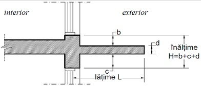
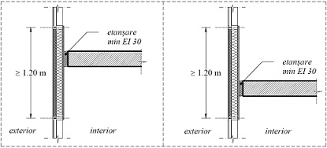

# Art. 2.3.6.1.2
(1) Pentru întârzierea propagării incendiilor între nivelurile construcției se va adopta una din următoarele soluții:
  - a. tâmplărie cu elemente vitrate fără performanțe la foc montată pe parapeți - pereți exteriori (neportanți) și/sau părți din pereții exteriori (neportanți) rezistenți la foc, clasificați din exterior spre interior (o->i);
  - b. zone continui dispuse în planul peretelui cortină, rezistente la foc, clasificate din exterior spre interior (o->i);
  - c. perete cortină sau panou de tâmplărie (minimum EI 30, integral (o<->i)) rezistent la foc;
  - d. zone continui (ecrane) de protecție, clasificate D_600 sau DH;
  - e. sisteme active de stingere a incendiilor (perdea de apă) amplasate în interior, la o distanță de maximum 30 cm de închiderea perimetrală, iar spațiile libere dintre planșee și peretele cortină se etanșează cu sisteme de etanșare rezistente la foc clasificate, având aceeași rezistență la foc cu a planșeului, dar nu mai mult de 120 de minute.
(2) Zonele verticale pentru întârzierea propagării incendiilor prin exteriorul închiderilor perimetrale ale construcției (pe fațadă), pot fi înlocuite de zone orizontale exterioare continui, rezistente la foc, clasificate pe criteriul RE dacă sunt necirculabile sau REI dacă sunt circulabile.
(3) Măsurile pasive prevăzute pentru întârzierea propagării incendiilor prin exteriorul închiderii perimetrale (pe fațadă) precum și prin interiorul construcției, vor avea rezistența la foc mai mare sau egală de 30 de minute, cu excepțiile prevăzute (privind clădirile de locuit reprezentând unități individuale precum și condominiul format din una sau mai multe construcții, cu înălțimea h < 8 m, unde "h" reprezintă cota ultimului planșeu accesibil al construcției, față de nivelul de referință).
(4) Ancorarea de structura clădirii a pereților cortină trebuie să respecte condițiile impuse peretelui cortină, condiții prevăzute în fișele tehnice din documentele de calitate specifice.
(5) În cazurile în care se precizează explicit, se pot însuma elementele verticale cu elementele orizontale având aceeași rezistență la foc (aceeași perioadă de timp) conform Figura 42, iar în cazurile în care însumarea nu este permisă se vor adopta măsuri conform Figura 43 sau conform cazuri specifice.

  

  Figura 42 - Concept însumare elemente verticale cu elementele orizontale
  având aceeași rezistență la foc (caz general)

  

  Figura 43 - Concept în care nu este permisă însumarea elementelor
  (Figura 43 exemplu: caz specific pereți cortină: zone continui, cu înălțimea de cel puțin 1,20 m măsurată pe verticală, rezistente la foc minimum EI 30 (o->i), dispuse în planul peretelui cortină)
