# Art. 2.3.6.1.3
(1) Pentru întârzierea propagării incendiilor între nivelurile construcțiilor prin exteriorul închiderii perimetrale (pe fațadă) și prin interiorul construcțiilor a:
  - – clădirilor:
  - – cu săli aglomerate,
  - – cu persoane care nu se pot evacua singure,
  - – cu funcțiune de cazare temporară
  - – învățământ preșcolar, primar și secundar
    cu înălțimea h ≥ 8 m (unde "h" reprezintă cota ultimului planșeu folosibil al construcției, față de nivelul de referință)
  precum și a
  - – clădirilor cu alte funcțiuni decât cele enumerate anterior cu regim de înălțime ≥ P+5E sau cu înălțimea h ≥ 20 m (unde "h" reprezintă cota ultimului planșeu folosibil al construcției, față de nivelul de referință),
  se poate adopta una din următoarele măsuri:
  - a. pereții exteriori (neportanți) și/sau părțile din pereții exteriori rezistenți la foc care includ tâmplărie cu elemente vitrate fără performanțe la foc (Figura 44) trebuie să îndeplinească următoarele criterii:
    - – la clădiri cu înălțime obișnuită:
      - i. înălțimea de cel puțin 1,20 m
        (și)
      - ii. rezistența la foc minimum EI 30 (o->i);
    - – la clădiri înalte:
      - i. înălțimea de cel puțin 1,20 m
        (și)
      - ii. rezistența la foc minimum EI 60 (o->i);
    - – la clădiri foarte înalte cu înălțimea mai mică de 125 m:
      - i. înălțimea de cel puțin 1,20 m
        (și)
      - ii. rezistența la foc minimum EI 90 (o->i);
    - – la clădiri foarte înalte cu înălțimea mai mare sau egală cu 125 m:
      - i. înălțimea de cel puțin 1,20 m
        (și)
      - ii. rezistența la foc minimum EI 120 (o->i).

    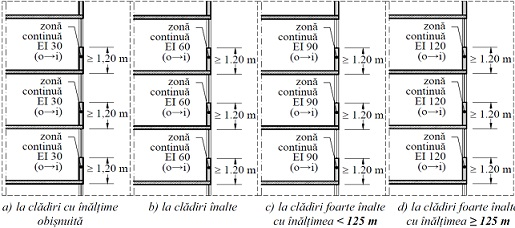

    Figura 44 - Performanțe pereți exteriori
    (neportanți) și/sau părți din pereții exteriori rezistenți la
    foc care includ elemente vitrate
  - b. zonele continui dispuse în planul peretelui cortină, (Figura 45) trebuie să îndeplinească următoarele criterii:
    - – la clădiri cu înălțime obișnuită:
      - i. înălțimea de cel puțin 1,20 m
        (și)
      - ii. rezistența la foc minimum EI 30 (o->i);
    - – la clădiri înalte:
      - i. înălțimea de cel puțin 1,20 m
        (și)
      - ii. rezistența la foc minimum EI 60 (o->i);
    - – la clădiri foarte înalte cu înălțimea mai mică de 125 m:
      - i. înălțimea de cel puțin 1,20 m
        (și)
      - ii. rezistența la foc minimum EI 90 (o->i);
    - – la clădiri foarte înalte cu înălțimea mai mare sau egală cu 125 m:
      - i. înălțimea de cel puțin 1,20 m (și)
      - ii. rezistența la foc minimum EI 120 (o->i).

    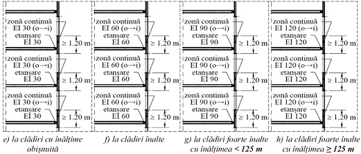

    Varianta 1): Performanțe zone continui (zona opacă la interior și exterior) dispuse în planul peretelui cortină

    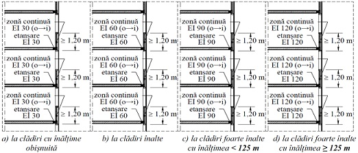

    Varianta 2): Performanțe zone continui (zonă opacă la interior și transparentă la exterior) dispuse în planul peretelui cortină
    Figura 45 - Performanțe zone continui cu
    înălțimea de cel puțin 1,20 m dispuse în planul
    peretelui cortină
    Notă Figura 45: Zona continuă EI x (o->i) este inserată în pereții cortină, fiind parte constructivă a peretelui cortină, aceasta fiind prinsă în/de peretele cortină în principal și suplimentar de planșeul clădirii
  - c. peretele cortină sau panoul de tâmplărie (Figura 46) trebuie să îndeplinească următorul criteriu (integral, pe toată înălțimea):
    - – la clădiri cu înălțime obișnuită:
      - i. rezistența la foc minimum EI 30 (o<->i);
    - – la clădiri înalte:
      - i. rezistența la foc minimum EI 30 (o<->i);
    - – la clădiri foarte înalte:
      - i. rezistența la foc minimum EI 60 (o<->i).
    Note:
    - (1) Pentru elemente de închidere rezistente la foc ale golurilor funcționale prevăzute în pereții de compartimentare (din exterior) amplasați la colțurile întrânde ale construcțiilor civile în formă de L, T sau U se vor utiliza valorile prevăzute în Tabelul 7, Tabelul 8, Tabelul 9, Tabelul 10, Tabelul 11 și Tabelul 12 iar pentru elemente de închidere rezistente la foc ale golurilor funcționale prevăzute în pereții de compartimentare (din exterior) amplasați la colțurile întrânde ale construcțiilor de producție/depozitare în formă de L, T sau U se vor utiliza valorile prevăzute în Tabelul 13.
    - (2) În situația vitrării pe toată înălțimea, se poate alege soluția de la alineatul anterior (zone vitrate cu înălțimea de cel puțin 1,20 m) care trebuie să îndeplinească criteriile prevăzute anterior (la lit. b)).

    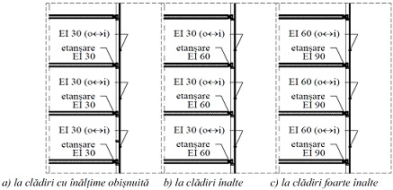

    Varianta 1): Caz general - performanțe zone continui vitrate dispuse în planul peretelui cortină

    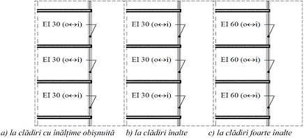

    Varianta 2): Caz general - performanțe zone continui vitrate la tâmplărie

    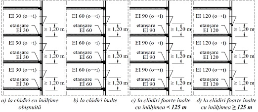

    Varianta 3): Performanțe zone vitrate cu înălțimea de cel puțin 1,20 m dispuse în planul peretelui cortină
    Figura 46 - Performanțe perete cortină sau
    panou de tâmplărie vitrate pe toată înălțimea
  - d. ecranele de protecție (Figura 47) trebuie să îndeplinească următoarele criterii:
    - – la clădiri cu înălțime obișnuită:
      - i. înălțimea de cel puțin 50 cm, amplasate sub planșeul de rezistență, astfel încât să respecte soluțiile H+L ≥ 1,20 m
        (și)
      - ii. rezistența la foc minimum D_600 30;
    - – la clădiri înalte:
      - i. înălțimea de cel puțin 1,20 m, amplasate sub planșeul de rezistență, astfel încât să respecte soluțiile H+L ≥ 1,20 m
        (și)
      - ii. rezistența la foc minimum D_600 60;
    - – la clădiri foarte înalte cu înălțimea mai mică de 75 m:
      - i. înălțimea de cel puțin 1,20 m, amplasate sub planșeul de rezistență,
        (și)
      - ii. rezistența la foc minimum D_600 90;
    - – la clădiri foarte înalte cu înălțimea mai mare sau egală de 75 m și mai mică de 125 m:
      - i. înălțimea de cel puțin 1,20 m, amplasate sub planșeul de rezistență,
        (și)
      - ii. rezistența la foc minimum DH 90;
    - – la clădiri foarte înalte cu înălțimea mai mare sau egală cu 125 m:
      - i. înălțimea de cel puțin 1,20 m, amplasate sub planșeul de rezistență,
        (și)
      - ii. rezistența la foc minimum DH 120.

    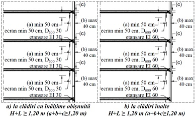

    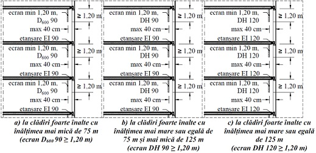

    Figura 47 - Performanțe ecrane de protecție
    Notă Figura 47: Atunci când plafoanele suspendate sau autoportante sunt dispuse la limita inferioară a ecranelor sau a zonelor continui dispuse în planul peretelui cortină, pentru a conta pe eficiența ecranelor, în plafoane se vor asigura spații libere (traforuri) prin care fumul să pătrundă în spatele ecranului, perforația fiind de cel puțin 75% din aria zonei perforate a plafonului (autoportant sau suspendat). Zona perforată va avea cel puțin 60 cm adâncime pe toată lungimea peretelui exterior (conform Figura 48).

    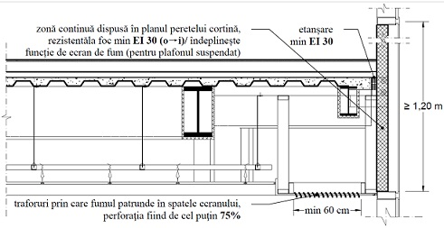

    Varianta a) cu zonă continuă dispusă în planul peretelui cortină

    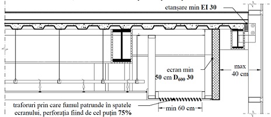

    Varianta b) cu ecran
    Figura 48 - Elemente incombustibile traforate dispuse la plafoane
(2) Elementele orizontale exterioare continui (prinse de planșeele construcției sau o continuare a acestora, conform Figura 49) rezistente la foc (RE dacă sunt necirculabile sau REI dacă sunt circulabile) trebuie să îndeplinească următoarele criterii:
  - – la clădiri cu înălțime obișnuită:
    - i. lățimea (măsurată pe orizontală) de cel puțin 1,20 m
      (și)
    - ii. rezistența la foc minimum RE 30 sau REI 30;
  - – la clădiri înalte:
    - i. lățimea (măsurată pe orizontală) de cel puțin 1,20 m
      (și)
    - ii. rezistența la foc minimum RE 60 sau REI 60;
  - – la clădiri foarte înalte cu înălțimea mai mică de 125 m:
    - i. lățimea (măsurată pe orizontală) de cel puțin 1,20 m
      (și)
    - ii. rezistența la foc minimum RE 90 sau REI 90;
  - – la clădiri foarte înalte cu înălțimea mai mare sau egală cu 125 m:
    - i. lățimea (măsurată pe orizontală) de cel puțin 1,20 m
      (și)
    - ii. rezistența la foc minimum RE 120 sau REI 120.

  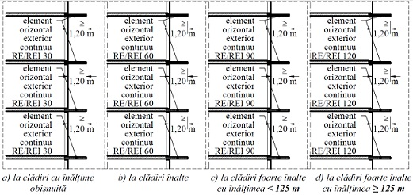

  Figura 49 - Performanțe elemente
  orizontale exterioare continui rezistente la foc
(3) Pentru întârzierea propagării incendiilor prin interiorul construcției, spațiile libere dintre planșee și peretele cortină se etanșează cu sisteme de etanșare având aceeași rezistență la foc cu a planșeului (Figura 50), astfel:
  - – la clădiri cu înălțime obișnuită:
    - i. rezistența la foc minimum EI 30;
  - – a clădiri înalte:
    - i. rezistența la foc minimum EI 60;
  - – la clădiri foarte înalte cu înălțimea mai mică de 125 m:
    - i. rezistența la foc minimum EI 90;
  - – la clădiri foarte înalte cu înălțimea mai mare sau egală cu 125 m:
    - i. rezistența la foc minimum EI 120.

  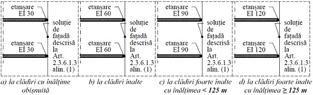

  Figura 50 - Performanțe privind etanșarea
  spațiilor libere dintre planșee și peretele cortină
