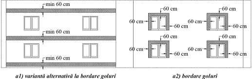
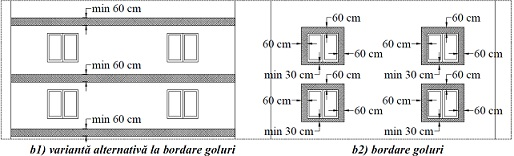

# Art. 2.3.6.1.9
(1) Atunci când la construcțiile menționate la Art. 2.3.6.1.8. sistemele compozite de izolare termică exterioară a pereților perimetrali sunt diferite de A1 sau A2-s1,d0, pentru soluția proiectată la izolarea termică a fațadelor indicată la articolul precedent, ferestrele și ușile închiderilor perimetrale se bordează laturile exterioare laterale și cea superioară, cu termoizolații clasa de reacție la foc A1 sau A2-s1,d0 cu lățimea de minimum 60 cm atunci când se folosesc tâmplării incombustibile și tâmplării din lemn, conform Figura 51, varianta a2) și se bordează laturile exterioare laterale și cea superioară, cu termoizolații clasa de reacție la foc A1 sau A2-s1,d0 cu lățimea de minimum 60 cm precum și latura inferioară, cu termoizolații clasa de reacție la foc A1 sau A2-s1,d0 cu lățimea de minimum 30 cm atunci când se folosesc tâmplării combustibile (cu excepția lemnului), conform Figura 51, varianta b2). În ambele variante, bordările trebuie să aibă aceeași grosime cu a materialului termoizolant al fațadei, conform prevederilor din Anexa 3 privind "Limitarea propagării incendiilor pe fațadă".
(2) Bordările golurilor din închiderile perimetrale menționate la alin. (1), pot fi înlocuite cu:
  - a) fâșii orizontale continui de termoizolație clasa de reacție la foc A1 sau A2-s1,d0 dispuse în dreptul tuturor planșeelor construcției, având lățimea de minimum 60 cm și aceeași grosime cu a materialului utilizat la termoizolarea exterioară a închiderii perimetrale (Figura 51, varianta a1) sau b1));
  - b) cursive sau copertine exterioare continui cu lățimea de minimum 60 cm (măsurată pe orizontală), clasa de reacție la foc A1 sau A2-s1,d0. Aceste elemente orizontale trebuie să depășească golurile cu minimum 60 cm și în proiecție orizontală.

  

  Varianta a) Tâmplărie incombustibilă sau din lemn

  

  Varianta b) Tâmplărie combustibilă, cu excepția lemnului
  Figura 51 - Bordările golurilor din închiderile perimetrale
