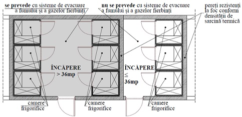

# Art. 2.4.16.9
(1) Camerele frigorifice de tip box-in-box nu se consideră încăperi de depozitare, iar în aceste condiții se prevăd sisteme de evacuare a fumului și a gazelor fierbinți din încăperea în care sunt amplasate camerele frigorifice, potrivit prevederilor normativului.
(3) Încăperile din construcții în care sunt amplasate camere frigorifice cu aria utilă mai mare de 36 mp și sarcina termică mai mare de 105 MJ/mp se prevăd cu sisteme de evacuare a fumului și gazelor fierbinți prin tiraj natural-organizat sau prin ventilare mecanică, potrivit prevederilor normativului și ale reglementărilor tehnice specifice (conform Figura 53). Suprafața utilă/ aerodinamică totală a ariei libere a dispozitivelor cu deschidere automată pentru evacuarea fumului în caz de incendiu prin tiraj natural-organizat, va fi cel puțin 1% din suprafață pardoselii. Atunci când evacuarea fumului se asigură prin ventilare mecanică, se respectă prevederile normativului și/ sau ale reglementărilor tehnice de specialitate.

  

  Figura 53 - Camere frigorifice de tip box-in-box
  Note Figura 53:
  - (a) Camerele frigorifice se prevăd cu pereți rezistenți la foc în funcție de densitatea sarcinii termice, conform Art. 2.3.1.2. și Tabelul 5.
  - (b) Pentru clădiri de depozite frigorifice se vor avea în vedere Art. 6.1.4.6. și Art. 6.1.4.7.
(3) Echiparea cu instalații de detectare, semnalizare, alarmare și stingere automată a incendiilor se face atât pentru spațiul în care sunt amplasate camerele, cât și în camerele frigorifice, luând în considerare caracteristicile compartimentului/clădirii în care sunt amplasate.
