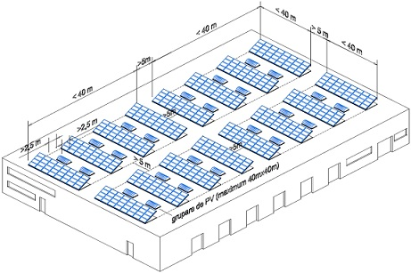

# Art. 2.4.18.5
La clădirile de locuit cu trei sau mai multe niveluri supraterane, precum și la alte funcțiuni civile, de producție și depozitare, prin amplasarea panourilor fotovolaice se va asigura (Figura 54):
a) un perimetru liber de cel puțin 1 m lățime în jurul marginilor acoperișului;
b) distanța minimă de 2,5 m în jurul luminatoarelor, a trapelor de ventilare sau de evacuare a fumului și gazelor fierbinți în caz de incendiu, precum și a altor străpungeri din acoperiș;
c) distanța minimă de 4,00 m față de pereții rezistenți la foc de separare a compartimentelor de incendiu (pereți antifoc);
d) continuitatea rețelei PV trebuie întreruptă cel puțin în dreptul rosturilor de tasare-dilatare sau seismice ale construcției, astfel încât să fie limitată propagarea arderii; întreruperea continuității se realizează prin fâșii continui din distanțe de minimum 1 m față de rost. Pe lățimea de minimum 1 m față de rost se vor utiliza materiale având clasa de reacție la foc A1 sau A2-s1,d0, sau se asigură măsuri de protecție a componentelor combustibile ale acoperișurilor pe lățimea normată a fâșiei de întrerupere;
e) grupările de celule fotovoltaice vor avea aria de cel mult 40 m x 40 m; acestea vor fi amplasate la minimum 5 m față de alte grupări.

Figura 54 - Amplasare grupări de celule fotovoltaice
