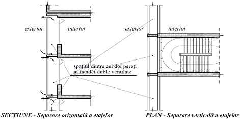

# Art. 2.4.7.3.2
Un sistem de fațadă dublă se consideră satisfăcător din punct de vedere al securității la incendiu, atunci când peretele interior al fațadei duble respectă regulile fațadei simple cu pereți cortină, iar peretele exterior este realizat în așa fel încât să anuleze efectul de coș, prin prevederea de separări orizontale și/sau verticale, conform Tabelul 20 (exemplu Figura 52).

Figura 52 - Anularea efectului de coș la fațadă dublă
