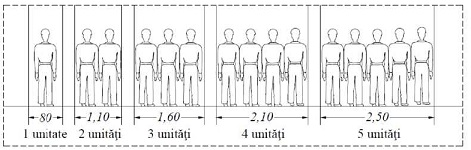
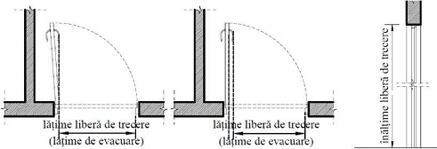

# Art. 2.5.11.1
(1) Lățimea liberă normată pentru unitățile de trecere (fluxuri) de evacuare este (conform Figura 60 și Figura 61):
  - a) 80 cm pentru o unitate de trecere (flux) de evacuare;
  - b) 1,10 m pentru două unități de trecere (fluxuri) de evacuare;
  - c) 1,60 m pentru trei unități de trecere (fluxuri) de evacuare;
  - d) 2,10 m pentru patru unități de trecere (fluxuri) de evacuare;
  - e) 2,50 m pentru cinci unități de trecere (fluxuri) de evacuare.
(2) Lățimile intermediare ale unităților de trecere rezultate din calcul, se consideră valabile pentru trecerea numărului inferior de unități de trecere (fluxuri) de evacuare.

  

  Figura 60 - Lățimi normate ale unităților de trecere (fluxurilor) de
  evacuare și lățimi libere ale ușilor de
  evacuare corespunzător numărului de fluxuri

  

  Figura 61 - Lățimi și înălțimi libere ale ușilor de evacuare
