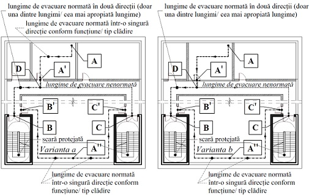
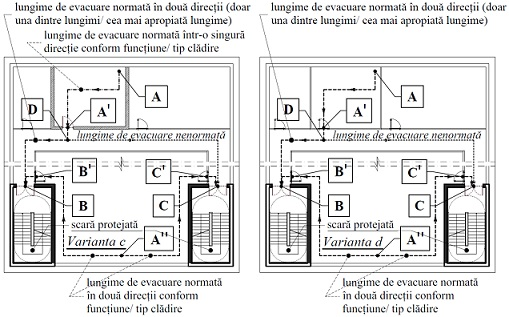
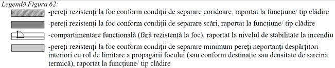
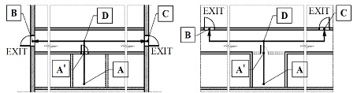
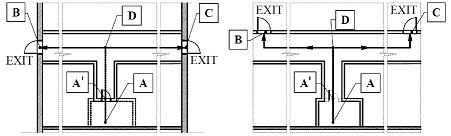
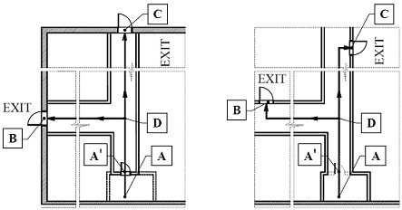
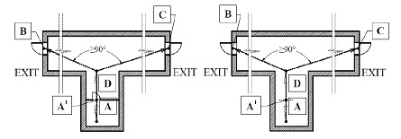
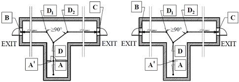

# Art. 2.5.14.1
(1) Lungimea căii de evacuare a utilizatorilor construcțiilor (Figura 62), se determină pe traseul ce trebuie parcurs - în axul căilor de evacuare, de la punctul de plecare al utilizatorului până la cea mai apropiată ușă de evacuare (directă în exterior, de acces într-o scară de evacuare, încăpere tampon sau de acces într-un degajament protejat), sau prima treapta a scării deschise, ținând seama de poziția diferitelor echipamente sau obiecte cu amplasament fix sau mobilier și care trebuie ocolite, astfel:
  - 1. lungimea pe căile de evacuare se măsoară pe orizontală, în axul căilor de circulație și evacuare și în direcția cea mai scurtă (doar una dintre lungimile căii de evacuare trebuie să îndeplinească condițiile normate) atunci când evacuarea se face către două direcții distincte și independente (sub un unghi mai mare sau egal de 90°), de la locul cel mai îndepărtat (de exemplu ușa unei încăperi prevăzută în coridorul de evacuare rezistent la foc conform condițiilor normate în condițiile în care în interiorul încăperii nu se depășește lungimea de coridor înfundat) până la ușa scării, a degajamentului protejat sau a încăperii tampon protejată de acces la cea mai apropiată scară de evacuare sau la o ușă/ieșire direct în exterior.
  - 2. lungimea în interiorul încăperilor deschise (open space) se măsoară pe orizontală, în axul căilor de circulație și evacuare și în direcția cea mai scurtă (doar una dintre lungimile căii de evacuare trebuie să îndeplinească condițiile normate) atunci când evacuarea se face către două direcții distincte și independente (sub un unghi mai mare sau egal de 90°), de la locul cel mai îndepărtat până la ușa scării, a degajamentului protejat sau a încăperii tampon protejată de acces la cea mai apropiată scară de evacuare sau la o ușă/ieșire direct în exterior.
    Schimbările de direcție de pe traseul parcurs (în interiorul încăperilor) se vor realiza în unghiuri cu grade funcție de axul căii de evacuare.
(2) Se vor avea în vedere următoarele:
  - a) un coridor înfundat cu lungimea mai mică decât cea normată pentru fiecare funcțiune/ tip de clădire, măsurată printr-o cale de evacuare (coridor) cu acces la două scări, încăperi tampon, degajamente protejate sau ieșiri în exterior amplasate în direcții opuse (evacuare în "T", sub un unghi α de 180°), este considerat cale de evacuare admisă dacă distanța totală din punctul de plecare până la o scară, încăpere tampon, degajament protejat sau ieșire în exterior nu depășește lungimea de evacuare în două direcții iar distanța de parcurs în aceeași direcție nu depășește lungimea de coridor înfundat;
  - b) în interiorul încăperilor tip "open space", lungimea măsurată până la cea mai apropiată ușă de acces la două scări, degajamente protejate, încăperi tampon sau ieșiri în exterior amplasate în direcții distincte și independente (evacuare în "Y", sub un unghi α mai mare sau egal de 90°), este considerat cale de evacuare admisă dacă distanța totală până la cea mai apropiată ușă de acces la scară, degajament protejat, încăpere tampon sau ieșire în exterior nu depășește lungimea normată în două direcții iar distanța de parcurs în aceeași direcție de la punctul de plecare până la punctul de inflexiune, nu depășește lungimea de coridor înfundat (Figura 62 și Figura 63);
  - c) pe coridoarele de evacuare, lungimea măsurată de la o ușă a unei încăperi prevăzută în peretele rezistent la foc al coridorului până la o cale de evacuare cu acces la două scări, degajamente protejate, încăperi tampon sau ieșiri în exterior amplasate în direcții distincte și independente (sub un unghi mai mare sau egal de 90°), este considerat cale de evacuare admisă dacă distanța totală până la cea mai apropiată ușă de acces la scară, degajament protejat, încăpere tampon sau ieșire în exterior nu depășește lungimea normată în două direcții iar distanța de parcurs în aceeași direcție, de la punctul de plecare până la punctul de inflexiune nu depășește lungimea de coridor înfundat (Figura 62 și Figura 63).

    

| În axul coridorului din punctul A' este prevăzut perete cu rezistență la foc (si ușă, conform prevederi normate) Cu condiția ca (AA') < l (A'D)+(BD) sau (A'D)+(CD) ≤ L (necesită o a doua direcție din punctul D, cu un unghi de min. 90°) Distanțele (pâna la ușile spre coridor) prevăzute din punctul A'', (A''B') < l și (A''C') < l | În axul din punctul A' nu este prevăzut perete cu rezistență la foc Dacă (AA') ≥ l, nu este admis Cu condiția ca (AD) < l (AD)+(BD) sau (AD)+(CD) ≤ L (necesită o a doua direcție din punctul D, cu un unghi de min. 90°) Distanțele (pâna la ușile spre coridor) prevăzute din punctul A'', (A''B') < l și (A''C') < l |
|---|---|

    

| În axul coridorului din punctul A' este prevăzut perete cu rezistență la foc (si ușă, conform prevederi normate) Cu condiția ca (AA') < l (A'D)+(BD) sau (A'D)+(CD) ≤ L (necesită o a doua direcție din punctul D, cu un unghi de min. 90°) Distanțele (pâna la ușile spre casa scării) prevăzute din punctul A'', (A''B) ≤ L și (A''C) ≤ L | În axul din punctul A' nu este prevăzut perete cu rezistență la foc Dacă (AA') ≥ l, nu este admis Cu condiția ca (AD) < l (AD)+(BD) sau (AD)+(CD) ≤ L (necesită o a doua direcție din punctul D, cu un unghi de min. 90°) Distanțele (pâna la ușile spre casa scării) prevăzute din punctul A'', (A''B) ≤ L și (A''C) ≤ L |
|---|---|

    

    Figura 62 - Evacuare (principii)
    Notă Figura 62: "L" indică lungimea maximă a căii de evacuare în două direcții; "l" indică lungimea maximă a căii de evacuare într-o direcție

    

| În axul din punctul A' este prevăzut perete cu rezistență la foc (si ușă conform prevederi normate) Dacă (AA') < l (A'D)+(BD) sau (A'D)+(CD) ≤ L | În axul din punctul A' nu este prevăzut perete cu rezistență la foc Dacă (AA') ≥ l, nu este admis Maximum admis (AD) < l (AD)+(BD) sau (AD)+(CD) ≤ L |
|---|---|

    Varianta a) - evacuare clasică pe coridoare

    

| În axul din punctul A' este prevăzut perete cu rezistență la foc (si ușă conform prevederi normate) Dacă (AA') < l (A'D)+(BD) sau (A'D)+(CD) ≤ L Cu condiția ca (A'D) < l | În axul din punctul A' nu este prevăzut perete cu rezistență la foc Dacă (AA') ≥ l, nu este admis Maximum admis (AD) < l (AD)+(BD) sau (AD)+(CD) ≤ L |
|---|---|

    Varianta b) - evacuare "în T" pe coridoare

    

| În axul din punctul A' este prevăzut minimum perete de sectorizare cu rezistență la foc (si ușă conform prevederi normate) Dacă (AA') < l (A'D)+(BD) sau (A'D)+(CD) ≤ L Cu condiția ca (A'D) < l | În axul din punctul A' nu este prevăzut perete cu rezistență la foc Dacă (AA') ≥ l, nu este admis Maximum admis (AD) < l (AD)+(BD) sau (AD)+(CD) ≤ L |
|---|---|

    Varianta c) - evacuare "în Y" (cu un unghi mai mare sau egal cu 90 de grade) pe coridoare

    

| În axul din punctul A' este prevăzut perete cu rezistență la foc (si ușă conform prevederi normate) Dacă (AA') < l (A'D)+(BD) sau (A'D)+(CD) ≤ L Cu condiția ca (A'D) < l | În axul din punctul A' nu este prevăzut perete cu rezistență la foc Dacă (AA') ≥ l, nu este admis Maximum admis (AD) < l (AD)+(BD) sau (AD)+(CD) ≤ L |
|---|---|

    Varianta d.1) - evacuare "în Y" (cu un unghi mai mare sau egal cu 90 de grade) în interiorul open space

    

| În axul din punctul A' este prevăzut minimum perete de sectorizare cu rezistență la foc (si ușă conform prevederi normate) Dacă (AA') < l (A'D)+(DD1)+(BD1) sau (A'D)+(DD2)+(CD2) ≤ L Cu condiția ca (A'D) < l | În axul din punctul A' nu este prevăzut minimum perete de sectorizare cu rezistență la foc Dacă (AA') ≥ l, nu este admis Maximum admis (AD) < l (AD)+(DD1)+(BD1) sau (AD)+(DD2)+(CD2) ≤ L |
|---|---|

    Varianta d.2) - evacuare "în Y" (cu un unghi mai mare sau egal cu 90 de grade) în interiorul open space
    Figura 63 - Evacuare (calculul lungimii - exemple)
    Notă Figura 63: "L" indică lungimea maximă a căii de evacuare în două direcții; "l" indică lungimea maximă a căii de evacuare într-o direcție.
(3) La determinarea lungimii de evacuare în spațiile tip open space compartimentate cu mobilier și/sau parapete, panouri opace sau vitrate, fixe sau mobile folosite ca separări funcționale și/sau izolante fonic, trebuie să se țină cont de următoarele cerințe:
  - a) lungimea căii de evacuare se calculează pornind de la punctul cel mai îndepărtat al spațiilor de tip open space până la intrarea într-un spațiu protejat (încăpere tampon protejată, degajament protejat, scară de evacuare etc. sau direct în exterior) având în vedere panourile de separare și mobilierul fix;
  - b) în situația scărilor deschise (doar acolo unde normativul prevede), lungimea de evacuare se măsoară până la prima treaptă a acestora.
