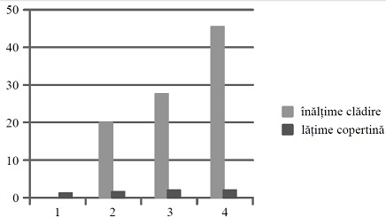
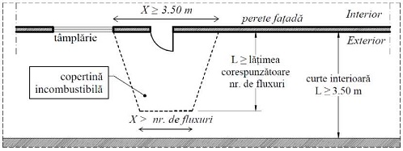
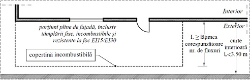

# Art. 2.5.5.6
Se recomandă ca în proximitatea ușii de acces și evacuare care este ultima zonă de pe traseul de evacuare a persoanelor (dintr-o construcție sau compartiment de incendiu) aflată în exterior, respectiv în imediata apropiere a ușii finale de evacuare unde, încă, se pot manifesta efectele incendiului, să se realizeze copertine de protecție.
(2) În toate situațiile, ușa de acces și evacuare se va proteja cu o copertină care rezistă la acțiune mecanică executată din materiale incombustibile, clasa A1, A2 s1,d0, cu rezistență la foc R 15 recomandabil pentru funcțiuni administrative, cultură, cult și învățământ, respectiv R 30 pentru funcțiuni de tip sănătate, turism, săli aglomerate, clădiri înalte și foarte înalte.
(3) Protejarea utilizatorilor în situația curților interioare cu lățimi mai mari de 3,50 m, se realizează astfel:
  - – pentru clădiri cu înălțimi mai mari de 20,00 m se recomandă copertine care rezistă la acțiune mecanică cu lățimi de minimum 2,00 m, iar pentru cele cu înălțimi mai mari de 28.0 m se recomandă copertine care rezistă la acțiune mecanică cu lățimi de minimum 3.0 m, dar cel puțin egală cu lățimea corespunzătoare numărului de fluxuri, conform Figura 55 și Figura 56. Înălțimea se măsoară de la nivelul terenului (carosabilul adiacent) accesibil autovehiculelor de intervenție ale pompierilor, până la pardoseala ultimului nivel folosibil.

    

    Notă Figura 55: lungimea copertinei, la baza mare, va fi mai mare sau egală cu 3,50 m centrată pe axul ușii de evacuare protejate astfel, respectiv la baza mică va fi mai mare decât lățimea corespunzătoare numărului de fluxuri.
    Figura 55 - Grafic înălțime clădire/ lățime copertină

    

    Figura 56 - Proximitatea ușii de acces și
    evacuare cu copertină centrată pe axul ușii de evacuare
    (X - lungime copertină și L - lățime copertină)
  - – pentru fațadele al căror trotuar pietonal este mai mic decât lățimea copertinei, se va utiliza lățimea trotuarului, situație în care lungimea bazei mici a copertinei va fi egală cu lungimea bazei mari.
(4) Protejarea utilizatorilor în situația curților interioare mai înguste de 3,50 m, se realizează astfel: în situația în care ușa de acces și evacuare finală principală sau secundară se face printr-o curte îngustă, mai mică de 3,5 m, care poate fi afectată de incendiul din clădirea în curs de evacuare, atunci trebuie asigurate măsuri pasive sau active: porțiuni pline de fațadă sau tâmplării fixe incombustibile, cu excepția componentelor nesubstanțiale, a garniturilor, izolatorilor, elementelor de vitraj din sticlă simplu sau izolant realizat din sticlă (precum și a foliilor de laminare) ale ușilor și ferestrelor (exterioare), inclusiv cele inserate în pereții cortină și rezistente la foc minimum EI 15 pentru funcțiuni administrative, cultură, cult și învățământ, respectiv EI 30 pentru funcțiuni tip sănătate, turism, săli aglomerate, clădiri înalte și foarte înalte (Figura 57). Înălțimea minimă pentru fațadele astfel tratate este de 3,00 m măsurată de la cota terenului la care se face evacuarea.
  Notă: Măsurile active de tip instalații automate de stingere cu sprinklere deschise pot înlocui porțiunile pline protejate conform celor de mai sus dacă asigură un timp de funcționare egal cu al elementului înlocuit, 15 minute sau 30 de minute.

  

  Figura 57 - Proximitatea ușii de acces și evacuare cu copertină
