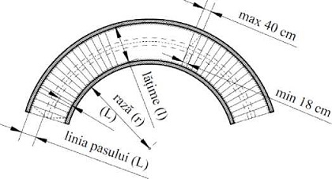

# Art. 2.5.6.1.5
(1) Înclinarea rampelor scărilor de evacuare, suprafața și forma treptelor și a podestelor, trebuie să permită circulația ușoară și sigură a utilizatorilor, potrivit prevederilor reglementărilor tehnice aplicabile.
(2) Scările în spirală sunt considerate căi de evacuare numai pentru o singură unitate de trecere (flux) de evacuare a utilizatorilor, atunci când îndeplinesc condițiile de alcătuire și dimensionare prevăzute în normativ și reglementările tehnice specifice scărilor.
(3) Scările cu rampe curbe (elicoidale) sunt considerate căi de evacuare a utilizatorilor numai în porțiunile de rampe în care lățimea minimă a treptei este de 18 cm și lățimea maximă este de 40 cm, pentru o unitate de trecere (flux) sau mai multe unități de trecere (fluxuri) de evacuare a utilizatorilor (Figura 58), atunci când îndeplinesc condițiile de alcătuire și dimensionare prevăzute în reglementările tehnice specifice scărilor (linia pasului etc.), iar raza interioară de curbură este cel puțin de două ori cât lățimea scării.

  

  Figura 58 - Scări cu rampe curbe (elicoidale) care sunt
  considerate căi de evacuare pentru mai multe unități de trecere (fluxuri)
(4) Scările cu trepte balansate pot fi considerate căi de evacuare numai pentru o unitate de trecere (flux) de evacuare a utilizatorilor, atunci când îndeplinesc condițiile de alcătuire prevăzute în normativ și dimensionare prevăzute în reglementările tehnice specifice scărilor.
