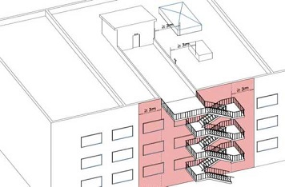

# Art. 2.5.7.1
(1) Terasele circulabile, cursivele și logiile construcțiilor care constituie căi de evacuare a utilizatorilor în caz de incendiu, trebuie să asigure lățimea de trecere rezultată din calcul, să fie rezistente la foc minimum REI 60 și protejate împotriva blocării circulației prin căderea unor elemente aprinse ale clădirii.
(2) Terasele cu lățime mai mică de 6 m, cursivele și logiile prevăzute pentru evacuarea utilizatorilor, trebuie să fie protejate împotriva efectelor incendiilor de la nivelurile inferioare ale construcției sau din vecinătăți, cu parapete pline de cel puțin 1,20 m înălțime, rezistente la foc minimum EI/REI 30.
(3) Pot fi utilizate pentru evacuarea utilizatorilor și porțiuni ale teraselor necirculabile care îndeplinesc condițiile menționate la alin. (1) și alin. (2) și au asigurate măsuri de marcare, organizare și protecție a traseelor stabilite pentru evacuare.
(4) Circulația utilizatorilor nu trebuie să fie blocată din cauza avarierii unor conducte prin care se vehiculează aburi, lichide sau gaze combustibile, acizi sau substanțe toxice etc., situate la mai puțin de 3 m de gabaritul scării.
(5) Se consideră satisfăcătoare protejarea circulațiilor prevăzute pentru evacuarea utilizatorilor, prin amplasarea lor în dreptul unor porțiuni pline de pereți rezistenți la foc minimum EW 15 care depășesc cu cel puțin 3 m gabaritul circulației sau prin ecranarea cu elemente rezistente la foc minimum EI 15/ EW 15 față de golurile din pereții construcției și conductele menționate la alin. (4) (conform Figura 59).

  

  Figura 59 - Protejarea circulațiilor
  prevăzute pentru evacuarea utilizatorilor de pe terasă
