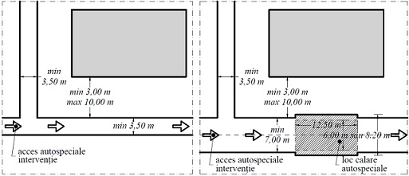
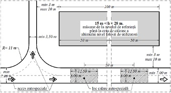
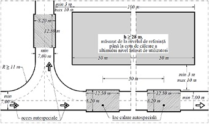

# Art. 2.6.2
Construcțiile vor asigura accesul autospecialelor de intervenție, astfel:
– prin intermediul unor căi de circulație carosabile cu lățimea liberă (gabarit) de minimum 3,50 m, pentru o bandă de circulație la construcții (inclusiv la ansamblurile de locuințe unifamiliale/colective) cu regim de înălțime h ≤ 15,00 m (măsurat de la nivelul de referință până la cota de călcare a ultimului nivel folosit de utilizatori) și cu lungime/ adâncime a carosabilului accesibil autospecialelor de intervenție ≤ 30,00 m, conform Figura 64 varianta a);
– prin intermediul unor căi de circulație carosabile cu lățimea liberă (gabarit) de minimum 7,0 m, la construcțiile (inclusiv ansamblurile de locuințe colective) cu regim de înălțime h >15,00 m (măsurat de la nivelul de referință până la cota de călcare a ultimului nivel folosit de utilizatori) sau cu lungime/adâncime a carosabilului accesibil autospecialelor de intervenție > 30,00 m, conform Figura 64 varianta b) și Figura 65);

  

| Varianta a) cu regim de înălțime h ≤ 15,00 m (măsurat de la nivelul de referință până la cota de călcare a ultimului nivel folosit de utilizatori) cu lungime/adâncime acces autospeciale intervenție mai mică de 30,00 m | Varianta b) cu regim de înălțime h > 15,00 m (măsurat de la nivelul de referință până la cota de călcare a ultimului nivel folosit de utilizatori) sau cu lungime/adâncime a carosabilului accesibil autospecialelor de intervenție > 30,00 m |
|---|---|

  Figura 64 - Accesul autospecialelor de intervenție - caz general
– circulațiile carosabile, vor fi dimensionate astfel încât să fie accesibile autospecialelor de intervenție potrivit caracteristicilor tehnice menționate la Art. 2.6.3.;
– pe traseul autospecialei de intervenție, înalțimea liberă va fi de minimum 4,20 m;
– distanța minimă de la construcție până la circulația carosabilă va fi de 3,00 m;
– distanța maximă de la construcție până la circulația carosabilă sau locul de amplasare al autospecialei de intervenție va fi de 10,00 m;
– construcțiile cu înălțimea h ≤ 15,00 m (măsurată de la nivelul de referință până la cota de călcare a ultimului nivel folosit de utilizatori) nu sunt obligatorii să fie prevăzute cu loc pentru calarea autospecialei de intervenție;
– la cel puțin o fațadă a clădirii, se va prevedea câte o zonă pentru calarea autospecialei de intervenție (la fiecare 50,00 m liniari) cu dimensiunea: 6,00 m x 12,50 m (doar pentru construcțiile cu înălțimea cuprinsă între 15,00 m < h < 28,00 m, măsurată de la nivelul de referință până la cota de călcare a ultimului nivel folosit de utilizatori, conform Figura 65 varianta a);
– la cel puțin două fațade ale clădirii, se va prevedea câte o zonă pentru calarea autospecialei de intervenție (la fiecare 50,00 m liniari) cu dimensiunea: 8,20 m x 12,50 m (doar pentru construcțiile cu înălțimea h ≥ 28,00 m, măsurată de la nivelul de referință până la cota de călcare a ultimului nivel folosit de utilizatori, conform Figura 65 varianta b);
– în incinta construcțiilor în care accesul autospecialelor se face prin intermediul unui punct prevăzut cu barieră, aceasta se va prevedea cu deschidere automată în caz de incendiu în toate situațiile în care construcția este prevăzută cu sistem de detectare, semnalizare și alarmare a incendiului;
– căile de circulație și acces de tip înfundat cu lungimi mai mari de 100 m, vor avea suficient spațiu asigurat pentru manevră și întoarcere a autospecialelor de intervenție (inclusiv în interiorul amplasamentelor), indiferent de destinația și regimul de înălțime ale construcțiilor;
– în situația în care accesul carosabil accesibil autospecialelor de intervenție depășește lungimea de 30,00 m, se vor asigura două benzi de circulație cu lățimea totală de min 7,0 m.

  

  Varianta a) la cel puțin o fațadă a clădirii (pentru construcțiile cu înălțimea cuprinsă între 15,00 m < h < 28,00 m, măsurată de la nivelul de referință până la cota de călcare a ultimului nivel folosit de utilizatori);

  

  Varianta b) la cel puțin două fațade ale clădirii (pentru construcțiile cu înălțimea h > 28,00 m, măsurată de la nivelul de referință până la cota de călcare a ultimului nivel folosit de utilizatori);
  Figura 65 - Accesul autospecialelor de
  intervenție la clădiri cu înălțimea mai mare de 15 m (măsurată de la nivelul
  de referință până la cota de călcare a ultimului nivel folosit de utilizatori)
