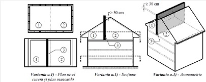
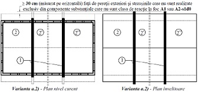
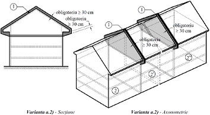
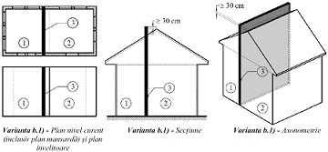
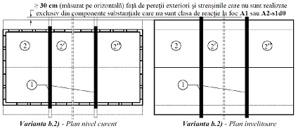
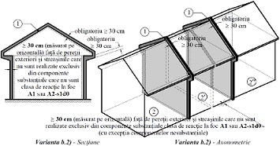

# Art. 3.1.2.9
(1) Mansardarea construcțiilor civile supraterane se asigură prin realizarea de tronsoane ale clădirii, prevăzute cu pereți de sectorizare rezistenți la foc minimum A1 sau A2-s1,d0, astfel:
  - a) EI/REI 120, la construcțiile cu nivelul de stabilitate la incendiu I;
  - b) EI/REI 90, la construcțiile cu nivelul de stabilitate la incendiu II;
  - c) EI/REI 60, la construcțiile cu nivelul de stabilitate la incendiu III;
  - d) EI/REI 30, la construcțiile cu nivelul de stabilitate la incendiu IV;
  - e) EI/REI 15, la construcțiile cu nivelul de stabilitate la incendiu IV sau V.
(2) Mansardarea construcțiilor civile supraterane (realizarea unui nivel funcțional în volumul podului), este admisă dacă pereții de sectorizare rezistenți la foc depășesc cu minimum (Figura 66):
  - – 30 cm (măsurat pe verticală), față de orice astfel de element combustibil al acoperișurilor și al luminatoarelor aflate la mai puțin de patru 4 m distanță de peretele de sectorizare, inclusiv a acoperișurilor cu suport din tablă și termoizolație care nu sunt clasa de reacție la foc A1 sau A2-s1,d0;
  - – 30 cm (măsurat pe verticală), față de planul exterior al acoperișurilor care nu sunt realizate exclusiv din componente substanțiale cu clasa de reacție la foc A1 sau A2- s1,d0 pe care le intersectează;
  - – 30 cm (măsurat pe verticală), față de planul exterior al luminatoarelor aflate la mai puțin de patru 4 m distanță de peretele de sectorizare;
  - – 30 cm (măsurat pe orizontală) față de pereții exteriori și streașinile care nu sunt realizate exclusiv din componente substanțiale clasa de reacție la foc A1 sau A2-s1,d0.

  

  Varianta a.1) - tronsonare paralelă cu linia pantei la nivelul mansardei - depășire cu minimum 30 cm (măsurat pe verticală), față de orice element combustibil al acoperișurilor prin pereți rezistenți la foc Legendă Figura 66 varianta a.1): 1 și 2 - tronsoane cu aria conform Art. 3.1.2.9.(3); 3 - pereți rezistenți la foc conform Art. 3.1.2.9.(1) care secționează planul mansardei

  

  

  Legendă Figura 66 varianta a.2): 1 - pereți rezistenți la foc conform Art. 3.1.2.9.(1) care secționează planul mansardei; 2, 2', 2" - tronsoane cu aria conform Art. 3.1.2.9.(3)
  Varianta a.2) - tronsonare perpendiculară pe linia pantei - depășire cu minimum 30 cm față de planul exterior al acoperișurilor și streșinilor care nu sunt realizate exclusiv din componente substanțiale cu clasa de reacție la foc A1 sau A2-s1,d0 pe care le intersectează prin pereți rezistenți la foc
  Varianta a) - tronsonare la nivelul mansardei - depășire cu minimum 30 cm (măsurat perpendicular pe verticală) față de planul exterior al acoperișurilor și minimum 30 cm (măsurat pe orizontală) față de planul exterior al streșinilor care nu sunt realizate exclusiv din componente substanțiale cu clasa de reacție la foc A1 sau A2-s1,d0, pe care le intersectează prin pereți rezistenți la foc conform Art. 3.1.2.9.(1) care secționează planul mansardei

  

  Varianta b.1) - tronsonare pe întreaga înălțime a construcției - depășire cu minimum 30 cm (măsurat perpendicular pe verticală) față de planul exterior al acoperișurilor și minimum 30 cm (măsurat pe orizontală) față de planul exterior al pereților exteriori și streșinilor care nu sunt realizate exclusiv din componente substanțiale cu clasa de reacție la foc A1 sau A2-s1,d0, pe care le intersectează prin pereți rezistenți la foc care secționează întreaga clădire
  Legendă Figura 66 varianta b.1): 1 și 2 - tronsoane cu aria conform Art. 3.1.2.9.(3); 3 - pereți rezistenți la foc conform Art. 3.1.2.9.(1) care secționează întreaga clădire

  

  

  Legendă Figura 66 varianta b.2): 1 - pereți rezistenți la foc conform Art. 3.1.2.9.(1) care secționează întreaga clădire; 2, 2', 2" - tronsoane cu aria conform Art. 3.1.2.9.(3)
  Varianta b.2) - tronsonare perpendiculară pe linia pantei - depășire cu minimum 30 cm față de planul exterior al acoperișurilor, pereților exteriori și streșinilor care nu sunt realizate exclusiv din componente substanțiale cu clasa de reacție la foc A1 sau A2-s1,d0 pe care le intersectează)
  Varianta b) - tronsonare pe întreaga înălțime a construcției - depășire cu minimum 30 cm (măsurat perpendicular pe verticală) față de planul exterior al acoperișurilor și minimum 30 cm (măsurat pe orizontală) față de planul exterior al pereților exteriori și streșinilor care nu sunt realizate exclusiv din componente substanțiale cu clasa de reacție la foc A1 sau A2-s1,d0, pe care le intersectează prin pereți rezistenți la foc conform Art. 3.1.2.9.(1)
  Figura 66 - Separare tronsoane clădire (prin pereți de
  sectorizare rezistenți la foc pentru mansardarea construcțiilor civile)
(3) Pereții de sectorizare rezistenți la foc minimum prevăzuți la alin. (1) se dispun la maximum
  - a) 65 m distanță, într-o arie de maximum 1.000 mp în construcțiile civile cu nivelul de stabilitate la incendiu I;
  - b) 55 m distanță, într-o arie de maximum 875 mp stabilitate la incendiu II;
  - c) 45 m distanță, într-o arie de maximum 625 mp stabilitate la incendiu III;
  - d) 35 m distanță, într-o arie de maximum 500 mp stabilitate la incendiu IV;
  - e) 25 m distanță, într-o arie de maximum 300 mp în construcțiile civile cu nivelul de stabilitate la incendiu V.
(4) Mansardarea clădirilor civile cu nivel de stabilitate la incendiu I-II, este admisă în condițiile alin. (1), iar elementele de construcție structurale, utilizate la realizarea mansardei au minimum clasa de reacție la foc A1, A2 s1,d0.
(5) În clădirile cu nivelul de stabilitate la incendiu III^V, mansardarea este admisă în condițiile respectării prevederilor din Tabelul 42, numărul de niveluri ale mansardei incluzându-se în numărul de niveluri supraterane ale construcției și luându-se în calcul la determinarea nivelului de stabilitate la incendiu al construcției.
