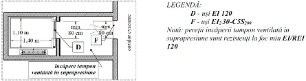
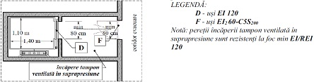

# Art. 3.1.4.8
(1) Accesul la ascensoarele de intervenție la nivelurile supraterane ale clădirilor se asigură prin realizarea unor încăperi tampon ventilate în suprapresiune, prevăzute cu uși rezistente la foc și etanșe la fum EI_2 30-C5S_200 către circulațiile comune orizontale și uși rezistente la foc EI 120 la ușile ascensoarelor iar încăperea tampon ventilată în suprapresiune trebuie să fie prevăzută cu pereți clasa de reacție la foc A1 sau A2-s1,d0, rezistenți la foc min EI/REI 120 (conform Figura 67 varianta a)).
(2) Accesul la ascensoarele de intervenție la nivelurile subterane ale clădirilor civile se asigură prin realizarea unor încăperi tampon ventilate în suprapresiune, prevăzute cu uși rezistente la foc și etanșe la fum EI_2 60-C5S_200 către circulațiile comune orizontale și uși rezistente la foc EI 120 la ușile ascensoarelor iar încăperea tampon ventilată în suprapresiune trebuie să fie prevăzută cu pereți clasa de reacție la foc A1 sau A2-s1,d0, rezistenți la foc min EI/REI 120 (conform Figura 67 varianta b)).

  

  Varianta a) în suprateran

  

  Varianta b) în subteran
  Figura 67 - Accese la ascensoare de
  intervenție ale clădirilor (cerințe minimale)
(3) Dacă ascensoarele de intervenție au cabina cu două accese, toate golurile de acces prevăzute trebuie să îndeplinească condițiile de la alin. (1) și alin. (2).
(4) La clădirile înalte sau foarte înalte ascensoarele de intervenție se prevăd conform dispozițiilor specifice.
(5) Dimensiunile cabinei ascensorului de intervenție în caz de incendiu (de pompieri) trebuie să fie de minimum 1.100 mm lățime și 1.400 mm adâncime, cu o sarcină nominală de 630 kg.; lățimea minimă a pasajului liber al ușii de cabină trebuie să fie de 800 mm. Dacă ascensorul de pompieri este destinat a fi utilizat pentru evacuare, pentru a transporta tărgi sau paturi sau este un ascensor care are o cabină cu două accese, soluție care de regulă nu este recomandată, atunci sarcina nominală minimă trebuie să fie de 1.000 kg și dimensiunile cabinei de 1.100 mm lățime și 2.100 mm adâncime.
(6) Ascensoarele de intervenție vor fi aduse automat la parter în caz de incendiu și vor avea asigurat apel prioritar pentru pompieri.
(7) Ascensoarele panoramice nu pot fi utilizate (de către pompieri) ca ascensoare de intervenție în caz de incendiu.
(8) Ascensoarele pentru intervenție în caz de incendiu (de pompieri) sunt alimentate cu energie electrică din două surse independente.
(9) Ascensorul de intervenție în caz de incendiu trebuie să fie poziționat în cadrul construcțiilor astfel încât să fie prevăzut cu acces spre exterior direct din afară sau prin spații ferite de fum cu lungimea maximă echivalentă cu cea a dimensiunilor de coridor înfundat din tipul sau destinațiile construcțiilor în care se află. Aceeași regulă se aplică în cazul prevederii mai multor ascensoare de intervenție într-o construcție.
(10) Ascensoarele pentru intervenție în caz de incendiu (de pompieri) vor asigura accesul pompierilor la toate nivelurile clădirii, cu excepția parcajelor subterane cu mai mult de 4 niveluri subterane înglobate în clădiri înalte sau foarte înalte, la care ascensoarele pentru intervenție în caz de incendiu (de pompieri) aferente parcajului, se separă de ascensoarele pentru intervenție în caz de incendiu (de pompieri) ale nivelurilor supraterane.
(11) În cazul defectării sau opririi, ascensoarele de intervenție din clădirile supraterane înalte și foarte înalte, precum și din clădirile unde acestea se mai prevăd, trebuie să fie echipate cu un acces prin care pompierii blocați să se poată salva singuri sau cu ajutorul altora (de exemplu trapa de salvare care trebuie prevăzută în acoperișul cabinei să fie echipată cu scară portabilă). În caz de incendiu toate cabinele trebuie să fie aduse automat la parter și să rămână oprite până la anularea comenzii de incendiu din clădire. Fac excepție ascensoarele pentru intervenție, precum și cele pentru evacuare persoane cu dizabilități, care vor funcționa în timpul incendiului, prin alimentare de rezervă.
(12) Atunci când golurile de acces la ascensoarele prevăzute pentru circulația funcțională a persoanelor și la ascensoarele pentru intervenție în caz de incendiu (de pompieri) debușează într-o încăpere tampon ventilată în suprapresiune comună, ușile de la toate ascensoarele vor fi minimum EI 120 iar la încăperea tampon ventilată în suprapresiune vor fi prevăzute uși rezistente la foc și etanșe la fum minimum EI_2 30-C5S_200 în suprateran și minimum EI_2 60-C5S_200 în subteran și pereți clasa de reacție la foc A1 sau A2-s1,d0, rezistenți la foc min EI/REI 120.
(13) Atunci când golurile de acces la ascensoarele prevăzute pentru circulația funcțională a persoanelor, la scările de evacuare a persoanelor și la ascensoarele prevăzute pentru intervenție în caz de incendiu (de pompieri), debușează într-o încăpere tampon ventilată în suprapresiune comună, ușile de la ascensoare vor fi minimum EI 120 și ușa de la casa scării va fi minimum EI_2 120-C5S_200 iar la încăperea tampon ventilată în suprapresiune vor fi prevăzute uși rezistente la foc și etanșe la fum minimum EI_2 30-C5S_200 în suprateran și minimum EI_2 60-C5S_200 în subteran și pereți clasa de reacție la foc A1 sau A2-s1,d0, rezistenți la foc min EI/REI 120.
(14) Atunci când golurile de acces la scările de evacuare a persoanelor, la ascensoarele prevăzute pentru intervenție în caz de incendiu (de pompieri), precum și la alte tipuri de ascensoare, debușează într-o încăpere tampon ventilată în suprapresiune comună, ușile de la toate ascensoarele vor fi minimum EI 120 și ușa de la casa scării va fi minimum EI_2 120-C5S_200 iar la încăperea tampon ventilată în suprapresiune vor fi prevăzute uși rezistente la foc și etanșe la fum minimum EI_2 30- C5S_200 în suprateran și minimum EI_2 60-C5S_200 în subteran și pereți clasa de reacție la foc A1 sau A2-s1,d0, rezistenți la foc min EI/REI 120.
